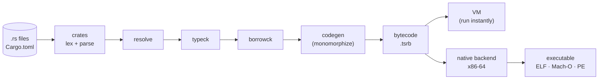

# TSRust

**Two can play at this game: a port of Rust to TypeScript.**

TSRust is a compiler for a real subset of Rust, written in TypeScript so you can read
every stage: tokens, parsing, crates and modules, name resolution, type inference,
traits, pattern exhaustiveness, ownership and borrow checking, monomorphization,
bytecode, and finally **x86-64 machine code in real executables** for Linux (ELF),
macOS (Mach-O) and Windows (PE). Programs can also run instantly in a bytecode VM.
It all runs in Node and entirely in the browser.

Every example program prints byte-for-byte the same output as the real `rustc`,
both in the VM and as a native executable (`npm run conformance` checks this), and
TSRust reports the same errors as rustc,
with the same codes: `E0382 use of moved value`, `E0502`, `E0597`, `E0004`…

```text
error[E0502]: cannot borrow `v` as mutable because it is also borrowed as immutable
 --> examples/errors/E0502_shared_then_mutable.rs:6:5
  |
5 |     let first = &v[0];
  |                 ----- immutable borrow occurs here
6 |     v.push(4);
  |     ^^^^^^^^^ mutable borrow occurs here
7 |     println!("first is {}", first);
  |                             ----- immutable borrow later used here
```

## The pipeline



| Stage | Source | Rust ideas it teaches |
|-------|--------|-----------------------|
| Lexing | [`src/lexer`](src/lexer) | tokens, literals and suffixes, lifetimes vs. chars |
| Parsing | [`src/parser`](src/parser) | the AST, precedence, `if let` desugaring, macros |
| Crates & modules | [`src/crates`](src/crates) | Cargo packages, dependency graphs, `mod foo;` files |
| Name resolution | [`src/resolve`](src/resolve) | namespaces, `use`, privacy, the prelude |
| Type checking | [`src/typeck`](src/typeck) | inference, traits, generics, associated types, coercions, exhaustiveness |
| Borrow checking | [`src/borrowck`](src/borrowck) | ownership, moves, borrows, NLL, lifetimes |
| Code generation | [`src/codegen`](src/codegen) | monomorphization, static dispatch |
| Bytecode | [`src/bytecode`](src/bytecode) | instruction sets, a binary file format |
| VM | [`src/vm`](src/vm) | runtime representation, checked arithmetic, panics |
| Native backend | [`src/native`](src/native), [`native/runtime`](native/runtime) | machine code, calling conventions, ELF / Mach-O / PE, a runtime library |
| Standard library | [`std/`](std) | `Option`, `Vec`, `Iterator`… written in Rust over a few intrinsics |

The [docs](docs/index.md) walk through each stage in detail, with diagrams.

## Quick start

Requires Node 22.18 or newer (TypeScript runs directly; there is no build step).

```sh
npm install
node src/cli.ts run examples/01_hello.rs          # compile and run in the VM
node src/cli.ts run examples/packages/app         # a 3-crate Cargo package
node src/cli.ts build examples/15_game_of_life.rs && ./15_game_of_life   # native executable for this OS
node src/cli.ts build examples/01_hello.rs --target windows              # 01_hello.exe (PE)
node src/cli.ts build examples/01_hello.rs --target macos                # Mach-O (x86-64)
node src/cli.ts build examples/07_iterators.rs --target bytecode -o it.tsrb && node src/cli.ts run it.tsrb
node src/cli.ts build it.tsrb --target linux -o it                       # bytecode → executable
node src/cli.ts check examples/errors/E0597_does_not_live_long_enough.rs
node src/cli.ts dump tokens|ast|types|mir|bytecode examples/03_borrowing.rs
npm test                  # unit and end-to-end tests
npm run conformance       # compare every example with real rustc (needs rustc)
npm run build:site        # docs + playground into site/
```

## The playground

`npm run build:site` produces a static site in `site/`: the docs plus a browser
playground with tabs for Output, Diagnostics, Tokens, AST, Types, MIR, Bytecode,
Native (machine code and executable layout) and Pipeline timing, and a button that
downloads your program as a Linux, macOS or Windows executable, compiled right in
the page. The included GitHub Actions workflow
([`.github/workflows/pages.yml`](.github/workflows/pages.yml)) tests and deploys it
to GitHub Pages on every push to `main`. To turn it on, set **Settings → Pages →
Source** to "GitHub Actions".

## What's supported

Structs, enums, tuples, `impl` blocks, traits with default methods, generics with
bounds and `where` clauses, associated types, operator overloading, `#[derive]`,
iterator adapters that need no closures (`enumerate`, `zip`, `skip`, `take`, `step_by`,
`sum`, `collect`…), `match` with guards and or-patterns, `if let`/`while let`,
`?`, `Box`, `Vec`, `String`, `HashMap`, modules, privacy, multi-crate packages,
and the full borrow-checking story.

Native executables target x86-64 (Apple Silicon Macs run them through Rosetta 2).
The ELF output is tested by running every example; the Mach-O and PE writers are
validated structurally with LLVM's object tools but haven't been run on macOS or
Windows yet.

The native runtime library is freestanding C in [`native/runtime`](native/runtime),
precompiled into a committed blob (`npm run build:runtime` regenerates it and needs
gcc), so building executables never needs a C compiler.

Not yet supported: closures, arrays and slices (beyond `&s[a..b]` on strings),
trait objects (`dyn`), `macro_rules!`, `Rc`/`RefCell`, and checking of named lifetimes
inside a function. See [docs/14-differences-from-rust.md](docs/14-differences-from-rust.md).

## License

MIT
