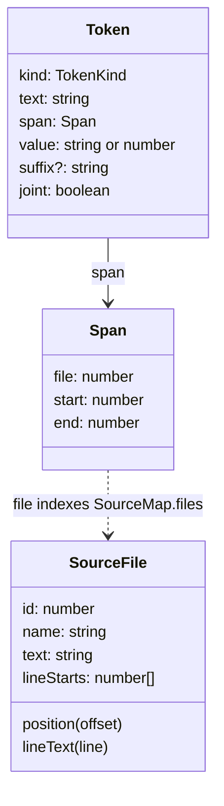
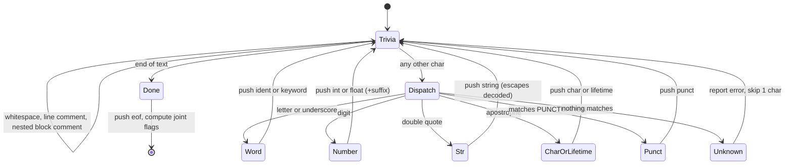

# 01 · Lexing

The first thing any compiler does is stop looking at characters. A source file is just a long string: `f`, `n`, space, `m`, `a`, `i`, `n`, `(`... Nothing downstream wants to think about individual characters. The parser wants to think about *words*: "the keyword `fn`", "the identifier `main`", "the integer `42` of type `u8`", "the arrow `->`".

The **lexer** (also called a scanner or tokenizer) does that conversion. It walks the text once, left to right, and produces a flat list of **tokens**. It also throws away everything that has no meaning for the program: whitespace and comments.

This chapter covers three files:

- [src/lexer/token.ts](../src/lexer/token.ts): what a token is, the keyword list, and the punctuation table
- [src/lexer/lexer.ts](../src/lexer/lexer.ts): the lexer loop itself
- [src/diagnostics.ts](../src/diagnostics.ts): spans (how every token remembers where it came from) and rustc-style error messages

## Why Rust's lexer is a little more interesting than most

Most of a Rust lexer is what you would expect from any C-like language. A few corners are specific to Rust, and they are good illustrations of why lexing is a separate, careful stage:

- **Literal suffixes.** `10u8`, `2.5f32` and `0xff_u8` carry their type in the literal itself. The lexer has to split the digits from the suffix.
- **Underscores in numbers.** `1_000_000` is one integer.
- **Nested block comments.** In C, `/* a /* b */ c */` ends at the first `*/`. In Rust, block comments nest, so that comment ends at the second `*/`.
- **The apostrophe means two things.** `'a'` is a character literal. `'a` (no closing quote) is a *lifetime*, as in `fn first<'a>(s: &'a str)`.
- **`>>` is ambiguous.** In `x >> 2` it is a shift. In `Vec<Vec<u8>>` it is two closing angle brackets. A lexer that greedily produces a single `>>` token makes the parser's life hard.
- **`.` after a number.** `1..10` is a range, `t.0.1` is nested tuple access, and `3.14` is a float.

We will see how TSRust handles each one.

## Tokens

Here is the token type, from [src/lexer/token.ts](../src/lexer/token.ts):

```ts
export type TokenKind =
  | "ident"
  | "keyword"
  | "int"
  | "float"
  | "string"
  | "char"
  | "lifetime"
  | "punct"
  | "eof";

export interface Token {
  kind: TokenKind;
  /** The exact source text, e.g. `0xff_u8` or `"hi\n"` (with quotes). */
  text: string;
  span: Span;
  /** Decoded value for literals: a number for ints/floats, a string for strings/chars, the name for idents/keywords/punct. */
  value: string | number;
  /** Literal type suffix like `i64` in `10i64`, if any. */
  suffix?: string;
  joint: boolean;
}
```

(The `joint` field has a long doc comment in the source; we come back to it below.)

A token keeps **both** the raw `text` and the decoded `value`. For the string literal `"a\tb"` the text is six characters including quotes and a backslash, while the value is three characters with a real tab in the middle. The parser uses the value; error messages use the text.



### Keywords are a set lookup

TSRust does not have special code for each keyword. It lexes every word the same way, then checks a set:

```ts
export const KEYWORDS = new Set([
  "as", "break", "const", "continue", "crate", "else", "enum", "false", "fn", "for",
  "if", "impl", "in", "let", "loop", "match", "mod", "move", "mut", "pub", "ref",
  "return", "self", "Self", "struct", "super", "trait", "true", "type", "use", "where", "while",
]);
```

Notice what is *not* there: `dyn`, `static`, `unsafe`, `async`. Rust reserves those, but TSRust gives them no meaning, so they lex as ordinary identifiers. The parser then rejects them with a specific message (for `dyn`) or a generic "expected item" (for `static`). `_` is also an identifier here; the parser treats an identifier spelled `_` as the wildcard.

### Punctuation and maximal munch

```ts
export const PUNCTUATION = [
  "<<=", ">>=", "..=", "...", "::", "->", "=>", "==", "!=", "<=", ">=", "&&", "||", "+=", "-=", "*=", "/=", "%=",
  "^=", "&=", "|=", "..",
  "+", "-", "*", "/", "%", "^", "!", "&", "|", "=", "<", ">", "@", ".", ",", ";", ":", "#", "$", "?",
  "(", ")", "[", "]", "{", "}",
];
```

The table is ordered **longest first**. The lexer tries each entry in order and takes the first that matches, which means it always takes the longest operator available at that point. This rule is called **maximal munch**: `..=` wins over `..`, which wins over `.`. Without it, `a..=b` would lex as `a` `.` `.` `=` `b`.

The comment in the source points out the deliberate gap: `>>` and `<<` are *not* in the table. The compound shift-assignments `<<=` and `>>=` *are*. They come first, so `x >>= 1` lexes as one `>>=` token rather than `>` `>=`. That creates a corner case `>=` already had: in `let v: Vec<u8>= ...` (no space before `=`) the lexer produces `>=` where the parser wants the `>` that closes the generic list. Like rustc, the parser handles this by *splitting* the token: `expectCloseAngle` in [src/parser/parser.ts](../src/parser/parser.ts) consumes one `>` and leaves `=` (or `>=`) behind as a new token.

## The lexer loop

The heart of [src/lexer/lexer.ts](../src/lexer/lexer.ts) is a single loop. At each position it skips trivia, then looks at one character and decides what kind of token starts there:

```ts
  run(): Token[] {
    while (true) {
      this.skipTrivia();
      if (this.pos >= this.text.length) break;
      const start = this.pos;
      const c = this.text[this.pos];
      if (isIdentStart(c)) this.identOrKeyword();
      else if (isDigit(c)) this.number();
      else if (c === '"') this.string();
      else if (c === "'") this.charOrLifetime();
      else if (!this.punct()) {
        this.diags.error("lex", this.span(start, start + 1), `unknown start of token: ${JSON.stringify(c)}`);
        this.pos++;
      }
    }
```

As a state machine, one iteration looks like this:



Each helper method advances `this.pos` past its token and calls `push`, which slices the raw text and records the span:

```ts
  private push(kind: TokenKind, start: number, value: string | number, suffix?: string) {
    this.tokens.push({ kind, text: this.text.slice(start, this.pos), span: this.span(start, this.pos), value, suffix, joint: false });
  }
```

### Nested comments

`skipTrivia` handles block comments with a depth counter, which is all it takes to support nesting:

```ts
        let depth = 0;
        do {
          if (t.startsWith("/*", this.pos)) { depth++; this.pos += 2; }
          else if (t.startsWith("*/", this.pos)) { depth--; this.pos += 2; }
          else this.pos++;
        } while (depth > 0 && this.pos < t.length);
```

If the loop runs off the end of the file with `depth > 0`, the lexer reports "unterminated block comment".

### Numbers

`number()` is the most intricate helper because so many shapes are legal: `42`, `1_000`, `0xff`, `0b1010`, `3.14`, `1e9`, `7u8`, `2.5f64`. It works in three steps:

1. **Digits.** A `0x`, `0o` or `0b` prefix switches the radix. Otherwise it reads decimal digits, then an optional fraction, then an optional exponent. In a binary or octal literal, a decimal digit that's too big for the radix is reported with a span on that digit: `0b12` gives `invalid digit for a base 2 literal`, and `0o79` gives `invalid digit for a base 8 literal`.
2. **Suffix.** If a letter follows, it reads an identifier and checks it against `INT_SUFFIXES` and `FLOAT_SUFFIXES`. An `f32`/`f64` suffix turns the literal into a float even without a dot (`2f64`). Anything else is an error: `invalid suffix`.
3. **Value.** Underscores are removed and the text is converted with `parseInt` or `parseFloat`.

The fraction rule is the clever bit:

```ts
      if (t[this.pos] === "." && isDigit(t[this.pos + 1] ?? "")) {
```

A dot belongs to the number only if a *digit* follows. So `1..10` lexes as `1` `..` `10`, and `x.max(y)` style calls on literals still work. Tuple access is subtler: `t.0.1` lexes as `t` `.` `0.1`, with `0.1` as a float. The lexer cannot know better, so the parser splits that float back into two field accesses (see [Parsing](02-parsing.md)).

Hex digits need care too: in `0xff_u8`, `f` is a digit but `u` is not, so the hex loop stops at the suffix.

### Strings and escapes

`string()` builds the decoded value character by character. A backslash calls `escape()`, which understands `\n \t \r \0 \\ \' \"` and `\u{...}`. Rust's "string continuation" is also supported: a backslash at the end of a line skips the newline and the next line's leading whitespace.

### Char or lifetime?

The apostrophe needs one character of lookahead beyond the next:

```ts
    if (isIdentStart(t[start + 1] ?? "") && t[start + 2] !== "'") {
```

If an identifier character follows the `'` and the character after *that* is not another `'`, this is a lifetime (`'a`, `'static`). Otherwise it is a char literal (`'a'`, `'\n'`, `'7'`). Chars are read by code point, so `'🦀'` works even though the crab is two UTF-16 units in JavaScript.

## Walking through a real example

Here is what the lexer produces for the first lines of [examples/01_hello.rs](../examples/01_hello.rs), using the real CLI:

```sh
node src/cli.ts dump tokens examples/01_hello.rs | head -25
```

```text
keyword   "fn"
ident     "greet"
punct     "("
ident     "name"
punct     ":"
punct     "&"
ident     "str"
punct     ")"
punct     "->"
ident     "String"
punct     "{"
ident     "format"
punct     "!"
punct     "("
string    "\"Hello, {}!\""
punct     ","
ident     "name"
punct     ")"
punct     "}"
keyword   "fn"
ident     "main"
punct     "("
punct     ")"
punct     "{"
keyword   "let"
```

The source was:

```rust
// Welcome to TSRust! Press "Run" to compile this program in your browser.
// Every stage of the compiler is visible in the tabs on the right.

fn greet(name: &str) -> String {
    format!("Hello, {}!", name)
}
```

A few things to notice. The two comment lines vanished. `str` and `String` are plain identifiers, not keywords: Rust's primitive types are ordinary names that name resolution looks up. And `format!` is two tokens, an identifier and a `!`: the lexer knows nothing about macros.

A line with suffixes and radixes:

```text
$ node src/cli.ts dump tokens lex.rs     # let big: u64 = 0xff_u8 as u64 + 1_000 >> 2;
keyword   "let"
ident     "big"
punct     ":"
ident     "u64"
punct     "="
int       "0xff_u8" (suffix u8)
keyword   "as"
ident     "u64"
punct     "+"
int       "1_000"
punct     ">"
punct     ">"
int       "2"
punct     ";"
eof       ""
```

And a lifetime next to a char literal:

```text
$ node src/cli.ts dump tokens lex2.rs    # fn first<'a>(s: &'a str) -> char { 'x' }
keyword   "fn"
ident     "first"
punct     "<"
lifetime  "'a"
punct     ">"
punct     "("
ident     "s"
punct     ":"
punct     "&"
lifetime  "'a"
ident     "str"
punct     ")"
punct     "->"
ident     "char"
punct     "{"
char      "'x'"
punct     "}"
eof       ""
```

## The `>>` problem and the `joint` flag

Look again at the line above: `1_000 >> 2` produced *two* `>` tokens. That is deliberate. Consider:

```rust
let v: Vec<Vec<u8>> = x >> 2;
```

The first `>>` closes two generic argument lists. The second is a shift. If the lexer emitted a single `>>` token, the type parser would have to split it in half when it wanted one `>`. TSRust takes the opposite approach: always emit single `>` tokens, and let the *expression* parser glue two of them back into a shift.

But `x > > 2` (with a space) is not a shift, it is a syntax error. To tell the difference, after lexing the loop marks every token that is immediately followed by the next one with no whitespace:

```ts
    for (let i = 0; i + 1 < this.tokens.length; i++) {
      this.tokens[i].joint = this.tokens[i].span.end === this.tokens[i + 1].span.start;
    }
```

Here is the line above with spans and joint flags (printed by a small script that calls `lex` directly):

```text
ident    "Vec"      value="Vec"    span=7..10 joint
punct    "<"        value="<"      span=10..11 joint
ident    "Vec"      value="Vec"    span=11..14 joint
punct    "<"        value="<"      span=14..15 joint
ident    "u8"       value="u8"     span=15..17 joint
punct    ">"        value=">"      span=17..18 joint
punct    ">"        value=">"      span=18..19
punct    "="        value="="      span=20..21
ident    "x"        value="x"      span=22..23
punct    ">"        value=">"      span=24..25 joint
punct    ">"        value=">"      span=25..26
int      "2"        value=2        span=27..28 joint
```

The parser's `peekBinaryOp` treats a joint `>` followed by another `>` as `>>`. In type position the parser never asks, so each `>` closes one list. rustc solves the same problem a different way (it splits a `>>` token on demand), but the effect is the same.

## Spans and diagnostics

Every token carries a `Span`, defined in [src/diagnostics.ts](../src/diagnostics.ts):

```ts
/** A half-open byte range `[start, end)` within the file identified by `file`. */
export interface Span {
  file: number;
  start: number;
  end: number;
}
```

(The offsets are really JavaScript string indices, which is close enough to bytes for ASCII source.)

Spans are the thread that ties every later error back to the source. Tokens get spans; the parser combines token spans into AST node spans with `joinSpans`; the type checker and borrow checker attach those spans to their errors. A span is just three numbers, so it is cheap to copy everywhere.

To turn an offset into a line and column, each `SourceFile` precomputes where every line starts, then binary-searches:

```ts
  position(offset: number): { line: number; col: number } {
    let lo = 0;
    let hi = this.lineStarts.length - 1;
    while (lo < hi) {
      const mid = (lo + hi + 1) >> 1;
      if (this.lineStarts[mid] <= offset) lo = mid;
      else hi = mid - 1;
    }
    return { line: lo + 1, col: offset - this.lineStarts[lo] + 1 };
  }
```

A `SourceMap` owns all files in one compilation (user files, `Cargo.toml` files and the bundled standard library), and a span's `file` number is an index into it.

### Errors that don't stop the world

Stages report problems through a `Diagnostics` bag rather than by throwing. Each diagnostic records which **stage** produced it, which is handy for teaching and for the playground's Diagnostics tab:

```ts
export type Stage = "lex" | "parse" | "crates" | "resolve" | "typeck" | "borrowck" | "codegen" | "emit" | "runtime";
```

`error()` returns a `DiagnosticBuilder`, so a stage can chain secondary labels (`.label(span, message)`), notes (`.note(message)`) and help lines (`.help(message)`). A real call from the manifest parser:

```ts
      diags.error("crates", span, `dependency \`${depName}\` must be a path dependency, e.g. \`${depName} = { path = "../${depName}" }\``)
        .note("TSRust has no package registry; all dependencies are local paths");
```

The lexer itself never fails hard. An unknown character produces a diagnostic and is skipped; a bad escape produces a diagnostic and the lexer carries on. That way the parser still gets a useful token stream, and the user sees every lexical problem at once:

```text
$ node src/cli.ts check lex_err.rs
error: invalid suffix `z` for number literal
 --> lex_err.rs:2:14
  |
2 |     let x = 5z;
  |              ^

error: unknown character escape: `q`
 --> lex_err.rs:3:17
  |
3 |     let s = "tab\q";
  |                 ^^

error: unknown start of token: "~"
 --> lex_err.rs:4:15
  |
4 |     let y = 3 ~ 4;
  |               ^

error: expected `;`, found literal `4`
 --> lex_err.rs:4:17
  |
4 |     let y = 3 ~ 4;
  |                 ^

error: could not compile `lex_err.rs` due to 4 previous errors
```

(Paths are shortened here; the CLI prints the full path.) The first three errors come from the lexer. The fourth comes from the parser, which received `3` `4` with the `~` removed. The driver only stops *between* stages.

`formatDiagnostic` renders the familiar rustc layout: a header, a `-->` location, the source line with a gutter, and `^^^` under the primary span (or `---` under secondary labels). It sorts labels by position and prints each source line once even when several labels point into it.

## Where TSRust differs from rustc

- **No raw or byte strings.** `r"..."`, `r#"..."#`, `b"..."` and `b'a'` are not recognized. `r"raw"` lexes as the identifier `r` followed by a string, and the parser then complains.
- **Fewer escapes.** `\x41` is rejected; only `\n \t \r \0 \\ \' \"` and `\u{...}` are supported.
- **ASCII identifiers only.** rustc accepts Unicode identifiers (`let café = 1;`); TSRust's `isIdentStart` is `/[A-Za-z_]/`.
- **Numbers are JavaScript numbers.** Integer values above 2^53 lose precision when lexed with `parseInt`.
- **No doc comments or token trees.** `///` and `//!` are just comments. rustc turns them into attributes; TSRust throws them away. rustc's lexer also produces *token trees* for macros; TSRust has no `macro_rules!`, so a flat list is enough.
- **`1.` isn't a float.** rustc accepts `1.` as `1.0`; TSRust requires a digit after the dot.

## Try it

```sh
node src/cli.ts dump tokens examples/01_hello.rs | head -30
node src/cli.ts dump tokens examples/12_operators.rs   # lots of punctuation
node src/cli.ts dump tokens examples/08_lifetimes.rs   # lifetimes and chars
```

In the playground, open any example and switch to the **Tokens** tab. It shows a table with each token's `line:col`, kind, text and decoded value. Experiments:

- Type `let x = 0xff_u8;` and check the value column shows `255`.
- Type `/* outer /* inner */ still a comment */` and watch it disappear from the token list.
- Type `let c = '\u{1F980}';` and see the decoded crab in the value column.
- Type `let y = 3 ~ 4;` and look at the **Diagnostics** tab: the lexer error and the parser error appear together, tagged with different stages.

## Exercises

1. **Raw strings.** Add support for `r"..."` and `r#"..."#`. Start in `run()` in [src/lexer/lexer.ts](../src/lexer/lexer.ts): before the `isIdentStart` branch, check for `r"` or `r#`. Count the `#`s, then scan for a `"` followed by the same number of `#`s, with no escape processing. Push a `"string"` token, and add a case to [tests/lexer.test.ts](../tests/lexer.test.ts).
2. **Byte literals.** Add `b'a'` (a `u8`) and `b"abc"`. Like raw strings, they need a check before the `isIdentStart` branch. Decide what the token's `value` should be, and which escapes are allowed (rustc accepts `\x80` through `\xff` in byte literals, but not `\u{...}`).
3. **`\x` escapes.** Extend `escape()` to accept `\x` followed by exactly two hex digits (at most `7f`, as rustc requires for char and string literals).
4. **`1.` as a float.** Accept `1.` as `1.0`, as rustc does. In `number()`, a dot followed by something other than a digit, `.` or an identifier start should still end a float, so `1..10` and `1.max(2)` keep lexing as they do now. Add tests for all three.
5. **rustc-style notes.** `formatDiagnostic` always indents the `= note: ...` and `= help: ...` lines with one space, but rustc aligns `=` with the `|` gutter, which is wider once line numbers reach 10. Fix it in [src/diagnostics.ts](../src/diagnostics.ts) and update any tests that compare rendered output.
