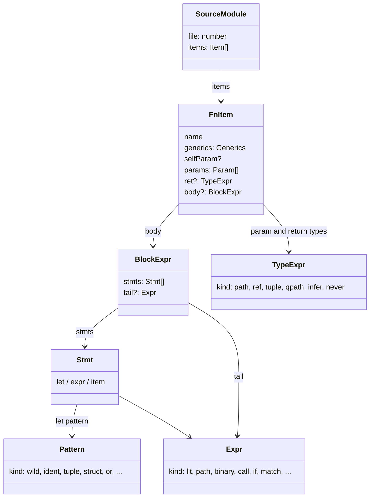
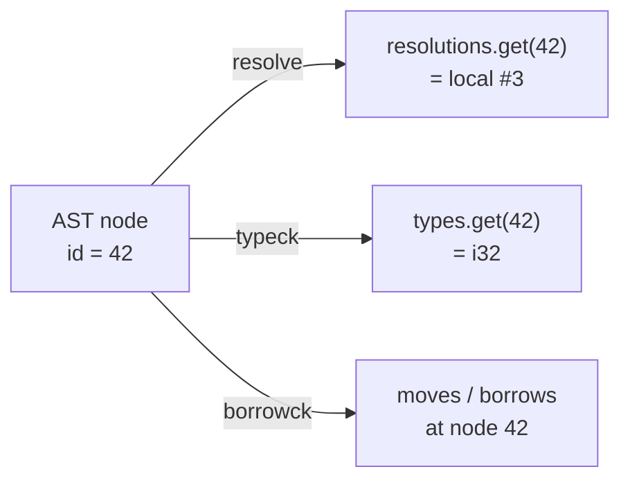
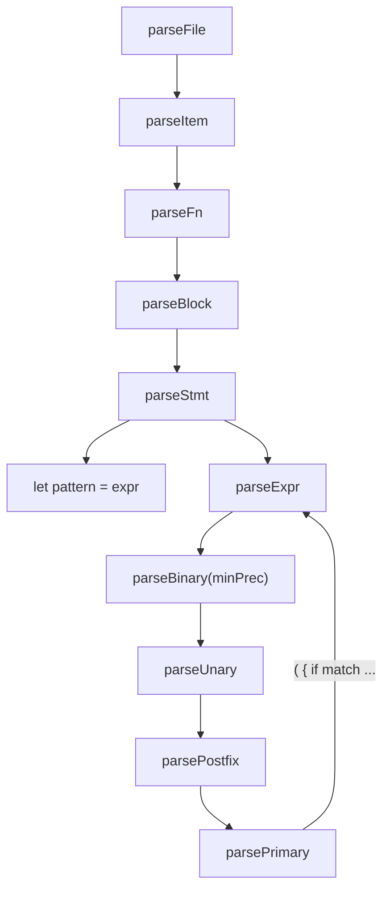
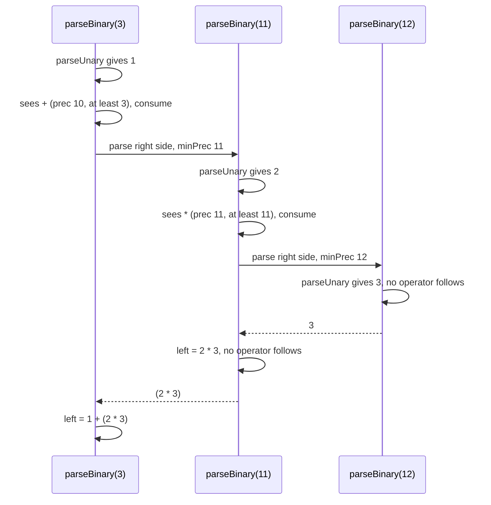
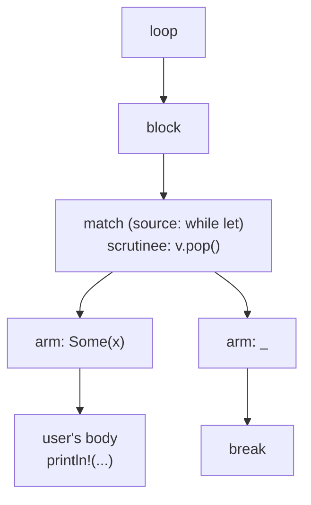
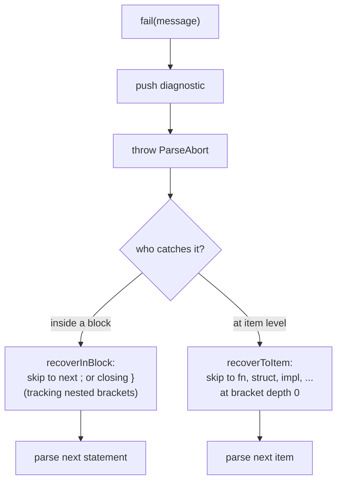

# 02 · Parsing

The lexer gave us a flat list of tokens. But a program is not flat. `1 + 2 * 3` has structure: the multiplication happens first, and its result is the right operand of the addition. A function contains a block, which contains statements, which contain expressions, which contain more expressions. The **parser** recovers that nesting and builds a tree: the **abstract syntax tree**, or AST.

This chapter covers:

- [src/parser/ast.ts](../src/parser/ast.ts): the shape of the tree
- [src/parser/parser.ts](../src/parser/parser.ts): the parser itself
- [src/parser/format.ts](../src/parser/format.ts): the mini-language inside `println!("...")`
- [src/parser/visit.ts](../src/parser/visit.ts): small helpers for walking the tree

## Why Rust's grammar is interesting

Rust is an **expression-oriented** language. Almost everything produces a value: blocks, `if`, `match`, `loop`. That is why you can write

```rust
let parity = if counter % 2 == 0 { "even" } else { "odd" };
```

and why a function body's last expression, without a semicolon, is its return value. The parser has to track the difference between `x` (a value) and `x;` (a statement whose value is thrown away).

Rust's syntax also has a few famous ambiguities, places where the same tokens could mean two different things. We will see how TSRust resolves each one the same way rustc does.

## The AST

The AST lives in [src/parser/ast.ts](../src/parser/ast.ts). It is a set of TypeScript **discriminated unions**: every node has a `kind` string, and TypeScript narrows the type when you `switch` on it. Here is part of `Expr`:

```ts
export type Expr =
  | ({ kind: "lit"; value: Literal } & Node)
  | ({ kind: "path"; path: Path } & Node)
  | ({ kind: "unary"; op: "-" | "!" | "*"; expr: Expr } & Node)
  | ({ kind: "ref"; mutable: boolean; expr: Expr } & Node)
  | ({ kind: "binary"; op: BinaryOp; left: Expr; right: Expr } & Node)
  | ({ kind: "assign"; op: AssignOp; target: Expr; value: Expr } & Node)
  | ({ kind: "call"; callee: Expr; args: Expr[] } & Node)
  | ({ kind: "methodCall"; receiver: Expr; method: string; methodSpan: Span; generics?: TypeExpr[]; args: Expr[] } & Node)
```

The other families are `Item` (things at module level: `fn`, `struct`, `enum`, `impl`, `trait`, `mod`, `use`, `const`, `type`), `Stmt` (`let`, an expression statement, or a nested item), `Pattern`, and `TypeExpr` (types as *written*, like `Vec<i32>` or `&'a str`, not yet understood).



### Node ids and side tables

Every node has two common fields:

```ts
interface Node {
  id: NodeId;
  span: Span;
}
```

The `span` points back at the source (see [Lexing](01-lexing.md)). The `id` is a unique number, handed out by a single `NodeIdGen` that is shared across every file of a compilation, including the standard library. That is why the `dump types` output shows ids like `#8326` even for a tiny program: the standard library's nodes were numbered first.

Why ids? Because the AST is never modified after parsing. When name resolution figures out that the `x` at node 42 refers to local variable #3, it records that in a map keyed by `42`. When the type checker learns that node 42 has type `i32`, it records that in *another* map. The module comment draws it like this:



These maps are called **side tables**. rustc does the same with its `HirId`-keyed tables. Keeping the tree immutable means each stage can be tested in isolation, and you can always ask "what did stage N conclude about this node?" without worrying about who else mutated it.

The AST deliberately knows nothing about meaning. `Some` in `Some(3)` is a `path` expression; whether it names a function, an enum variant, or nothing at all is name resolution's problem.

## Recursive descent

The parser is a **recursive-descent** parser: one method per grammar rule, each consuming tokens and returning a node. Grammar rules refer to each other (a block contains statements, a statement contains expressions, an expression may contain a block), so the methods call each other recursively. The module comment has the call graph:



Everything is built on four tiny helpers:

```ts
  /** Is the current token the punctuation or keyword `s`? */
  private is(s: string, t: Token = this.tok): boolean {
    return (t.kind === "punct" || t.kind === "keyword") && t.value === s;
  }

  private eat(s: string): boolean {
    if (this.is(s)) {
      this.advance();
      return true;
    }
    return false;
  }

  private expect(s: string): Token {
    if (this.is(s)) return this.advance();
    this.fail(`expected \`${s}\`, found ${describe(this.tok)}`);
  }
```

`is` looks, `eat` consumes if present, `expect` consumes or reports an error. With those, most rules read almost like the grammar. Here is `parseItem`, which dispatches on the leading keyword:

```ts
    if (this.is("fn")) return this.parseFn(start, isPub, false);
    if (this.is("struct")) return this.parseStruct(start, isPub, derives);
    if (this.is("enum")) return this.parseEnum(start, isPub, derives);
    if (this.is("impl")) return this.parseImpl(start);
    if (this.is("trait")) return this.parseTrait(start, isPub);
    if (this.is("mod")) return this.parseMod(start, isPub);
    if (this.is("use")) return this.parseUse(start, isPub);
    if (this.is("const")) return this.parseConst(start, isPub);
    if (this.is("type")) return this.parseTypeAlias(start, isPub);
    this.fail(`expected item, found ${describe(this.tok)}`);
```

Before that, `parseAttributes` reads outer attributes. It keeps the trait names from `#[derive(...)]` and skips every other attribute; `where` clauses are parsed by `parseWhere` and merged into the matching generic parameter's bounds, so later stages see `<T: Display>` and `where T: Display` identically.

### Blocks, statements, and the tail expression

`parseBlock` reads statements until `}`. The rule for the block's value is short:

```ts
        const stmt = this.parseStmt();
        if (stmt.kind === "expr" && !stmt.semi && this.is("}")) {
          tail = stmt.expr;
        } else {
          stmts.push(stmt);
        }
```

An expression statement with no semicolon, right before the closing brace, becomes the block's `tail`: its value.

`parseStmt` enforces the other half of Rust's rule: block-like expressions (`if`, `match`, `loop`, `while`, `for`, `{}`) end a statement on their own, while everything else needs a `;` unless it is the tail. That is why

```rust
if a { 1 } else { 2 }
-1
```

is two statements in Rust, not a subtraction. TSRust's `parseExprStmt` parses a block-like expression at statement start with `parsePrimary`, so no binary operator can follow, but it still allows a method chain such as `match x { .. }.unwrap()`.

## Precedence climbing

Recursive descent alone can parse expressions, but the classic textbook approach needs one method per precedence level, and Rust has a dozen. TSRust uses **precedence climbing** instead: one loop driven by a table.

```ts
const BINARY_PRECEDENCE: Record<string, number> = {
  "||": 3, "&&": 4,
  "==": 5, "!=": 5, "<": 5, ">": 5, "<=": 5, ">=": 5,
  "|": 6, "^": 7, "&": 8, "<<": 9, ">>": 9,
  "+": 10, "-": 10, "*": 11, "/": 11, "%": 11,
};
const AS_PRECEDENCE = 12;
```

Assignment (level 1) and ranges (level 2) are handled by `parseAssign` and `parseRange` above the loop; unary operators and postfix operators (`.field`, `.method()`, calls, indexing, `?`) bind tighter than everything in the table.

The loop:

```ts
  private parseBinaryRest(left: A.Expr, minPrec: number, noStruct: boolean): A.Expr {
    while (true) {
      const op = this.peekBinaryOp();
      if (!op) return left;
      const prec = op.op === "as" ? AS_PRECEDENCE : BINARY_PRECEDENCE[op.op];
      if (prec < minPrec) return left;
      this.pos += op.width;
      if (op.op === "as") {
        const ty = this.parseType();
        left = { kind: "cast", id: this.id(), span: joinSpans(left.span, ty.span), expr: left, ty };
        continue;
      }
      const right = this.parseBinary(prec + 1, noStruct);
      left = { kind: "binary", id: this.id(), span: joinSpans(left.span, right.span), op: op.op as A.BinaryOp, left, right };
```

The idea: having parsed a left operand, keep absorbing operators whose precedence is at least `minPrec`. The right operand is parsed recursively with `prec + 1`, so it only absorbs operators that bind *strictly tighter*. That `+ 1` is what makes operators left-associative: in `a - b - c`, the right side of the first `-` refuses to take the second `-`, which is then applied to `(a - b)`.

Here is the trace for `1 + 2 * 3`:



And the real AST for `let x = 1 + 2 * 3;`, from `node src/cli.ts dump ast` (spans and ids are omitted by the dumper):

```json
          "init": {
            "kind": "binary",
            "op": "+",
            "left": {
              "kind": "lit",
              "value": {
                "kind": "int",
                "value": 1
              }
            },
            "right": {
              "kind": "binary",
              "op": "*",
              "left": {
                "kind": "lit",
                "value": {
                  "kind": "int",
                  "value": 2
                }
              },
              "right": {
                "kind": "lit",
                "value": {
                  "kind": "int",
                  "value": 3
                }
              }
            }
          }
```

Two more details live in this loop:

- **Comparisons don't chain.** In Rust `a < b < c` is an error, not `(a < b) < c`. After building a level-5 node, the loop checks whether another level-5 operator follows and fails with "comparison operators cannot be chained".
- **Shifts are glued here.** As explained in [Lexing](01-lexing.md), the lexer never produces `>>`. `peekBinaryOp` reports a shift when it sees a `>` marked `joint` followed by another `>`, and `op.width` is 2 so both tokens are consumed.

### Postfix: the tuple-index float

The lexer turns `t.0.1` into `t` `.` `0.1`, because `0.1` looks like a float. `parsePostfixOps` notices a float token after a dot and splits it back:

```ts
        } else if (t.kind === "float" && /^\d+\.\d+$/.test(t.text)) {
          // `nested.0.1` lexes `0.1` as a float. Split it back into two fields.
```

rustc has exactly the same hack.

## Two famous ambiguities

### Struct literals in conditions

What does this mean?

```rust
if x == y { z } else { 0 }
```

If `y { z }` were a struct literal (with field shorthand for `z`), the `if` would have no body. Rust's rule: **struct literals are not allowed directly in the head of `if`, `while`, `match` or `for`**. TSRust implements it with a `noStruct` flag that is threaded through the expression methods. The heads of those constructs are parsed with `parseExpr(true)`, and the path case in `parsePrimary` only parses a struct literal when the flag is off:

```ts
      const path = this.parsePath("expr");
      if (this.is("{") && !noStruct && this.looksLikeStructLit()) return this.parseStructLit(path);
```

`looksLikeStructLit` adds a second guard by peeking two tokens past the `{`: a struct literal starts with `}`, `..`, or an identifier followed by `:`, `,` or `}`. Note that `{ z }` *passes* this check, which is why the `noStruct` flag is essential. It works:

```text
$ node src/cli.ts run amb.rs        # let r = if x == y { z } else { 0 }; println!("{r}");
5
```

The cost is that you must parenthesize a struct literal in a condition. Without parentheses, `P` ends the condition and `{` starts the body:

```text
$ node src/cli.ts run amb2.rs
error: expected `;`, found `:`
 --> amb2.rs:5:18
  |
5 |     if p == P { x: 1 } { println!("same"); }
  |                  ^
```

`if p == (P { x: 1 }) { ... }` works, because inside parentheses the flag is reset. rustc gives a friendlier message here ("struct literals are not allowed here", with a suggestion to add parentheses).

### Generics versus less-than: the turbofish

Is `<` a comparison or the start of generic arguments? In `a < b` it is a comparison; in `Vec<i32>` it opens generics. A parser that has to guess would need unbounded lookahead. Rust's answer is to make the syntax tell you:

- In **type** position (after `:` in a `let`, in a signature), `<` always opens generics.
- In **expression** position, generic arguments need the **turbofish** `::<`: `Vec::<i32>::new()`, `"5".parse::<i32>()`.

`parsePath` takes a mode argument for exactly this reason:

```ts
  /**
   * Parse `a::b::c`. In `"type"` mode `<` after a segment opens generic args;
   * in `"expr"` mode generics need the turbofish `::<`.
   */
  private parsePath(mode: "type" | "expr"): A.Path {
```

Forgetting the turbofish produces a parse that is *valid but wrong*: `Vec<i32>::new()` is read as `Vec < i32 > ::new()`, a chain of comparisons:

```text
error: comparison operators cannot be chained
  --> errs.rs:15:22
   |
15 |     let bad = Vec<i32>::new();
   |                      ^
```

rustc reports the same error, plus a hint to use `::<...>`. Adding that hint to TSRust is a nice exercise.

## Desugaring `if let` and `while let`

Some syntax is just shorthand for other syntax. Rather than teach every later stage about `if let`, the parser rewrites it into a `match` on the spot, the way rustc lowers it from AST to HIR:

- `if let P = e { a } else { b }` becomes `match e { P => a, _ => b }`
- `while let P = e { body }` becomes `loop { match e { P => body, _ => break } }`

For this program:

```rust
fn main() {
    let o = Some(3);
    if let Some(n) = o { println!("{n}"); }
}
```

`dump ast` shows a `match` with a synthesized wildcard arm and an empty block (the missing `else`):

```json
      "tail": {
        "kind": "match",
        "scrutinee": {
          "kind": "path",
          "path": {
            "segments": [
              {
                "name": "o"
              }
            ]
          }
        },
        "source": "if let",
        "arms": [
          {
            "pat": {
              "kind": "tupleStruct",
```

```json
          {
            "pat": {
              "kind": "wild"
            },
            "body": {
              "kind": "block",
              "stmts": []
            }
          }
```

The `source` field remembers where the `match` came from. The exhaustiveness checker ([src/typeck/exhaustive.ts](../src/typeck/exhaustive.ts)) only reports "unreachable pattern" for `source === "match"`, so an irrefutable `if let y = x { .. }` doesn't produce a confusing warning about an `_` arm the user never wrote.

For `while let Some(x) = v.pop() { println!("{x}"); }` the AST is a `loop` whose body is a single `match` statement:



One subtlety: `'outer: while let ... { }` puts the label on the synthesized `loop`, and `relabelBreaks` also attaches it to the synthesized `break`, so it still exits the right loop.

## Patterns

Patterns get their own small grammar in `parsePattern`/`parsePatternAtom`: wildcards, literals (including negative numbers and ranges like `1..=9`), tuples, `&` patterns, `ref`/`mut` bindings, `x @ pat`, tuple-struct and struct patterns with `..`, and `|` alternatives.

One rule deserves a mention. Is `None` in `match o { None => .. }` a binding (a new variable named `None`) or a reference to the enum variant? The parser can't know, so it doesn't decide:

```ts
      // A lone identifier is a *binding*, unless name resolution later finds it
      // names a unit variant or constant (like `None`). That's rustc's rule too.
```

## Built-in macros and format strings

Real Rust macros are expanded from token trees before parsing finishes. TSRust has no `macro_rules!`; it knows a fixed set of macros and parses their arguments directly as expressions in `parseMacro`. The result is a single `macro` node:

```ts
  | ({ kind: "macro"; name: string; args: Expr[]; format?: FormatSpec; repeat?: boolean } & Node);
```

`vec![x; n]` sets `repeat`; `assert_eq!(a, b, "...")` puts `a` and `b` in `args` and the message in `format`; `write!(f, "...")` puts `f` in `args`.

### Format strings are checked at compile time

`println!("{} is {:?}", a, b)` contains a little language of its own. In Rust, a mismatch between holes and arguments is a *compile* error, not a runtime surprise. TSRust parses the string at compile time in [src/parser/format.ts](../src/parser/format.ts), which supports:

| Hole       | Meaning                                         |
|------------|-------------------------------------------------|
| `{}`       | next positional argument, `Display` formatting  |
| `{:?}`     | next positional argument, `Debug` formatting    |
| `{:#?}`    | pretty `Debug`                                  |
| `{0}`      | explicit positional argument                    |
| `{name}`   | inline variable capture (Rust 2021)             |
| `{:.2}`    | precision, for floats                           |
| `{{` `}}`  | literal braces                                  |

`parseFormatString` returns a list of **pieces**, either literal text or a hole referring to an argument index. Inline captures like `{name}` are numbered *after* the explicit arguments, and the parser synthesizes a path expression for each one, so later stages see an ordinary argument list. For

```rust
println!("{name} has {} legs, {:.1}", n, 2.5);
```

the real AST is:

```json
  "pieces": [
    { "kind": "hole", "arg": 2, "debug": false, "pretty": false },
    { "kind": "text", "text": " has " },
    { "kind": "hole", "arg": 0, "debug": false, "pretty": false },
    { "kind": "text", "text": " legs, " },
    { "kind": "hole", "arg": 1, "debug": false, "pretty": false, "precision": 1 }
  ],
  "args": [ n, 2.5, name ]
```

(Compacted by hand; `args` holds full expression nodes.) It prints `Ferris has 10 legs, 2.5`.

`parseMacro` then checks the counts in both directions: too few arguments, and arguments that no hole uses:

```text
error: 2 positional argument(s) in format string, but 1 given
  --> errs.rs:13:14
   |
13 |     println!("{} {}", p.x);
   |              ^^^^^^^
```

```text
error: argument never used in format string
 --> fmt.rs:4:49
  |
4 |     println!("{name} has {} claws, {:?}", n, n, 7);
  |                                                 ^
```

Whether each argument actually implements `Display` or `Debug` is a type question, answered later by the [type checker](05-type-checking.md).

## Error recovery

A parser that stops at the first syntax error is frustrating. TSRust reports an error and keeps going. The mechanism has two parts.

First, `fail` records a diagnostic and throws a private exception:

```ts
  private fail(message: string, span: Span = this.tok.span): never {
    this.diags.error("parse", span, message);
    throw new ParseAbort(message);
  }
```

Second, two places catch it and **resynchronize**: skip tokens until reaching a point where parsing can sensibly resume.



Both recovery functions first make sure at least one token is consumed (`if (this.pos === start) this.advance();`), which guarantees the parser can't loop forever on the same bad token.

Here is a file with several unrelated mistakes; all of them are reported in one run:

```text
$ node src/cli.ts check errs.rs
error: expected pattern, found `{`
 --> errs.rs:3:12
  |
3 | fn broken( {
  |            ^

error: closures are not supported by TSRust yet
 --> errs.rs:9:26
  |
9 |     let n = v.iter().map(|x| x * 2).count();
  |                          ^

error: expected expression, found `)`
 --> errs.rs:9:35
  |
9 |     let n = v.iter().map(|x| x * 2).count();
  |                                   ^

error: arrays and slices are not supported by TSRust yet; use `Vec<T>`
  --> errs.rs:10:12
   |
10 |     let a: [i32; 3] = [1, 2, 3];
   |            ^

error: comparison operators cannot be chained
  --> errs.rs:11:14
   |
11 |     if 1 < 2 < 3 {}
   |              ^
```

Recovery is never perfect. The third error above is a **cascade**: after the closure error, `recoverInBlock` stops at the `)` that closes `map(` (it treats any unmatched closer as the end of the block) without consuming it, and the next statement then starts at `)`. The same happens after any error inside macro parentheses. Making recovery smarter about which bracket it is inside is one of the exercises.

The same machinery gives clear messages for unsupported features, because the parser checks for them at the point where they would start: `|` or `move` in expression position is a closure, `[` in a type is an array or slice, and `dyn`, `impl` or `fn` in a type are rejected by `parseType`.

## Walking the tree

Each later stage has its own detailed traversal, but some jobs just need "every child expression". [src/parser/visit.ts](../src/parser/visit.ts) provides three helpers: `forEachChildExpr` (one level), `forEachBlock` (every block, recursively, used for example to find items declared inside function bodies), and `patternBindings`, which lists every variable a pattern introduces. For an or-pattern it only looks at the first alternative, because Rust requires every alternative to bind the same names.

## Where TSRust differs from rustc

- **No token trees or `macro_rules!`.** Macros are a fixed list parsed as expressions. `stringify!`, `matches!`, `include_str!` and user macros are rejected with "cannot find macro".
- **Format specs are a subset.** Width, alignment, fill, sign, hex (`{:x}`) and named arguments (`{x}` with `x = 5` after the string) are rejected; only inline captures of local variables are supported. `{:>8}` gives "unsupported format spec".
- **Desugaring happens in the parser.** rustc keeps `if let` in its AST and lowers it to HIR later; TSRust rewrites it immediately. `let ... else` is not supported.
- **Unsupported syntax:** closures, arrays/slices, `dyn`/`impl`/`fn` types, `static`, `unsafe`, `async`, attributes other than `#[derive]` (others are skipped silently), `pub(crate)` (treated as `pub`).
- **Error messages are simpler.** rustc has dozens of targeted suggestions (missing turbofish, parenthesize struct literal, missing comma). TSRust reports the raw expectation.
- **Recovery cascades.** After an error inside parentheses, a spurious `expected expression, found ')'` often follows. Similarly, after an unsupported `impl` type in a parameter list, `recoverToItem` stops right at the `impl` keyword (it looks like the start of an item) and reports a second error.

## Try it

```sh
node src/cli.ts dump ast examples/01_hello.rs
node src/cli.ts dump ast examples/05_enums_match.rs | less   # lots of patterns
node src/cli.ts check examples/errors/E0308_mismatched_types.rs
```

In the playground, open the **AST** tab. Experiments:

- Change `1 + 2 * 3` to `(1 + 2) * 3` and compare the trees.
- Write `if let Some(x) = opt { .. }` and find the `match` with `"source": "if let"`.
- Write `let v = Vec<i32>::new();` and read the Diagnostics tab. Then fix it with the turbofish.
- Write `println!("{} {}", a);` and see the error appear before any type checking runs.

## Exercises

1. **Turbofish hint.** When "comparison operators cannot be chained" fires and the left side of the first comparison is a path, add a `.help("use \`::<...>\` instead of \`<...>\` to specify generic arguments")`. Start in `parseBinaryRest` in [src/parser/parser.ts](../src/parser/parser.ts).
2. **Struct literal hint.** Detect the `if p == P { x: 1 } { .. }` case: when parsing a condition with `noStruct` set and `looksLikeStructLit()` is true after a path, report "struct literals are not allowed here" with a help suggesting parentheses.
3. **Width and alignment in format strings.** Extend `parseFormatString` in [src/parser/format.ts](../src/parser/format.ts) to accept `{:>8}`, `{:<8}`, `{:^8}` and `{:08}`. Add fields to the `hole` variant of `FormatPiece` in [src/parser/ast.ts](../src/parser/ast.ts), then follow them into codegen's `FMT` instruction and the VM's formatter in [src/vm/format.ts](../src/vm/format.ts).
4. **Smarter block recovery.** Make `recoverInBlock` remember the bracket depth at which the failed statement started, so an unmatched `)` from an enclosing call is consumed rather than treated as the end of the block. Check that `errs.rs` above no longer reports the cascade.
5. **`let ... else`.** Parse `let PAT = EXPR else { DIVERGING_BLOCK };` and desugar it, for example into a `match` with the binding names carried out of the first arm. Think about what the borrow checker and exhaustiveness checker need to see.
