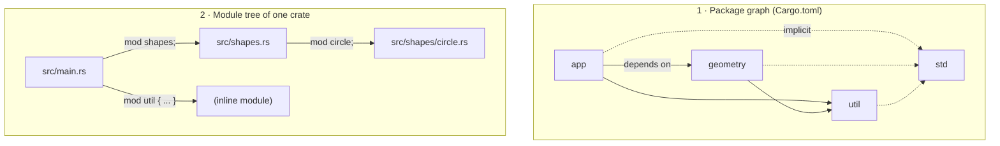
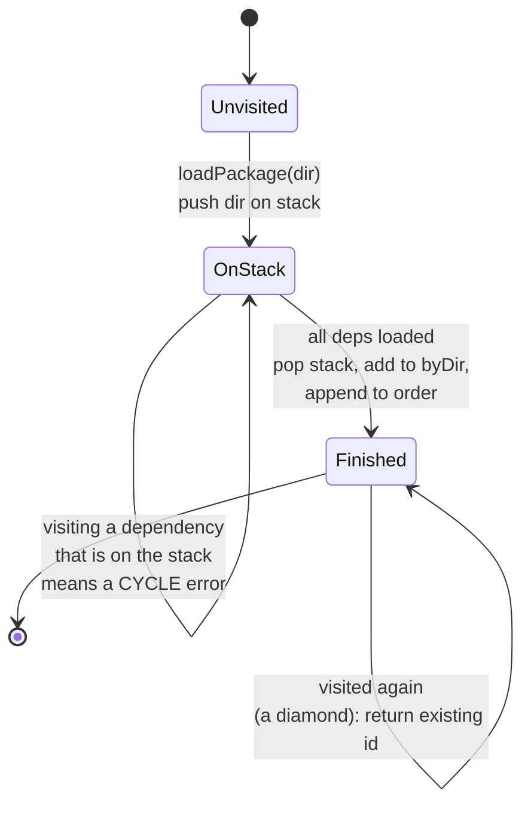
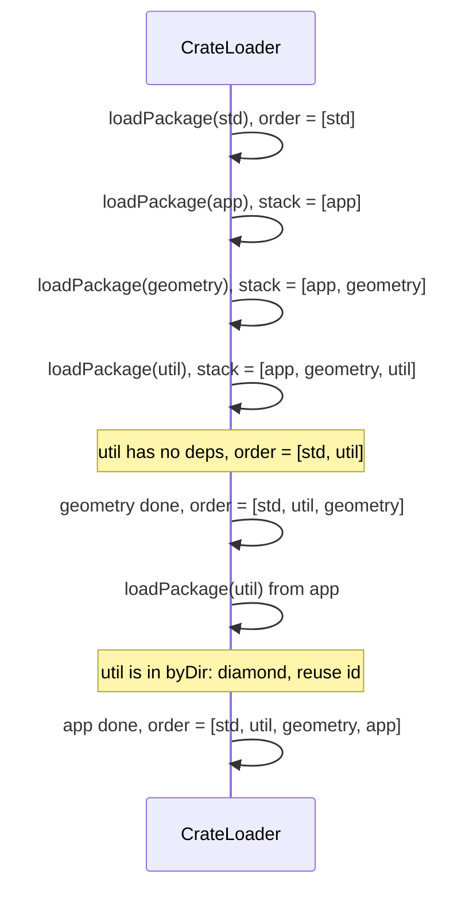
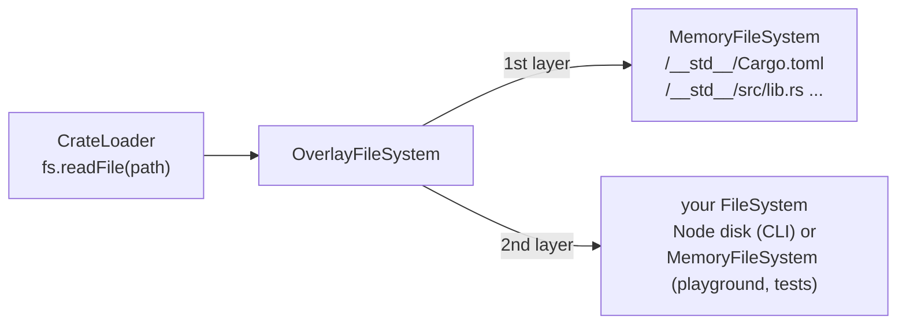
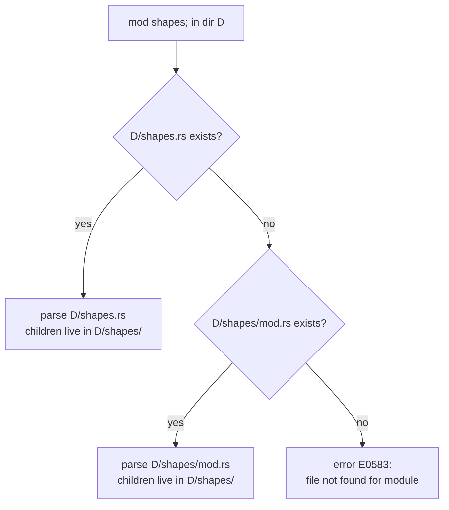

# 03 · Crates and modules

So far we have turned *one file* into an AST. Real Rust programs are bigger than one file, and bigger than one package. This chapter is about the stage that finds all the source code a program needs, parses it, and hands the rest of the compiler a tidy, ordered set of crates.

Source files:

- [src/crates/loader.ts](../src/crates/loader.ts): the crate graph and module files
- [src/crates/manifest.ts](../src/crates/manifest.ts): a tiny `Cargo.toml` parser
- [src/crates/fs.ts](../src/crates/fs.ts): the virtual filesystem
- [std/](../std/) and [scripts/gen-std.ts](../scripts/gen-std.ts): the standard library and how it is bundled
- [examples/packages/](../examples/packages/): a three-crate example

In the driver this whole stage is called `crates`, and it is where lexing and parsing actually run: the loader lexes and parses each file as it discovers it.

## Two kinds of structure: crates and modules

Rust organizes code at two levels, and it helps to keep them apart.

A **crate** is a unit of compilation. A binary crate (with `fn main`) or a library crate (with `src/lib.rs`). Crates depend on other crates, and those dependencies are declared *outside* the code, in a **package manifest** (`Cargo.toml`). A crate cannot see another crate unless it declares a dependency on it. In Rust, crate dependencies must form a **DAG** (a directed acyclic graph): crate A can depend on B, but B can't then depend on A.

A **module** is a namespace *inside* a crate. Modules form a **tree** rooted at the crate root (`main.rs` or `lib.rs`). A module can be written inline, `mod util { ... }`, or in its own file, declared with `mod util;`. Modules control privacy (items are private to their module unless marked `pub`) and naming (`crate::shapes::Circle`).

The loader's module comment shows both at once:



The output of this stage is a `CrateGraph`:

```ts
export interface Crate {
  id: number;
  name: string;
  /** Directory containing `Cargo.toml` (or the single source file). */
  dir: string;
  kind: "bin" | "lib";
  isStd: boolean;
  /** Items of the crate root module (`main.rs`/`lib.rs`), with all `mod x;` bodies loaded. */
  items: A.Item[];
  rootFile: number;
  /** Extern crate name → crate id. Always includes `std` (except for std itself). */
  deps: Map<string, number>;
}

export interface CrateGraph {
  crates: Crate[];
  /** Crate ids in build order: dependencies before dependents. */
  order: number[];
  root: number;
  std: number;
}
```

Notice that a crate's `items` is a single tree: every `mod x;` has been replaced by the parsed contents of `x.rs`. Later stages never think about files again. They see one AST per crate, plus spans that still remember which file each node came from.

## The example: a diamond

[examples/packages/](../examples/packages/) contains three packages:

```text
examples/packages/
├── app/
│   ├── Cargo.toml          depends on geometry and util
│   └── src/main.rs
├── geometry/
│   ├── Cargo.toml          depends on util
│   └── src/
│       ├── lib.rs          pub mod shapes;
│       └── shapes/
│           ├── mod.rs      mod circle; mod square;
│           ├── circle.rs
│           └── square.rs
└── util/
    ├── Cargo.toml          no dependencies
    └── src/lib.rs
```

`app` depends on `geometry` and `util`, and `geometry` *also* depends on `util`. This shape is called a **diamond**, and the important property is that `util` is built **once** and shared, not twice.

```sh
node src/cli.ts run examples/packages/app
```

```text
=== shapes ===
total area: 7.142
***
```

## Reading `Cargo.toml`

Cargo manifests are TOML. A full TOML parser is a project of its own, so [src/crates/manifest.ts](../src/crates/manifest.ts) understands only the subset that matters for building a dependency graph:

```toml
[package]
name = "app"
version = "0.1.0"

[dependencies]
geometry = { path = "../geometry" }
util = { path = "../util" }
```

That means `[section]` headers, `key = value` lines, `#` comments, and values that are strings, numbers, booleans, or inline tables `{ k = v, ... }`. The parser goes line by line. Each line is stripped of comments (being careful not to treat a `#` inside a string as a comment), matched against a header regex, or split at the first `=`. Values are parsed recursively by `parseValue`; for an inline table it splits on commas that are not inside strings or nested braces.

From the parsed sections, `parseManifest` builds:

```ts
export interface Manifest {
  name: string;
  version: string;
  dependencies: Dependency[];
  span: Span;
}
```

Two small details mirror Cargo. Package names have `-` replaced with `_`, because a crate called `my-utils` is referred to as `my_utils` in Rust code. And the dependency's *key* (the name on the left of `=`) is the name the depending crate uses in paths like `use geometry::Area`.

Only **path dependencies** are supported. There is no registry to download from, which keeps the build hermetic and lets it run in a browser. A version dependency gets a clear error:

```text
$ node src/cli.ts check reg
error: dependency `serde` must be a path dependency, e.g. `serde = { path = "../serde" }`
 --> reg/Cargo.toml:6:1
  |
6 | serde = "1.0"
  | ^^^^^^^^^^^^^
  = note: TSRust has no package registry; all dependencies are local paths
```

(Paths in the examples on this page are shortened; the CLI prints full paths.) Notice that the manifest is added to the `SourceMap` like any `.rs` file, so errors in it get the same rustc-style rendering with line numbers.

## The package graph: one depth-first search, two jobs

Starting from the root package, the loader reads each manifest, follows its dependencies, and recursively loads them. This is a **depth-first search** (DFS), and it does two jobs at once.

**Cycle detection.** If `a` depends on `b`, `b` on `c`, and `c` on `a`, there is no order in which to build them. The DFS keeps the current path on a `stack`. Arriving at a package that is already on the stack means we have walked in a circle.

**Topological order.** A package is appended to `order` only *after* all its dependencies have finished loading (a **post-order** traversal). So every crate appears after everything it depends on. This is the build order the later stages use: when name resolution processes `app`, it can rely on `geometry` and `util` already being resolved.

Here is the heart of `loadPackage`, lightly trimmed:

```ts
    const existing = this.byDir.get(dir);
    if (stack.includes(dir)) {
      const cycle = [...stack.slice(stack.indexOf(dir)), dir].map((d) => this.names.get(d) ?? d);
      diags.error("crates", requestedBy ?? { file: -1, start: 0, end: 0 }, `cyclic package dependency: ${cycle.join(" -> ")}`)
        .note("crates must form a DAG (directed acyclic graph) so there is an order to build them in");
      return undefined;
    }
    if (existing !== undefined) return existing; // already fully loaded (a "diamond" dependency)
```

```ts
    const crate = this.newCrate(manifest.name, dir, rootPath.endsWith("main.rs") ? "bin" : "lib");
    // Remove from byDir until finished so diamonds are distinguished from cycles.
    this.byDir.delete(dir);

    stack.push(dir);
    if (!crate.isStd) crate.deps.set("std", 0);
    for (const dep of manifest.dependencies) {
      const depId = this.loadPackage(joinPath(dir, dep.path), stack, dep.span);
      if (depId !== undefined) crate.deps.set(dep.name, depId);
    }
    stack.pop();
    this.byDir.set(dir, crate.id);
```

```ts
    this.order.push(crate.id); // post-order: after all dependencies
```

The two checks at the top are the classic three-color DFS in disguise:



"On the stack" is gray, "in `byDir`" is black. A gray package reached again is a cycle; a black package reached again is a diamond, and we just reuse it.

### Walking the diamond

For `examples/packages/app`, the calls go like this:



A small script that calls `loadCrates` directly and prints each crate in `order` (id, name, kind, deps) shows exactly that:

```text
0 std lib 
3 util lib std=0
2 geometry lib std=0 util=3
1 app bin std=0 geometry=2 util=3
files:
  21 examples/packages/app/Cargo.toml
  22 examples/packages/geometry/Cargo.toml
  23 examples/packages/util/Cargo.toml
  24 examples/packages/util/src/lib.rs
  25 examples/packages/geometry/src/lib.rs
  26 examples/packages/geometry/src/shapes/mod.rs
  27 examples/packages/geometry/src/shapes/circle.rs
  28 examples/packages/geometry/src/shapes/square.rs
  29 examples/packages/app/src/main.rs
```

Two things are worth noticing. Crate **ids** are handed out in *pre-order* (`app` is 1 because it was created first), but the build **order** is post-order. And the file list shows that each crate's sources are parsed only after its dependencies are done: `util/src/lib.rs` is file 24, `app/src/main.rs` is last. (Files 0 to 20 are the standard library.)

### A real cycle

With three packages `a -> b -> c -> a`:

```text
$ node src/cli.ts check cyc/a
error: cyclic package dependency: a -> b -> c -> a
 --> cyc/c/Cargo.toml:6:1
  |
6 | a = { path = "../a" }
  | ^^^^^^^^^^^^^^^^^^^^^
  = note: crates must form a DAG (directed acyclic graph) so there is an order to build them in

error: could not compile `a` due to 1 previous error
```

The error points at the exact manifest line that closes the loop, because each `Dependency` carries the span of its line, and that span is passed down as `requestedBy`. The `names` map, filled in as soon as each manifest is read, lets the message say `a -> b -> c` rather than three directory paths.

## The standard library is just another crate

Every crate (except `std` itself) gets an implicit dependency on `std`: that is the `crate.deps.set("std", 0)` line above. `std` is always loaded first, so it is always crate 0.

TSRust's `std` is written in Rust, in [std/](../std/), and laid out like any library package:

```text
std/
├── Cargo.toml        [package] name = "std"
└── src/
    ├── lib.rs        pub mod boxed; pub mod clone; ... pub mod vec;
    ├── prelude.rs    pub use crate::option::Option::{self, None, Some}; ...
    ├── option.rs  result.rs  vec.rs  string.rs  iter.rs  collections.rs ...
    └── num.rs        (generated)
```

It is lexed, parsed, resolved and type-checked by the same code as your program. The [standard library chapter](13-standard-library.md) covers what is inside; here we care about how it gets loaded without a disk.

### Bundling: `scripts/gen-std.ts`

The browser has no filesystem, so the std sources are embedded into the compiler itself. [scripts/gen-std.ts](../scripts/gen-std.ts) (run with `npm run gen`, and automatically before `npm test`) does two things:

1. **Generates `std/src/num.rs`.** The methods and trait impls for numeric types (`i32::MAX`, `checked_add`, `impl FromStr for u8`, `impl Sum for f64`, ...) are the same for every type. Real Rust's standard library uses `macro_rules!` to stamp them out; TSRust has no `macro_rules!`, so a TypeScript function generates the text instead.
2. **Writes `src/std/bundle.ts`.** It walks every file under `std/` and writes them all into one exported object, path to contents:

```ts
export const STD_FILES: Record<string, string> = {
  "Cargo.toml": "[package]\nname = \"std\"\nversion = \"0.1.0\"\n",
  "src/boxed.rs": "//! `Box<T>`: a value on the heap with a single owner.\n//! ...
```

(Second line truncated.) Both generated files say "GENERATED ... do not edit by hand"; edit the files in `std/` or the generator instead.

## The virtual filesystem

The compiler never touches the real disk directly. It reads through a one-method interface, from [src/crates/fs.ts](../src/crates/fs.ts):

```ts
export interface FileSystem {
  /** Returns the file's text, or `undefined` if it doesn't exist. */
  readFile(path: string): string | undefined;
}
```

There are three implementations:

| Implementation | Where | Backed by |
|----------------|-------|-----------|
| `NodeFileSystem` | [src/cli.ts](../src/cli.ts) | `readFileSync` on the real disk |
| `MemoryFileSystem` | [src/crates/fs.ts](../src/crates/fs.ts) | a `Map` of normalized path to text. The playground, the tests and `compileSource` use it. |
| `OverlayFileSystem` | [src/crates/fs.ts](../src/crates/fs.ts) | a list of layers; the first that has the file wins |

The loader always wraps whatever it is given in an overlay with the bundled std mounted at a fake root:

```ts
export const STD_ROOT = "/__std__";
```

```ts
    this.fs = new OverlayFileSystem(prefixFs(STD_ROOT, STD_FILES), opts.fs);
```



So `loadPackage("/__std__", ...)` reads `/__std__/Cargo.toml` from memory, exactly the way it reads `examples/packages/app/Cargo.toml` from disk. The playground compiles a project with:

```ts
    c = compile({ fs: new MemoryFileSystem(project.files), entry: project.entry });
```

which is why multi-file examples work in the browser with no server.

Because paths are plain strings, `fs.ts` also provides `normalizePath` (collapsing `.`, `..` and duplicate slashes), `joinPath` and `dirname`. Normalizing matters: `examples/packages/geometry/../util` and the `util` path reached from `app` must compare equal, or the diamond would load `util` twice.

## Module files

Once a crate's root file is parsed, `loadModFiles` walks its items looking for `mod name;` declarations (a `ModItem` with no `items`) and fills in their bodies from other files.

The rules, which match rustc's:

1. For `mod shapes;`, look for `shapes.rs` next to the current module's directory, then `shapes/mod.rs`.
2. Where do *that* file's own child modules live?
   - If the file was `shapes/mod.rs`, its children live beside it, in `shapes/`.
   - If the file was `shapes.rs`, its children live in a subdirectory named after it: `shapes/circle.rs`. (A crate root like `main.rs` or `lib.rs` is a "directory owner", so its children are beside it in `src/`.)
3. An inline `mod util { mod helpers; }` doesn't have a file, but its out-of-line children still live in a subdirectory: `src/util/helpers.rs`.

In code:

```ts
      const flat = joinPath(dir, `${item.name}.rs`);
      const nested = joinPath(dir, item.name, "mod.rs");
      const path = [flat, nested].find((p) => this.fs.readFile(p) !== undefined);
```

```ts
      // `foo.rs` keeps children in `foo/`; `foo/mod.rs` keeps them beside itself.
      this.loadModFiles(item.items, path === flat ? joinPath(dir, item.name) : dirname(path), true);
```



Both styles put the children in the same directory; they differ only in where the parent's own file sits. `geometry` uses the `mod.rs` style: `src/lib.rs` says `pub mod shapes;`, which loads `src/shapes/mod.rs`, which says `mod circle;`, which loads `src/shapes/circle.rs`.

A missing file is error E0583, with a help line naming both candidates:

```text
$ node src/cli.ts check miss
error[E0583]: file not found for module `shapes`
 --> miss/src/main.rs:1:1
  |
1 | mod shapes;
  | ^^^^^^^^^^^
  = help: to create the module `shapes`, create file "miss/src/shapes.rs" or "miss/src/shapes/mod.rs"
```

The loader then sets the module's items to `[]` and carries on, so other errors in the crate are still reported.

## Single files

Most examples are a single `.rs` file with no manifest. `loadSingleFile` handles this case by creating an implicit binary crate named after the file (with `-` replaced by `_`), giving it the `std` dependency, and loading any `mod x;` files relative to the file's directory. The crate root is a directory owner, so `examples/foo.rs` with `mod bar;` looks for `examples/bar.rs`.

## Where TSRust differs from rustc and Cargo

- **TOML subset.** No arrays, multi-line strings, dotted keys, or `[dependencies.foo]` tables. Single-quoted strings are accepted, but `parseValue`'s comma splitting only tracks double quotes. `edition`, `[dev-dependencies]` and `[features]` are ignored.
- **Path dependencies only.** No registry, no versions, no `git = "..."`, no `package = "..."` renames.
- **One target per package.** A package used as a dependency must have `src/lib.rs`; the root may have `src/main.rs` or `src/lib.rs`. Cargo also supports `src/bin/*.rs`, `examples/`, custom `[lib] path`, and so on.
- **No `#[path = "..."]`** on modules. The loader also doesn't notice when both `foo.rs` and `foo/mod.rs` exist (it silently picks `foo.rs`; rustc reports E0761). Declaring the same `mod x;` twice loads the file twice; name resolution then reports E0428.
- **Everything is compiled together.** rustc compiles each crate separately and records its public interface in metadata (`.rlib`) for dependents. TSRust parses every crate into one compilation and processes them in `order`, which is simpler but means there is no separate compilation or caching.
- **`std` is a source dependency.** Real `std` is precompiled. TSRust compiles its std from source every time, which costs a few dozen milliseconds but means you can read and change it.

## Try it

```sh
node src/cli.ts run examples/packages/app
node src/cli.ts check examples/packages/app      # prints time per stage, "crates" first
node src/cli.ts run examples/13_modules.rs        # inline modules and privacy
```

Build your own cycle and watch the DFS catch it:

```sh
mkdir -p /tmp/cyc/a/src /tmp/cyc/b/src
printf '[package]\nname = "a"\n\n[dependencies]\nb = { path = "../b" }\n' > /tmp/cyc/a/Cargo.toml
printf '[package]\nname = "b"\n\n[dependencies]\na = { path = "../a" }\n' > /tmp/cyc/b/Cargo.toml
echo 'fn main() {}' > /tmp/cyc/a/src/main.rs
echo 'pub fn f() {}' > /tmp/cyc/b/src/lib.rs
node src/cli.ts check /tmp/cyc/a
```

In the playground, a project with more than one file (or a `Cargo.toml`) shows a file picker next to the example dropdown, so you can edit each file; the compiler sees them through a `MemoryFileSystem`. The **Pipeline** tab shows the crate graph and the time spent in each stage. With the multi-crate example loaded (or the same files on disk with the CLI), try:

- In `geometry/src/shapes/mod.rs`, rename `mod circle;` to `mod circles;` and read the E0583 help.
- Add `app = { path = "../app" }` to `util/Cargo.toml` and read the cycle error.
- Change `geometry`'s dependency key to `utility = { path = "../util" }` and see which `use` statements break (the key, not the package name, is what code refers to).

## Exercises

1. **Dependency renames.** Support Cargo's `package` key: `utils = { path = "../util", package = "util" }`. Start in `parseManifest` in [src/crates/manifest.ts](../src/crates/manifest.ts); the `Dependency` already separates the name used in code from the path.
2. **`#[path]` attributes.** Let `#[path = "other.rs"] mod foo;` override the file lookup. The parser currently skips non-derive attributes in `parseAttributes`; you will need to keep this one on `ModItem`, then use it in `loadModFiles`.
3. **Ambiguous module files.** Report rustc's E0761 when both `foo.rs` and `foo/mod.rs` exist. The check belongs in `loadModFiles`, right where `flat` and `nested` are computed.
4. **Print the crate graph.** Add `node src/cli.ts dump crates <dir>` to [src/cli.ts](../src/cli.ts) that prints `graph.order` with each crate's kind, directory and dependencies, much like the script output above.
5. **Unused dependency warning.** After name resolution, warn about any `[dependencies]` entry whose crate is never referenced. You will need the dependency spans from the manifest and some way to record which extern crates the resolver looked up.
