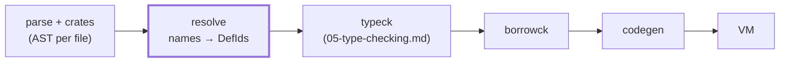
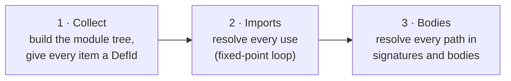
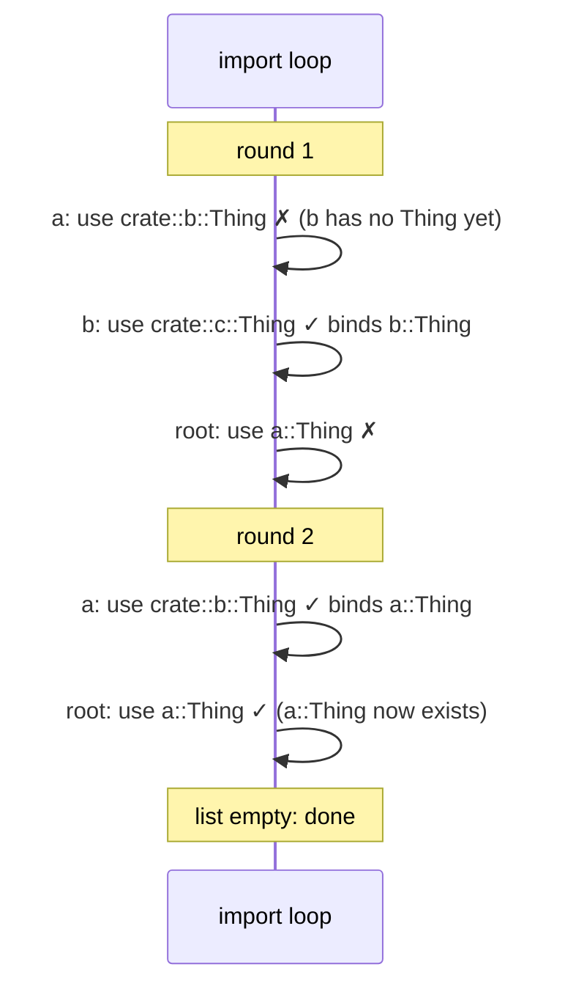
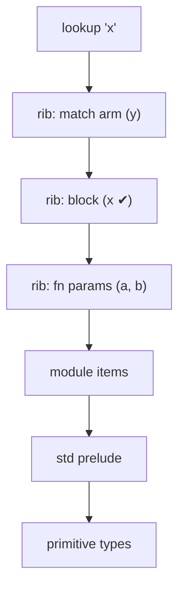

# 04 · Name Resolution

After parsing ([02-parsing.md](02-parsing.md)) and loading crates ([03-crates-and-modules.md](03-crates-and-modules.md)), the compiler has a tree of syntax for every file. Each name in that tree is still only a string. When you write `Point::new(1, 2)` inside `fn main`, the parser records the segments `Point` and `new` and nothing more. It doesn't know whether `Point` is a struct, a module, a local variable or a typo.

**Name resolution** answers one question for every path in the program: *what does this name refer to?* It is the first stage that sees the whole program at once, and every later stage depends on its answers.

The implementation is in two files:

- [src/resolve/defs.ts](../src/resolve/defs.ts): the vocabulary. It defines `DefId`, `Def`, namespaces and `Res`.
- [src/resolve/resolver.ts](../src/resolve/resolver.ts): the algorithm, about 1,000 lines.



## Definitions and DefIds

Every named thing the program declares gets a numbered **definition**. This includes modules, functions, structs, enums, variants, traits, impls, constants, type aliases, associated types and generic parameters. Later stages never look items up by name again. They use the number, a `DefId`, because a name can be ambiguous ("which `new`?") and a number cannot.

```ts
export type DefId = number;

export type DefKind =
  | "mod" | "fn" | "struct" | "enum" | "variant" | "trait" | "impl" | "const" | "typeAlias" | "assocTy" | "tyParam";
```

A `Def` records the kind, the name, its crate, its `parent` (the enclosing module, enum, impl or trait) and the AST node. It also records `module`, the module whose privacy rules apply to it. Modules and enums carry a `scope`: the names declared directly inside them.

DefIds are handed out from a single array, and the standard library is collected first, so std's items get the low numbers and yours come after. (AST node ids are numbered across all crates in a similar way, which is why `dump types` prints ids like `#8313` even for a tiny program.)

When a name has been resolved, the result is a `Res`:

```ts
export type Res =
  | { kind: "def"; def: DefId }
  | { kind: "local"; id: A.NodeId }
  | { kind: "prim"; name: PrimName }
  /** `Self`: inside an impl it is the impl's self type; inside a trait, the implementing type. */
  | { kind: "selfTy"; owner: DefId }
  | { kind: "err" };
```

Local variables are not definitions. A `let` binding resolves to the **node id of the pattern that introduced it**, which is enough for the type checker to find its type later.

## Two namespaces

Rust keeps two separate tables of names in every module.

| Namespace | Holds |
|-----------|-------|
| type | modules, structs, enums, traits, type aliases, generic params |
| value | functions, constants, local variables, constructors of tuple/unit structs and variants |

The same name can live in both at once without conflict. Here is the `struct` case from `collectItems`:

```ts
          this.define(scope, "type", item.name, b);
          // Tuple and unit structs also name their constructor in the value namespace.
          if (item.fieldsKind !== "named") this.define(scope, "value", item.name, b);
```

That is why `struct Meters(f64);` works both as a type (`let m: Meters`) and as a function (`Meters(5.0)`). The declaration puts one entry in each namespace. A struct with named fields has no constructor function, so it only takes the type slot.

You can see the namespaces in action with a deliberately clashing program:

```rust
struct Point { x: i32 }
fn Point() {}
enum Point { A }
fn main() {}
```

`fn Point` is fine, because a named-field struct leaves the value namespace empty. The enum clashes with the struct in the type namespace:

```text
error[E0428]: the name `Point` is defined multiple times
 --> dup.rs:3:6
  |
1 | struct Point { x: i32 }
  |        ----- previous definition of `Point` here
3 | enum Point { A }
  |      ^^^^^
  = note: `Point` must be defined only once in the type namespace of this module
```

An enum gets its own scope, like a small module. Each variant is defined in *both* namespaces of that scope. A tuple variant `Some` is a constructor (value), and a struct-like variant `Move { x, y }` is used in struct-literal position (type).

## The three passes

Items in Rust can be used before they are declared, and modules can import from each other in cycles. A single top-to-bottom walk can't handle that. The resolver works in three passes instead.



### Pass 1: collect

`collectItems` walks each crate in dependency order (std first). It creates a `Def` for every item and inserts it into its module's scope. A few details matter later:

- **Generic parameters get DefIds too.** `collectGenerics` creates a `tyParam` def for each `T` and stores the list in `genericsOf`. A `T` in a signature can then resolve to a specific DefId, and two different functions' `T`s are never confused.
- **Impls have no name.** They get a DefId called `<impl>` and are appended to `impls`, but they go into no namespace. You can't name an impl in Rust. The type checker finds methods by searching impls, not by name (see [05-type-checking.md](05-type-checking.md)).
- **Items inside function bodies** go into an *anonymous block module* named `{block}`. `collectBodyItems` finds every block that contains item statements and gives it its own module.
- **`use` declarations are only recorded.** `collectUse` flattens `use a::{b, c::*}` into one `PendingImport` per leaf. Nothing is looked up yet.

### Pass 2: imports to a fixed point

Imports can depend on other imports, across modules, in any textual order:

```rust
mod a { pub use crate::b::Thing; }
mod b { pub use crate::c::Thing; }
mod c {
    #[derive(Debug)]
    pub struct Thing;
}

use a::Thing;

fn main() {
    println!("{:?}", Thing);
}
```

Processed top to bottom, `a`'s import fails because `b` has not imported `Thing` yet. The resolver doesn't need to find a "correct" order. It keeps retrying:

```ts
  private resolveImports() {
    let remaining = [...this.pending];
    while (remaining.length) {
      const next: PendingImport[] = [];
      for (const imp of remaining) if (!this.tryImport(imp, false)) next.push(imp);
      if (next.length === remaining.length) {
        // No progress: report the leftovers.
        for (const imp of next) this.tryImport(imp, true);
        return;
      }
      remaining = next;
    }
  }
```

Each successful import adds a binding, which may allow another import to succeed in the next round. This is a **fixed-point iteration**: repeat until nothing changes. The loop must terminate, because every round either shrinks the list or stops.



When a round makes no progress, the leftover imports are tried once more with `report = true`, which emits the errors. A true cycle shows up like this:

```text
error[E0432]: unresolved import `crate::b::Thing`
 --> e0432.rs:1:17
  |
1 | mod a { pub use crate::b::Thing; }
  |                 ^^^^^^^^^^^^^^^
  |                 --------------- no `Thing` in `crate::b`
```

`tryImport` looks the last segment up in **both** namespaces and binds whichever it finds. So `use shapes::Meters;` brings in the type and the constructor together.

### Glob imports

`use colors::*;` doesn't copy names. It records the target in the importing scope's `globs` list. Lookups fall back to globs only after explicit names:

```ts
  private lookupInScope(container: DefId, name: string, ns: Namespace, from: DefId, visiting: Set<DefId>): Binding | undefined {
    const scope = this.defs[container].scope;
    if (!scope || visiting.has(container)) return undefined;
    const direct = (ns === "type" ? scope.types : scope.values).get(name);
    if (direct) return direct;
    visiting.add(container);
    for (const glob of scope.globs) {
      const b = this.lookupInScope(glob.target, name, ns, from, visiting);
      // Globs only bring in names visible to the importing module.
      if (b && this.isAccessible(b, glob.target, container)) return { ...b, isPub: b.isPub && glob.isPub, isImport: true };
    }
    return undefined;
  }
```

This gives Rust's rule that an explicit item or `use` *shadows* a glob. The `visiting` set protects against two modules that glob-import each other. The target can be a module or an enum, so `use Color::*;` makes the variants usable unqualified:

```rust
use colors::*;
use colors::Color::*;

fn main() {
    let c = favorite();
    match c {
        Red => println!("red"),
        Green => println!("green"),
        Blue => println!("blue"),
    }
}
```

### The standard prelude

Every Rust program can write `Some`, `Vec` and `String` without importing them. In TSRust these names come from [std/src/prelude.rs](../std/src/prelude.rs):

```rust
pub use crate::option::Option::{self, None, Some};
pub use crate::result::Result::{self, Err, Ok};
pub use crate::string::{String, ToString};
pub use crate::vec::Vec;
```

The prelude is not injected as a glob into each module. After pass 1, the resolver remembers `std::prelude` as `preludeModule`, and `lookupLexical` consults it as a last resort, after the current module and before primitive types. That is why a local `struct Vec` simply wins over std's: the module's own items are searched first.

After imports, the resolver also records **lang items**: a fixed table (`LANG_PATHS`) of std items the compiler must know by identity, such as `Option`, `Iterator`, `Add` and `Display`. The type checker uses them for `for` loops, operators and formatting.

### Pass 3: bodies, ribs and shadowing

Inside function bodies, names come and go with blocks. The resolver keeps a stack of **ribs** (rustc's term). Each function, block, `let`, match arm and `for` loop pushes a rib holding the names it binds:

```ts
interface Rib {
  values: Map<string, A.NodeId>;
  types: Map<string, Res>;
  /** Anonymous module for items declared in this block. */
  module?: DefId;
  /** A nested fn item: locals of outer ribs are not reachable. */
  boundary?: boolean;
}
```

Lookup walks the stack from the innermost rib outwards, then falls back to module items:



The `let` statement is handled carefully, because the order of resolution decides what shadowing means:

```ts
        if (s.kind === "let") {
          if (s.ty) this.resolveType(s.ty);
          if (s.init) this.resolveExpr(s.init);
          // A `let` starts a new scope: later statements see the binding, the
          // initializer does not. Shadowing just overwrites the map entry.
          const letRib: Rib = { values: new Map(), types: new Map() };
          this.bindPattern(s.pat, letRib, new Map());
          this.ribs.push(letRib);
```

The initializer is resolved *before* the new rib is pushed. In `let x = x * 2;` the right-hand `x` therefore refers to the previous `x`. Each `let` gets a fresh rib, so a shadowed binding is a different local with a different node id. Nothing is overwritten. The old value still exists, and the borrow checker treats it as a separate variable.

```rust
fn main() {
    let x = 5;
    let x = x * 2;
    {
        let x = "inner";
        println!("{}", x);
    }
    println!("{}", x);
}
```

This prints `inner` and then `10`: the inner block's rib is popped when the block ends.

### Nested fn items can't see locals (E0434)

A `fn` declared inside another function is an ordinary item, not a closure. It can't read the enclosing function's variables. The resolver models this with a **boundary** rib. When `lookupLexical` finds a local only by crossing a boundary, it returns nothing:

```ts
        if (local !== undefined) {
          if (crossedBoundary) return undefined; // reported by the caller as E0434
          return { kind: "local", id: local };
        }
```

`reportUnresolved` then checks whether the name exists as a local anywhere in the rib stack. If it does, it reports a specific error instead of a plain "cannot find value":

```text
error[E0434]: can't capture dynamic environment in a fn item
 --> e0434.rs:4:13
  |
4 |         x * factor
  |             ^^^^^^
  = help: use a closure instead (TSRust doesn't support closures yet), or pass the value as a parameter
```

Nested items are resolved *after* the rest of their block. The outer ribs are still on the stack at that point, and that is what makes the helpful message possible. Generic parameters of the outer function are hidden in the same way: the copied ribs have their `types` maps cleared.

## Privacy (E0603)

In Rust, a private item is visible in the module that declares it and in that module's descendants. `pub` makes it visible everywhere. `isAccessible` implements exactly that:

```ts
  private isAccessible(binding: Binding, container: DefId, from: DefId): boolean {
    if (binding.isPub || this.defs[container].kind === "enum") return true;
    // Private: visible in `container` and its descendants.
    const owner = this.nearestNamedModule(container);
    for (let m: DefId | undefined = from; m !== undefined; m = this.defs[m].parent) {
      if (m === owner) return true;
      if (this.defs[m].kind !== "mod") break;
    }
    return false;
  }
```

Enum variants are always public, so the `kind === "enum"` shortcut handles them. Every step of a path through a module is checked, and so is every `use`:

```rust
mod shapes {
    pub struct Circle { pub r: f64 }
    fn area(c: &Circle) -> f64 { 3.14 * c.r * c.r }
    pub mod inner {
        pub fn call() -> f64 { super::area(&super::Circle { r: 1.0 }) }
    }
}
```

`inner::call` can reach `super::area` because `inner` is a descendant of `shapes`. `main` can't:

```text
error[E0603]: function `area` is private
  --> e0603.rs:11:28
   |
 3 |     fn area(c: &Circle) -> f64 { 3.14 * c.r * c.r }
   |        ---- the function `area` is defined here
11 |     println!("{}", shapes::area(&c));
   |                            ^^^^
  = help: mark it `pub` to make it visible outside its module
```

Field privacy (E0616, E0451) and method privacy (E0624) are checked later by the type checker. Only it knows which struct a `.field` refers to, or which impl a `.method()` comes from. Its `isDescendant` test treats a `{block}` module as part of its parent, so a struct declared inside `fn main` has fields that `main` can use, as in rustc, where a function body belongs to its module.

## Paths that resolve only partway

Look at `Point::new`. `Point` is a struct, but `new` is not inside any scope the resolver knows. It is an associated function, and finding it means searching impls, possibly generic ones, and possibly trait impls (`T::default()`). That needs types, so the resolver stops early and hands over a **partial resolution**:

```ts
export interface PartialRes {
  base: Res;
  /** Path segments after the resolved base, e.g. `["new"]`. Empty when fully resolved. */
  unresolved: A.PathSegment[];
  /** Index into the path's segments of the segment that produced `base`. */
  baseIndex: number;
}
```

`resolvePath` looks up the first segment lexically. It then keeps stepping through anything that has a `scope` (modules and enums). It stops as soon as it reaches something without one:

```ts
    for (i = 1; i < segs.length; i++) {
      if (res.kind !== "def") break;
      const def = this.defs[res.def];
      if (!def.scope) break; // a type: the rest is type-relative
```

| Path | `base` | `unresolved` |
|------|--------|--------------|
| `std::cmp::max` | the fn `max` | `[]` |
| `Option::Some` | the variant `Some` | `[]` (enums have a scope) |
| `Point::new` | the struct `Point` | `["new"]` |
| `i32::MAX` | `prim i32` | `["MAX"]` |
| `T::default` | the type param `T` | `["default"]` |
| `Self::Item` | `selfTy` | `["Item"]` |

The type checker's `resolveAssocItem` picks up where this leaves off (see [05-type-checking.md](05-type-checking.md) and [06-traits-and-generics.md](06-traits-and-generics.md)).

All segments except the last are looked up in the type namespace, since only types and modules can have children. The last segment uses whatever namespace the context requires. An expression path wants a value. A type annotation or struct literal wants a type.

## When an identifier pattern is really a constant

`match o { None => .., x => .. }` contains two identifier patterns that look identical to the parser. One names a unit variant. The other introduces a new variable. The resolver tells them apart in `bindPattern`:

```ts
      case "ident": {
        // Is this actually a unit variant, unit struct or constant (e.g. `None`)?
        if (!p.mutable && !p.byRef && !p.sub) {
          const res = this.lookupLexical(p.name, "value");
          if (res?.kind === "def") {
            const d = this.defs[res.def];
            const isUnitLike =
              d.kind === "const" ||
              (d.kind === "variant" && d.variant!.fieldsKind === "unit") ||
              (d.kind === "struct" && (d.node as A.StructItem).fieldsKind === "unit");
            if (isUnitLike) {
              this.patternPaths.set(p.id, { base: res, unresolved: [], baseIndex: 0 });
              return;
            }
          }
        }
```

If the name resolves to something unit-like, the pattern is recorded in `patternPaths` and binds nothing. Otherwise it becomes a fresh binding. This is also how a typo goes wrong in real Rust, and TSRust reproduces it:

```rust
fn describe(o: Option<i32>) -> i32 {
    match o {
        Nome => 0,
        Some(n) => n,
    }
}
```

`Nome` resolves to nothing, so it becomes a variable that matches *everything*. The program compiles, and the exhaustiveness checker ([07-pattern-matching.md](07-pattern-matching.md)) notices the consequence:

```text
warning: unreachable pattern
 --> nome.rs:4:9
  |
4 |         Some(n) => n,
  |         ^^^^^^^
  = note: this arm can never match: earlier arms cover every value it matches
```

`bindPattern` also enforces two pattern rules that depend only on names:

- No name may be bound twice in one pattern (`(x, x)`, E0416).
- Every alternative of an or-pattern must bind the same set of names (E0408).

```text
error[E0408]: variable `a` is not bound in all patterns
 --> orpat.rs:4:18
  |
4 |         (a, 0) | (0, b) => println!("{}", a),
  |                  ^^^^^^
```

## Loop labels

`break` and `continue` also refer to something by name: a loop. The resolver keeps a separate `labelStack`, pushing an entry for each `loop`, `while` and `for`. `resolveLabel` binds every `break`/`continue` to the node id of its target loop in the `labels` map. An unlabeled `break` targets the innermost loop. A labeled one searches outwards by name:

```text
error[E0426]: use of undeclared label `'outr`
 --> labels.rs:5:25
  |
5 |             if i == 2 { break 'outr; }
  |                         ^^^^^^^^^^^
```

A `break` outside any loop is E0268. Labels don't cross function boundaries: `resolveFn` saves the label stack and starts an empty one.

## What the resolver hands on

| Field of `ResolveResults` | Used by |
|---|---|
| `defs` | everything: the master table of definitions |
| `paths` | typeck: `Path.id` → `PartialRes` |
| `patternPaths` | typeck, exhaustiveness, borrowck, codegen: ident patterns that are constants |
| `genericsOf` | typeck: generic param DefIds per item |
| `impls`, `traits` | typeck: the impl index and method lookup |
| `lang` | typeck and codegen: well-known std items |
| `labels` | typeck, borrowck, codegen: `break`/`continue` targets |
| `main` | codegen: the entry point (E0601 if missing) |

## Where TSRust differs from rustc

- **No macro expansion or hygiene.** In rustc, name resolution and macro expansion are interleaved. TSRust's macros (`println!`, `vec!`, ...) are built into the parser, so resolution runs once on a finished AST.
- **Glob conflicts are not detected.** If two globs both provide a name, rustc reports an ambiguity when the name is used. TSRust takes the first glob that has it.
- **No `pub(crate)` or `pub(super)`.** Visibility is binary: private or `pub`.
- **No re-export checks.** rustc rejects `pub use` of a private item (E0364/E0365). TSRust only checks that the importing module can see the item.
- **Simplified prelude.** rustc injects the prelude per edition and treats it as a glob with special shadowing rules. TSRust consults `std::prelude` as a final lexical fallback.
- **Extern crates.** Dependencies are found by name from any path's first segment (see [03-crates-and-modules.md](03-crates-and-modules.md)). There is no `extern crate` declaration.
- **No closures.** The only capture-related error is E0434 for nested `fn` items.

## Try it

From the repository root:

```sh
node src/cli.ts check examples/errors/E0425_unresolved_name.rs
node src/cli.ts check examples/errors/E0603_private_item.rs
node src/cli.ts run examples/13_modules.rs
node src/cli.ts run examples/packages/app          # multi-crate resolution
```

(Diagnostics print the absolute path of the file. The excerpts in this chapter shorten it to the file name.)

In the playground:

1. Pick the modules example from the dropdown. Rename a `pub fn` to private and watch the **Diagnostics** tab report E0603.
2. Write `match Some(1) { Nome => 0, Some(n) => n }`. Check the warning in **Diagnostics**, then look at the **Types** tab: `Nome` shows up as a local variable of type `Option<i32>`.
3. Shadow a variable three times with `let x = x + 1;` and look at the **MIR** tab. Each `x` becomes a separate local `_N`.
4. Put a `fn` inside `main` that reads a local of `main` and read the E0434 message.

## Exercises

1. **Glob ambiguity.** Make `lookupInScope` collect *all* glob matches and report an error if two different `Res` values come back. Start in [src/resolve/resolver.ts](../src/resolve/resolver.ts) `lookupInScope`, and add a test in [tests/resolve.test.ts](../tests/resolve.test.ts).
2. **`pub(crate)`.** Extend the parser to accept `pub(crate)` and store a visibility enum instead of `isPub: boolean`. Then teach `isAccessible` that a `pub(crate)` item is visible anywhere in the same crate (`this.defs[from].crate`).
3. **"Did you mean?" suggestions.** When `reportUnresolved` fails, compute the edit distance to every name in the current ribs and module and add a `help:` with the closest match. rustc does this for typos like `Nome`.
4. **Unused imports.** Record which `Binding`s with `isImport: true` are ever returned by `lookupLexical` or `resolvePath`. After pass 3, warn about the rest (rustc's `unused_imports` lint).
5. **Lint the `Nome` trap.** In `bindPattern`, when an identifier pattern starts with an uppercase letter and resolves to nothing, emit a warning like rustc's "variable `Nome` should have a snake case name" plus a note that it will match anything.
