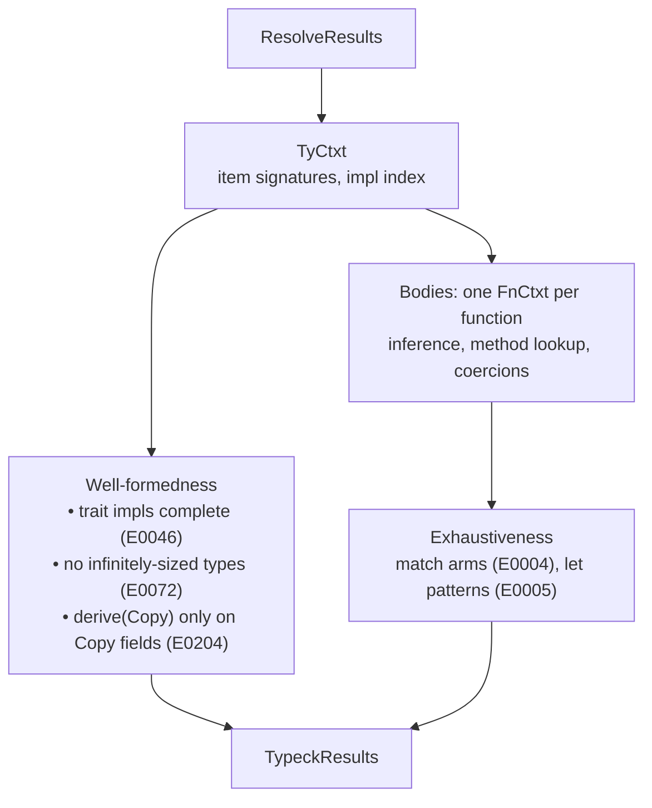
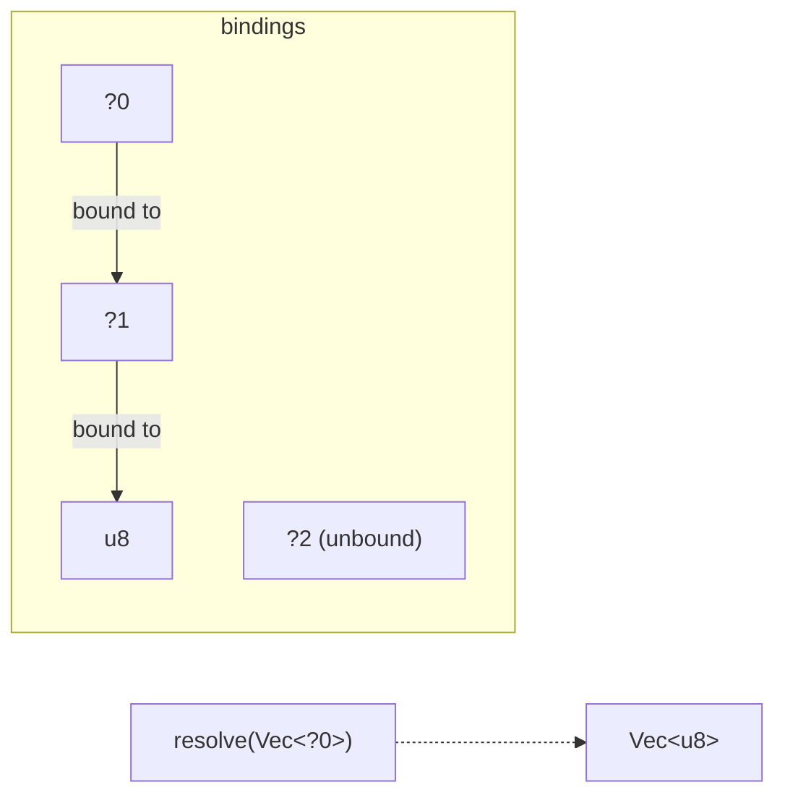
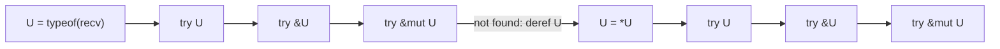
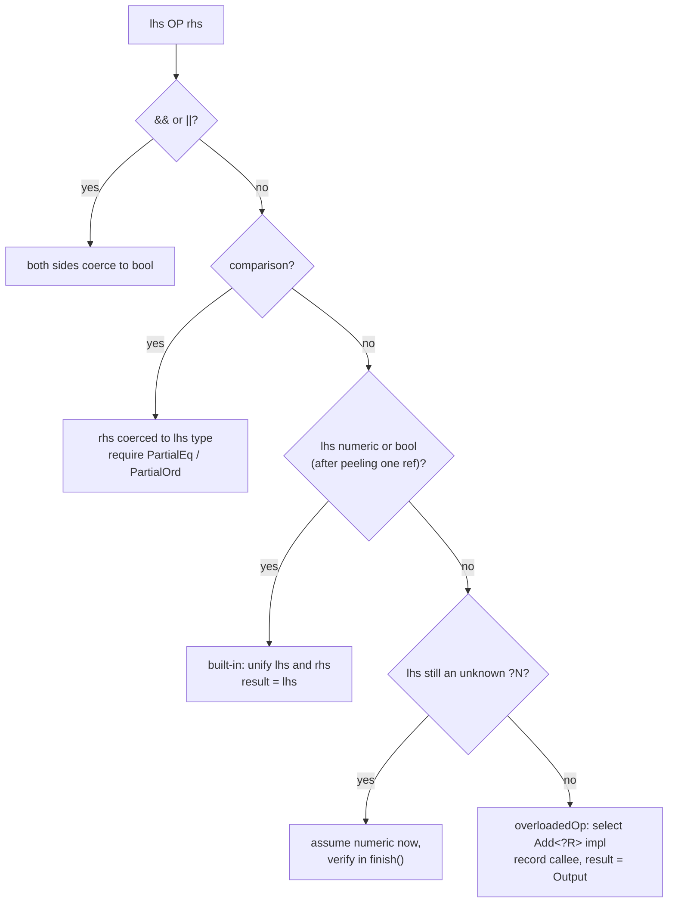

# 05 · Type Checking

Name resolution ([04-name-resolution.md](04-name-resolution.md)) tells us *what* each name refers to. Type checking works out *what kind of value* every expression produces, and it rejects programs where the kinds don't fit. Along the way it makes a long list of decisions that later stages rely on: which method a `.len()` call means, where an implicit `&` or `*` is inserted, how a pattern binds its variables.

Rust's type checker does a lot of **inference**. You annotate function signatures, and the compiler works out the types of locals, closures (not in TSRust), generic arguments and literals. This chapter explains how that works.

| File | Role |
|------|------|
| [src/typeck/types.ts](../src/typeck/types.ts) | `Ty`, the semantic type representation |
| [src/typeck/infer.ts](../src/typeck/infer.ts) | inference variables and unification |
| [src/typeck/tcx.ts](../src/typeck/tcx.ts) | `TyCtxt`: item signatures, converting written types |
| [src/typeck/check.ts](../src/typeck/check.ts) | `FnCtxt`: checks one function body |
| [src/typeck/traits.ts](../src/typeck/traits.ts) | trait selection (the subject of [06-traits-and-generics.md](06-traits-and-generics.md)) |
| [src/typeck/exhaustive.ts](../src/typeck/exhaustive.ts) | match exhaustiveness ([07-pattern-matching.md](07-pattern-matching.md)) |
| [src/typeck/results.ts](../src/typeck/results.ts) | the side tables handed to later stages |
| [src/typeck/index.ts](../src/typeck/index.ts) | the driver |



## Syntax types and semantic types

The parser produces an `A.TypeExpr`: the type *as written*, such as the path `Vec<i32>` or `&'a mut T`. The type checker works with `Ty`, the type's *meaning*:

```ts
export type Ty =
  | { k: "int"; name: IntName }
  | { k: "float"; name: FloatName }
  | { k: "bool" }
  | { k: "char" }
  | { k: "str" }
  | { k: "never" }
  | { k: "tuple"; elems: Ty[] }
  | { k: "ref"; mutable: boolean; inner: Ty }
  | { k: "adt"; def: DefId; args: Ty[] }
  | { k: "param"; def: DefId; name: string }
  /** An associated type projection that can't be normalized yet, e.g. `I::Item` inside `fn f<I: Iterator>`. */
  | { k: "proj"; trait: DefId; traitArgs: Ty[]; self: Ty; name: string }
  | { k: "var"; id: number }
  | { k: "error" };
```

A few things to notice:

- **Structs and enums are both `adt`** ("algebraic data type"), identified by DefId plus generic arguments. `Vec<i32>` is `{ k: "adt", def: <Vec>, args: [i32] }`. So are `String`, `Option` and your own structs.
- **Type aliases disappear.** `TyCtxt.astToTy` expands `type Grid = Vec<Vec<bool>>` on the spot.
- **Lifetimes are erased.** `&'a T` and `&'b T` are the same `Ty`. Lifetimes are the borrow checker's business ([09-lifetimes.md](09-lifetimes.md)).
- **`var` is an unknown** still being inferred, printed as `?0`, `?1`, ... in this chapter and shown to users as `_`, `{integer}` or `{float}`.
- **`error`** is a poison type. Once something fails to check, its type becomes `error`, and `unify` accepts `error` with anything. This stops one mistake from cascading into dozens of follow-on errors.

### Signatures first

Before any body is checked, `TyCtxt` can answer questions about items: `fnSig(def)`, `variants(adt)`, `implHeader(impl)`, `predicates(def)`. Each is computed lazily and cached, like rustc's queries. None of them involves inference, because Rust requires every item signature to be fully annotated. The doc comment in [tcx.ts](../src/typeck/tcx.ts) explains why that matters:

> Signatures never need inference: Rust requires full type annotations on items. That's a deliberate design choice — it keeps inference *local* to a single function body, so a change inside one function can't change the inferred types of another.

So `_` in a signature is rejected with E0121, but `let v: Vec<_> = ...` inside a body is fine. In that case `astToTy` is given a `fresh` callback that turns `_` into a new inference variable.

## Inference variables and unification

Consider:

```rust
let mut v = Vec::new();
v.push(1u8);
```

Nobody wrote `v`'s type. `Vec::new` has signature `fn new() -> Vec<T>`, so the checker *instantiates* `T` with a fresh variable and gives `v` the type `Vec<?0>`. Then `v.push(1u8)` requires the parameter type `?0` to match the argument type `u8`, and the checker records `?0 := u8`.

This is Hindley–Milner-style inference, and its core operation is **unification**: make two types equal, binding variables as needed. `InferCtxt` stores one slot per variable:

```ts
export class InferCtxt {
  private readonly bindings: (Ty | undefined)[] = [];
  private readonly kinds: VarKind[] = [];
  private readonly undo: { id: number; binding: Ty | undefined; kind: VarKind }[] = [];
```

A variable can be bound to another variable, so `?0 := ?1` and `?1 := u8` form a chain. `shallow` follows such chains to the first non-variable (or unbound variable). `resolve` does that recursively throughout a type. This is the "find" half of a union-find structure, without path compression.



`unify` walks both types in parallel:

```ts
  unify(a: Ty, b: Ty): boolean {
    a = this.shallow(a);
    b = this.shallow(b);
    if (a.k === "error" || b.k === "error") return true;
    if (a.k === "var" && b.k === "var") {
      if (a.id === b.id) return true;
      // Keep the more specific kind: binding a general var to an int var keeps "int".
      if (this.kinds[a.id] === "general") { this.bind(a.id, b); return true; }
      if (this.kinds[b.id] === "general") { this.bind(b.id, a); return true; }
      if (this.kinds[a.id] !== this.kinds[b.id]) return false;
      this.bind(a.id, b);
      return true;
    }
    if (a.k === "var") return this.bindVar(a.id, b);
    if (b.k === "var") return this.bindVar(b.id, a);
```

After those cases, two concrete types must have the same shape: same ADT and pairwise-unifiable arguments, same reference mutability, same tuple length, and so on.

### The occurs check

Binding `?0 := Vec<?0>` would create an infinite type, `Vec<Vec<Vec<...>>>`. `bindVar` refuses it:

```ts
    if (this.occurs(id, t)) return false;
```

You can trigger this by pushing a vector into itself:

```rust
fn main() {
    let mut v = Vec::new();
    v.push(v);
}
```

```text
error[E0308]: mismatched types
 --> occurs.rs:3:12
  |
3 |     v.push(v);
  |            ^ expected `_`, found `Vec<_>`
```

### Snapshots and rollback

Some checks need to *try* a unification and back out if it fails. Method lookup tries candidate after candidate. Trait selection tries impl after impl. Every `bind` pushes the old value onto an undo log, so undoing is cheap:

```ts
  snapshot(): number {
    return this.undo.length;
  }

  rollback(snap: number) {
    while (this.undo.length > snap) {
      const u = this.undo.pop()!;
      this.bindings[u.id] = u.binding;
      this.kinds[u.id] = u.kind;
    }
  }
```

The pattern `const snap = this.infcx.snapshot(); if (!unify(...)) this.infcx.rollback(snap);` appears throughout [check.ts](../src/typeck/check.ts) and [traits.ts](../src/typeck/traits.ts).

## Literals: integer and float variables

What is the type of `5`? It could be any of the twelve integer types. Rust gives an unsuffixed literal a special **integral** variable, displayed as `{integer}`, that may only unify with integer types:

```ts
export type VarKind = "general" | "int" | "float";
```

```ts
    const kind = this.kinds[id];
    if (kind === "int" && t.k !== "int") return false;
    if (kind === "float" && t.k !== "float") return false;
```

If nothing pins it down by the end of the function, it **defaults** to `i32`. Float literals default to `f64`:

```ts
  applyDefaults() {
    for (let id = 0; id < this.bindings.length; id++) {
      if (this.bindings[id]) continue;
      const root = this.shallow({ k: "var", id });
      if (root.k !== "var" || root.id !== id) continue;
      if (this.kinds[id] === "int") this.bind(id, { k: "int", name: "i32" });
      else if (this.kinds[id] === "float") this.bind(id, { k: "float", name: "f64" });
      else if (this.sawNever.has(id)) this.bind(id, { k: "tuple", elems: [] });
    }
  }
```

The last line is **never-type fallback**. A variable that only ever met `!` (from `return`, `panic!()`, or `break`) becomes `()`.

Inference is not left-to-right. A later use can decide an earlier literal's type:

```rust
fn main() {
    let mut v = Vec::new();
    v.push(1u8);
    let x = 5;
    let y = 7;
    let z: u64 = y;
    let f = 2.5;
    let total = x + 1;
    println!("{} {} {} {} {}", v.len(), x, z, f, total);
}
```

```text
$ node src/cli.ts dump types infer.rs
   2:9   mut v: Vec<u8>  (#8313)
   4:9   x: i32  (#8323)
   5:9   y: u64  (#8326)
   6:9   z: u64  (#8329)
   7:9   f: f64  (#8335)
   8:9   total: i32  (#8338)
```

`y` became `u64` because of the line *after* it, while `x` fell back to `i32`.

Until defaulting happens, an integer variable has no methods of its own, so a method call on one is ambiguous:

```text
error[E0689]: can't call method `sqrt` on ambiguous numeric type `{float}`
 --> e0689.rs:3:22
  |
3 |     println!("{}", x.sqrt());
  |                      ^^^^
  = help: give the value a concrete type, e.g. `let x: f64 = ...;` or a suffix like `2.0f64`
```

## Bidirectional checking

The main entry point takes an optional **expected type**:

```ts
  checkExpr(e: A.Expr, expected?: Ty): Ty {
    const t = this.checkExprInner(e, expected);
    return this.record(e.id, t, e.span);
  }
```

Type information flows in both directions. It flows *up* from leaves (a literal `"hi"` is `&str`) and *down* from context (`let x: u8 = 5` expects `u8`). The downward hint is just a hint. Each case decides how to use it:

- **Literals.** `checkLit` returns the expected type directly if it is an integer type, so `let x: u8 = 5` never creates a variable.
- **`vec![...]`.** If a `Vec<T>` is expected, the elements are checked against `T`.
- **`if` and `match`.** The expected type, or a fresh variable, becomes the result type that every branch is coerced into.
- **Tuples.** Each element gets the matching element of an expected tuple type.
- **`&expr`.** With `&T` expected, the inner expression is checked against `T`.

After checking, the caller **coerces** the actual type to the expected one at *coercion sites*. Those are `let` with a type annotation, function and method arguments, struct literal fields, return values and branch results. `checkExprCoerce` packages the two steps:

```ts
  checkExprCoerce(e: A.Expr, expected: Ty): Ty {
    const t = this.checkExpr(e, expected);
    this.coerce(e, t, expected, e.span);
    return expected;
  }
```

When coercion fails, the user sees E0308. The `mismatch` helper adds targeted hints:

```text
error[E0308]: mismatched types
 --> e0308.rs:7:19
  |
7 |     let s = greet("Ferris");
  |                   ^^^^^^^^ expected `String`, found `&str`
  = help: try using a conversion method: `.to_string()` or `String::from(...)`
```

## Coercions

At coercion sites Rust allows a few implicit conversions. TSRust implements these:

| From | To | Why |
|------|----|-----|
| `&mut T` | `&T` | a unique borrow can act as a shared one |
| `&String` | `&str` | deref coercion (`String: Deref<Target = str>`) |
| `&Box<T>` | `&T` | deref coercion |
| `&&T` | `&T` | deref coercion through a reference |
| `!` | anything | code after `return` never runs |

`coerce` tries plain unification of the referents first. If that fails, it dereferences the source step by step until something fits:

```ts
    if (a.k === "ref" && e.k === "ref" && (a.mutable || !e.mutable)) {
      const snap = this.infcx.snapshot();
      if (this.infcx.unify(a.inner, e.inner)) return true;
      this.infcx.rollback(snap);
      // Deref coercion: &String → &str, &Box<T> → &T, &&T → &T.
      const steps: DerefStep[] = [];
      let cur = this.infcx.shallow(a.inner);
      for (let i = 0; i < 8; i++) {
        const next = this.derefOnce(cur);
        if (!next) break;
        steps.push(next.step);
        cur = this.infcx.shallow(next.ty);
        const snap2 = this.infcx.snapshot();
        if (this.infcx.unify(cur, e.inner)) {
          if (site) {
            this.out.coercions.set(site.id, steps);
            this.mine.add(site.id);
          }
          return true;
        }
        this.infcx.rollback(snap2);
      }
    }
```

The condition `a.mutable || !e.mutable` handles `&mut T → &T`. A mutable reference may stand in for a shared one, never the reverse. The deref steps are recorded in the `coercions` side table, so the code generator knows to turn a `String` pointer into a `str` view.

```rust
fn shout(s: &str) -> usize { s.len() }
fn peek(v: &Vec<i32>) -> i32 { v[0] }

fn main() {
    let owned = String::from("hello");
    let n = shout(&owned);          // &String  → &str
    let mut v = vec![1, 2, 3];
    let m = &mut v;
    let first = peek(m);            // &mut Vec → &Vec
    let b = Box::new(String::from("boxed"));
    let k = shout(&b);              // &Box<String> → &String → &str
    println!("{} {} {}", n, first, k);
}
```

This prints `5 1 5`.

## Method calls: probing

`recv.method(args)` is the most involved expression in the checker. The method might be inherent (`impl Vec<T> { fn len(&self) }`) or come from a trait. The receiver might need `&`, `&mut`, or one or more `*` to fit the method's `self` parameter. Rust's rule, implemented in `probeMethod`, is to try a sequence of receiver types and stop at the first that has a matching method:



```ts
  probeMethod(recvTy: Ty, name: string, span: Span, explicit?: A.TypeExpr[]): MethodPick | undefined {
    const steps = this.autoderef(recvTy);
    for (const step of steps) {
      const u = this.infcx.shallow(step.ty);
```

```ts
      for (const autoref of [undefined, "ref", "mut"] as const) {
        const recv: Ty = autoref ? { k: "ref", mutable: autoref === "mut", inner: u } : u;
        const pick = this.probeInherent(u, steps, recv, name, span, explicit) ?? this.probeTraits(recv, name, span, explicit);
        if (pick) {
          pick.adjust = { derefs: step.steps, autoref };
          return pick;
        }
      }
```

`autoderef` produces the chain of types reachable by dereferencing: `&&Vec<i32>`, `&Vec<i32>`, `Vec<i32>`. For a `String` the chain is `String`, `str`. "Try `R`" means: is there a method of that name whose `self` parameter type *unifies* with `R`? For `Vec::len(&self)` the `self` type is `&Vec<T>`. So:

| Receiver | Autoderef steps | Matching candidate | Adjustment |
|----------|-----------------|--------------------|------------|
| `v: Vec<i32>` | 0 | `&Vec<i32>` (autoref) | `&v` |
| `r: &Vec<i32>` | 0 | `&Vec<i32>` (by value) | none |
| `rr: &&Vec<i32>` | 1 | `&Vec<i32>` (by value) | `*rr` |
| `s: String` | 1 (`String` → `str`) | `&str` (autoref) | `&*s` |

Inherent methods are searched first, through an index keyed by the self type's "head" (an ADT DefId or a primitive name). Trait methods come next. `probeTraits` puts traits from the function's where-clauses first, so `x.fmt(f)` on a `T: Display` finds `Display::fmt`.

The chosen `{ derefs, autoref }` is stored in the `adjustments` table, and later stages make it explicit. In the MIR ([08-ownership-and-borrowing.md](08-ownership-and-borrowing.md)) for `rr.len()` and `s.len()`, you can see the inserted `*` and `&*`:

```text
        _7 = call len(copy (*_6));
        _8 = copy _7;
        _9 = call from(const);
        _10 = move _9;
        _12 = &(*_10)  // loan L2;
        _11 = call len(move _12);
```

When nothing matches, the error looks for a likely cause. Here it notices a field with the same name:

```text
error[E0599]: no method named `x` found for `Point` in the current scope
 --> e0599.rs:5:22
  |
5 |     println!("{}", p.x());
  |                      ^
  = help: `x` is a field; to access it, remove the parentheses: `.x`
```

Field access (`checkField`) and indexing (`checkIndex`) use the same autoderef chain, which is why `self.items[0]` works when `self` is `&Self`.

### Path calls: `Point::new` and `T::default`

Recall from [04-name-resolution.md](04-name-resolution.md) that `Point::new` comes out of the resolver as base `Point` with `["new"]` unresolved. `resolveAssocItem` finishes the job. It first searches inherent impls whose self type unifies with `Point`, then traits that have an item with that name and are implemented for the type. For `Trait::method` paths, `Self` becomes a fresh variable that the arguments determine. Generic parameters of the impl and the method are instantiated with fresh variables, or with turbofish arguments like `parse::<i32>` if given.

## Patterns and match ergonomics

`checkPat(p, expected, mode)` checks a pattern against the type of the value being matched, and it records a **binding mode** for each variable. Originally Rust required you to write `&Some(ref s)` to match on a reference without moving out of it. Since 2018 the compiler does this for you ("match ergonomics"). When a non-reference pattern meets a reference, the checker peels the reference and switches the *default binding mode* to `ref`:

```ts
    if (peels) {
      let t = this.infcx.shallow(expected);
      while (t.k === "ref") {
        mode = t.mutable && mode !== "ref" ? "refMut" : "ref";
        expected = t.inner;
        t = this.infcx.shallow(expected);
        derefs++;
      }
    }
```

An identifier pattern then binds `&T` (or `&mut T`) instead of `T`:

```rust
let opt = Some(String::from("hi"));
match &opt {
    Some(s) => println!("{}", s),
    None => {}
}
let pair = (1, String::from("x"));
let (a, b) = &pair;
let mut m = Some(5);
if let Some(n) = &mut m {
    *n += 1;
}
```

```text
   4:14  s: &String  (#8326)
   8:10  a: &i32  (#8343)
   8:13  b: &String  (#8344)
  10:17  n: &mut i32  (#8357)
```

Two side tables carry this forward. `patDerefs` records how many references were peeled. `bindingModes` records `move`, `ref` or `refMut` for each binding. The borrow checker uses them to create loans instead of moves, and the code generator uses them to emit `REF` instead of `LOAD`. [07-pattern-matching.md](07-pattern-matching.md) covers the pattern side in depth.

## Operators

`a + b` in Rust is sugar for `Add::add(a, b)`. For primitives, the compiler emits a native instruction instead. `checkBinary` handles the common cases directly and falls back to trait lookup for everything else:



The built-in path enforces Rust's "no implicit numeric conversion" rule by unifying the two sides:

```text
error[E0277]: cannot add `{float}` to `{integer}`
 --> ops.rs:4:13
  |
4 |     let c = a + b;
  |             ^^^^^
  = note: no implementation for `{integer} + {float}`
  = help: Rust never converts numbers implicitly; use `as` to convert, e.g. `x as {integer}`
```

The overloaded path, `overloadedOp`, instantiates the operator trait (for example `Add<?R>`) and asks the trait solver for an impl. If exactly one impl fits, unifying with it determines `?R` *before* the right operand is checked. That is what makes `string + &other` coerce `&String` to `&str`: the only `Add` impl for `String` is `Add<&str>`. Its failures get special help text:

```text
error[E0369]: cannot add `&str` to `&str`
 --> ops.rs:5:13
  |
5 |     let s = "abc" + "def";
  |             ^^^^^^^^^^^^^
  = note: `+` cannot be used to concatenate two `&str` strings
  = help: create an owned `String` from the left side: `left.to_string() + right`
```

## Deferred work: obligations

The checker often learns about a requirement before it knows enough to decide it. `show(42)` with `fn show<T: Display>` requires `?T: Display`, and `?T` is only an integer variable at that moment. Such requirements become **obligations**:

```ts
type Obligation =
  | { kind: "trait"; self: Ty; trait: DefId; args: Ty[]; span: Span; why?: string }
  | { kind: "proj"; proj: Extract<Ty, { k: "proj" }>; ty: Ty; span: Span };
```

`processObligations` loops over the list until no more progress is made. Each obligation is either proven (removed), disproven (an E0277 is reported), or still ambiguous (kept for later). The checker calls it with `final = false` at moments when more information helps, such as just before probing a method on a receiver. It calls it once more with `final = true` at the end, when anything left is reported as "type annotations needed".

Operators on a value of not-yet-known type are deferred in a similar way. `checkBinary` assumes a built-in numeric operation and pushes an entry onto `deferredNumeric`, which is checked after inference:

```rust
fn main() {
    let x = Default::default();
    let y = x + 1;
    println!("{}", y);
}
```

When `x + 1` is checked, `x` is just `?0`. The `+` is deferred, and `1` is coerced to `?0`, turning it into an integer variable. Defaulting then makes it `i32`, and the pending `?0: Default` obligation is finally proven for `i32`. The program prints `1`. `dump types` confirms `x: i32` and `y: i32`.

### Finishing a body

```ts
  private finish() {
    this.processObligations(false);
    this.infcx.applyDefaults();
    this.processObligations(true);
    this.checkDeferredNumeric();
    this.checkIntLiterals();
    this.writeback();
  }
```


The order matters. Defaulting must happen *between* the two passes. Some obligations are only decidable once `{integer}` has become `i32`, and defaulting too early would override information a later obligation could have provided.

Literal ranges can only be checked at the end, too. The `"lit"` case of `checkExprInner` records each integer literal with its type in `intLits`, and `checkIntLiterals` looks at the final type. `let x: u8 = 300;` is rejected, as in rustc:

```text
error: literal out of range for `u8`
 --> lit.rs:2:17
  |
2 |     let x: u8 = 300;
  |                 ^^^
  = note: the literal `300` does not fit into the type `u8` whose range is `0..=255`
```

If something is still unknown after all this, the user must annotate:

```text
error[E0283]: type annotations needed: cannot satisfy `_: FromIterator`
 --> ambig.rs:2:20
  |
2 |     let v = (0..3).collect();
  |                    ^^^^^^^
```

## Writeback and side tables

During checking, types are recorded as they are discovered, variables and all. `writeback` resolves every recorded type through the final bindings. If a variable remains, it reports E0282 and replaces the variable with `error`:

```text
error[E0282]: type annotations needed
 --> e0282.rs:2:13
  |
2 |     let v = Vec::new();
  |             ^^^^^^^^^^
  = note: cannot infer the type `Vec<_>`
```

The final product is a set of tables keyed by AST node id, defined in [results.ts](../src/typeck/results.ts). Later stages read these instead of redoing any analysis:

| Table | Contents | Main consumer |
|-------|----------|---------------|
| `types` | type of every expression and pattern | borrowck, codegen |
| `callees` | which fn, method or operator impl a call invokes, with generic substitutions | borrowck, codegen |
| `ctors` | struct/variant built or matched, with generic args | codegen, exhaustiveness |
| `adjustments` | auto-deref/auto-ref on receivers and operands | borrowck, codegen |
| `coercions` | deref-coercion steps at coercion sites | codegen |
| `bindingModes`, `patDerefs` | match ergonomics decisions | borrowck, codegen |
| `fieldIndices` | `p.x` → field number | borrowck, codegen |
| `locals` | name, type and mutability of each binding | borrowck, `dump types` |
| `forLoops` | the `into_iter` and `next` callees for each `for` | borrowck, codegen |
| `tryKinds`, `strSlices` | how `?` and `&s[a..b]` lower | codegen |

The types written here may still contain generic parameters such as `T`. The code generator substitutes concrete types when it monomorphizes ([10-code-generation.md](10-code-generation.md)).

## Where TSRust differs from rustc

- **No closures, function pointers or trait objects.** Using a function name as a value is an error, and `dyn Trait` and `impl Trait` types are rejected by the parser.
- **Coercions are a fixed list.** TSRust has no general `Deref` trait. The deref steps are hard-coded for `&`, `Box` and `String` (`derefOnce`), and there is no unsizing coercion (`[T; N]` to `[T]`) because TSRust has no arrays or slices.
- **Trait methods are found even when the trait is not in scope.** `probeTraits` searches every trait in the program that has a method of that name. rustc requires the trait to be imported (E0599 with "trait is not in scope").
- **Operators on unknown types are guessed.** rustc would report E0282 for `x + 1` if `x`'s type were still unknown at that point. TSRust assumes a numeric operation and checks it after inference (`deferredNumeric`).
- **Integer method calls before defaulting fail.** `7.to_string()` is E0689 in TSRust. rustc accepts it, because trait method lookup works on `{integer}`.
- **`?` doesn't call `From::from`.** The error types must match exactly (`checkTry`), and `?` works only on `Option` and `Result`.
- **No two-phase type checking of items.** rustc collects and checks items in a query-driven order with cycle detection. TSRust checks bodies in DefId order. This is safe because bodies only depend on signatures.
- **Literal range checks are approximate.** `checkIntLiterals` reports rustc's `overflowing_literals` error for `i8`, `i16`, `i32`, `u8`, `u16` and `u32`, and doesn't check 64-bit or 128-bit types. (A negated literal may be one past a signed maximum, so `-128i8` is fine while `128i8` is an error.)
- **Only bounded ranges.** `a..b` and `a..=b` are supported. `..b` and `a..` are only allowed when slicing a string.

## Try it

```sh
node src/cli.ts dump types examples/07_iterators.rs
node src/cli.ts check examples/errors/E0308_mismatched_types.rs
node src/cli.ts check examples/errors/E0599_no_method.rs
node src/cli.ts dump mir examples/03_borrowing.rs     # see inserted & and * adjustments
```

In the playground:

1. Open any example and switch to the **Types** tab. Delete a type annotation and see what inference produces instead.
2. Type `let mut v = Vec::new(); v.push(1u8);` and then change `1u8` to `1`. Watch `v` go from `Vec<u8>` to `Vec<i32>` in **Types**.
3. Write `let n: u64 = 3; let m: u32 = 4; let s = n + m;` and read the E0277 in **Diagnostics**.
4. Call `.len()` on `v`, `&v` and `&&v` and compare the receivers in the **MIR** tab.
5. Match on `&Some(String::new())` with and without the `&` and compare the binding types.

## Exercises

1. **64-bit literal ranges.** `checkIntLiterals` in [src/typeck/check.ts](../src/typeck/check.ts) checks 8-, 16- and 32-bit types (tracking literals directly under unary `-` so `-128i8` passes). Extend it to `i64`/`u64`, keeping in mind the VM stores integers as JavaScript numbers: decide whether literals above 2^53 should be a compile error with a TSRust-specific note.
2. **Better E0308 for numeric conversions.** When `mismatch` sees two different integer types, add `help: you can convert ... using .try_into()` or suggest `as`. The hook is `mismatch` in [check.ts](../src/typeck/check.ts).
3. **Path compression.** Make `InferCtxt.shallow` rebind each visited variable directly to the final type. Be careful: every rebinding must go through the undo log, or `rollback` breaks. Measure the effect with `node src/cli.ts check` timings on `examples/15_game_of_life.rs`.
4. **Require traits in scope.** Make `probeTraits` skip traits that are not visible from the current module. A trait is in scope if it is defined in the module or an ancestor block, imported with `use`, or in the prelude. You will need the resolver to export each module's trait imports.
5. **`?` with `From`.** In `checkTry`, when the error types differ, register an obligation `RetErr: From<ExprErr>` instead of failing, and record the `From::from` callee for the code generator. See [06-traits-and-generics.md](06-traits-and-generics.md) for how obligations are solved.
