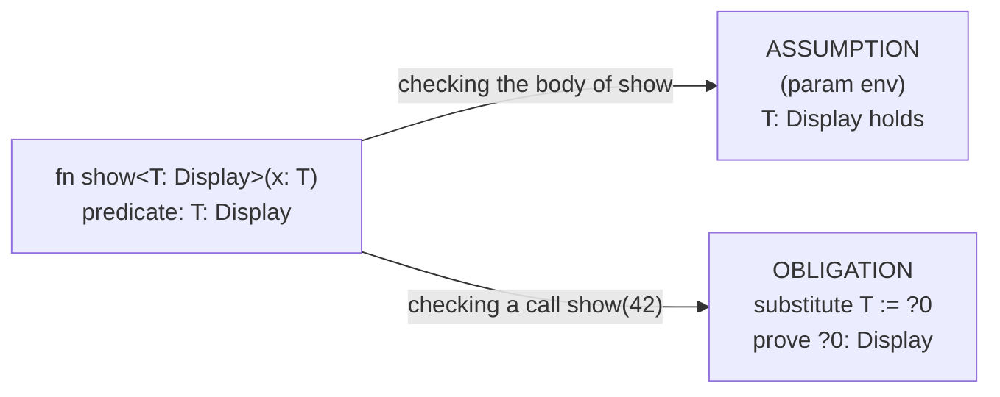
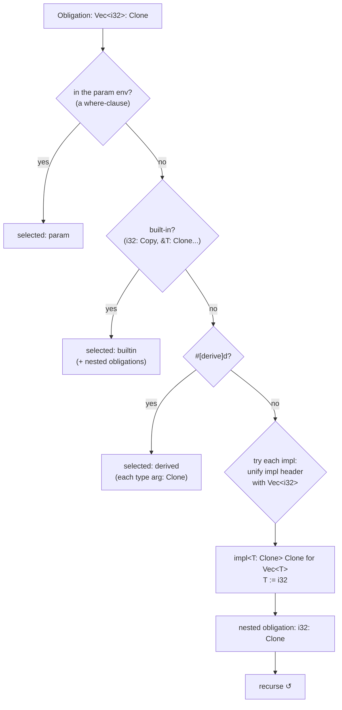
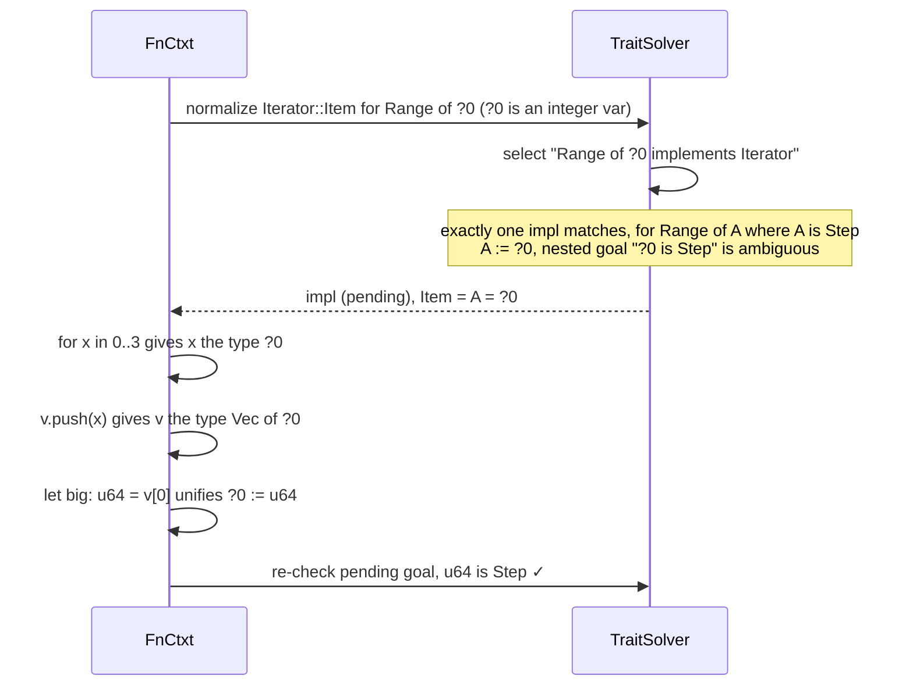

# 06 · Traits and Generics

Traits are Rust's interfaces. Generics let one function or type work for many types, and trait **bounds** say what those types must be able to do. Together they raise two questions for a compiler:

1. **Inside a generic function**, what is a `T` allowed to do? Only what its bounds promise. `fn show<T: Display>(x: T)` may format `x`, and nothing else.
2. **At a call site**, does the concrete type satisfy the bounds? `show(42)` is fine. `show(Opaque)` is not, unless `Opaque: Display`.

Both questions go to the same component, the **trait solver** in [src/typeck/traits.ts](../src/typeck/traits.ts). This chapter builds on the inference machinery of [05-type-checking.md](05-type-checking.md). Variables, unification, snapshots and obligations all reappear here.

## Generic parameters and `Self`

Every item knows its generic parameters, *including those of its parents*. A method in `impl<T> Wrapper<T>` with its own `<U>` has the parameter list `[T, U]`. `TyCtxt.allParams` builds that list:

```ts
  allParams(def: DefId): DefId[] {
    const cached = this.paramsCache.get(def);
    if (cached) return cached;
    const parent = this.genericParent(def);
    const own = this.defs[def].kind === "variant" ? [] : (this.res.genericsOf.get(def) ?? []);
    let params = [...(parent !== undefined ? this.allParams(parent) : []), ...own];
    if (this.defs[def].kind === "trait") params = [this.traitInfo(def).selfParam, ...params];
    this.paramsCache.set(def, params);
    return params;
  }
```

Note the last special case. Inside a trait, `Self` is an unknown type: "whoever implements this". TSRust models it the way rustc does, as a hidden **first generic parameter** of the trait. `traitInfo` creates a synthetic `tyParam` definition named `Self` the first time a trait is inspected. So `trait Add<Rhs = Self>` really has parameters `[Self, Rhs]`, and `<Meters as Add<f64>>` is the substitution `Self := Meters, Rhs := f64`.

When a call is checked, every parameter in this list is **instantiated** with a fresh inference variable (or a turbofish type), and unification fills them in.

## Predicates: where-clauses as data

Bounds like `T: Clone` become **predicates**:

```ts
export type Predicate =
  | { kind: "trait"; self: Ty; trait: DefId; args: Ty[] }
  /** `<self as trait>::name == ty`, from bounds like `I: Iterator<Item = u8>`. */
  | { kind: "proj"; self: Ty; trait: DefId; traitArgs: Ty[]; name: string; ty: Ty };
```

A bound with an associated-type binding produces two predicates:

```ts
  /** `T: Iterator<Item = u8>` → `[T: Iterator, <T as Iterator>::Item == u8]` */
  boundToPredicates(self: Ty, bound: A.Path, ctx: AstConvCtx): Predicate[] {
```

`TyCtxt.predicates(def)` collects the predicates of an item and its parents. Inside a trait it also adds `Self: Trait`, since every trait method may assume its own trait is implemented. The parser folds `where T: PartialOrd + Copy` into the parameter's bound list, so inline bounds and `where` clauses look identical from here on.

### One predicate, two roles

The same predicate list plays opposite roles depending on where you stand:



**In the body**, predicates form the **parameter environment**. Each `FnCtxt` creates its solver with the function's own predicates:

```ts
    this.solver = new TraitSolver(tcx, this.infcx, tcx.predicates(def));
```

Without the bound, the body can't format `x`, because nothing says `T` can be displayed:

```rust
fn show<T>(x: T) -> String {
    format!("<{}>", x)
}
```

```text
error[E0277]: `T` doesn't implement `std::fmt::Display`
 --> nobound.rs:2:21
  |
2 |     format!("<{}>", x)
  |                     ^
  = note: in format strings you may be able to use `{:?}` (or {:#?} for pretty-print) instead
```

This is the key difference from C++ templates. A Rust generic body is checked **once**, against its bounds, not against each type it is later used with.

**At a call site**, `registerPredicates` substitutes the fresh variables into the callee's predicates and pushes each one as an obligation:

```text
error[E0277]: `Opaque` doesn't implement `std::fmt::Display`
  --> bound.rs:11:20
   |
11 |     println!("{}", show(Opaque));
   |                    ^^^^
```

## Trait selection

When an obligation needs deciding, the checker calls `TraitSolver.select(self, trait, args)`. The answer is a **selection**: not just yes or no, but *which* implementation proves it. The code generator later needs to know which impl's method to call.

```ts
export type Selection =
  /** `pending`: the impl's own where-clauses couldn't be decided yet and must be re-checked. */
  | { kind: "impl"; impl: DefId; subst: Subst; pending?: boolean }
  | { kind: "param" }
  | { kind: "builtin" }
  | { kind: "derived" }
  | { kind: "ambiguous" }
  | { kind: "none" };
```

Candidates are considered in a fixed order:



**1. The param env.** If a where-clause unifies with the goal, we are done. Inside `fn f<T: Clone>`, `T: Clone` is simply true.

**2. Built-in impls.** Primitive types implement the standard traits natively in the VM, so there is no Rust `impl` to find. A table encodes them:

```ts
const PRIM_TRAITS: Record<string, (t: Ty) => boolean> = {
  Copy: (t) => t.k === "int" || t.k === "float" || t.k === "bool" || t.k === "char" || t.k === "never",
  Clone: (t) => t.k === "int" || t.k === "float" || t.k === "bool" || t.k === "char" || t.k === "never",
```

Structural rules follow the same idea. A tuple is `Clone` if all its elements are. `&T` is always `Copy`. `&T: Debug` if `T: Debug`. These generate **nested obligations** that are solved recursively.

**3. Derives.** `#[derive(Clone)]` doesn't generate an impl in TSRust. The `TyCtxt` remembers derived traits per type, and selection treats them as a family of impls that require each type argument to implement the trait too. `Pair<T>` with `#[derive(Debug)]` is `Debug` exactly when `T: Debug`.

**4. Impls.** Each impl of the trait is tried in a snapshot. Matching an impl is just unification:

```ts
  private matchImpl(impl: DefId, self: Ty, args: Ty[], depth: number): "ok" | "ambiguous" | "none" {
    const subst = this.instantiate(impl);
    if (!this.unifyImplHeader(impl, subst, self, args)) return "none";
    return this.proveImplPredicates(impl, subst, depth);
  }
```

Instantiate the impl's generics with fresh variables, unify its self type and trait arguments with the goal, then recursively prove the impl's own where-clauses. For `Vec<i32>: Clone` against `impl<T: Clone> Clone for Vec<T>`, unification sets `T := i32` and leaves the nested goal `i32: Clone`. Recursion is capped at `MAX_DEPTH = 24`, at which point the answer is "ambiguous".

### Ambiguity

Sometimes the honest answer is "can't tell yet":

- The self type is still an inference variable. Any impl might end up applying.
- Several impls fit. `Range<{integer}>: Iterator` could use the impl for any integer type.

```ts
    if (candidates.length === 0) return { kind: "none" };
    // Several impls fit (e.g. `Range<{integer}>: Iterator` matches the impl for every
    // integer type): we can't choose until inference learns more.
    if (candidates.length > 1) return { kind: "ambiguous" };
```

Ambiguous obligations stay in the `FnCtxt`'s pending list and are retried as inference progresses. Integer defaulting often settles them. Here is a case where it settles them in a disappointing way:

```rust
trait Describe { fn describe(&self) -> String; }
impl Describe for u8 { fn describe(&self) -> String { String::from("u8") } }
impl Describe for i64 { fn describe(&self) -> String { String::from("i64") } }

fn show<T: Describe>(x: T) -> String { x.describe() }

fn main() {
    println!("{}", show(5));
}
```

`?T: Describe` with `?T = {integer}` is ambiguous between `u8` and `i64`. At the end of the function `{integer}` defaults to `i32`, and the final round of `processObligations` finds no impl:

```text
error[E0277]: the trait bound `i32: Describe` is not satisfied
 --> ambigimpl.rs:8:20
  |
8 |     println!("{}", show(5));
  |                    ^^^^
```

rustc reports the same error for the same reason.

## Supertraits and elaboration

`trait Ord: Eq + PartialOrd` declares that every `Ord` type is also `Eq` and `PartialOrd`. So a bound `T: Ord` should let you use `==`, even though `==` belongs to `PartialEq`, two levels up. When the solver builds the param env, it **elaborates** each bound into the bound plus all its supertraits, transitively:

```ts
  private elaborate(tr: TraitRef, self: Ty): TraitRef[] {
    const out: TraitRef[] = [];
    const seen = new Set<DefId>();
    const go = (t: TraitRef) => {
      if (seen.has(t.trait)) return;
      seen.add(t.trait);
      out.push(t);
      const info = this.tcx.traitInfo(t.trait);
      const params = this.tcx.allParams(t.trait);
      const subst: Subst = new Map([[info.selfParam, self], ...params.slice(1).map((p, i) => [p, t.args[i]] as [DefId, Ty])]);
      for (const s of info.supertraits) go({ trait: s.trait, args: s.args.map((a) => substitute(a, subst)) });
    };
    go(tr);
    return out;
  }
```

```rust
fn same<T: Ord>(a: T, b: T) -> bool {
    a == b
}
```

This compiles: the param env for `same` contains `T: Ord`, `T: Eq`, `T: PartialEq` and `T: PartialOrd`. The `Step` trait in [std/src/iter.rs](../std/src/iter.rs) uses the same mechanism. Its `Copy + PartialOrd` supertraits let the generic `Range` iterator copy and compare its bounds.

## Associated types and normalization

An **associated type** is a type chosen by each impl: `Iterator` has `type Item;`, and every iterator picks its own. In the type checker, a use like `I::Item` or `<Range<i32> as Iterator>::Item` is a **projection**, `Ty` kind `proj`. **Normalizing** a projection means replacing it with the concrete type it denotes. You select the impl, then read its `type Item = ...;` with the impl's generics substituted.

```ts
  normalize(t: Extract<Ty, { k: "proj" }>, depth = 0): Ty | undefined {
    if (depth > MAX_DEPTH) return undefined;
    const self = this.infcx.shallow(t.self);
    // A binding from the environment (`I: Iterator<Item = u8>`) wins.
    for (const p of this.env) {
      if (p.kind !== "proj" || p.trait !== t.trait || p.name !== t.name) continue;
      const snap = this.infcx.snapshot();
      if (this.infcx.unify(p.self, self) && p.traitArgs.every((a, i) => this.infcx.unify(a, t.traitArgs[i]))) return p.ty;
      this.infcx.rollback(snap);
    }
    if (self.k === "var") return undefined;
    const sel = this.select(self, t.trait, t.traitArgs, depth);
    // A generic param proven by a where-clause stays a *rigid* projection: `I::Item` is
    // an opaque type inside the function. But a blanket impl can still normalize it.
    if (sel.kind !== "impl" && (self.k === "param" || self.k === "proj")) return { ...t, self };
```

There are three possible outcomes:

| Situation | Result |
|-----------|--------|
| A where-clause says `I: Iterator<Item = i32>` | `i32`, straight from the env |
| The self type is concrete and one impl applies | the impl's `type Item`, substituted |
| The self type is a generic param with only a bound | stays a **rigid** projection `<I as Iterator>::Item`, an opaque type that only equals itself |
| The self type is still `?N` | `undefined`: try again later |

In the last case, the checker's `normalize` wrapper replaces the projection with a fresh variable and records a `proj` obligation, `<?N as Iterator>::Item == ?M`. When `?N` becomes known, `processObligations` normalizes and unifies the result with `?M`.



### Why `Range` has one generic impl

The `Step` trait in [std/src/iter.rs](../std/src/iter.rs) exists for exactly this reason:

```rust
/// Types with a successor, so ranges of them can be iterated. One generic
/// impl per range type (below) lets inference flow: in `for i in 0..n`, the
/// item type is simply the range's element type.
pub trait Step: Copy + PartialOrd {
    fn forward(self) -> Self;
}

impl<A: Step> Iterator for crate::ops::Range<A> {
    type Item = A;
```

If std had separate `impl Iterator for Range<i32>`, `impl Iterator for Range<u8>`, and so on, then `Range<{integer}>: Iterator` would match all of them and stay ambiguous. The loop variable's type would be unknown when the body is checked. With one generic impl there is exactly one candidate, so the solver **commits to it** while its nested `A: Step` obligation is still undecided:

```ts
    // Exactly one impl fits. Commit to it even if its where-clauses are still
    // undecided (they're returned as `pending` for the caller to re-check):
    // this is what lets `Range<{integer}>::Item` normalize to `{integer}`.
```

The result is that type information flows backwards through a loop:

```rust
fn main() {
    let mut it = 0..3;
    let a = it.next();
    let b = (5u8..7).next();
    let mut v = Vec::new();
    for x in 0..3 {
        v.push(x);
    }
    let big: u64 = v[0];
}
```

```text
   2:9   mut it: Range<i32>  (#8313)
   3:9   a: Option<i32>  (#8318)
   4:9   b: Option<u8>  (#8323)
   5:9   mut v: Vec<u64>  (#8329)
   6:9   x: u64  (#8334)
   9:9   big: u64  (#8347)
```

### `for` loops and the blanket `IntoIterator`

`checkFor` doesn't special-case ranges or vectors. It asks for two projections:

```ts
    const intoIterTy = this.normalize({ k: "proj", trait: intoIterTrait, traitArgs: [], self: iterTy, name: "IntoIter" }, e.iter.span);
    const itemTy = this.normalize({ k: "proj", trait: iteratorTrait, traitArgs: [], self: intoIterTy, name: "Item" }, e.iter.span);
```

For a `Range`, the first projection is answered by a **blanket impl**, which applies to every type meeting a bound:

```rust
/// Every iterator is trivially convertible into itself.
impl<I: Iterator> IntoIterator for I {
    type Item = I::Item;
    type IntoIter = I;
    fn into_iter(self) -> I {
        self
    }
}
```

Matching this impl unifies `I` with anything. The real filter is the nested obligation `I: Iterator`. The resulting callees (`into_iter`, `next`) are stored in the `forLoops` side table for the borrow checker and code generator.

Two more blanket impls in std show the pattern:

```rust
/// A *blanket implementation*: one impl that covers every `T: Display`.
impl<T: Display + ?Sized> ToString for T {
    fn to_string(&self) -> String {
        format!("{}", self)
    }
}
```

```rust
impl<T, U: From<T>> Into<U> for T {
    fn into(self) -> U {
        U::from(self)
    }
}
```

Implement `Display` for your `Point`, and `p.to_string()` works with no further code. `let s: String = "hi".into();` works because `String: From<&str>`. The first is used at the end of [examples/06_traits_generics.rs](../examples/06_traits_generics.rs), where `sq.to_string()` goes through `Display for Square`.

## Default methods

A trait method with a body is a **default method**. Implementors may override it or inherit it:

```rust
trait Greet {
    fn name(&self) -> String;
    fn greet(&self) -> String {
        format!("Hello, {}!", self.name())
    }
}
```

The type checker handles this in three places:

- **Completeness.** `checkTraitImpls` in [index.ts](../src/typeck/index.ts) requires every method *without* a body to be implemented (E0046), rejects extras (E0407), and compares signatures with `Self` substituted (E0053).
- **Calls.** A call `x.greet()` is recorded as a call to the *trait's* method `Greet::greet`, with `Self` in the substitution. The checker never decides which body runs.
- **Codegen.** During monomorphization, `resolveCallee` in [codegen.ts](../src/codegen/codegen.ts) selects the impl for the concrete `Self`. It calls the impl's method if one exists, and otherwise compiles the trait's default body with `Self` substituted.

```text
error[E0046]: not all trait items implemented, missing: `name`
 --> e0046.rs:8:1
  |
8 | impl Shape for Sq {
  | ^^^^^^^^^^^^^^^^^^^
  = help: implement the missing item in this `impl Shape for Sq`

error[E0053]: method `area` has an incompatible type for trait
 --> e0046.rs:9:8
  |
9 |     fn area(&self) -> f32 { 1.0 }
  |        ^^^^
  = note: return type: expected `f64`, found `f32`
```

## Operator traits and default type parameters

The operator traits in [std/src/ops.rs](../std/src/ops.rs) are generic over the right-hand side, with a **default**:

```rust
pub trait Add<Rhs = Self> {
    type Output;
    fn add(self, rhs: Rhs) -> Self::Output;
}
```

`impl Add for Meters` omits `Rhs`, so it means `impl Add<Meters> for Meters`. `traitRefFromPath` fills in missing arguments from the declared defaults, evaluating `Self` as the impl's self type:

```ts
    params.forEach((p, i) => {
      if (i < written.length) args.push(written[i]);
      else {
        const def = node.generics.params[i].default;
        args.push(def ? this.astToTy(def, { ...ctx, selfTy: self }) : (ctx.fresh?.() ?? ERROR));
      }
    });
```

One type can implement the same trait several times with different `Rhs`:

```rust
impl Add for Meters {
    type Output = Meters;
    fn add(self, rhs: Meters) -> Meters { Meters(self.0 + rhs.0) }
}

impl Add<f64> for Meters {
    type Output = Meters;
    fn add(self, rhs: f64) -> Meters { Meters(self.0 + rhs) }
}
```

For `a + b`, `overloadedOp` (see [05-type-checking.md](05-type-checking.md)) asks for `Meters: Add<?R>`. With two impls this is ambiguous, so the right operand is checked against `?R`. Checking `Meters(2.0)` binds `?R := Meters`, the deferred obligation then selects exactly one impl, and its `type Output` gives the result type. With a single impl, `?R` is learned *before* the operand is checked, which enables coercions on the right-hand side.

Comparison operators work differently. `a == b` always requires both sides to have the same type and dispatches to `PartialEq::eq`. Primitives use the built-in selection. User types need an impl or a derive:

```text
error[E0369]: binary operation `==` cannot be applied to type `Meters`
  --> ops.rs:19:36
   |
19 |     println!("{:?} {:?} {}", a, b, a == b);
   |                                    ^^^^^^
  = note: an implementation of `PartialEq` might be missing for `Meters`
  = help: consider annotating `Meters` with `#[derive(PartialEq)]`
```

## Derives

`#[derive(...)]` is checked by name in the resolver (an unknown derive is an error). The type checker records the list in `tcx.derives`, and `checkDerives` in [index.ts](../src/typeck/index.ts) enforces the rules that rustc would discover when type-checking the generated impl:

```text
error[E0204]: the trait `Copy` cannot be implemented for this type
 --> e0204.rs:2:8
  |
2 | struct Named {
  |        ^^^^^
4 |     name: String,
  |     ------------ this field does not implement `Copy` (its type is `String`)
  = note: a `Copy` type is duplicated bit-for-bit, so it may only contain other `Copy` types
```

The derived behaviour itself (field-by-field equality, cloning, `{:?}` formatting) is implemented natively in the VM ([12-the-vm.md](12-the-vm.md)), using the type descriptors the code generator emits.

## A preview of monomorphization

The type checker deliberately leaves generic code generic. A call `largest(&vec![3, 9, 2])` is recorded in the `callees` table as `largest` with substitution `[i32]`. A call to `item > best` inside `largest` is recorded as `PartialOrd::gt` with `Self := T`. The code generator compiles **one copy of each generic function per set of concrete type arguments** and re-runs selection for every trait call, now with concrete types:

```text
fn #0 mono::main  (params: 0, locals: 8)
    16  CALL          #1 <mono::largest::<i32>> 1
    53  CALL          #2 <mono::largest::<char>> 1
fn #1 mono::largest::<i32>  (params: 1, locals: 7)
fn #2 mono::largest::<char>  (params: 1, locals: 7)
```

(These are the `fn` headers and `CALL` lines picked out of `dump bytecode` with `grep`.)

There are no vtables and no runtime type information. Every trait call is resolved statically. [10-code-generation.md](10-code-generation.md) covers the work queue of instances and how `resolveCallee` picks impl methods, default methods, intrinsics and built-ins.

## Where TSRust differs from rustc

- **No coherence checks.** rustc rejects overlapping impls (E0119) and impls of foreign traits for foreign types (the orphan rule, E0117). TSRust checks neither. Overlapping impls just make selection ambiguous.
- **Traits need not be in scope** for method calls (see [05-type-checking.md](05-type-checking.md)).
- **No trait objects, `impl Trait`, or closures.** All dispatch is static.
- **A single impl doesn't decide an integer variable.** If `u8` is the only type implementing `Describe`, rustc infers `show(5)` as `show::<u8>`. TSRust's `select` returns "ambiguous" whenever the self type is an inference variable, so `{integer}` defaults to `i32` and the call fails with E0277.
- **Built-in impls for primitives are a table** (`PRIM_TRAITS`), not real `impl` blocks in std. The VM implements them natively.
- **Derives are not expanded into impls,** and `#[derive(Default)]` is not supported (it reports an error asking for a hand-written impl).
- **No auto traits or markers beyond `Copy`.** There is no `Send`, `Sync` or `Sized` checking. `?Sized` is parsed and ignored.
- **Associated types are simple.** There are no generic associated types, no associated consts in traits, and no bounds on associated types (`type IntoIter: Iterator`). `T::Item` is resolved by searching the bounds on `T` and taking the first trait that declares `Item`.
- **`where` clauses only constrain generic parameters.** The parser merges `where T: Bound` into `T`'s bound list and rejects anything else, such as `where Vec<T>: Debug`.
- **Recursion limit.** Selection gives up as "ambiguous" after 24 nested levels, where rustc would report an overflow error.

## Try it

```sh
node src/cli.ts run examples/06_traits_generics.rs
node src/cli.ts run examples/12_operators.rs
node src/cli.ts dump types examples/07_iterators.rs
node src/cli.ts check examples/errors/E0277_trait_not_implemented.rs
node src/cli.ts dump bytecode examples/06_traits_generics.rs | grep '^fn'
```

In the playground:

1. Open the traits-and-generics example. Remove `+ Copy` from `largest`'s where-clause and read the borrow checker's complaint about moving out of a vector. Then remove `PartialOrd` and read the type checker's.
2. Add `impl fmt::Display for Circle` and call `.to_string()` on a circle. The blanket `ToString` impl picks it up.
3. In the operators example, add `impl Add<f64> for Money` and check `price + 1.5`. Then delete it and read E0277/E0369.
4. Write `for i in 0..3 { v.push(i) }` followed by `let x: u8 = v[0];` and watch `i` become `u8` in the **Types** tab.
5. Look at the **Bytecode** tab for a generic function called with two types and find both copies.

## Exercises

1. **Overlap check (E0119).** After building `traitImpls` in [src/typeck/tcx.ts](../src/typeck/tcx.ts), test every pair of impls of the same trait. Instantiate both with fresh variables and unify their headers in a snapshot. If unification succeeds, report "conflicting implementations". Remember to ignore pairs whose where-clauses can't both hold, or accept false positives.
2. **Single-impl inference for integer variables.** In `TraitSolver.select`, when the self type is an `int` or `float` inference variable, try only the impls whose self type is a primitive of that kind. If exactly one matches, unify and select it. Check that the `Describe` example above then infers `u8`, and that `Range<{integer}>` still works.
3. **`#[derive(Default)]`.** Remove the error in `checkDerives`, add a `Default` case to the derived selection path, and implement the VM side so a derived `default()` builds each field's default. Start with [src/typeck/index.ts](../src/typeck/index.ts) and the `nativeMethods` list in `resolveCallee` in [src/codegen/codegen.ts](../src/codegen/codegen.ts).
4. **Associated type bounds.** Support `type IntoIter: Iterator<Item = Self::Item>;` in trait declarations. Parse the bound, turn it into predicates on the projection, and add them to the trait's predicates, so that `<T as IntoIterator>::IntoIter: Iterator` holds inside generic code without an extra where-clause.
5. **Explain selection.** Add a `dump traits` command to [src/cli.ts](../src/cli.ts) that logs every top-level `select` call made while checking the root crate: goal, outcome, and the chosen impl's location. It is a good way to see how often ambiguity is resolved later.
