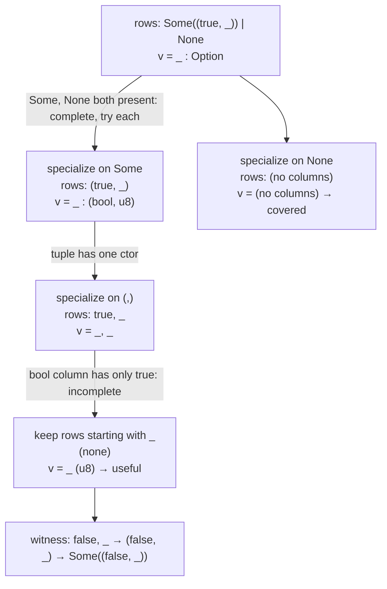
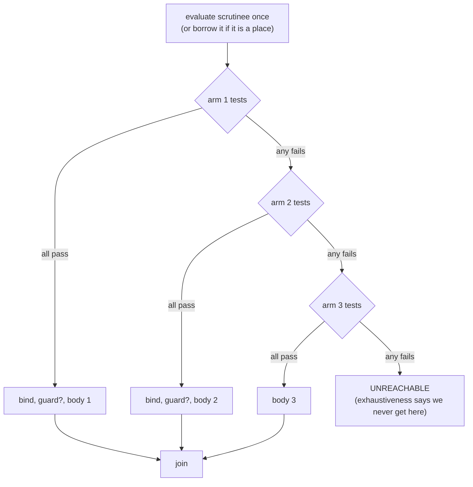

# 07 · Pattern Matching

Patterns are one of the features people miss most when they leave Rust. A `match` takes a value apart, tests its shape, and binds the pieces, all in one construct. The compiler then promises two things: every possible value is handled, and no arm is dead code.

Patterns show up in more places than `match`:

```rust
match msg { Msg::Move { x, y: 0 } => .., _ => .. }   // match arms
let (a, b) = pair;                                     // let
if let Some(n) = opt { .. }                            // if let
while let Some(top) = stack.pop() { .. }               // while let
for (i, item) in v.iter().enumerate() { .. }           // for
fn dist(&(x, y): &(f64, f64)) -> f64 { .. }            // fn parameters
```

Four stages of TSRust each do part of the work:

| Stage | Job | Where |
|-------|-----|-------|
| resolve | decide whether `None` is a constant or a new variable | `bindPattern` in [src/resolve/resolver.ts](../src/resolve/resolver.ts) |
| typeck | type the pattern, choose binding modes | `checkPat` in [src/typeck/check.ts](../src/typeck/check.ts) |
| typeck | exhaustiveness, unreachable arms, refutability | [src/typeck/exhaustive.ts](../src/typeck/exhaustive.ts) |
| borrowck | turn bindings into moves or loans | `bindPattern` in [src/borrowck/lower.ts](../src/borrowck/lower.ts) |
| codegen | compile tests and jumps | `testPattern` and `match` in [src/codegen/codegen.ts](../src/codegen/codegen.ts) |

The first stage is covered in [04-name-resolution.md](04-name-resolution.md). This chapter focuses on the rest.

## The pattern language

The parser produces this small set of pattern forms ([src/parser/ast.ts](../src/parser/ast.ts)):

```ts
export type Pattern =
  | ({ kind: "wild" } & Node)
  | ({ kind: "ident"; name: string; mutable: boolean; byRef: boolean; sub?: Pattern } & Node)
  | ({ kind: "lit"; value: Literal; negative: boolean } & Node)
  | ({ kind: "range"; lo: Literal; hi: Literal; inclusive: boolean } & Node)
  | ({ kind: "tuple"; elems: Pattern[] } & Node)
  /** A bare path such as `None` or `Color::Red`. */
  | ({ kind: "path"; path: Path } & Node)
  | ({ kind: "tupleStruct"; path: Path; elems: Pattern[] } & Node)
  | ({ kind: "struct"; path: Path; fields: { name: string; pat: Pattern; span: Span }[]; rest: boolean } & Node)
  | ({ kind: "ref"; mutable: boolean; inner: Pattern } & Node)
  | ({ kind: "or"; alts: Pattern[] } & Node);
```

| Syntax | Kind | Matches |
|--------|------|---------|
| `_` | `wild` | anything, binds nothing |
| `x`, `mut x`, `ref x`, `ref mut x` | `ident` | anything, binds it |
| `d @ 1..=9` | `ident` with `sub` | what `sub` matches, and binds the whole value |
| `42`, `-1`, `'a'`, `"hi"`, `true` | `lit` | an equal value |
| `1..=9`, `'a'..='z'`, `0..10` | `range` | a value in the range |
| `(a, _, 3)` | `tuple` | a tuple, element by element |
| `None`, `Color::Red` | `path` | a unit variant, unit struct or constant |
| `Some(x)`, `Meters(m)` | `tupleStruct` | a tuple variant or tuple struct |
| `Point { x, y: 0, .. }` | `struct` | a struct or struct-like variant |
| `&p`, `&mut p` | `ref` | a reference, then `p` against its target |
| `A \| B` | `or` | either alternative |

`if let` and `while let` aren't separate constructs. The parser desugars them into `match` and marks the result with a `source` field. `if let P = e { a } else { b }` becomes `match e { P => a, _ => b }`, and `while let` becomes a `loop` around such a match with `_ => break`. The `source` field matters later: unreachable-arm warnings are only emitted for real `match` expressions, since the synthetic `_` arm of an `if let` is often unreachable on purpose.

## Typing patterns and binding modes

`checkPat(p, expected, mode)` in [check.ts](../src/typeck/check.ts) walks the pattern alongside the type of the value being matched. Literals are unified with the expected type. A `tupleStruct` pattern looks up its constructor (recorded in `ctors`) and checks each sub-pattern against the substituted field type. A `struct` pattern additionally reports missing fields without `..` (E0027) and unknown fields (E0026). The details are in [05-type-checking.md](05-type-checking.md). What matters here is the **binding mode** each variable ends up with:

| Written | Matched against | Binding mode | Variable's type |
|---------|-----------------|--------------|-----------------|
| `x` | `T` | move (or copy) | `T` |
| `ref x` | `T` | ref | `&T` |
| `ref mut x` | `T` | refMut | `&mut T` |
| `Some(x)` | `&Option<T>` | ref (match ergonomics) | `&T` |
| `Some(x)` | `&mut Option<T>` | refMut (match ergonomics) | `&mut T` |
| `(t, mut m)` | `&(String, i32)` | `t`: ref, `m`: move (`mut` resets) | `&String`, `i32` |

The last row is a Rust 2021 rule that TSRust follows: `mut x` under a by-reference default mode resets the mode to move. Here are all of these together:

```rust
fn main() {
    let mut pair = (String::from("a"), 5);
    let (ref name, n) = pair;
    println!("{} {}", name, n);
    let (ref mut s, _) = pair;
    s.push('!');
    let r = &pair;
    let (t, mut m) = r;
    m += 1;
    println!("{} {}", t, m);
    match 7 {
        d @ 1..=9 => println!("digit {}", d),
        _ => {}
    }
}
```

```text
$ node src/cli.ts dump types bind2.rs
   2:9   mut pair: (String, i32)  (#8313)
   3:10  name: &String  (#8321)
   3:20  n: i32  (#8322)
   5:10  s: &mut String  (#8333)
   7:9   r: &(String, i32)  (#8344)
   8:10  t: &String  (#8349)
   8:13  mut m: i32  (#8350)
  12:9   d: i32  (#8368)
```

The results go into three side tables. `bindingModes` holds the mode per binding. `patDerefs` holds the number of references peeled by match ergonomics per pattern. `types` holds the type each pattern node matched *after* peeling.

## Exhaustiveness: the usefulness algorithm

A `match` must cover every value of the scrutinee's type. Checking that naively ("enumerate all values") is impossible for `i32` and wasteful for nested enums. TSRust uses the algorithm rustc uses, from Luc Maranget's paper *Warnings for pattern matching*. Everything rests on one question:

> **Usefulness.** Given a list of pattern rows (the arms so far), is there a value that a new row `v` matches but no existing row does?

Two answers follow from it:

- The `match` is **exhaustive** if and only if the wildcard row `_` is *not* useful after all the arms. If it is useful, the value it finds is the **witness** printed in the error.
- An arm is **unreachable** if and only if its row is *not* useful against the arms above it.

```ts
  checkMatch(e: Extract<A.Expr, { kind: "match" }>) {
    const ty = this.r.types.get(e.scrutinee.id);
    if (!ty || this.hasError(ty)) return;
    const rows: DPat[][] = [];
    for (const arm of e.arms) {
      const row = [this.lower(arm.pat, ty)];
      if (e.source === "match" && !this.useful(rows, row)) {
        this.diags.warning("typeck", arm.pat.span, "unreachable pattern").note("this arm can never match: earlier arms cover every value it matches");
      }
      if (!arm.guard) rows.push(row);
    }
    const witness = this.useful(rows, [{ kind: "wild", ty }]);
```

Note the `if (!arm.guard)` line. An arm with a guard might not match even when its pattern does, so it can't help cover anything. It is still checked for reachability, though.

This check runs only after type checking has succeeded for the whole program (`if (!diags.hasErrors)` in [index.ts](../src/typeck/index.ts)), because it needs fully resolved types.

### Patterns as constructors

First, `lower` translates each AST pattern into a simpler **deconstructed pattern**. It is either a wildcard, an or-pattern, or a *constructor* applied to sub-patterns:

```ts
type Ctor =
  | { kind: "variant"; index: number }
  | { kind: "single" } // structs, tuples, references
  | { kind: "bool"; value: boolean }
  | { kind: "range"; lo: number; hi: number } // ints and chars (as code points)
  | { kind: "str"; value: string }
  | { kind: "opaque" }; // matches nothing we can reason about (floats, consts)

type DPat = { kind: "wild"; ty: Ty } | { kind: "ctor"; ctor: Ctor; fields: DPat[]; ty: Ty } | { kind: "or"; alts: DPat[]; ty: Ty };
```

The lowering is uniform:

- `Some(x)` becomes `variant#1(_)`. A *binding* is just a wildcard as far as coverage goes.
- `(true, n)` becomes `single(bool true, _)`.
- `Point { y: 0, .. }` becomes `single(_, range 0..=0)`, with the unmentioned fields filled in as wildcards.
- A match-ergonomics pattern `Some(s)` against `&Option<String>` is re-wrapped as an explicit reference constructor, `single(variant#1(_))`. That is why witnesses for references print with a leading `&`.

Each type also has a list of all its constructors (`allCtors`). For `bool` that is `false` and `true`. For an enum it is one per variant. For structs, tuples and references it is the single constructor `single`. For `!` it is the empty list. For integers, floats, strings and std's native types (`Vec`, `String`, ...) the answer is `undefined`, meaning "infinitely many". Only a wildcard covers those completely.

### Specialization

The algorithm works on a **matrix**: one row per arm, one column per value still being examined. At first there is one column, the scrutinee. **Specializing** the matrix by a constructor `c` asks: "suppose the value in the first column was built with `c`; what remains to be matched?" Rows that start with `c` keep `c`'s fields as new columns. Rows that start with a wildcard get one wildcard per field. Rows starting with a different constructor are dropped:

```ts
  private specialize(rows: DPat[][], c: Ctor, arity: number, fieldTys: Ty[]): DPat[][] {
    const out: DPat[][] = [];
    for (const row of rows) {
      const head = row[0];
      if (head.kind === "wild") out.push([...fieldTys.slice(0, arity).map((t): DPat => ({ kind: "wild", ty: t })), ...row.slice(1)]);
      else if (head.kind === "ctor" && this.covers(head.ctor, c)) out.push([...head.fields, ...row.slice(1)]);
    }
    return out;
  }
```

`useful(rows, v)` recurses on the first column of `v`:

1. **No columns left:** `v` is useful exactly when there are no rows. Some row matched everything, so the answer is no.
2. **`v` starts with a constructor `c`:** specialize both `rows` and `v` by `c` and recurse.
3. **`v` starts with a wildcard:** look at the constructors in the first column of `rows`.
   - If they form a **complete** set (every constructor of the type appears), try each constructor in turn, specialize, and recurse. `v` is useful if any branch finds a witness.
   - Otherwise some constructor is missing. Only rows starting with a wildcard can cover it, so recurse on those rows with the first column dropped. If that finds a witness, prefix it with the missing constructor, or with `_` for infinite types.

The witness is rebuilt on the way back up, wrapping the fields that the recursion found in the constructor that was specialized.

### A worked example

```rust
fn f(o: Option<(bool, u8)>) -> u8 {
    match o {
        Some((true, n)) => n,
        None => 0,
    }
}
```



```text
error[E0004]: non-exhaustive patterns: `Some((false, _))` not covered
 --> witness.rs:2:11
  |
2 |     match o {
  |           ^ pattern `Some((false, _))` not covered
  = note: the matched value is of type `Option<(bool, u8)>`
  = help: ensure that all possible cases are being handled by adding a match arm with a wildcard pattern or an explicit pattern `Some((false, _)) => todo!()`
```

Witnesses read naturally because `show` prints them in Rust syntax. Variants of `Option` and `Result` are unqualified (they're in the prelude), struct-like variants print as `Name { .. }`, and the match-ergonomics reference shows up as `&`:

```text
error[E0004]: non-exhaustive patterns: `&Shape::Rect { .. }` not covered
 --> enumw.rs:4:11
  |
4 |     match s {
  |           ^ pattern `&Shape::Rect { .. }` not covered
  = note: the matched value is of type `&Shape`
```

### Infinite types and guards

For an integer, the first column is never complete, so only a wildcard or binding can finish the match. The witness is plain `_`:

```text
error[E0004]: non-exhaustive patterns: `_` not covered
 --> ints.rs:2:11
  |
2 |     match n {
  |           ^ pattern `_` not covered
  = note: the matched value is of type `u8`
```

Guards are ignored for coverage, so this is rejected even though the guards obviously cover every `i32`. rustc rejects it too, because it doesn't reason about guard expressions:

```rust
fn sign(n: i32) -> i32 {
    match n {
        x if x < 0 => -1,
        x if x >= 0 => 1,
    }
}
```

### Unreachable arms

```rust
fn f(p: (bool, bool)) -> u8 {
    match p {
        (true, _) => 1,
        (false, true) => 2,
        (_, true) => 3,
        _ => 4,
    }
}
```

By the third arm, every value with `true` in the second position is already handled. The arm `(_, true)` is checked against the first two rows, and it is not useful:

```text
warning: unreachable pattern
 --> unreach.rs:5:9
  |
5 |         (_, true) => 3,
  |         ^^^^^^^^^
  = note: this arm can never match: earlier arms cover every value it matches
```

It is a warning, not an error, so the program still runs (and prints `4` for `(false, false)`).

## Refutability (E0005)

A `let`, a `for` loop or a function parameter has no second arm to fall back on. Its pattern must be **irrefutable**: it must match every value. That is the same question as exhaustiveness for a one-arm match:

```ts
  checkIrrefutable(p: A.Pattern, ty: Ty | undefined, what: string) {
    if (!ty || this.hasError(ty)) return;
    const witness = this.useful([[this.lower(p, ty)]], [{ kind: "wild", ty }]);
```

`walkPatterns` in [index.ts](../src/typeck/index.ts) calls it for every `let`, every `for` binding and every parameter:

```text
error[E0005]: refutable pattern in local binding: `None` not covered
 --> e0005.rs:3:9
  |
3 |     let Some(x) = opt;
  |         ^^^^^^^
  = note: `let` bindings require an "irrefutable pattern", one that matches every possible value
  = help: use `if let` or `match` to handle the other cases
```

## Bindings in the borrow checker

The borrow checker ([08-ownership-and-borrowing.md](08-ownership-and-borrowing.md)) needs to know what each binding does to the matched value. Its `bindPattern` follows the pattern into **places**, such as `_2.<v1>0` for "field 0 of variant 1 of local 2". It then emits either a move/copy or a loan, depending on the binding mode:

```ts
        const mode = this.r.bindingModes.get(p.id) ?? "move";
        const valTy = this.r.types.get(p.id) ?? ty;
        if (mode === "move") {
          this.assign({ local, proj: [] }, { k: "use", op: this.operand(place, valTy) }, p.span);
        } else {
          const l = this.loan(place, mode === "refMut", p.span);
          this.assign({ local, proj: [] }, { k: "ref", mutable: mode === "refMut", place, loan: l }, p.span);
        }
```

This is why `match &opt { Some(s) => .. }` doesn't move out of `opt`. The type checker chose `ref`, and the borrow checker turns that into a shared loan of `opt`'s payload instead of a move.

The MIR for a match doesn't contain the tests themselves. The borrow checker only needs to know that *some* arm runs, so `lowerMatch` emits an `inspect` of the scrutinee (a read) and a `switch` to every arm:

```text
    bb0: {
        _1 = {const};
        _2 = copy _1;
        inspect(_2);
        switch -> [bb1, bb2, bb3];
    }

    bb2: {
        _4 = copy _2.<v1>0;
        _3 = copy _4;
        StorageDead(_4);
        goto -> bb4;
    }
```

## Compiling a match to tests and jumps

The code generator ([10-code-generation.md](10-code-generation.md)) compiles a `match` as a sequence of arms. Each arm is a series of tests that jump to the *next* arm on failure:



```ts
    for (const arm of e.arms) {
      this.depth = base;
      const fails: number[] = [];
      this.declarePattern(arm.pat);
      this.testPattern(arm.pat, place, fails);
      if (arm.guard) {
        this.expr(arm.guard);
        fails.push(this.jump(Op.JUMP_IF_FALSE));
      }
      this.expr(arm.body);
      ends.push(this.jump(Op.JUMP));
      for (const f of fails) this.patch(f);
    }
    this.depth = base;
    this.emit(Op.UNREACHABLE);
```

`testPattern` walks the pattern recursively, keeping a *place* (a slot plus a path of field and deref projections) for the sub-value it is examining. Each kind of pattern emits its own test:

| Pattern | Emitted test |
|---------|--------------|
| `_` | nothing |
| `x` | no test; `LOAD`/`STORE` (or take a reference, for `ref` modes) into the variable's slot |
| literal | load, push constant, `EQ`, `JUMP_IF_FALSE` |
| range | two comparisons (`GE`, then `LE` or `LT`), each with `JUMP_IF_FALSE` |
| variant | load, `GET_TAG`, compare with the variant index, `JUMP_IF_FALSE`, then the fields |
| struct / tuple | no test of its own; recurse into fields |
| constant | load, push the constant, `DEEP_EQ` |
| `A \| B` | try `A`; on success jump to the end; `A`'s failures fall into `B` |

The failure jumps are collected in `fails` and patched to the start of the next arm. In an irrefutable context (`let`, parameters, `for`), `fails` is `undefined`, and `testPattern` emits no tests at all. It only binds.

Here is the bytecode for a small match. The source-location comment lines have been removed from the `dump bytecode` output; everything else is as printed:

```rust
let o = Some(7);
let r = match o {
    Some(0) => 100,
    Some(n) => n,
    None => -1,
};
```

```text
    12  REF_LOCAL     1
    14  STORE         2
    16  LOAD          2
    18  LOAD_REF      
    19  GET_TAG       
    20  CONST         1
    22  EQ            
    23  JUMP_IF_FALSE -> 39
    25  LOAD          2
    27  LOAD_REF      
    28  GET_FIELD     0
    30  CONST         0
    32  EQ            
    33  JUMP_IF_FALSE -> 39
    35  CONST         100
    37  JUMP          -> 75
    39  LOAD          2
    41  LOAD_REF      
    42  GET_TAG       
    43  CONST         1
    45  EQ            
    46  JUMP_IF_FALSE -> 59
    48  LOAD          2
    50  LOAD_REF      
    51  GET_FIELD     0
    53  STORE         3
    55  LOAD          3
    57  JUMP          -> 75
    59  LOAD          2
    61  LOAD_REF      
    62  GET_TAG       
    63  CONST         0
    65  EQ            
    66  JUMP_IF_FALSE -> 74
    68  CONST         1
    70  NEG           i32
    72  JUMP          -> 75
    74  UNREACHABLE   
    75  STORE         4
```

Reading it:

- **12–14:** `o` is a place, so the generator stores a *reference* to it in slot 2 instead of copying the value. Bindings by reference can then point into the original.
- **16–33:** arm 1. Check the tag is 1 (`Some`; `None` is variant 0 in [std/src/option.rs](../std/src/option.rs)), then check field 0 equals 0. Either failure jumps to 39.
- **39–57:** arm 2 re-tests the tag. The tests are not shared between arms. Then `n` is bound by storing field 0 into slot 3.
- **59–72:** arm 3 tests for tag 0.
- **74:** the `UNREACHABLE` trap that every match ends with. Exhaustiveness checking guarantees it never runs.

The VM that executes these instructions is described in [12-the-vm.md](12-the-vm.md).

### Or-patterns and shared slots

In `Some(1) | Some(2)`, or in `(x, 0) | (0, x)`, each alternative is a separate sub-pattern, but they must bind the *same* variables (the resolver enforces this, E0408). `declarePattern` gives each name a single slot shared by all alternatives, so the arm body reads `x` from one place no matter which alternative matched. The or-pattern compiles to "try alternative 1; on success jump past the others; on failure fall into alternative 2; ...", with the last alternative's failure becoming the whole pattern's failure.

## Where TSRust differs from rustc

- **No integer range exhaustiveness.** rustc splits integer ranges and knows that `0..=127` and `128..=255` cover all of `u8`. TSRust treats integers (and `char`) as infinite, so that match is rejected:

  ```text
  error[E0004]: non-exhaustive patterns: `_` not covered
   --> u8full.rs:2:11
    |
  2 |     match n {
    |           ^ pattern `_` not covered
    = note: the matched value is of type `u8`
  ```

  Overlapping ranges are only recognized when one range contains the other entirely (`covers`), so some unreachable range arms go unreported.
- **Constants and floats are opaque.** A `const` or float pattern never counts towards coverage. rustc looks inside constants of enum and struct types.
- **No slice, box or rest-in-tuple patterns.** TSRust has no arrays or slices, so `[first, .., last]` doesn't exist, and `(a, ..)` and `Some(..)` aren't parsed. `..` works only in struct patterns.
- **No `let ... else`.** The parser rejects it with an error.
- **Naive code generation.** rustc lowers a match to a *decision tree* that tests each discriminant at most once. TSRust tests arms one after another, re-reading the tag in each arm. The result is correct and easy to follow, but slower for large matches.
- **Binding before guards.** TSRust performs an arm's bindings (including moves) before evaluating its guard. rustc binds by reference while the guard runs and only moves once the guard succeeds. The difference is only visible in programs that move a value in an arm whose guard then fails.
- **Witness choice.** When several values are missing, rustc lists up to three (`` `B` and `C` not covered ``). TSRust reports the first one it finds.

## Try it

```sh
node src/cli.ts check examples/errors/E0004_non_exhaustive.rs
node src/cli.ts run examples/05_enums_match.rs
node src/cli.ts dump bytecode examples/05_enums_match.rs
node src/cli.ts dump mir examples/05_enums_match.rs
```

In the playground:

1. Load the enums-and-match example and delete one arm. The **Diagnostics** tab shows the witness. Delete two and see which one is reported.
2. Nest the patterns: match on `Option<Result<bool, u8>>` with a few arms and try to predict the witness before reading it.
3. Write `match x { _ => 0, 1 => 1 }` and read the unreachable-pattern warning.
4. Compare the **Bytecode** tab for `match n { 1 => .., 2 => .., _ => .. }` with the same match written as `if n == 1 { .. } else if n == 2 { .. }`.
5. Match on `&v` where `v: Option<String>` and check the binding in **Types** (`&String`) and the loan in **MIR**.

## Exercises

1. **Integer range splitting.** Give integer types a finite constructor set in `allCtors`: split the type's full range (`0..=255` for `u8`, and so on) at every boundary that appears in the first column, as rustc does. Update `covers` and the witness printer. Then the `u8full.rs` example compiles and unreachable range arms are reported. Start in [src/typeck/exhaustive.ts](../src/typeck/exhaustive.ts).
2. **Report several witnesses.** Change `useful` to return a list of witnesses (up to three) for the top-level wildcard, and format them as rustc does: `` `A`, `B` and `C` not covered ``.
3. **`..` in tuple patterns.** Parse `(a, .., z)` and `Some(..)` in `parsePatternAtom` in [src/parser/parser.ts](../src/parser/parser.ts). Then expand the rest into wildcards in `checkPat`, the lowering in `exhaustive.ts`, and `testPattern`, using the tuple's arity from the type.
4. **Decision trees.** Rewrite `FnCompiler.match` in [src/codegen/codegen.ts](../src/codegen/codegen.ts) so that consecutive arms testing the same enum share one `GET_TAG`, followed by a jump to the first arm that could match each tag. Measure the instruction counts with `dump bytecode` before and after.
5. **`let ... else`.** Support `let PAT = EXPR else { DIVERGING };`. Desugar it in the parser like `if let`, check that the else block has type `!`, and skip the E0005 refutability check for it.
