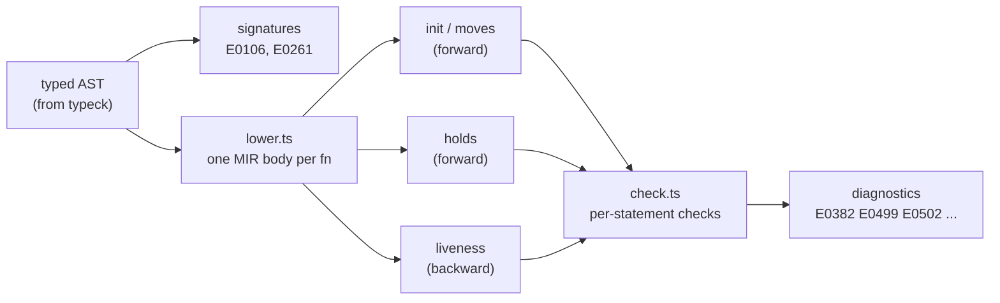
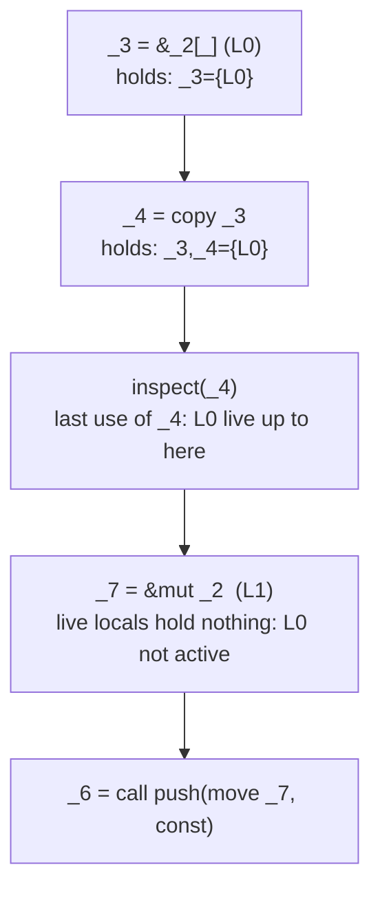
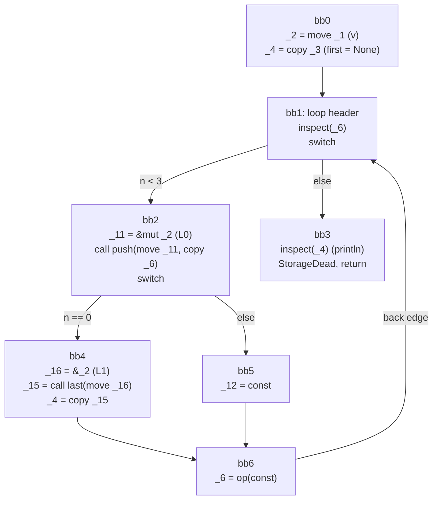
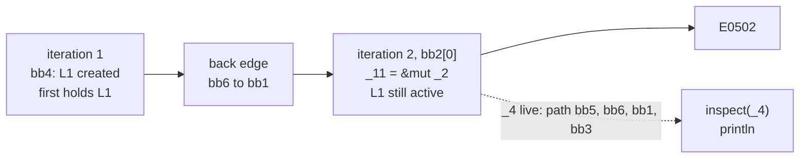

# 08 · Ownership and Borrowing

Every earlier stage of TSRust has a counterpart in compilers for other languages. Lexers, parsers, name resolution and type inference all existed long before Rust. This chapter covers the part that is specific to Rust: the **borrow checker**. It is the pass that rejects a program because a `String` was used after it was moved, or because a vector was pushed to while something still pointed into it.

The borrow checker lives in four files:

| File | Role |
|------|------|
| [src/borrowck/index.ts](../src/borrowck/index.ts) | Entry point: checks signatures, then lowers and checks each function |
| [src/borrowck/mir.ts](../src/borrowck/mir.ts) | The data structures: MIR bodies, places, operands, loans |
| [src/borrowck/lower.ts](../src/borrowck/lower.ts) | Turns the typed AST of one function into MIR |
| [src/borrowck/check.ts](../src/borrowck/check.ts) | Dataflow analyses and the actual error checks |

Lifetimes in function signatures (`signature.ts`) get their own chapter, [09-lifetimes.md](09-lifetimes.md). This chapter treats a call's effect on borrows as a given and covers everything else.

## The rules being enforced

Some Rust first, since the checker can only be understood in terms of the rules it enforces.

**Ownership.** Every value has exactly one owner. Assigning or passing a non-`Copy` value *moves* it, and the old variable can no longer be used:

```rust
let s = String::from("hello");
let t = s;                 // ownership moves to t
println!("{} {}", s, t);   // error: s was moved
```

Types like `i32`, `bool` and `&T` implement `Copy`. Reading them duplicates the bits and leaves the original usable. For `Copy` types a "move" is just a copy.

**Borrowing.** Instead of moving, you can lend a value out with `&` (shared) or `&mut` (mutable). At every point in the program, a value may have either:

- any number of shared borrows, or
- exactly one mutable borrow,

and while borrowed it can't be moved or overwritten. People call this "aliasing XOR mutability". It is what lets Rust promise that a `&Vec<i32>` will not be invalidated by a `push` somewhere else.

**Non-lexical lifetimes (NLL).** A borrow only lasts until its last use, not until the end of the enclosing `{}` block:

```rust
let mut v = vec![1, 2, 3];
let first = &v[0];
println!("first is {}", first);  // last use of `first`
v.push(4);                       // fine: the borrow is over
```

Move the `println!` below the `push` and the program is rejected. Most of this chapter explains how the checker tells those two programs apart.

## Why not check the AST directly?

The AST is a tree, and borrows don't follow its shape. Take an `if` without an `else` inside a `while` loop. A value can be moved on one branch and used after the join, or borrowed late in one iteration and used early in the next. Answering "is this borrow still in use here?" means following every path execution can take, including loop back edges and early `return`s.

So TSRust does what rustc does. It first **lowers** each function into a *control-flow graph* (CFG) of very simple statements, called **MIR** (Mid-level IR). Each node of the graph is a **basic block**: a straight-line list of statements ending in one **terminator** that says where control goes next (`goto`, `switch`, `return`). Once the program is in this form, the questions above become standard *dataflow analysis* over a graph. Compilers have been doing that kind of analysis since the 1970s.



The driver in [src/borrowck/index.ts](../src/borrowck/index.ts) is short. It checks every signature first. As in rustc, a signature error stops the pass before any body is examined:

```ts
  sigs.checkAll();
  // Like rustc, signature errors (E0106) stop us before checking bodies.
  if (diags.errors().length > before) return { bodies, mirText: () => "" };
```

Then, for each function body outside `std`, it builds a `Lowerer`, lowers the function, and runs a `BodyChecker` on the result. The standard library is trusted and skipped, much as rustc doesn't re-check your dependencies.

## The vocabulary of MIR

[src/borrowck/mir.ts](../src/borrowck/mir.ts) defines everything in about a hundred lines. The core ideas:

- A **local** (`_0`, `_1`, ...) is a variable or a compiler temporary. `_0` is the return place and `_1.._n` are the arguments.
- A **place** is a local plus a path of **projections**: a field (`.next`), a dereference (`*`), or an index (`[_]`). Places are the things that can be borrowed, moved from and assigned to.
- An **operand** reads a place, either by `copy` or by `move`, or is a `const`.
- Each `&` or `&mut` creates a numbered **loan**: which place was borrowed, whether mutably, and where.

```ts
export type Projection =
  | { k: "deref"; via: "ref" | "refMut" | "box" | "other" }
  | { k: "field"; index: number; variant?: number; name?: string }
  | { k: "index" };

export interface Place {
  local: Local;
  proj: Projection[];
}
```

There are only three statement kinds: `assign` (a place gets an rvalue), `inspect` (a place is read without being moved, as by a `match` scrutinee or a `println!` argument), and `dead` (a variable's scope ended, printed as `StorageDead`). The rvalues are just as few: `use` an operand, take a `ref`, build an `aggregate` (struct, tuple, `vec!`), make a `call`, or a `pure` operation such as arithmetic, whose result can never hold a borrow.

All index expressions are collapsed into a single `[_]` projection. The checker never knows *which* element is borrowed, only that some element of `v` is. That is why `&mut v[0]` and `&mut v[1]` conflict, in TSRust and in rustc.

You can see MIR for any program that type-checks with `node src/cli.ts dump mir file.rs`. It prints the MIR even when the borrow checker reports errors, so you can look at exactly what the checker saw. Here is the passing NLL example from above:

```rust
fn main() {
    let mut v = vec![1, 2, 3];
    let first = &v[0];
    println!("first is {}", first);
    v.push(4);
    println!("{:?}", v);
}
```

```text
fn nll::main {
    let mut _0: ();  // return place
    let mut _1: Vec<i32>;  // temp
    let mut _2: Vec<i32>;  // v
    let mut _3: &i32;  // temp
    let _4: &i32;  // first
    let mut _5: ();  // temp
    let mut _6: ();  // temp
    let mut _7: &mut Vec<i32>;  // temp
    let mut _8: ();  // temp

    bb0: {
        _1 = {const, const, const};
        _2 = move _1;
        _3 = &_2[_]  // loan L0;
        _4 = copy _3;
        inspect(_4);
        _5 = op();
        _7 = &mut _2  // loan L1;
        _6 = call push(move _7, const);
        inspect(_2);
        _8 = op();
        _0 = const;
        StorageDead(_4);
        StorageDead(_2);
        return;
    }

    bb1: {
        unreachable;
    }
}
```

Things to notice:

- `vec![1, 2, 3]` is an `aggregate` written into a temporary, then *moved* into `v`, because `Vec<i32>` is not `Copy`.
- `&v[0]` is the loan `L0` on the place `_2[_]`. `first` (`_4`) gets a *copy* of the reference, since `&i32` is `Copy`.
- `println!` became `inspect(_4)` followed by an opaque `op()`. Format arguments are read by reference and never moved.
- `v.push(4)` became an explicit mutable loan `L1` on `_2` followed by a `call`. The method's auto-borrow is spelled out.
- At the end of the block, `StorageDead` marks each user variable's scope ending, in reverse declaration order.
- The trailing `bb1: unreachable` is a leftover. The lowerer always opens a fresh block after a terminator, and if nothing jumps to it the checker ignores it (it only visits blocks reachable from `bb0`).

## Lowering: the decisions that matter

[src/borrowck/lower.ts](../src/borrowck/lower.ts) walks the typed AST and emits statements. Most of it is bookkeeping, but a few decisions directly determine what the borrow checker can see.

### Copy or move

Every read of a place goes through one helper:

```ts
  private operand(place: Place, ty: Ty): RefOperand {
    return { k: this.isCopy(ty) ? "copy" : "move", place, refs: this.mayHoldRefs(ty) };
  }
```

`isCopy` asks the trait solver from the type checker whether the type implements `Copy`. The `refs` flag records whether the value *could contain a borrow* (a reference, a struct with a lifetime parameter, a generic). The checker only bothers tracking loans through values that can hold them.

### Places stay places

`match x { .. }`, `&v[i]`, `p.field` and `*r` all name existing memory, so `lowerPlace` turns them into a place with projections instead of copying the value into a temporary. This matters. If `&p.a` borrowed a temporary copy of `p.a`, the checker could never notice that it overlaps with a later `p = ...`. Anything that is *not* a place, like a call result, is evaluated into a fresh temporary local, and that temporary is the place.

### Auto-ref and auto-deref become explicit

Rust lets you write `v.len()` where `len` takes `&self`, and `r.field` where `r` is a reference. The type checker records these *adjustments* (see [05-type-checking.md](05-type-checking.md)), and the lowerer turns them into explicit `*` projections and explicit loans. In the MIR above, `v.push(4)` became `_7 = &mut _2` with a loan. The loan is marked `implicit`, which is how diagnostics can say "(implicitly, for this method call on `v`)".

### Two-phase borrows

`v.push(v.len())` is legal Rust, but read naively it borrows `v` mutably for `push` and then shared for `len` while the mutable borrow is alive. rustc accepts it using *two-phase borrows*: the `&mut v` is reserved first and only activated when the call actually happens. TSRust gets the same result with a simpler trick. It evaluates the arguments **before** creating the receiver's borrow:

```ts
    // Arguments first, then the receiver's auto-borrow (two-phase borrows).
    const args = e.args.map((a) => this.lowerArg(a));
```

The MIR for `v.push(v.len())` shows the order:

```text
        _5 = &_2  // loan L0;
        _4 = call len(move _5);
        _6 = &mut _2  // loan L1;
        _3 = call push(move _6, copy _4);
```

By the time `L1` exists, `len` has returned a `usize` that holds no borrow, so `L0` is no longer live and nothing conflicts.

### Implicit reborrows of `&mut` arguments

`&mut T` is not `Copy`. If passing `v: &mut Vec<i32>` to a function moved it, this would fail on the second line:

```rust
fn f(v: &mut Vec<i32>) { v.push(1); v.push(2); g(v); g(v); }
```

Rust inserts a *reborrow* `&mut *v` at each such use. TSRust does the same in `lowerArg` (for arguments) and `lowerMethodCall` (for receivers): a `&mut`-typed place is never moved into a call. Instead a fresh loan of `(*v)` is taken:

```text
fn reborrow::f {
    ...
    bb0: {
        _3 = &mut (*_1)  // loan L0;
        _2 = call push(move _3, const);
        _5 = &mut (*_1)  // loan L1;
        _4 = call g(move _5);
        _7 = &mut (*_1)  // loan L2;
        _6 = call g(move _7);
        _0 = const;
        return;
    }
```

`_1` is only ever reborrowed and never moved, so it stays usable.

This does not apply to `let`. `let mut slot = head;` really does move the `&mut` out of `head`, exactly as in rustc.

### Scope ends become `dead`

At the end of every block, `endScope` emits a `dead` statement for each variable declared in it, innermost first:

```ts
  private endScope(span: Span) {
    const scope = this.scopes.pop() ?? [];
    for (let i = scope.length - 1; i >= 0; i--) this.emit({ k: "dead", local: scope[i], span: { ...span, start: Math.max(span.start, span.end - 1) } });
  }
```

The span is the block's closing `}`. That is where "`x` dropped here while still borrowed" points when a reference outlives its referent. That error (E0597) is covered in [09-lifetimes.md](09-lifetimes.md).

`break`, `continue` and `return` leave scopes early, without reaching the closing `}`. Each loop records the scope `depth` at which it started, and before its `goto` an early exit calls `exitScopes`, which emits `dead` for every scope above that depth (above 0 for `return`). The scopes stay on the stack, because the code after the `break` in the same block is still lowered inside them:

```ts
  private exitScopes(depth: number, span: Span) {
    for (let i = this.scopes.length - 1; i >= depth; i--) {
      const scope = this.scopes[i];
      for (let j = scope.length - 1; j >= 0; j--) this.emit({ k: "dead", local: scope[j], span });
    }
  }
```

Here the span is the `break` itself. So in `let r; loop { let x = 1; r = &x; break; } println!("{}", r);`, the E0597 says "`x` dropped here while still borrowed" under `break`.

## Three dataflow analyses

[src/borrowck/check.ts](../src/borrowck/check.ts) computes three facts for every program point. Each is a *dataflow analysis*: a per-statement **transfer function** says how a statement changes the fact, and a **join** says how facts combine where control-flow edges meet. A worklist re-runs blocks until nothing changes. That state is a **fixed point**, and reaching it is what makes loops work: a fact produced at the bottom of a loop flows along the back edge to the top, which may change the top, and so on until it stabilizes.

| Analysis | Direction | Fact | Join |
|----------|-----------|------|------|
| init/moves | forward | which places are *maybe moved*, *maybe uninitialized* or *maybe initialized* | union |
| holds | forward | for each local, which loans it may be carrying | union per local |
| liveness | backward | which locals may still be read later | union |

All three joins are unions, so the analyses are *conservative*. If something is moved on *any* incoming path, it counts as maybe-moved. That is exactly what Rust requires: using a value moved on only one branch is still an error.

The generic forward solver is `forward<S>()`. You pass it an entry state, a bottom state, `join`, `transfer`, `eq` and `clone`, and it iterates a worklist until no block's out-state changes:

```ts
      const prev = outStates.get(b);
      if (!prev || !eq(prev, st)) {
        outStates.set(b, st);
        for (const s of this.succs(b)) if (!queued.has(s)) { queued.add(s); work.push(s); }
      }
```

### 1. Init and moves (forward)

The state is a map of *move paths* (strings like `"3"`, `"3.f0"`, `"3.f0.*"`) to the span where each was moved, plus two sets of locals: `uninit` (maybe uninitialized) and `init` (maybe initialized). Both are unions at joins, so after `let x; if c { x = 1; }` the local `x` is in both. A local that is in `uninit` but not `init` is *definitely* uninitialized. `pathKeys` turns a place into its prefixes. It stops at a dereference of a reference or at an index, because you can't move out from behind those (that's E0507, below). A dereference of a `Box` *is* a move path, since a box owns its contents.

The transfer function:

- `move p` marks `p`'s path moved.
- Assigning to `p` clears "moved" for `p` and everything under it. So `let t = s; s = String::from("b");` makes `s` usable again. Assigning a whole local also removes it from `uninit` and adds it to `init`.
- `dead x` marks `x` uninitialized (and not initialized) and forgets its moves.

Because the state records *fields*, moving `p.a` and then using `p.b` is fine. Using all of `p` afterwards is a "partial move" error:

```text
error[E0382]: use of partially moved value: `p`
```

### 2. Holds (forward)

This analysis is the core of TSRust's design. For each local it tracks the set of loans whose reference **may currently be stored in that local**. `_3 = &_2[_]` puts `L0` into `holds(_3)`. `_4 = copy _3` copies it into `holds(_4)`. Aggregates take the union of their operands. Calls inherit loans according to the callee's signature (the `ArgFlow` summary from [09-lifetimes.md](09-lifetimes.md)):

```ts
      case "call": {
        const out = new Set<number>();
        if (!this.h.mayHoldRefs(destTy)) return out;
        rv.ops.forEach((op, i) => {
          if (op.k === "const") return;
          const flow = rv.flows[i] ?? "full";
          if (flow === "none") return;
          let src = op.place.local;
          if (flow === "inner") {
            const borrowed = this.h.borrowOf.get(op.place.local);
            if (borrowed) src = borrowed.local;
          }
          for (const l of st.get(src) ?? []) out.add(l);
        });
        return out;
      }
```

So `v.len()` returns a `usize`, which can't hold a borrow, and the result holds nothing. `v.first()` returns `Option<&T>` tied to `&self`, so its result holds the loan on `v`.

One more rule: taking a reference *through* a reference (`&mut (*_8).next`) also inherits whatever `_8` holds. A reborrow keeps the original loan alive.

### 3. Liveness (backward)

A local is **live** at a point if some path from that point reads it before overwriting it. This is the textbook backward analysis:

```ts
  private liveTransfer(s: Statement, live: Set<Local>): Set<Local> {
    const out = new Set(live);
    if (s.k === "assign" && s.dest.proj.length === 0) out.delete(s.dest.local);
    for (const u of this.uses(s)) out.add(u);
    return out;
  }
```

Walking backward, an assignment to the whole local kills it, and every read makes it live. `return` makes `_0` live. Writing *through* a reference (`(*r).x = ..`) counts as a use of `r`.

### NLL falls out

Combine the last two and you get non-lexical lifetimes:

> A loan is **live** at a point if some local that is live after that point holds it.

`checkStatement` computes exactly that set before checking each statement:

```ts
    const active = new Map<number, Local[]>();
    for (const l of liveAfter) {
      for (const loan of holds.get(l) ?? []) {
```

In the passing MIR above, `L0` is held by `_3` and `_4`. After `inspect(_4)`, nothing reads `_3` or `_4` again, so neither is live, and `L0` is not active when `_7 = &mut _2` creates `L1`. Move the `println!` below the `push` and `_4` is still live at `_7 = &mut _2`, so `L0` is active and conflicts.



## Places overlap: the access rules

When a statement accesses a place, the checker compares it against every active loan. Two places can only conflict if they **overlap**:

```ts
  private overlaps(a: Place, b: Place): boolean {
    if (a.local !== b.local) return false;
    const n = Math.min(a.proj.length, b.proj.length);
    for (let i = 0; i < n; i++) {
      const x = a.proj[i], y = b.proj[i];
      if (x.k !== y.k) return true; // be conservative
      if (x.k === "field" && y.k === "field" && (x.index !== y.index || x.variant !== y.variant)) return false;
    }
    return true;
  }
```

One place being a prefix of the other means they overlap: `s` and `s.a`, or `v` and `v[_]`. Different fields of the same struct diverge and don't, which is why this compiles:

```rust
let mut t = (1, 2);
let a = &mut t.0;
let b = &mut t.1;   // fine: t.0 and t.1 are disjoint
*a += 1; *b += 1;
```

The same reasoning explains why calling a method like `p.a()` borrows *all* of `p`. The loan is on the receiver place `p`, and that overlaps `p.b`. rustc behaves the same way.

Given an overlapping active loan, whether the access conflicts depends on the two kinds. Shared loans only object to accesses that mutate:

```ts
      const accessMutates = a.kind === "move" || a.kind === "write" || (a.kind === "borrow" && a.mutable);
      if (!loan.mutable && !accessMutates) continue;
```

What remains maps onto error codes:

| Access at the statement | Active loan | Error | Message |
|-------------------------|-------------|-------|---------|
| `&mut` borrow | mutable | E0499 | cannot borrow `v` as mutable more than once at a time |
| `&` / `&mut` borrow, or `inspect` | the other kind | E0502 | cannot borrow `v` as mutable because it is also borrowed as immutable |
| plain read (`copy`) | mutable | E0503 | cannot use `x` because it was mutably borrowed |
| `move` | any | E0505 | cannot move out of `s` because it is borrowed |
| assignment | any | E0506 | cannot assign to `x` because it is borrowed |

Every one of these also says *where the borrow is later used*. `findLaterUse` does a breadth-first walk forward from the statement and reports the first statement that reads one of the locals holding the loan:

```text
error[E0499]: cannot borrow `scores` as mutable more than once at a time
 --> examples/errors/E0499_two_mutable_borrows.rs:6:13
  |
5 |     let a = &mut scores;
  |             ----------- first mutable borrow occurs here
6 |     let b = &mut scores;
  |             ^^^^^^^^^^^ second mutable borrow occurs here
7 |     a.push(30);
  |     ---------- first borrow later used here
```

## Errors about moves and initialization

These come from the init/moves state, checked for every access except a write.

**E0382, use after move.** The access's path, or one of its prefixes, is in the maybe-moved set. Moves inside loops get a special message. If the recorded move is at or after the access in the source, the move must have come around the back edge:

```ts
        const inLoop = moveSpan.start >= a.span.start;
        if (moveSpan.start === a.span.start && moveSpan.end === a.span.end) {
          b.diag.labels[0].message = "value moved here, in previous iteration of loop";
```

```text
error[E0382]: use of moved value: `s`
 --> loopmove.rs:4:9
  |
4 |         drop(s);
  |         ^^^^^^^ value moved here, in previous iteration of loop
  = note: move occurs because `s` has type `String`, which does not implement the `Copy` trait
```

The checker found this with no special loop logic. On the first pass the loop body sees `s` initialized. The move flows around the back edge, the loop header's in-state changes, and on the second pass `drop(s)` reads a maybe-moved `s`.

**E0381, use of an uninitialized binding.** `let x: i32;` declares `x` without a value. Locals other than the arguments start in the `uninit` set, and reading a user variable that is maybe-uninitialized is an error. `let x; if c { x = 1; } println!("{}", x);` fails because on the `else` path `x` was never assigned.

## Errors about mutability: E0596, E0594, E0384

`checkMutability` runs for every mutable borrow and every write:

- Through a shared reference (`*r` where `r: &T`): **E0596** for `&mut`, **E0594** for assignment. This is how `fn f(r: &Vec<i32>) { r.push(1); }` fails: the auto-borrow is `&mut (*r)`.
- Through a mutable reference: always fine. A `&mut` can be mutated through even if the variable holding it isn't `mut`.
- On a local not declared `mut`: E0596 for a borrow, E0594 for assigning a field.
- Assigning a whole immutable local: **E0384**, *unless* the local is definitely uninitialized (not in the `init` set). That exception makes deferred initialization work: `let x; if c { x = 1 } else { x = 2 }`. In `let x; for i in 0..2 { x = i; }`, the assignment from the first iteration flows around the back edge, so on the second pass `x` is maybe initialized and the assignment is E0384, as in rustc.

```text
error[E0596]: cannot borrow `names` as mutable, as it is not declared as mutable
 --> examples/errors/E0596_not_mutable.rs:4:5
  |
3 |     let names = Vec::new();
  |         ----- help: consider changing this to be mutable: `mut names`
4 |     names.push("ferris");
  |     ^^^^^^^^^^^^^^^^^^^^
```

## Moving out of a borrow: E0507

You can't move a non-`Copy` value out from behind a reference or out of a vector by index. The owner would be left with a hole. `checkMoveOut` looks at every `move` operand's projections. If any is an index, or a dereference of something other than a `Box`, the move is rejected:

```text
error[E0507]: cannot move out of index of `Vec<String>`
 --> examples/errors/E0507_move_out_of_borrow.rs:5:17
  |
5 |     let first = names[0];
  |                 ^^^^^^^^ move occurs here, because the value does not implement the `Copy` trait
```

`fn f(x: &i32) -> i32 { *x }` is fine, because `i32` is `Copy` and lowering emitted `copy`, not `move`. `let s = *b;` for `b: Box<String>` is also fine. Rust lets you move out of a box.

## Killing loans when a reference is reassigned

One classic pattern needs special care: walking a linked list with a mutable cursor.

```rust
fn push_back(head: &mut Option<Box<Node>>, v: i32) {
    let mut slot = head;
    while let Some(node) = slot {
        slot = &mut node.next;
    }
    *slot = Some(Box::new(Node { v, next: None }));
}
```

The loop body lowers to:

```text
    bb1: {
        inspect(_4);
        switch -> [bb3, bb4];
    }
    ...
    bb3: {
        _8 = &mut (*_4).<v1>0  // loan L0;
        _10 = &mut (*(*_8)).next  // loan L1;
        _4 = move _10;
        ...
```

`node` (`_8`) borrows the `Some` payload *through* `slot` (`_4`). That is loan `L0` on `(*_4).<v1>0`. Then `slot` is overwritten with a borrow of `node.next`, and because that borrow goes through `_8`, it inherits `L0`. Without further rules, `slot` would hold a loan on `(*slot)`, its own pointee. On the next iteration `inspect(_4)` at the loop header reads `slot` while a mutable loan of an overlapping place is live, and you get a bogus error. Disabling the rule below in a scratch copy of the checker produces exactly that:

```text
error[E0502]: cannot borrow `slot` as immutable because it is also borrowed as mutable
```

The fix, which rustc also applies, is that **overwriting a reference kills the loans that were taken through it**. Once `slot` points somewhere new, data reached through its *old* value can no longer be reached via `slot`:

```ts
      // Overwriting a reference `x` makes data borrowed *through* `*x` unreachable
      // via `x`: those loans are killed (rustc does the same).
      const killed = (id: number) => {
        const p = this.body.loans[id].place;
        return p.local === s.dest.local && p.proj[0]?.k === "deref";
      };
```

A matching rule in `checkConflicts` stops the assignment `_4 = move _10` from conflicting with loans whose place starts with `*_4`. Reassigning a reference doesn't disturb the data it used to point to.

## End to end: a borrow that survives the loop

The rest of this chapter traces one program through the entire checker. It's chosen so that the error can only be found by the fixed point:

```rust
fn main() {
    let mut v = vec![1];
    let mut first = None;
    let mut n = 0;
    while n < 3 {
        v.push(n);
        if n == 0 {
            first = v.last();
        }
        n += 1;
    }
    println!("{:?}", first);
}
```

On the first iteration, `push` is harmless. But `first = v.last()` stores a reference into `v`, and nothing guarantees `first` is overwritten before the `println!`. On iterations 2 and 3, `push` could reallocate the vector while `first` points into it. rustc rejects this, and so does TSRust:

```text
error[E0502]: cannot borrow `v` as mutable because it is also borrowed as immutable
  --> loopback.rs:6:9
   |
 6 |         v.push(n);
   |         ^^^^^^^^^ mutable borrow occurs here
 8 |             first = v.last();
   |                     -------- immutable borrow occurs here (implicitly, for this method call on `v`)
12 |     println!("{:?}", first);
   |                      ----- immutable borrow later used here
```

### The MIR

This listing comes from `node src/cli.ts dump mir loopback.rs`, which prints the E0502 and then the MIR. The local declarations are trimmed. The ones that matter are `_2: Vec<i32>` (`v`), `_4: Option<&i32>` (`first`), `_6: i32` (`n`), and the temporaries `_11: &mut Vec<i32>`, `_15: Option<&i32>` and `_16: &Vec<i32>`.

```text
    bb0: {
        _1 = {const};
        _2 = move _1;
        _3 = const;
        _4 = copy _3;
        _5 = const;
        _6 = copy _5;
        goto -> bb1;
    }

    bb1: {
        inspect(_6);
        _8 = op();
        inspect(_8);
        switch -> [bb2, bb3];
    }

    bb2: {
        _11 = &mut _2  // loan L0;
        _10 = call push(move _11, copy _6);
        inspect(_6);
        _13 = op();
        inspect(_13);
        switch -> [bb4, bb5];
    }

    bb3: {
        _7 = const;
        inspect(_4);
        _18 = op();
        _0 = const;
        StorageDead(_6);
        StorageDead(_4);
        StorageDead(_2);
        return;
    }

    bb4: {
        _16 = &_2  // loan L1;
        _15 = call last(move _16);
        _4 = copy _15;
        _14 = const;
        _12 = const;
        goto -> bb6;
    }

    bb5: {
        _12 = const;
        goto -> bb6;
    }

    bb6: {
        inspect(_6);
        _6 = op(const);
        _17 = const;
        _9 = const;
        goto -> bb1;
    }
```

`n += 1` on an `i32` has no `AddAssign` call, so it lowers to `inspect(_6)` followed by `_6 = op(const)`, a `pure` rvalue. `n < 3` and `n == 0` are comparisons, which never move their operands, so they lower to `inspect`s followed by an `op()` whose result holds nothing.



### Holds: two passes to a fixed point

The worklist starts with every reachable block in order, so `bb1` is processed before `bb6` has an out-state.

1. **First pass.** `bb1`'s in-state comes only from `bb0`, so nobody holds anything. In `bb4`, `_16 = &_2` makes `holds(_16) = {L1}`. `last` has flow `full` for `&self`, and its result type `Option<&i32>` can hold a reference, so `holds(_15) = {L1}`, then `holds(_4) = {L1}`. `bb6` joins `bb4` and `bb5` (union), so its out-state includes `_4: {L1}`.
2. **The back edge.** `bb6`'s out-state changed, so its successor `bb1` is queued again. Its in-state is now the union of `bb0` (nothing) and `bb6` (`_4: {L1}`, ...). The change ripples into `bb2`, `bb3`, `bb4`, `bb5` and `bb6`.
3. **Stable.** The second time through, `bb6`'s out-state comes out the same, so nothing new is queued and the analysis stops.

After the fixed point, the in-state of `bb2` says `first` may hold `L1`. It may be carrying a reference into `v` from an earlier iteration.

### Liveness

Is `_4` live right after `_11 = &mut _2`? Walk forward along the paths: `bb2 → bb5 → bb6 → bb1 → bb3` reaches `inspect(_4)` without passing any assignment to `_4`. So yes, `_4` is live. (Along `bb2 → bb4` it gets overwritten first, but liveness asks whether *some* path reads it.)

### The check

At `bb2[0]`, the statement `_11 = &mut _2` is a mutable borrow access of place `_2`. The active loans are those held by locals live after it, so `L1` is active (held by `_4`). `L1` is on `_2`, the same place. It is a shared loan and the access is a mutable borrow, so the result is **E0502**. Then `findLaterUse` walks forward from `bb2[1]` looking for a statement that reads `_4`. It skips `bb4[2]`, which *writes* `_4`, and finds `inspect(_4)` in `bb3`: the `println!`.



### Why the fixes work

- **Print inside the `if`, don't keep `first`.** Then `_4` is not live after the loop, so `L1` is never active at the `push`.
- **Assign `first` unconditionally after the `push`** (remove the `if`). Then on every path from `bb2[0]`, `_4` is overwritten before it is read. `_4` is dead at the `push`, and `L1` is held only by a dead local. This version compiles in both TSRust and rustc, even though `first` "holds" a borrow of `v` during the next iteration's `push`. Liveness, not holding, decides.

## Where TSRust differs from rustc

TSRust's checker is deliberately small, and it's honest to list where it is weaker or simply different.

- **Loans are tracked per local, not per region.** rustc gives each reference type a *region* (a set of program points) and solves constraints between regions. TSRust instead asks "which locals hold this loan, and are any of them live?" The two usually agree, and [09-lifetimes.md](09-lifetimes.md) discusses where they don't. One visible case: `match v.get_mut(0) { Some(x) => x, None => { v.push(0); ... } }` in a function returning `&mut i32` is accepted by TSRust but rejected by rustc with E0499. This is NLL's famous "problem case #3". TSRust's answer agrees with Polonius, rustc's next-generation checker.
- **Temporaries never "die".** Temporaries have no `dead` statement, and E0597 only considers user variables. So `let r: &String; { r = &String::from("t"); } println!("{}", r);` is accepted. rustc reports E0716 (temporary value dropped while borrowed).
- **Index projections are opaque.** `v[_]` has no idea which element is meant, so two `&mut v[i]` always conflict. rustc behaves the same here, which is why `split_at_mut` exists.
- **Overlap is conservative.** If two projections at the same position have different kinds, they are assumed to overlap.
- **No drop elaboration, no closures, no `unsafe`.** There are no `Drop`-aware checks such as borrows that conflict with a destructor running at scope end. rustc's MIR has explicit `drop` terminators. TSRust has only `StorageDead`.
- **Diagnostics are reported once per (span, kind).** The `reported` set stops a loop's fixed-point re-runs from duplicating messages.

The broader list is in [14-differences-from-rust.md](14-differences-from-rust.md).

## Try it

From the repository root:

```sh
node src/cli.ts check examples/errors/E0382_use_after_move.rs
node src/cli.ts check examples/errors/E0499_two_mutable_borrows.rs
node src/cli.ts check examples/errors/E0502_shared_then_mutable.rs
node src/cli.ts check examples/errors/E0507_move_out_of_borrow.rs
node src/cli.ts check examples/errors/E0596_not_mutable.rs
node src/cli.ts dump mir examples/03_borrowing.rs
node src/cli.ts run examples/11_box_list.rs
```

`dump mir` also works on the error examples: it prints the borrow errors, then the MIR the checker looked at (`node src/cli.ts dump mir examples/errors/E0502_shared_then_mutable.rs`).

In the playground:

1. Pick **E0502_shared_then_mutable** from the error examples and read the **Diagnostics** tab. Move the `println!` above `v.push(4)` and confirm the error disappears. That is NLL at work.
2. Open the **MIR** tab, before and after the fix. Find the `loan L0` and the last `inspect` of the local holding it.
3. Write `v.push(v.len())` and look at the MIR. Note that the `&` for `len` comes before the `&mut` for `push`.
4. Try the disjoint-field program (`let a = &mut t.0; let b = &mut t.1;`), then change `t.1` to `t.0`.
5. Paste the end-to-end example above. Delete the `if n == 0 { ... }` wrapper and watch the error go away.

## Exercises

1. **Read how early exits end scopes.** Look at `exitScopes` and the `"break"`, `"continue"` and `"return"` cases of `lowerInto` in [src/borrowck/lower.ts](../src/borrowck/lower.ts), then run `dump mir` on `let r; loop { let x = 1; r = &x; break; } println!("{}", r);`. Find both `StorageDead`s for `x`: the one on the `break` path, and the one at the end of the loop body (which is unreachable here). Then change `break` to `continue` and predict the result before you run it. (The error you get is not E0597. Why?)
2. **"value assigned is never read".** rustc warns about `let mut x = 1; x = 2; println!("{}", x);` because the first value is overwritten before any read. Liveness already knows this: an assignment to a user variable that is not live right after the statement is a dead store. Report it as a warning in [src/borrowck/check.ts](../src/borrowck/check.ts), and make sure you don't warn about `_`-prefixed names or about temporaries.
3. **Detect E0716.** Give temporaries created by `lowerToTemp` for a `ref` operand a `dead` at the end of the enclosing statement, and let `checkStorageDead` report temporaries with a new message. Watch out for rustc's temporary lifetime extension, which keeps `let r = &String::new();` legal.
4. **Track index values.** Give `{ k: "index" }` an optional constant, so that `&mut a[0]` and `&mut a[1]` on a fixed-size array don't conflict. Update `overlaps` and `placeToString`. rustc does *not* do this. Write down why it would be unsound for `Vec` with a non-constant index.
5. **Location-sensitive loans (Polonius-style).** Today a loan is live wherever a holder is live. Polonius instead asks whether the loan can *reach* the point through the flow of the specific value. Sketch how `holds` would change if each holder recorded the *statement* that created the hold, and find a program on which the two approaches disagree.
