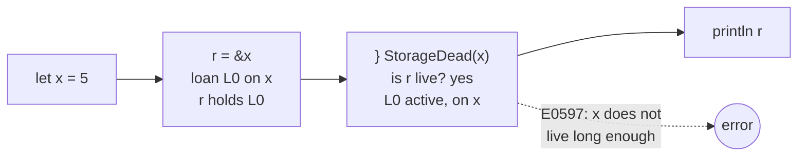
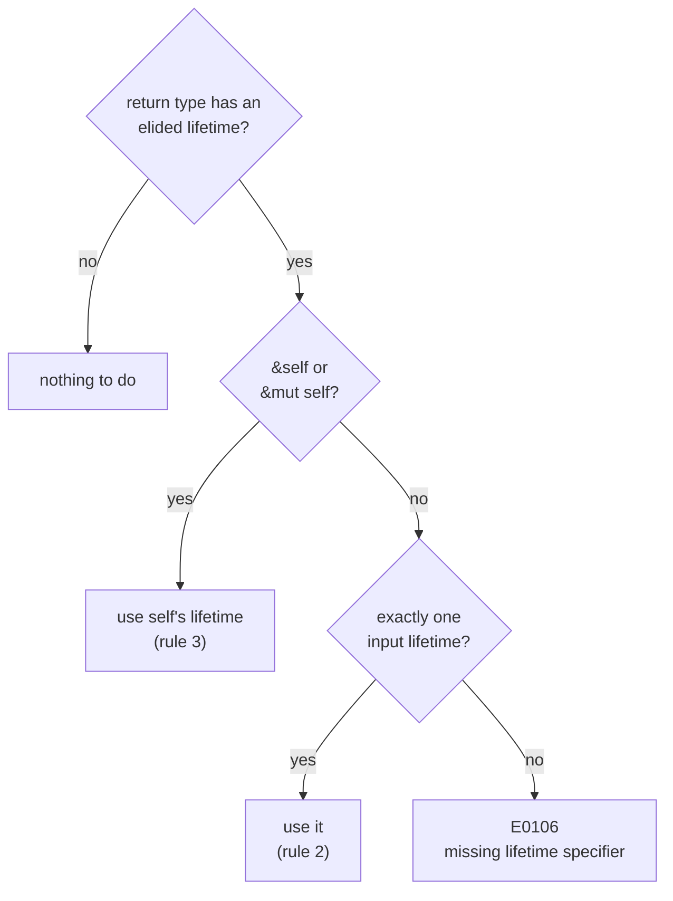
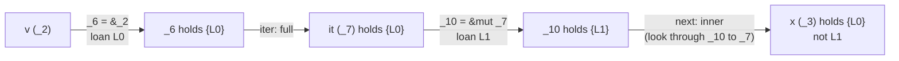
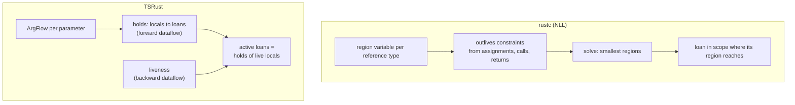

# 09 · Lifetimes

[08-ownership-and-borrowing.md](08-ownership-and-borrowing.md) showed how TSRust decides, inside one function, whether a borrow is still in use. This chapter covers what happens at the boundaries: when a variable goes out of scope while still borrowed, when a reference is returned from a function, and when a call's result might point into its arguments. In Rust these questions are answered with **lifetimes**.

Source: [src/borrowck/signature.ts](../src/borrowck/signature.ts), plus the E0597 and E0515 checks at the end of [src/borrowck/check.ts](../src/borrowck/check.ts).

## What a lifetime is

A lifetime is a region of the program during which a reference must stay valid. The rule that makes references safe is short: **a reference must not outlive the value it points to.**

```rust
fn main() {
    let r;
    {
        let x = 5;
        r = &x;
    }
    println!("{}", r);
}
```

`x` is destroyed at the inner `}`, but `r` is used after that. If this compiled, `r` would be a dangling pointer. The borrow of `x` needs a lifetime that reaches the `println!`, and `x` itself doesn't live that long:

```text
error[E0597]: `x` does not live long enough
 --> examples/errors/E0597_does_not_live_long_enough.rs:7:13
  |
7 |         r = &x;
  |             ^^ borrowed value does not live long enough
8 |     }
  |     - `x` dropped here while still borrowed
9 |     println!("{}", r);
  |                    - borrow later used here
```

Inside a function body you almost never write lifetimes. The compiler can see every borrow and every use, and it works them out. Lifetimes only become visible in **signatures** and **type definitions**, where the compiler would otherwise have to look inside another function to know what's going on.

## Inside a function: E0597

TSRust needs nothing new to check the program above. Lowering (see [08-ownership-and-borrowing.md](08-ownership-and-borrowing.md)) puts a `StorageDead` where each variable's scope ends, and also on every `break`, `continue` and `return` that leaves the scope early:

```text
    bb0: {
        _3 = const;
        _4 = copy _3;
        _6 = &_4  // loan L0;
        _1 = copy _6;
        _5 = const;
        _2 = const;
        StorageDead(_4);
        inspect(_1);
        _7 = op();
        _0 = const;
        StorageDead(_1);
        return;
    }
```

`_4` is `x` and `_1` is `r`. At `StorageDead(_4)`, the checker computes the active loans, meaning loans held by a local that is live afterwards. `r` holds `L0` and is read by the next `inspect(_1)`, so `L0` is active. `L0` borrows `_4` itself, which is dying. That is E0597:

```ts
  private checkStorageDead(s: Extract<Statement, { k: "dead" }>, active: Map<number, Local[]>, at: { block: number; index: number }) {
    for (const [loanId, holders] of active) {
      const loan = this.body.loans[loanId];
      if (loan.place.local !== s.local) continue;
      if (loan.place.proj.some((p) => p.k === "deref" && p.via !== "box")) continue;
      const decl = this.body.locals[s.local];
      if (decl.kind !== "user") continue;
      // Held only by the return place: that's E0515, reported at the `return`.
      if (holders.every((h) => h === 0)) continue;
```

The filters each have a reason:

- A loan of `(*r).field` borrows data *behind* a reference that the dying local only points at. The data lives somewhere else, so the local dying doesn't invalidate it. A `Box` is different: it owns its contents, so a borrow through a `Box` does die with it.
- Only user variables are checked. Temporaries have no `dead` statement (see "Where TSRust differs from rustc").
- A loan held only by `_0`, the return place, is a returned reference. It gets the more specific E0515 described below.



## Across a call: signatures need lifetimes

Now the borrow passes through a function:

```rust
fn longest<'a>(x: &'a str, y: &'a str) -> &'a str {
    if x.len() > y.len() { x } else { y }
}

fn main() {
    let a = String::from("a long string");
    let result;
    {
        let b = String::from("short");
        result = longest(a.as_str(), b.as_str());
    }
    println!("longest: {}", result);
}
```

When checking `main`, the compiler does not look at the body of `longest`. That is a deliberate design choice in Rust. A function's signature is a contract. Callers rely only on it, and changing a function's body never breaks its callers. So the signature must say what the returned reference may point into. `<'a>` declares a lifetime parameter, and using `'a` on both inputs and the output says: *the result is valid only as long as both `x` and `y` are.* Since `b` dies before `result` is used, TSRust reports:

```text
error[E0597]: `b` does not live long enough
  --> longest.rs:10:38
   |
10 |         result = longest(a.as_str(), b.as_str());
   |                                      ^^^^^^^^^^ borrowed value does not live long enough
11 |     }
   |     - `b` dropped here while still borrowed
12 |     println!("longest: {}", result);
   |                             ------ borrow later used here
```

The relevant MIR shows how the loans reach `result` (`_3`):

```text
        _10 = &_2  // loan L0;
        _9 = call as_str(move _10);
        _12 = &_6  // loan L1;
        _11 = call as_str(move _12);
        _8 = call longest(copy _9, copy _11);
        _3 = copy _8;
        _7 = const;
        _4 = const;
        StorageDead(_6);
        inspect(_3);
```

`as_str(&self) -> &str` passes `L0` into `_9` and `L1` into `_11`. `longest` ties its result to both arguments, so `_8`, and then `_3`, hold `{L0, L1}`. At `StorageDead(_6)` (`b`), `_3` is still live, so `L1` is active, and E0597 fires. If `longest` were declared `fn longest<'a, 'b>(x: &'a str, y: &'b str) -> &'a str`, `_3` would hold only `L0` and the program would compile.

How does the checker turn a signature into "holds both"? Through a per-argument summary called an **ArgFlow**.

## Lifetime elision and E0106

Writing `'a` everywhere would be tedious, so Rust fills in missing ("elided") lifetimes with three rules. `signature.ts` implements them:

1. Each elided lifetime in an input becomes its own distinct lifetime parameter.
2. If there is exactly one input lifetime, it is used for every elided output lifetime.
3. If there is `&self` or `&mut self`, its lifetime is used for every elided output lifetime.

Otherwise the output lifetime is ambiguous and you must write it yourself: **E0106**.



In the code, `names()` walks a type expression and collects every lifetime it mentions. Each elided one is given a fresh name like `'_7`. This includes a struct's lifetime parameters that weren't written: `Highlight` with no `<'a>` still has one lifetime. All the input lifetimes go into `allInputLts`, and then:

```ts
    if (ret.elided.length) {
      const unique = [...new Set(allInputLts)];
      let target: string | undefined;
      if (selfLt) target = selfLt;
      else if (unique.length === 1) target = unique[0];
```

If there is no `target`, it reports E0106 with one of two hints, depending on whether there were zero inputs to borrow from or several:

```text
error[E0106]: missing lifetime specifier
 --> examples/errors/E0106_missing_lifetime.rs:3:33
  |
3 | fn longest(x: &str, y: &str) -> &str {
  |                                 ^^^^ expected named lifetime parameter
  = help: this function's return type contains a borrowed value, but the signature does not say whether it is borrowed from `x` or `y`
  = help: consider introducing a named lifetime parameter: `fn name<'a>(x: &'a T, y: &'a T) -> &'a T`
```

```text
error[E0106]: missing lifetime specifier
 --> e0106none.rs:1:11
  |
1 | fn f() -> &str { "hi" }
  |           ^^^^ expected named lifetime parameter
  = help: this function's return type contains a borrowed value, but there is no value for it to be borrowed from
  = help: consider using the `'static` lifetime, or returning an owned value like `String`
```

Because struct lifetimes count, `fn f(h: &Highlight) -> &str` is also E0106. There are two input lifetimes, the `&` and the hidden one inside `Highlight`. rustc agrees.

The same walk catches **E0261**, a lifetime used without being declared. The declared set is the function's own `<'a, ...>`, plus those of the enclosing `impl` or `trait`, plus `'static` and `'_`:

```text
error[E0261]: use of undeclared lifetime name `'a`
 --> e0261.rs:1:9
  |
1 | fn f(x: &'a str) -> &'a str { x }
  |         ^^^^^^^
```

As in rustc, signature errors stop borrow checking before any function body is examined. `checkAll()` runs first in [src/borrowck/index.ts](../src/borrowck/index.ts).

## ArgFlow: what a signature means to a caller

Once elision is resolved, TSRust boils each parameter down to one of three values, defined in [src/borrowck/mir.ts](../src/borrowck/mir.ts):

```ts
/** How a call's result may borrow from each argument (see `signature.ts`). */
export type ArgFlow = "none" | "inner" | "full";
```

- **`full`**: the result may contain the argument itself and anything it borrows. If the argument is a reference, the result keeps the referent borrowed.
- **`inner`**: the result may contain what the argument *points to* borrows, but not the reference itself.
- **`none`**: the result is independent of the argument.

The computation is a few lines at the end of `compute()`:

```ts
    const retNames = new Set([...ret.lifetimes, ...ret.params]);
    const flows: ArgFlow[] = inputs.map((inp) => {
      if (inp.isRef && inp.outer && retNames.has(inp.outer)) return "full";
      const innerHit = [...inp.inner.lifetimes, ...inp.inner.params].some((n) => retNames.has(n));
      if (!innerHit) return "none";
      return inp.isRef ? "inner" : "full";
    });
```

For a reference parameter `&'x T`, `outer` is `'x` and `inner` holds the lifetimes and type parameters inside `T`. If the return type mentions `'x`, the flow is `full`. If it only mentions something inside `T`, the flow is `inner`. Type parameters count as "something that might hold a borrow", because `T` could be instantiated with `&str`. That is why `fn id<T>(x: T) -> T` is `full`.

These are the real flows TSRust computed for a small test file (printed by walking each call's `rv.flows` in the MIR):

| Call | Signature | Flows |
|------|-----------|-------|
| `v.len()` | `fn len(&self) -> usize` | `["none"]` |
| `v.first()` | `fn first(&self) -> Option<&T>` | `["full"]` |
| `v.iter()` | `fn iter(&self) -> Iter<T>` | `["full"]` |
| `it.next()` | `fn next(&mut self) -> Option<&'a T>` on `Iter<'a, T>` | `["inner"]` |
| `longest(&s, &s)` | `fn longest<'a>(x: &'a str, y: &'a str) -> &'a str` | `["full","full"]` |
| `first_word(&s)` | `fn first_word(s: &str) -> &str` | `["full"]` |
| `h.text()` | `fn text(&self) -> &str` in `impl<'a> Highlight<'a>` | `["full"]` |
| `h.inner()` | `fn inner(&self) -> &'a str` in `impl<'a> Highlight<'a>` | `["inner"]` |
| `id(&s)` | `fn id<T>(x: T) -> T` | `["full"]` |

### How a call inherits loans

In the holds analysis (see [08-ownership-and-borrowing.md](08-ownership-and-borrowing.md)), a call's result holds the union over its arguments:

- `none`: contributes nothing.
- `full`: contributes the loans held by the argument's local.
- `inner`: the argument is a temporary like `_10 = &mut _7`. The lowerer remembered, in `borrowOf`, that `_10` borrows `_7`. The result gets the loans held by **`_7`**, the thing pointed to, not by `_10`.

The result type gets checked first. If it can't contain a reference (`usize`, `bool`, `()`, a struct without lifetime parameters), the result holds nothing, whatever the flows say. That is the `mayHoldRefs(destTy)` test.



This is the MIR behind that diagram, for a program that keeps an item from an iterator after the iterator is gone:

```rust
fn main() { let v = vec![1, 2]; let x; { let mut it = v.iter(); x = it.next(); } println!("{:?}", x); }
```

```text
        _6 = &_2  // loan L0;
        _5 = call iter(move _6);
        _7 = move _5;
        _10 = &mut _7  // loan L1;
        _9 = call next(move _10);
        _3 = copy _9;
        _8 = const;
        _4 = const;
        StorageDead(_7);
        inspect(_3);
```

At `StorageDead(_7)` (the iterator `it`), `x` is live, but it holds only `L0`, a loan on `v`, which is still alive. No error, and rustc agrees: `Iter<'a, T>::next` returns `&'a T`, which borrows the vector, not the iterator. If `next` were treated as `full`, `x` would hold `L1` too, and this would be a false E0597.

## Structs that hold references

A struct can store a reference, but then the struct's type has to carry the reference's lifetime. Otherwise nothing would stop the struct from outliving the data:

```rust
struct Highlight<'a> {
    text: &'a str,
}
```

From [examples/08_lifetimes.rs](../examples/08_lifetimes.rs). For the borrow checker this has two consequences.

**A struct value can carry loans.** `mayHoldRefs` treats any ADT with a lifetime parameter as possibly holding a borrow, so building one with an aggregate copies the loans of its fields into the new local:

```text
error[E0597]: `s` does not live long enough
 --> structref.rs:2:60
  |
2 | fn main() { let h; { let s = String::from("x"); h = H { t: &s }; } println!("{}", h.t); }
  |                                                            ^^ borrowed value does not live long enough
  |                                                                  - `s` dropped here while still borrowed
  |                                                                                   --- borrow later used here
```

**Methods choose between `full` and `inner`.** Inside `impl<'a> Highlight<'a>`, `self`'s inner lifetimes include `'a`. Compare two methods:

```rust
impl<'a> Highlight<'a> {
    fn text(&self) -> &str { self.text }      // elided: tied to &self -> full
    fn inner(&self) -> &'a str { self.text }  // tied to 'a -> inner
}
```

With `h` declared in an inner block, `a = h.inner()` may outlive `h` because it only borrows the original string. `b = h.text()` may not:

```text
error[E0597]: `h` does not live long enough
  --> hl.rs:17:13
   |
17 |         b = h.text();
   |             ^^^^^^^^ borrowed value does not live long enough
18 |     }
   |     - `h` dropped here while still borrowed
19 |     println!("{} {}", a, b);
   |                          - borrow later used here
```

That matches rustc exactly. The elided signature promises less than the code delivers, and callers are held to the promise.

## Returning references to locals: E0515

A function's locals all die when it returns, so a function can never return a reference to one of them, whatever the signature says:

```rust
fn make_greeting<'a>(name: &'a str) -> &'a str {
    let s = format!("Hello, {}", name);
    &s
}
```

```text
    bb0: {
        inspect(_1);
        _2 = op();
        _3 = move _2;
        _0 = &_3  // loan L0;
        StorageDead(_3);
        return;
    }
```

At `StorageDead(_3)`, `L0` is active. It's held by `_0`, which `return` reads. But E0597 skips loans held only by the return place. Instead, `checkReturn` runs at every `return` terminator and inspects what `_0` holds:

```ts
  private checkReturn(holds: Holds, span: Span) {
    for (const loanId of holds.get(0) ?? []) {
      const loan = this.body.loans[loanId];
      if (loan.place.proj.some((p) => p.k === "deref" && p.via !== "box")) continue;
```

A loan on a place reached through a reference, such as `&(*p).name` for a parameter `p: &P`, points at the caller's data and is fine. Any other loan is on something in this frame (a local, an argument passed by value, or a temporary), and returning it is E0515:

```text
error[E0515]: cannot return reference to local variable `s`
 --> examples/errors/E0515_return_local_reference.rs:5:5
  |
3 | fn make_greeting<'a>(name: &'a str) -> &'a str {
  |                                                - returns a value referencing data owned by the current function
5 |     &s
  |     ^^ `s` is borrowed here
  = help: return an owned value instead (e.g. `String` rather than `&str`), or take the data as a parameter
```

Since `holds` flows through aggregates, the same check catches a struct smuggling the reference out. The message then says "value referencing" instead of "reference to":

```text
error[E0515]: cannot return value referencing local variable `s`
```

for `fn mk<'a>() -> H<'a> { let s = String::from("x"); H { t: &s } }`.

## Where TSRust differs from rustc

This is the part of TSRust that differs most from rustc's internals, so it gets a careful comparison.

**rustc solves region constraints.** In rustc's NLL borrow checker, every reference type in a function body gets a *region variable*: an unknown set of program points. Each assignment, call and return adds an *outlives constraint* (`'a: 'b` means "region `'a` must contain everything in `'b`"). Liveness adds "this region contains every point where the variable is live". The solver computes the smallest regions that satisfy everything, and a loan is in scope wherever its region reaches. Named lifetimes in the signature (`'a`) become *universal regions* that must contain the whole function body, plus whatever the signature's `where` clauses demand.

**TSRust tracks loans per local.** TSRust has no region variables and no constraint solver. It approximates a reference's region as "the points where some local holding this loan is live":

| Question | rustc | TSRust |
|----------|-------|--------|
| What can a reference point to? | Its region's loans, via constraint solving | `holds(local)`, via forward dataflow |
| How long must a loan stay valid? | Wherever its region is live | Wherever a holder is live |
| What does a call's result borrow? | Substitute regions into the signature, add constraints | `ArgFlow` per argument: full, inner or none |
| Is the function body consistent with its signature? | Yes, universal regions are checked | Only E0515 (returning locals) |



In practice:

- **Named lifetimes are not checked inside the function that declares them.** `fn f<'a, 'b>(x: &'a str, y: &'b str) -> &'a str { y }` compiles in TSRust. rustc says "lifetime may not live long enough". Similarly, `fn f(x: &i32) -> &'static i32 { x }` is accepted. TSRust trusts every signature, both at call sites and in the body. Only E0515 compares a body against reality.
- **Flows are per argument, not per lifetime.** A function returning `(&'a T, &'b U)` gives both arguments `full`, so the whole tuple holds both loans. rustc would track the two halves separately.
- **No variance, no subtyping, no `'static` reasoning.** `'static` is accepted as a declared name and otherwise ignored.
- **Sometimes TSRust is more permissive than rustc.** Because loans are tied to the specific locals holding them rather than to a region shared by every path, TSRust accepts NLL's "problem case #3", which rustc rejects with E0499:

  ```rust
  fn first_or_push(v: &mut Vec<i32>) -> &mut i32 {
      match v.get_mut(0) {
          Some(x) => x,
          None => { v.push(0); v.get_mut(0).unwrap() }
      }
  }
  ```

  This program is in fact sound, and rustc's next-generation checker, Polonius, also accepts it. It's still a difference: code that passes TSRust may not pass rustc.
- **Generic code is conservative.** A type parameter in the return type marks every argument that mentions the parameter as `full`, even when the result couldn't actually contain a borrow from it.
- **Temporaries are not covered by E0597.** See [08-ownership-and-borrowing.md](08-ownership-and-borrowing.md). `let r: &String; { r = &String::from("t"); } println!("{}", r);` is accepted, and rustc reports E0716.

None of these gaps can corrupt memory in the VM (see [12-the-vm.md](12-the-vm.md)). A reference there is a `Ref`, an index into a garbage-collected JavaScript array such as a frame's slots, so a reference that slipped through would at worst read a stale or reused slot. The borrow checker in TSRust exists to teach the rules and reject what rustc rejects, not to keep the VM safe. [14-differences-from-rust.md](14-differences-from-rust.md) collects the language-level differences.

## Try it

```sh
node src/cli.ts run examples/08_lifetimes.rs
node src/cli.ts check examples/errors/E0106_missing_lifetime.rs
node src/cli.ts check examples/errors/E0597_does_not_live_long_enough.rs
node src/cli.ts check examples/errors/E0515_return_local_reference.rs
node src/cli.ts dump mir examples/08_lifetimes.rs
```

In the playground:

1. Load **08_lifetimes** and run it. Then move `println!("longest: {}", result);` below the `}` that ends `b`'s block, as the comment in the file suggests, and read the **Diagnostics** tab.
2. In the same program, change `fn longest<'a>(x: &'a str, y: &'a str) -> &'a str` to `fn longest<'a, 'b>(x: &'a str, y: &'b str) -> &'a str` and make it return `x`. The E0597 goes away, because the result no longer holds the loan on `b`.
3. Load the **E0106** error example and fix it the three ways the rules allow: add `<'a>`, take only one reference, or return `String`.
4. Add `fn inner(&self) -> &'a str { self.text }` to `Highlight` and compare the **MIR** tab for `h.text()` and `h.inner()`. The two calls lower to MIR of the same shape. Only the flows recorded on the `call` differ, and you can see the effect by keeping each result after `h`'s scope ends.

## Exercises

1. **Check named lifetimes in returns.** In `BodyChecker.checkReturn` ([src/borrowck/check.ts](../src/borrowck/check.ts)), the return place's loans are known. Arguments are locals `_1.._n`. Using the `FlowSig` for the function itself, report "lifetime may not live long enough" when `_0` holds a loan derived from an argument whose flow is `none`. You'll need to seed each argument with a synthetic loan at entry, so that `holds` can tell where a returned reference came from.
2. **Per-lifetime flows.** Replace `ArgFlow[]` with, for each output lifetime, the set of inputs it may borrow from, and give tuple and struct results field-level holds. Start in `SignatureChecker.compute` and `BodyChecker.loansOfRv`.
3. **Point "dropped here" at the right `}`.** For `let r; loop { let x = 1; r = &x; break; } println!("{}", r);`, TSRust's E0597 puts "`x` dropped here while still borrowed" under the `break`, because `exitScopes` in [src/borrowck/lower.ts](../src/borrowck/lower.ts) gives each `dead` the span of the exit. rustc points at the `}` that closes `x`'s block. Remember each scope's closing-brace span on the `scopes` stack and use it in `exitScopes`, then add the program to [tests/borrowck.test.ts](../tests/borrowck.test.ts).
4. **Report which lifetime is ambiguous.** For `fn f(h: &Highlight) -> &str`, rustc says the signature doesn't say which of `h`'s two lifetimes the result borrows from. TSRust's help names only `h`. Extend the E0106 help in `compute()` to count lifetimes per parameter.
5. **A tiny region solver.** As an experiment, give each reference-typed local a region variable and generate `'a: 'b` constraints from `assign` statements and calls (using signatures). Solve them by fixed-point iteration over sets of `(block, index)` points, and compare the answers with the holds-based checker on [tests/borrowck.test.ts](../tests/borrowck.test.ts) and the programs in this chapter.
