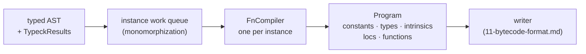
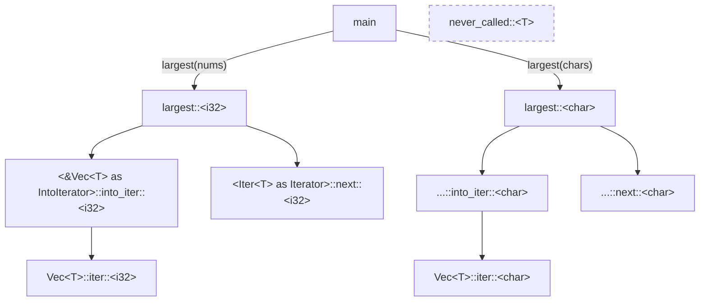
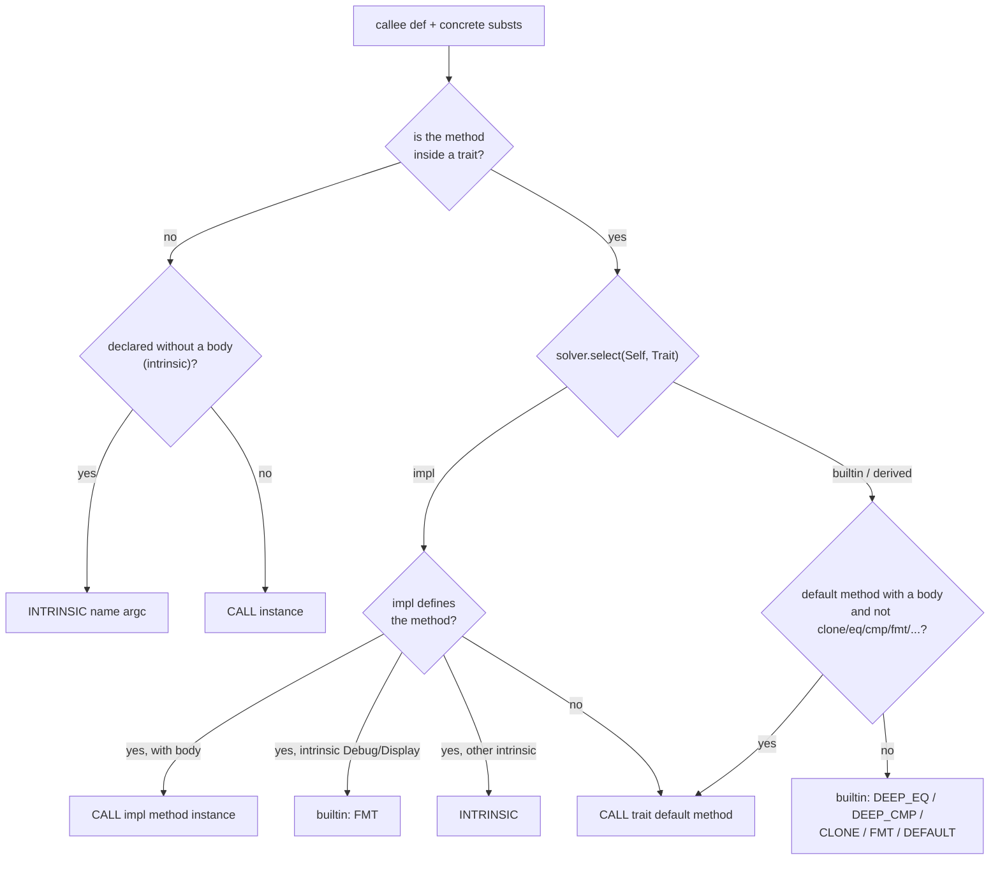
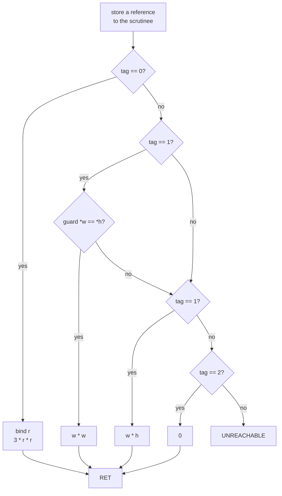

# 10 · Code Generation

By the time a program reaches the code generator, every hard question has been answered. The resolver knows what every name refers to ([04-name-resolution.md](04-name-resolution.md)). The type checker knows the type of every expression and which trait method each call refers to ([05-type-checking.md](05-type-checking.md), [06-traits-and-generics.md](06-traits-and-generics.md)). The borrow checker has proved that no value is used after a move and that no `&mut` is aliased ([08-ownership-and-borrowing.md](08-ownership-and-borrowing.md)).

The code generator's job is to turn all of that into instructions for a simple machine. It lives in one file, [src/codegen/codegen.ts](../src/codegen/codegen.ts). The instruction set is in [src/bytecode/opcodes.ts](../src/bytecode/opcodes.ts), and the shape of a compiled program is in [src/bytecode/program.ts](../src/bytecode/program.ts).



The generator never re-infers anything. It reads side tables that the type checker filled in, keyed by AST node id: `types` (the type of each expression), `callees` (which function or trait method a call refers to), `adjustments` (auto-deref and auto-ref), `coercions`, `ctors` (struct and variant constructors), `fieldIndices`, `bindingModes`, `patDerefs`, `tryKinds` and `forLoops`. If you want to know why some instruction was emitted, the answer is usually one of those tables.

## The stack machine

TSRust compiles to bytecode for a **stack machine**. Instructions pop their inputs from an *operand stack* and push their results. There are no registers. Each function also has numbered **local slots**: parameters come first, then variables and temporaries.

Here is a tiny program and its real disassembly:

```rust
fn main() {
    let x = 40 + 2;
    println!("{}", x);
}
```

```text
$ node src/cli.ts dump bytecode tiny.rs
fn #0 tiny::main  (params: 0, locals: 5)
        ; tiny.rs:1:11
        ; tiny.rs:2:5
        ; tiny.rs:2:13
     0  CONST         40
     2  CONST         2
     4  ADD           i32
     6  STORE         0
     8  LOAD          0
    10  STORE         1
        ; tiny.rs:3:5
    12  NEW_STRING    
    13  STORE         2
    15  LOAD          1
    17  STORE         3
    19  LOAD          3
    21  STORE         4
    23  LOAD          2
    25  LOAD          4
    27  FMT           type#0 0 -1
    31  LOAD          2
    33  PRINT         1
    35  UNIT          
    36  POP           
    37  UNIT          
    38  RET           
```

(In this chapter, file paths in the `;` location comments are shortened to the file name. The real CLI prints the full path.)

Read it top to bottom. `CONST 40` and `CONST 2` push two numbers. `ADD i32` pops both and pushes 42. The `i32` operand tells the VM which overflow rules to apply. `STORE 0` pops the result into slot 0. The `let` then copies slot 0 into slot 1, which is the slot that belongs to `x`. That is a wasted move, and it is typical: TSRust has no optimizer, so the bytecode shows the compilation scheme directly. The rest builds a `String` (slot 2), formats `x` into it with `FMT`, prints it, and returns `()`.

The left column is the **offset** of each instruction in the function's flat `code: number[]` array. An instruction is an opcode number followed by its inline operands. `CONST 40` takes two array cells, so the next instruction starts at offset 2.

Every expression compiles to code that leaves **exactly one value** on the stack. Statements are expressions followed by `POP`. Blocks without a tail push `UNIT`. That invariant keeps the generator simple, and it is written into the `expr` method:

```ts
  expr(e: A.Expr): void {
    const start = this.depth;
    this.exprInner(e);
    // Diverging expressions may leave the bookkeeping unbalanced; normalize it.
    this.depth = start + 1;
```

## Monomorphization

A generic function such as `fn largest<T: PartialOrd + Copy>(items: &Vec<T>) -> T` has no single machine-level meaning. Comparing two `i32`s and comparing two `char`s are different operations. Rust's answer, which TSRust copies, is **monomorphization**: compile a separate copy of the function for each set of concrete type arguments it is actually used with.

The `ProgramBuilder` keeps a work queue of **instances**. An instance is a function's `DefId` plus a substitution for its generic parameters. Compilation starts from `main`:

```ts
  const g = new ProgramBuilder(tc, sources, diags);
  const entry = g.instance(main, []);
  g.drain();
```

`instance()` builds a string key from the definition and its type arguments. If that key has been seen before, it returns the existing function index. Otherwise it reserves a new index and enqueues the work:

```ts
    const key = `${def}<${substs.map(tyKey).join(",")}>`;
    const existing = this.instances.get(key);
    if (existing !== undefined) return existing;
```

`drain()` pops instances one at a time and compiles them. Compiling one body finds the calls it makes. Each call goes through `instance()`, which may enqueue more work. The loop ends when no new instances turn up.



Here is the program behind that diagram, `mono.rs`:

```rust
fn largest<T: PartialOrd + Copy>(items: &Vec<T>) -> T {
    let mut best = items[0];
    for &x in items {
        if x > best {
            best = x;
        }
    }
    best
}

fn never_called<T: Clone>(x: &T) -> T {
    x.clone()
}

fn main() {
    let nums = vec![3, 9, 4];
    let chars = vec!['a', 'z', 'q'];
    println!("{} {}", largest(&nums), largest(&chars));
}
```

And here is the complete function table of the compiled program, standard library instances included:

```text
0 main::main
1 main::largest::<i32>
2 main::largest::<char>
3 <&Vec<T> as IntoIterator>::into_iter::<i32>
4 <Iter<T> as Iterator>::next::<i32>
5 <&Vec<T> as IntoIterator>::into_iter::<char>
6 <Iter<T> as Iterator>::next::<char>
7 Vec<T>::iter::<i32>
8 Vec<T>::iter::<char>
```

Notice three things.

1. `largest` appears twice, once per type. The two copies have the same shape. They differ only in the type descriptor their comparison uses (`DEEP_CMP type#0` versus `DEEP_CMP type#1`) and in which iterator instances they call (`#3`/`#4` versus `#5`/`#6`).
2. `never_called` is missing. It type-checked and borrow-checked, but nothing reached it from `main`, so it was never compiled. For a generic function this is unavoidable: without concrete types there is nothing to compile. Rust behaves the same way, which is why an unused generic function can't cause a codegen error.
3. Out of the hundreds of functions in the standard library, only the three this program actually uses were compiled, as six instances.

## Static dispatch of trait methods

The type checker records a call like `x > best` abstractly as `<T as PartialOrd>::gt`. That was enough for type checking. Codegen runs after substitution, though, so it knows that `T` is `i32` and must pick the code that will actually run. That choice is `resolveCallee`, and its result is a `Target`:

```ts
type Target =
  | { kind: "fn"; def: DefId; substs: Ty[] }
  | { kind: "intrinsic"; name: string }
  | { kind: "builtin"; trait: string; method: string; self: Ty };
```

For a method that belongs to a trait, the generator asks the trait solver to **select** an implementation for the concrete `Self` type. It then branches on the answer:



The builtin branch is how primitives and `#[derive]`d impls work. No Rust source exists for `i32: PartialOrd` or for a derived `PartialEq`, so the generator emits a structural VM instruction instead:

```ts
      if (sel.kind === "builtin" || sel.kind === "derived") {
        // Default methods with bodies (like `Ord::max`) still run as Rust code.
        const fn = d.node as A.FnItem;
        const nativeMethods = ["clone", "eq", "ne", "partial_cmp", "cmp", "lt", "le", "gt", "ge", "fmt", "default"];
        if (fn.body && !nativeMethods.includes(d.name)) return { kind: "fn", def, substs };
        return { kind: "builtin", trait: traitName, method: d.name, self };
      }
```

That is why `x > best` inside `largest::<i32>` compiles to a structural comparison followed by a primitive test:

```text
    42  LOAD          6
    44  LOAD          3
    46  DEEP_CMP      type#0
    48  CONST         0
    50  GT            i32
    52  JUMP_IF_FALSE -> 63
```

`DEEP_CMP` pushes -1, 0 or 1, and `GT i32` against 0 turns that into a `bool`. When the operands are known primitives with no trait call involved, as in `40 + 2`, `binary()` emits the native `ADD`/`LT`/... directly, each carrying the operands' numeric kind.

There are **no vtables**. TSRust has no `dyn Trait` (the parser rejects it), so every method call is resolved at compile time to exactly one function.

## Places and references

Rust distinguishes *values* from *places*. A place is a memory location you can read, write or borrow: `x`, `p.x`, `*r`, `v[i]`. The generator represents a place as a root slot plus a list of projections:

```ts
interface CgPlace {
  slot: number;
  proj: ({ k: "field"; i: number } | { k: "deref"; via: "ref" | "box" | "str" | "none" } | { k: "index"; slot: number; map: boolean; keyTy?: Ty })[];
  ty: Ty;
}
```

Three helpers turn a place into instructions:

| Helper | Emits | Used for |
|---|---|---|
| `loadPlace` | `LOAD slot`, then `GET_FIELD`, `LOAD_REF`, `GET_BOX`, `STR_OF`, `INDEX_GET` | reading |
| `refPlace` | `REF_LOCAL slot`, then `FIELD_REF`, `DEREF_REF`, `STR_REF`, `INDEX_REF` | `&place`, `&mut place`, writing through projections |
| `storePlace` | `STORE slot`, or `refPlace` + value + `STORE_REF` | assignment |

A `deref` projection records how to dereference: through a reference or a `Box` (`LOAD_REF` or `GET_BOX` when reading, `DEREF_REF` when borrowing), or through a `String` viewed as `str` (`STR_OF` when reading, `STR_REF` when borrowing). The fourth case, `none`, is a deref of a `&str`, which emits nothing because a `&str` is its own reference.

In the VM a reference is a `Ref` object: an array plus an index ([12-the-vm.md](12-the-vm.md)). In native code it is simply an address ([15-native-code.md](15-native-code.md)). `REF_LOCAL 3` makes a `Ref` to slot 3 of the current frame. `FIELD_REF 1` turns a reference to a struct into a reference to its second field. `LOAD_REF` and `STORE_REF` read and write through a reference. Those few instructions are enough for `&`, `&mut` and `*`.

```rust
#[derive(Clone, Copy, Debug)]
struct Point { x: i32, y: i32 }

fn main() {
    let mut p = Point { x: 1, y: 2 };
    let q = p;          // Copy: a real copy
    p.x = 10;           // write through a place
    let r = &mut p;
    r.y += 5;
    println!("{:?} {:?}", p, q);
}
```

```text
        ; places.rs:7:5
    35  REF_LOCAL     3
    37  FIELD_REF     0
    39  CONST         10
    41  STORE_REF     
    42  UNIT          
    43  POP           
        ; places.rs:8:5
    44  REF_LOCAL     3
    46  STORE         6
    48  LOAD          6
    50  STORE         7
        ; places.rs:9:5
    52  REF_LOCAL     7
    54  DEREF_REF     
    55  FIELD_REF     1
    57  DUP           
    58  LOAD_REF      
    59  CONST         5
    61  ADD           i32
    63  STORE_REF     
```

`p.x = 10` is `REF_LOCAL 3; FIELD_REF 0` (the address of `p.x`), then the value, then `STORE_REF`. `r.y += 5` first auto-derefs `r`: the type checker recorded that adjustment, and `adjust()` turns it into a `deref` projection, which becomes `DEREF_REF`. Then `DUP` keeps the field reference so it can be read (`LOAD_REF`), added to, and written back (`STORE_REF`). The output is `Point { x: 10, y: 7 } Point { x: 1, y: 2 }`, as in Rust.

## Copy versus move at runtime

Structs, tuples and enum variants are heap objects in the VM, and a slot holds a pointer to one. **Moving** a value only copies that pointer. That is safe because the borrow checker has already proved the old owner is never used again. **Copying** a `Copy` aggregate is different: both copies stay usable, and writing to one must not change the other. So `readPlace` emits a real copy:

```ts
  private readPlace(p: CgPlace) {
    this.loadPlace(p);
    if (this.g.needsCopy(p.ty)) this.emit(Op.COPY, this.g.typeDesc(p.ty));
  }
```

`needsCopy` returns true for non-empty tuples and user ADTs whose type implements `Copy`. In the `places.rs` dump, `let q = p;` becomes `LOAD 3; COPY type#0; STORE 4`. Without that `COPY`, `p.x = 10` would also change `q`. The operand is the type descriptor of `Point`: the VM ignores it, but the native runtime needs it to know how deep to copy. Primitives never need `COPY`, because a number is copied just by pushing it.

## Control flow: jumps and patching

`if` compiles to a conditional jump whose target isn't known yet. `jump()` emits the instruction with a placeholder target of `-1` and returns the operand's position. `patch()` fills in the real offset once the code it should jump to has been emitted:

```ts
      case "if": {
        this.expr(e.cond);
        const toElse = this.jump(Op.JUMP_IF_FALSE);
        const base = this.depth;
        this.expr(e.then);
        const toEnd = this.jump(Op.JUMP);
        this.patch(toElse);
```

### Pattern tests

A `match` stores its scrutinee once. If the scrutinee is a place, the generator stores a *reference* to it, so that by-reference bindings point into the original value. Each arm is then a sequence of tests. Every failed test jumps to the next arm. `testPattern` walks the pattern and emits:

- for a variant: `GET_TAG`, `CONST index`, `EQ`, `JUMP_IF_FALSE` to the next arm;
- for a literal: `EQ` against the literal; for a range: `GE` and `LE`/`LT`;
- for a binding: `readPlace` (move or copy) or `refPlace` (a `ref` binding or match ergonomics), then `STORE` into the variable's slot.

After the last arm comes `UNREACHABLE`. The exhaustiveness checker ([07-pattern-matching.md](07-pattern-matching.md)) proved that no value gets that far.

```rust
fn area(s: &Shape) -> i32 {
    match s {
        Shape::Circle(r) => 3 * r * r,
        Shape::Rect { w, h } if *w == *h => w * w,
        Shape::Rect { w, h } => w * h,
        Shape::Empty => 0,
    }
}
```

```text
     0  REF_LOCAL     0
     2  STORE         1
     4  LOAD          1
     6  LOAD_REF      
     7  LOAD_REF      
     8  GET_TAG       
     9  CONST         0
    11  EQ            i32
    13  JUMP_IF_FALSE -> 37
    15  REF_LOCAL     1
    17  DEREF_REF     
    18  DEREF_REF     
    19  FIELD_REF     0
    21  STORE         2
   ...
    37  LOAD          1
    39  LOAD_REF      
    40  LOAD_REF      
    41  GET_TAG       
    42  CONST         1
    44  EQ            i32
    46  JUMP_IF_FALSE -> 84
   ...
    64  LOAD          3
    66  LOAD_REF      
    67  LOAD          4
    69  LOAD_REF      
    70  EQ            i32
    72  JUMP_IF_FALSE -> 84
   ...
   136  UNREACHABLE   
   137  RET           
```

Because `s` is `&Shape`, match ergonomics bind `r`, `w` and `h` as references. The generator builds them with `REF_LOCAL ... FIELD_REF` instead of copying the fields. The guard `if *w == *h` is just another test: a false guard jumps to the next arm (offset 84), exactly like a failed pattern. Every `EQ` here says `i32`: for the tag tests that is the type of a tag, and for the guard it is the type of `*w`.



### Loops, `break`, and static stack depth

`while`, `loop` and `for` record a `LoopCtx`: where `continue` jumps to, a list of `break` jumps to patch later, and the operand stack **depth** when the loop started. `loop` also gets a result slot so that `break value` can deliver a value.

The depth matters because `break` can appear in the middle of an expression. In `100 + if cond { break i; } else { 0 }`, the `100` is already on the stack when the `break` runs. If the jump simply left it there, the stack would be off by one for the rest of the function. So every `emit` updates a statically computed `depth` using the `stackEffect` table, and `break` pops the difference:

```ts
      case "break": {
        const loop = this.loops.get(this.tcx.res.labels.get(e.id) ?? -1)!;
        if (e.value) this.expr(e.value);
        else this.emit(Op.UNIT);
        if (loop.resultSlot !== undefined) this.emit(Op.STORE, loop.resultSlot);
        else this.emit(Op.POP);
        for (let d = this.depth; d > loop.depth; d--) this.emit(Op.POP);
        loop.breaks.push(this.jump(Op.JUMP));
        return;
      }
```

Here is that situation in real output (`let total = 100 + if v[i as usize] == target { break i; } else { 0 };` inside a `loop`):

```text
    36  CONST         100
   ...
    55  JUMP_IF_FALSE -> 68
        ; loops.rs:7:56
    57  LOAD          3
    59  STORE         4
    61  POP           
    62  JUMP          -> 96
```

Offset 59 stores the break value into the loop's result slot. Offset 61 pops the stranded `100`. Offset 62 jumps to the loop exit. This works only because the stack depth at each instruction is known at compile time, which is also true of the JVM and of WebAssembly.

### `for` loops

The parser desugars `while let`. `for` is compiled directly from the `forLoops` entry the type checker recorded, which holds the resolved `IntoIterator::into_iter` and `Iterator::next` callees and the item type:

```text
    16  LOAD          0
    18  CALL          #3 <<&Vec<T> as IntoIterator>::into_iter::<i32>> 1
    21  STORE         4
    23  REF_LOCAL     4
    25  CALL          #4 <<Iter<T> as Iterator>::next::<i32>> 1
    28  STORE         5
    30  LOAD          5
    32  GET_TAG       
    33  JUMP_IF_FALSE -> 67
    35  LOAD          5
    37  GET_FIELD     0
    39  LOAD_REF      
    40  STORE         6
```

`into_iter` runs once. Then each iteration calls `next(&mut iter)` and tests the tag. `None` is variant 0, so `JUMP_IF_FALSE` leaves the loop. Otherwise the code binds the pattern (`&x` here, hence the `LOAD_REF`) to field 0 of the `Some`. Iterators are ordinary Rust code from [std/src/vec.rs](../std/src/vec.rs) that has been monomorphized like everything else ([13-standard-library.md](13-standard-library.md)).

### The `?` operator

`?` is a tag test and an early return:

```ts
        const isOption = this.r.tryKinds.get(e.id) === "option";
        // Option: Some = 1 continues. Result: Ok = 0 continues.
        const ok = this.jump(isOption ? Op.JUMP_IF_TRUE : Op.JUMP_IF_FALSE);
        // The early-return value has the same runtime shape (`None` / `Err(e)`).
        this.emit(Op.LOAD, slot);
        this.emit(Op.RET);
```

On the failure path it returns the scrutinee value *itself*. The `Err(e)` that comes in is already the `Err(e)` that goes out, because TSRust's `?` does not call `From::from` (the type checker requires both error types to be identical). For `let n: i32 = s.parse()?;`:

```text
     2  CALL          #3 <str::parse::<i32>> 1
     5  STORE         1
     7  LOAD          1
     9  GET_TAG       
    10  JUMP_IF_FALSE -> 15
    12  LOAD          1
    14  RET           
    15  LOAD          1
    17  GET_FIELD     0
```

## Formatting macros

`println!`, `format!`, `write!` and friends are built into the parser. It parses the format string at compile time into *pieces*: literal text and holes ([02-parsing.md](02-parsing.md)). Codegen evaluates each argument once into a slot, then appends the pieces one at a time to a `String` target.

How a hole gets formatted depends on static dispatch again. `appendFmt` resolves `Display::fmt` (or `Debug::fmt` for `{:?}`) for the argument's type:

- If the result is **not** a user function (a primitive, `String`, a `#[derive(Debug)]` type, or the native `Debug for Vec<T>`), it emits one `FMT type flags precision` instruction. The VM formats the value itself, guided by a runtime type descriptor.
- If it **is** a user `impl Display`, it emits `CALL <T as Display>::fmt` with `&value` and `&mut target`, and the target `String` serves as the `Formatter`.

Here are both cases in one line, `println!("{} {:?} {:.2}", m, parse_twice("21"), 2.5)`, where `Money` has a hand-written `Display`:

```text
    33  REF_LOCAL     4
    35  REF_LOCAL     3
    37  CALL          #2 <<Money as Display>::fmt> 2
    40  POP           
    41  LOAD          3
    43  CONST         " "
    45  STR_APPEND    
    46  LOAD          5
    48  STORE         7
    50  LOAD          3
    52  LOAD          7
    54  FMT           type#0 1 -1
   ...
    69  LOAD          8
    71  FMT           type#4 0 2
```

The `FMT` operands are a type descriptor, flags (`1` = Debug, `2` = pretty) and a precision (`-1` = none). Inside `Money`'s `fmt`, `write!(f, ...)` compiles to the same `STR_APPEND`/`FMT` sequence, appending through the `&mut Formatter` reference. A `Formatter` is a `String` at runtime. The program prints `$12.34 Ok(42) 2.50`.

## The line table

When a program panics, Rust prints `src/main.rs:LINE:COL`. To support that, each `FunctionCode` carries a `lines` array of `[codeOffset, locIndex]` pairs, and `Program.locs` holds the deduplicated `{file, line, col}` records. The generator calls `setLoc(span)` before code that might panic, such as arithmetic, indexing, calls and statements. A new pair is added only when the location changes:

```ts
  private setLoc(span: Span) {
    const loc = this.g.loc(span);
    if (loc < 0 || loc === this.lastLoc) return;
    this.lastLoc = loc;
    this.lines.push(this.here(), loc);
  }
```

The `; file:line:col` comments in the disassembly come from this table. At panic time the VM looks for the last entry whose offset is at or before the failing instruction ([12-the-vm.md](12-the-vm.md)).

For a method call, the location is the span of the method *name*, recorded just before the `CALL`. In the `?` example above, the line table entry for the `CALL` at offset 2 points at column 20 of `    let n: i32 = s.parse()?;`, the `p` of `parse`. That matches rustc, whose `#[track_caller]` methods such as `unwrap()` report the position of the method name in your code. Together with the rule that panics inside the standard library are reported at the innermost frame outside it ([12-the-vm.md](12-the-vm.md)), `o.unwrap()` on `None` points at `unwrap` in your source, as it does in Rust.

## Runtime type descriptors

Most instructions don't need types: `ADD i32` carries its numeric kind inline. Structural operations do. `FMT` must know field names to print `Point { x: 1, y: 2 }`, and `CLONE` must know which fields are `String`s that need a deep copy. For these operations the generator interns a `TypeDesc` for each concrete type (see [src/bytecode/program.ts](../src/bytecode/program.ts)), and instructions refer to it by index (`type#0`). Descriptors refer to each other by index, so recursive types such as `Box<List>` work. The descriptor table for `fmt.rs`:

```text
0 {"k":"enum","name":"Result","variants":[{"name":"Ok","kind":"tuple","fields":[{"name":"0","ty":1}]},{"name":"Err","kind":"tuple","fields":[{"name":"0","ty":2}]}]}
1 {"k":"int","name":"i32"}
2 {"k":"struct","name":"ParseIntError","kind":"named","fields":[{"name":"message","ty":3}]}
3 {"k":"string"}
4 {"k":"float","name":"f64"}
```

Generic field types are substituted and normalized first, so a descriptor always describes a fully concrete type, such as `Result<i32, ParseIntError>`. Lang items get special descriptors: `Vec` becomes `vec`, `String` and `Formatter` become `string`, `Box` becomes `box`, and `HashMap` becomes `map`.

## What the instructions must say for native code

The VM can look at a value at run time and see that it is a JavaScript number, a string or an `RString`. Machine code can't: in a native executable every value is one 64-bit word ([15-native-code.md](15-native-code.md)). So the generator puts into the bytecode everything a back end needs to know about each word:

- **Typed constants.** `lit()` emits `CONST` for integers and string literals, `CONST_F` for floats and `CONST_CHAR` for `char`s. All three index the same constant pool. In `fmt.rs`, the `2.5` compiles to `CONST_F 2.5`. For native code that becomes the IEEE-754 bits of the double, which an integer `2` must not become.
- **Typed comparisons.** `EQ`, `NE`, `LT`, `LE`, `GT` and `GE` carry a numeric kind, like the arithmetic instructions. `numKind` maps `&str` (and `str`) to the kind `str`, so `a == b` on two string slices is `EQ str`, which native code compiles to a call that compares bytes. Signed and unsigned kinds need different machine comparisons, and float kinds need floating-point ones.
- **`STR_OF` and `STR_REF`.** Reading a `String` place through a `str` deref emits `STR_OF` (the value viewed as `&str`), and borrowing one emits `STR_REF` (a `&String` turned into `&str`).
- **`COPY type`**, shown above.
- **Key descriptors for `HashMap`.** Native code hashes and compares keys by walking their type descriptor, so `callTarget` passes the key type's descriptor index as an extra, final argument to every `HashMap::` and `collections::` intrinsic:

```ts
    if (t.kind === "intrinsic") {
      // Native code can't inspect values at runtime, so map operations get the
      // key's type descriptor (for hashing and equality) as a trailing argument.
      if (/^(HashMap|collections)::/.test(t.name) && t.substs?.length) {
        this.emitConst(this.g.typeDesc(t.substs[0]));
        argc++;
      }
```

For `ages.insert(String::from("Ann"), 31)` on a `HashMap<String, i32>`, that is the `CONST 0` (descriptor 0 is `{"k":"string"}`) and the argument count 4, one more than in the Rust source:

```text
    11  REF_LOCAL     1
    13  CONST         "Ann"
        ; map.rs:5:17
    15  INTRINSIC     <String::from> 1
    18  CONST         31
        ; map.rs:5:10
    20  CONST         0
    22  INTRINSIC     <HashMap::insert> 4
```

The VM ignores this extra information. It all went into format version 2 of the `.tsrb` file ([11-bytecode-format.md](11-bytecode-format.md)).

## Where TSRust differs from rustc

- **No intermediate representation for codegen.** rustc lowers to MIR, optimizes it, and hands it to LLVM. TSRust emits bytecode straight from the typed AST, with no optimizer. Redundant `STORE`/`LOAD` pairs and dead code after `break` are visible in every dump. (TSRust does build a MIR, but only for the borrow checker.)
- **Derives are not code.** rustc expands `#[derive(PartialEq)]` into a real `impl` that calls `PartialEq` on each field. TSRust emits one structural `DEEP_EQ`. One consequence: if a field's type has a *hand-written* `Debug` or `PartialEq`, a derived impl on the outer type ignores it ([14-differences-from-rust.md](14-differences-from-rust.md)).
- **No vtables or function pointers.** Everything is statically dispatched.
- **Memory layout.** rustc computes sizes and alignments, and a move is a `memcpy`. TSRust boxes every aggregate, so a move copies a pointer and `Copy` needs an explicit `COPY`.
- **Panic locations** imitate `#[track_caller]` without implementing it. rustc marks individual functions such as `unwrap()` with the attribute, and their panics report the caller's location. TSRust instead treats *every* standard-library function that way, and records method-call locations at the method name.

## Try it

```sh
node src/cli.ts dump bytecode examples/06_traits_generics.rs   # your functions only
node src/cli.ts run examples/05_enums_match.rs
node src/cli.ts build examples/07_iterators.rs --target bytecode -o it.tsrb && node src/cli.ts run it.tsrb
```

In the playground, open the **Bytecode** tab. It shows only your functions, and a note says how many monomorphized functions the whole program contains. Some experiments:

- Pick the generics example, then call a generic function with a third type and watch a new `::<...>` instance appear.
- Remove `Copy` from a struct's derive list and add `.clone()` where the borrow checker asks for it. The `COPY` instructions disappear and `CLONE` appears.
- Write `break` inside a binary expression, as in the `loops.rs` example above, and find the extra `POP`.
- Compare the **MIR** tab with the **Bytecode** tab for the same function. The MIR is the borrow checker's view; the bytecode is the machine's.

## Exercises

1. **Peephole optimizer.** Add a pass after `compileFn` that turns `STORE n; LOAD n` into `DUP; STORE n` when slot `n` is never read again, and drops `UNIT; POP`. Jump targets are absolute offsets, so you will have to remap them. Start at `ProgramBuilder.drain()`.
2. **Constant folding.** `-1` compiles to `CONST 1; NEG i32`. Fold negated literals in `unary()`, then try folding `CONST a; CONST b; ADD` (keeping the overflow check at compile time).
3. **Native comparisons for primitives.** `x > best` on `i32` goes through `DEEP_CMP; CONST 0; GT i32`. In `binary()`, when `target.self` is an int, float or char, emit `GT` with that type's kind directly. Measure the step count with `run()`'s `steps` result.
4. **Honor user impls inside derives.** Make `builtinMethod` for a derived impl compile to per-field calls (resolving each field's impl with `resolveCallee`) instead of a single `DEEP_EQ`. This is what rustc's derive expansion does.
5. **Tail calls.** Detect `return f(args)` where `f` is the current instance and compile it to stores into the parameter slots plus `JUMP 0`. Test it with a deep recursion that currently hits the VM's call-depth limit.
