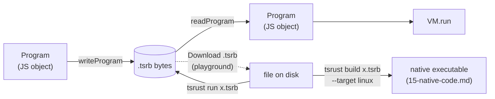
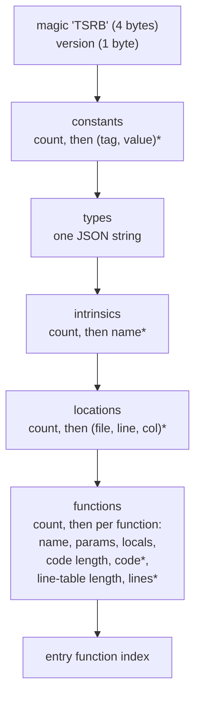
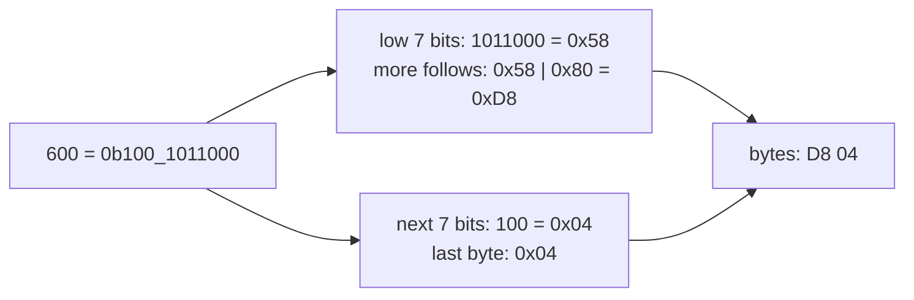

# 11 · The Bytecode Format

The code generator produces a `Program`, an in-memory JavaScript object ([10-code-generation.md](10-code-generation.md)). To save that program, download it from the playground, or run it later without the compiler, TSRust serializes it into a compact binary file with the extension `.tsrb` ("TSRust bytecode"). This chapter describes that file byte by byte.

The format is defined in [src/bytecode/writer.ts](../src/bytecode/writer.ts), which contains both the writer and the reader. The data it serializes is described in [src/bytecode/program.ts](../src/bytecode/program.ts), and the opcode numbering comes from [src/bytecode/opcodes.ts](../src/bytecode/opcodes.ts).

## Why have a binary format at all?

The VM could just take the `Program` object directly, and in principle that would be fine. A real file format brings three benefits:

1. **It separates compiler and runtime.** A `.tsrb` file has everything the VM needs and nothing else: no AST, no types, no source text. If the VM can run it, the compiler didn't leak information through a side channel.
2. **It is a teaching artifact.** You can open it in a hex editor and see every instruction.
3. **The format is exercised on every run.** The driver's `execute()` does not hand the in-memory program to the VM. It writes the bytes, then *reads them back* first:

```ts
/**
 * Run a successful compilation. The program is read back from its serialized
 * bytes first, proving the `.tsrb` file contains everything needed.
 */
export function execute(c: Compilation, opts: RunOptions = {}): RunResult {
  if (!c.bytes) throw new Error("nothing to run: compilation failed");
  const start = performance.now();
  const result = run(readProgram(c.bytes), opts);
```

That is the same idea as Java `.class` files, Python `.pyc` files and WebAssembly `.wasm` modules: a portable, versioned container for code meant for a virtual machine.

The file is also the input of TSRust's second back end, which compiles it to machine code ([15-native-code.md](15-native-code.md)). `node src/cli.ts build x.tsrb --target linux` turns a `.tsrb` file into an executable without the source, and produces exactly the same bytes as building from the source.



## The layout

A `.tsrb` file is a single stream of sections in a fixed order. There is no table of contents and there are no offsets: the reader just reads each section in turn.



Here is the writer in full. It mirrors that diagram line for line:

```ts
export function writeProgram(p: Program): Uint8Array {
  const w = new ByteWriter();
  for (const b of MAGIC) w.byte(b);
  w.byte(FORMAT_VERSION);
  w.uvar(p.constants.length);
  for (const c of p.constants) {
    if (typeof c === "number") { w.byte(0); w.f64(c); }
    else { w.byte(1); w.str(c); }
  }
  w.str(JSON.stringify(p.types));
  w.uvar(p.intrinsics.length);
  for (const name of p.intrinsics) w.str(name);
  w.uvar(p.locs.length);
  for (const l of p.locs) { w.str(l.file); w.uvar(l.line); w.uvar(l.col); }
  w.uvar(p.functions.length);
  for (const f of p.functions) {
    w.str(f.name);
    w.uvar(f.params);
    w.uvar(f.locals);
    w.uvar(f.code.length);
    for (const x of f.code) w.svar(x);
    w.uvar(f.lines.length);
    for (const x of f.lines) w.svar(x);
  }
  w.uvar(p.entry);
  return w.result();
}
```

Each section in more detail:

| Section | Encoding | Notes |
|---|---|---|
| magic | bytes `54 53 52 42` | ASCII `TSRB`. The reader rejects other files with "not a TSRust bytecode file (bad magic number)". |
| version | 1 byte | `FORMAT_VERSION = 2`. A mismatch produces "unsupported .tsrb version 1 (expected 2)". |
| constants | uvar count, then a tag byte per constant | Tag `0`: an IEEE-754 `f64`, 8 bytes, little-endian. Tag `1`: a string. Every number is stored as an `f64`, integers included ([12-the-vm.md](12-the-vm.md) explains why). `char` constants are one-character strings. The instruction that uses a constant (`CONST`, `CONST_F` or `CONST_CHAR`) says which kind of value it is. |
| types | one string | The runtime type descriptors, as JSON. |
| intrinsics | uvar count, then strings | Names such as `Vec::push`. `INTRINSIC` operands index this list, and the VM looks each name up in its native table. |
| locations | uvar count, then (string, uvar, uvar) | `{file, line, col}` records for panic messages. |
| functions | uvar count, then each function | `name` (for the disassembler and error messages), `params`, `locals`, then the code and the line table as zigzag varints. |
| entry | uvar | Index of `main` in the function list. |

A *string* is always a uvar byte length followed by that many bytes of UTF-8.

The type descriptors are stored as JSON rather than in a binary encoding. That is a deliberate shortcut: descriptors form a small recursive structure (see `TypeDesc` in [program.ts](../src/bytecode/program.ts)), and `JSON.stringify` and `JSON.parse` handle it in two lines. A production format would encode them in binary, as WebAssembly does for its type section.

## Varints: LEB128 and zigzag

Most numbers in a program are small: opcodes below 64, slot numbers below 20, small constant indices. Spending four bytes on each would waste most of them. TSRust instead uses **LEB128** ("Little-Endian Base 128"), the variable-length integer encoding used by DWARF debug info, WebAssembly and Protocol Buffers.

The idea: split the number into 7-bit groups, lowest group first. Put each group in a byte, and set the byte's high bit (`0x80`) if more bytes follow.

```ts
  /** Unsigned LEB128. */
  uvar(n: number) {
    do {
      let b = n % 128;
      n = Math.floor(n / 128);
      if (n > 0) b |= 0x80;
      this.byte(b);
    } while (n > 0);
  }
```

The code uses `% 128` and `Math.floor(n / 128)` instead of `& 0x7f` and `>> 7`. JavaScript's bitwise operators work on 32-bit integers, and the arithmetic version works for any integer up to 2^53.

Encoding 600, for example:



Values from 0 to 127 take one byte, values up to 16383 take two, and so on.

LEB128 handles unsigned numbers, but bytecode contains a few negative ones. The most common is the `-1` precision operand of `FMT`, meaning "no precision". In two's complement, -1 is all ones and would need the maximum number of bytes. **Zigzag** encoding maps signed integers to unsigned ones so that values near zero stay small whatever their sign:

```ts
  /** Zigzag then LEB128: 0 → 0, -1 → 1, 1 → 2, -2 → 3 ... */
  svar(n: number) {
    this.uvar(n >= 0 ? n * 2 : -n * 2 - 1);
  }
```

The reader reverses both steps:

```ts
  svar(): number {
    const z = this.uvar();
    return z % 2 === 0 ? z / 2 : -(z + 1) / 2;
  }
```

TSRust encodes the *entire* code array with `svar`, opcodes and unsigned operands included. That keeps the reader trivial, since it never needs to know which operands are signed. The cost is that every non-negative value doubles before encoding. That is why opcode 9 (`LOAD`) appears in the file as the byte `12`, and why the table below has a "Byte in file" column. With 60 opcodes the largest encoded opcode is `0x76`, so every opcode still fits in one byte. Opcodes from 64 up would need two. (Exercise 1 removes this cost.)

## The instruction set

Every instruction is an opcode followed by a fixed number of operands. The operand names come from `OPS` in [opcodes.ts](../src/bytecode/opcodes.ts), which is the single source of truth for the code generator, the writer, the disassembler and the VM. The table below was generated from `OPS` itself, by a script that imports `opcodes.ts` and prints one row per entry, so it cannot drift from the code.

| # | Byte in file | Opcode | Operands | Meaning |
|--:|:------------:|--------|----------|---------|
| 0 | `00` | `NOP` | — | do nothing |
| 1 | `02` | `CONST` | `const` | push constant-pool entry: an integer, or a string (a `&str`) |
| 2 | `04` | `CONST_F` | `const` | push a floating-point constant |
| 3 | `06` | `CONST_CHAR` | `const` | push a `char` constant (stored as a one-character string) |
| 4 | `08` | `UNIT` | — | push the unit value () |
| 5 | `0a` | `TRUE` | — | push true |
| 6 | `0c` | `FALSE` | — | push false |
| 7 | `0e` | `POP` | — | discard the top of the stack |
| 8 | `10` | `DUP` | — | duplicate the top of the stack |
| 9 | `12` | `LOAD` | `slot` | push the value in a local slot |
| 10 | `14` | `STORE` | `slot` | pop a value into a local slot |
| 11 | `16` | `REF_LOCAL` | `slot` | push a reference to a local slot (&x) |
| 12 | `18` | `LOAD_REF` | — | pop a reference, push the value it points to (*r) |
| 13 | `1a` | `STORE_REF` | — | pop value and reference, write the value through it (*r = v) |
| 14 | `1c` | `FIELD_REF` | `field` | pop &struct, push &struct.field |
| 15 | `1e` | `DEREF_REF` | — | pop &T where T is a reference or Box, push a reference to its target |
| 16 | `20` | `STR_REF` | — | pop &String (or &&str), push &str (deref coercion) |
| 17 | `22` | `STR_OF` | — | pop a String value, push it viewed as &str |
| 18 | `24` | `INDEX_REF` | — | pop index and &Vec, push &vec[index] (bounds-checked) |
| 19 | `26` | `INDEX_GET` | — | pop index and Vec, push vec[index] (bounds-checked) |
| 20 | `28` | `MAKE_AGG` | `tag` `count` | pop `count` values into a struct/tuple/enum variant with the given tag |
| 21 | `2a` | `GET_FIELD` | `field` | pop an aggregate, push one of its fields |
| 22 | `2c` | `GET_TAG` | — | pop an enum value, push its variant index |
| 23 | `2e` | `GET_BOX` | — | pop a Box, push its contents |
| 24 | `30` | `COPY` | `type` | pop an aggregate, push a deep copy (for Copy types) |
| 25 | `32` | `ADD` | `num` | pop b, a; push a + b (checked for overflow) |
| 26 | `34` | `SUB` | `num` | pop b, a; push a - b (checked) |
| 27 | `36` | `MUL` | `num` | pop b, a; push a * b (checked) |
| 28 | `38` | `DIV` | `num` | pop b, a; push a / b (checked, panics on zero) |
| 29 | `3a` | `REM` | `num` | pop b, a; push a % b |
| 30 | `3c` | `NEG` | `num` | pop a; push -a |
| 31 | `3e` | `NOT` | `num` | pop a; push !a (bitwise for integers, logical for bool) |
| 32 | `40` | `BITAND` | `num` | bitwise and |
| 33 | `42` | `BITOR` | `num` | bitwise or |
| 34 | `44` | `BITXOR` | `num` | bitwise xor |
| 35 | `46` | `SHL` | `num` | shift left |
| 36 | `48` | `SHR` | `num` | shift right |
| 37 | `4a` | `CAST` | `from` `to` | numeric `as` conversion |
| 38 | `4c` | `EQ` | `num` | primitive equality (numbers, bools, chars, or `&str` for kind str) |
| 39 | `4e` | `NE` | `num` | primitive inequality |
| 40 | `50` | `LT` | `num` | primitive < |
| 41 | `52` | `LE` | `num` | primitive <= |
| 42 | `54` | `GT` | `num` | primitive > |
| 43 | `56` | `GE` | `num` | primitive >= |
| 44 | `58` | `DEEP_EQ` | `type` | structural equality (#[derive(PartialEq)], String, tuples...) |
| 45 | `5a` | `DEEP_CMP` | `type` | structural comparison; pushes -1, 0 or 1 |
| 46 | `5c` | `CLONE` | `type` | structural deep clone (#[derive(Clone)]) |
| 47 | `5e` | `DEFAULT` | `type` | push the default value of a primitive type |
| 48 | `60` | `JUMP` | `target` | jump |
| 49 | `62` | `JUMP_IF_FALSE` | `target` | pop a bool; jump if false |
| 50 | `64` | `JUMP_IF_TRUE` | `target` | pop a bool; jump if true |
| 51 | `66` | `CALL` | `fn` `argc` | call a bytecode function |
| 52 | `68` | `RET` | — | return the top of the stack to the caller |
| 53 | `6a` | `INTRINSIC` | `intrinsic` `argc` | call a native function implemented by the VM |
| 54 | `6c` | `PANIC` | — | pop a message and panic |
| 55 | `6e` | `UNREACHABLE` | — | trap: control should never get here |
| 56 | `70` | `NEW_STRING` | — | push a new empty String |
| 57 | `72` | `STR_APPEND` | — | pop &str and String; append (String stays referenced elsewhere) |
| 58 | `74` | `FMT` | `type` `flags` `precision` | pop value and String; append the value formatted with Display (flags&1 = Debug, flags&2 = pretty) |
| 59 | `76` | `PRINT` | `flags` | pop a String and print it (flags&1 = newline, flags&2 = stderr) |

Operand kinds:

- `const`: index into the constant pool.
- `slot`: local slot number in the current frame.
- `field`, `tag`, `count`, `argc`: small integers.
- `num`, `from`, `to`: an index into `NUM_KINDS`: `i8` (0), `i16`, `i32` (2), `i64`, `i128`, `isize`, `u8` (6), `u16`, `u32`, `u64`, `u128`, `usize` (11), `f32` (12), `f64` (13), `bool` (14), `char` (15), `str` (16). The VM uses it to pick overflow bounds and float rounding. The native back end also uses it to choose machine instructions: a signed or unsigned compare, an SSE float compare, or a call that compares two strings (kind `str`, used only by `EQ`...`GE`).
- `type`: index into the type-descriptor table.
- `target`: an absolute code offset within the same function.
- `fn`: index into the function list. `intrinsic`: index into the intrinsic-name list.
- `flags`, `precision`: formatting options. Precision `-1` means none, and it is the reason zigzag exists.

The numbering is simply declaration order in the `table` object (`Object.entries` preserves insertion order). Inserting a new opcode in the middle renumbers every opcode after it, which silently breaks every `.tsrb` file already written. New opcodes should go at the end, or `FORMAT_VERSION` should be bumped.

Version 2 is an example of the second choice. For the native back end, which can't inspect a value at run time to find out what it is, the bytecode had to state what every word means ([15-native-code.md](15-native-code.md)). Version 2 inserted `CONST_F` and `CONST_CHAR` (typed constants) and `STR_OF` (a `String` value viewed as `&str`, next to `STR_REF` for `&String`), gave `EQ`, `NE`, `LT`, `LE`, `GT` and `GE` a `num` operand, and gave `COPY` a `type` operand. It also changed the calls to `HashMap` intrinsics, which now receive the key's type descriptor as an extra, final argument. The VM ignores most of this information.

## A hex walk-through

Let's take apart a real file. The source:

```rust
fn main() {
    let x = 40 + 2;
    println!("{}", x);
}
```

Built as `main.rs`, which is what the playground's **Download .tsrb** button produces (`node src/cli.ts build --target bytecode` stores the full path of the source file instead, which makes the dump longer but no different in structure):

```text
$ xxd main.tsrb
00000000: 5453 5242 0202 0000 0000 0000 0044 4000  TSRB.........D@.
00000010: 0000 0000 0000 0040 1a5b 7b22 6b22 3a22  .......@.[{"k":"
00000020: 696e 7422 2c22 6e61 6d65 223a 2269 3332  int","name":"i32
00000030: 227d 5d00 0407 6d61 696e 2e72 7301 0b07  "}]...main.rs...
00000040: 6d61 696e 2e72 7302 0507 6d61 696e 2e72  main.rs...main.r
00000050: 7302 0d07 6d61 696e 2e72 7303 0501 0a6d  s...main.rs....m
00000060: 6169 6e3a 3a6d 6169 6e00 0527 0200 0202  ain::main..'....
00000070: 3204 1400 1200 1402 7014 0412 0214 0612  2.......p.......
00000080: 0614 0812 0412 0874 0000 0112 0476 0208  .......t.....v..
00000090: 0e08 6808 0000 0002 0004 1806 00         ..h..........
```

157 bytes in all. Reading it section by section:

| Offset | Bytes | Meaning |
|---|---|---|
| `00` | `54 53 52 42` | magic `TSRB` |
| `04` | `02` | format version 2 |
| `05` | `02` | 2 constants |
| `06` | `00` + `00 00 00 00 00 00 44 40` | tag 0 (number): `40.0` as a little-endian f64 (`0x4044000000000000`) |
| `0f` | `00` + `00 00 00 00 00 00 00 40` | tag 0 (number): `2.0` |
| `18` | `1a` | the types string is 26 bytes long… |
| `19` | `5b 7b … 7d 5d` | …`[{"k":"int","name":"i32"}]`: one descriptor, for `x` |
| `33` | `00` | 0 intrinsics (`println!` compiles to opcodes, not intrinsics) |
| `34` | `04` | 4 source locations |
| `35` | `07 "main.rs" 01 0b` | `main.rs:1:11` (the function body's `{`) |
| `3f` | `07 "main.rs" 02 05` | `main.rs:2:5` (the `let`) |
| `49` | `07 "main.rs" 02 0d` | `main.rs:2:13` (the `40 + 2`) |
| `53` | `07 "main.rs" 03 05` | `main.rs:3:5` (the `println!`) |
| `5d` | `01` | 1 function |
| `5e` | `0a "main::main"` | its name |
| `69` | `00` `05` | 0 params, 5 locals |
| `6b` | `27` | 39 code cells follow |
| `6c` | `02 00 02 02 32 04 …` | the code (decoded below) |
| `93` | `08` | 8 line-table cells follow |
| `94` | `00 00 00 02 00 04 18 06` | pairs (0,0) (0,1) (0,2) (12,3) |
| `9c` | `00` | entry = function 0 |

Now the code. Each byte here is a zigzag varint, so halve it to get the value:

```text
bytes   02 00 | 02 02 | 32 04 | 14 00 | 12 00 | 14 02 | 70 | 14 04 | 12 02 | ...
values   1  0 |  1  1 | 25  2 | 10  0 |  9  0 | 10  1 | 56 | 10  2 |  9  1 | ...
         CONST 0  CONST 1  ADD i32  STORE 0  LOAD 0  STORE 1  NEW_STRING  STORE 2  LOAD 1
```

`CONST 0` pushes constant 0 (40.0), `CONST 1` pushes constant 1 (2.0), and `ADD 2` adds them as `NUM_KINDS[2]`, `i32`. That matches the disassembly from [10-code-generation.md](10-code-generation.md) instruction for instruction. Further on is the formatting instruction:

```text
bytes   74 00 00 01
values  58  0  0 -1      FMT type#0 flags=0 precision=-1
```

That trailing `01` is the zigzag-encoded `-1`.

The line table `(0,0) (0,1) (0,2) (12,3)` says: from offset 0 the location is loc 0, then loc 1, then loc 2 (three entries start at the same offset, and the VM uses the last), and from offset 12 it is loc 3. So a panic in the `ADD` at offset 4 would report `main.rs:2:13`.

You can run the file without the compiler:

```text
$ node src/cli.ts run main.tsrb
42
```

## Size in practice

The game-of-life example compiles to a few kilobytes:

```text
$ node src/cli.ts build examples/15_game_of_life.rs --target bytecode -o gol.tsrb
    Finished gol.tsrb (bytecode, 6643 bytes, 12 functions) in 168ms
```

Most of a small file is strings: file paths in the location table, function names, and the JSON type table. The code itself is compact because nearly every cell fits in one byte.

## Where TSRust differs from rustc

rustc does not produce bytecode. It emits native machine code through LLVM, packaged in an object file format (ELF, Mach-O or PE). TSRust's native back end does the same from the bytecode, and [15-native-code.md](15-native-code.md) describes those formats. rustc's closest equivalent to `.tsrb` is the `.rlib`/`.rmeta` metadata that crates use to describe themselves to each other. The relevant comparisons are really with other VMs:

- **JVM `.class` files** also begin with a magic number (`CAFEBABE`) and have a constant pool, but use fixed-width big-endian integers and include a verifier-oriented type system for the stack. TSRust has no bytecode verifier. It trusts its own code generator.
- **WebAssembly** uses LEB128 everywhere, as TSRust does, but encodes opcodes as raw bytes and only signed immediates as signed LEB128. TSRust's "zigzag everything" approach is simpler but doubles every value.
- **No debug sections or symbol tables** beyond function names and the line table. There is no way to map a slot back to a variable name.
- **No compatibility guarantees.** `FORMAT_VERSION` exists, but nothing migrates old files.

## Try it

```sh
node src/cli.ts build examples/01_hello.rs --target bytecode -o hello.tsrb
xxd hello.tsrb | head -20
node src/cli.ts run hello.tsrb
node src/cli.ts build hello.tsrb --target linux -o hello && ./hello   # the same file, as machine code
node src/cli.ts dump bytecode examples/01_hello.rs   # match the hex to the listing
```

In the playground, compile any example and click **Download .tsrb**, then run it locally with `node src/cli.ts run main.tsrb`. Some experiments:

- Add a string literal to `println!` and find it in the constant section.
- Write `let big = 1_000_000;` and look at how the `f64` constant is stored. Then find a constant index above 63 in a big program and see it take two bytes.
- Corrupt the first byte of the file with a hex editor and run it, to see the magic-number check.

## Exercises

1. **Unsigned code encoding.** Use `uvar` for opcodes and all operands except `precision` and jump placeholders. The reader then has to consult `OPS[op].operands` to know how to decode each operand. Measure the size difference on `examples/14_algorithms.rs`. Bump `FORMAT_VERSION`.
2. **Integer constants.** Add constant tag `2` for integers that fit in a zigzag varint, so `CONST 2` doesn't spend 9 bytes on `2.0`. Start in `writeProgram`/`readProgram`.
3. **Binary type table.** Replace the JSON type section with a binary encoding: a tag byte per `TypeDesc` kind followed by its fields. Compare sizes for a program with many structs.
4. **A verifier.** Write `verify(p: Program)` that checks every jump target lands on an instruction boundary, every `LOAD`/`STORE` slot is below `locals`, every `CONST`/`CALL`/`INTRINSIC` index is in range, and stack depth is consistent at every join point. Run it in `readProgram`, so a hand-edited file can't crash the VM.
5. **String deduplication.** File names repeat in every location record. Intern them into a string table, then measure how much smaller the files get.
