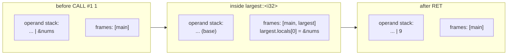
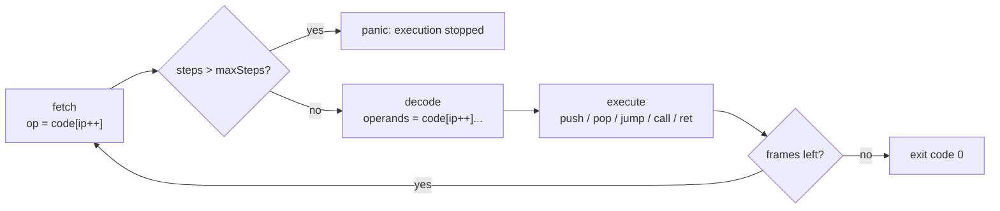
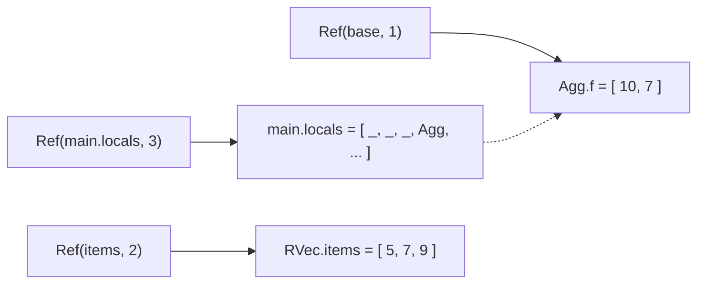

# 12 · The Virtual Machine

The last stage of TSRust executes the bytecode. Real Rust programs run directly on the CPU. TSRust programs run on a **virtual machine**: a TypeScript program that reads instructions one at a time and does what each one says. This chapter covers how Rust values are represented in JavaScript, how calls and references work, and how the VM reproduces Rust's runtime behavior (overflow panics, bounds checks, exact `println!` output) closely enough that most programs print byte-for-byte what `rustc` would.

The VM is one of two executors. The other is the native back end ([15-native-code.md](15-native-code.md)), which compiles the same bytecode to x86-64 machine code. The two share nothing below the `Program`, so the conformance check, which compares both against `rustc`, also checks them against each other. Where they differ, this chapter says so.

Source files:

- [src/vm/vm.ts](../src/vm/vm.ts): the interpreter loop, frames, arithmetic, and structural operations.
- [src/vm/values.ts](../src/vm/values.ts): runtime value classes and UTF-8 helpers.
- [src/vm/intrinsics.ts](../src/vm/intrinsics.ts): native functions behind the standard library.
- [src/vm/format.ts](../src/vm/format.ts): Rust-exact `Display` and `Debug`.

## Values

Rust has a precise memory model: every type has a size, and a `Vec<i32>` is a pointer, a capacity and a length. The VM doesn't model bytes at all. It maps each kind of Rust value onto a JavaScript value. The table is in the header of [values.ts](../src/vm/values.ts):

| Rust | VM representation |
|---|---|
| integers, floats | JS `number` |
| `bool` | JS `boolean` |
| `char` | one-code-point JS `string` |
| `&str` | JS `string` (immutable, so no `Ref` needed) |
| `()` | `undefined` |
| struct, tuple, enum variant | `Agg`: a tag plus an array of fields |
| `String` | `RString`: a mutable box around a JS string |
| `Vec<T>` | `RVec` |
| `Box<T>` | a one-element JS array `[value]` |
| `HashMap<K, V>` | `RMap` |
| `&T`, `&mut T` | `Ref`: an array plus an index |

Some consequences:

- **One aggregate class.** A struct, a tuple and an enum variant are all `new Agg(tag, fields)`. For an enum, `tag` is the variant index (`None` = 0, `Some` = 1); for structs and tuples it is 0. Field names exist only in the type descriptors ([10-code-generation.md](10-code-generation.md)), which are consulted only for printing and structural operations.
- **`String` versus `&str`.** A `String` is mutable and owned, so it needs an identity: two `RString` objects with the same text are different strings, and `push_str` mutates one in place. A `&str` is an immutable view, so a plain JS string serves. Turning `&String` into `&str` (deref coercion, the `STR_REF` instruction) just reads `.s`.
- **Moves are free.** Moving a struct copies the `Agg` pointer. `Copy` types get a real duplicate through the `COPY` instruction, which calls `copyValue`.

## Frames and the operand stack

The VM's state is small:

```ts
interface Frame {
  fn: FunctionCode;
  code: number[];
  ip: number;
  locals: Value[];
  /** Operand stack height when the frame was entered. */
  base: number;
}
```

There is one **operand stack** shared by all frames, and a stack of **frames**, one per active call. Each frame has its own instruction pointer `ip` and its own array of local slots.

`CALL f n` pops `n` arguments into the new frame's first slots, last argument first:

```ts
  private call(fnIndex: number, argc: number) {
    const fn = this.program.functions[fnIndex];
    if (this.frames.length >= (this.opts.maxDepth ?? 2000)) {
      throw new Panic("stack overflow: too many nested calls (infinite recursion?)");
    }
    const locals: Value[] = new Array(fn.locals);
    for (let i = argc - 1; i >= 0; i--) locals[i] = this.stack.pop();
    this.frames.push({ fn, code: fn.code, ip: 0, locals, base: this.stack.length });
  }
```

`RET` pops the return value, truncates the operand stack back to the frame's `base` (discarding anything the callee left behind), pops the frame, and pushes the return value for the caller:

```ts
        case Op.RET: {
          const v = stack.pop();
          stack.length = frame.base;
          this.frames.pop();
          stack.push(v);
          break;
        }
```



The VM never recurses in TypeScript: a Rust call pushes a frame and the same `while` loop keeps going. A deeply recursive Rust program therefore can't overflow the JavaScript stack. Instead, the `maxDepth` limit (2000 frames by default) turns runaway recursion into a Rust-style panic.

## Fetch, decode, execute

The interpreter is one `while` loop with a `switch`:

```ts
    while (this.frames.length) {
      const frame = this.frames[this.frames.length - 1];
      const code = frame.code;
      const op = code[frame.ip++];
      if (++this.steps > maxSteps) throw new Panic(`TSRust: execution stopped after ${maxSteps} instructions (infinite loop?)`);
      switch (op) {
        case Op.NOP: break;
        case Op.CONST: stack.push(this.program.constants[code[frame.ip++]]); break;
```

**Fetch** reads `code[ip]`. **Decode** reads the operands, each case advancing `ip` past its own (`code[frame.ip++]`). **Execute** pushes, pops, jumps or calls. A jump just assigns `frame.ip`. The loop ends when `main`'s frame returns and the frame stack is empty.



The step limit exists for the browser. An infinite `loop {}` in the playground would freeze the tab, so the VM stops after `maxSteps` instructions: 200 million by default and 50 million in the playground.

```text
thread 'main' panicked at p.rs:2:30:
TSRust: execution stopped after 200000000 instructions (infinite loop?)
```

## References are `Ref` slots

The key idea of the memory model is that **every place a Rust reference can point to lives in some JavaScript array**:

| Place | Array | Index |
|---|---|---|
| local variable | `frame.locals` | slot number |
| struct/tuple field | `agg.f` | field index |
| `Vec` element | `vec.items` | element index |
| `Box` contents | the box itself (`[value]`) | 0 |
| `HashMap` value | `map.vals` | entry index |

So a reference can be a single class:

```ts
export class Ref {
  base: Value[];
  i: number;
  constructor(base: Value[], i: number) {
    this.base = base;
    this.i = i;
  }
  get(): Value {
    return this.base[this.i];
  }
  set(v: Value) {
    this.base[this.i] = v;
  }
}
```

`REF_LOCAL 3` is `new Ref(frame.locals, 3)`. `FIELD_REF i` pops a reference to a struct and pushes `new Ref(struct.f, i)`. `INDEX_REF` checks bounds, then pushes `new Ref(vec.items, i)`. `LOAD_REF` and `STORE_REF` call `get()` and `set()`. `&mut v[2]` passed to a function really does let that function overwrite the vector's element in place.



Two things make this safe: the borrow checker, and JavaScript's garbage collector. A `Ref` keeps its array alive, so a dangling reference can't crash the VM. But the borrow checker has already rejected any program that could *observe* one, such as a reference to a local that outlives its frame (E0597, E0515).

`LOAD_REF` is strict about what it dereferences. A `&str` is represented by the string itself, so a JavaScript string passes through unchanged. But a number, a boolean or `undefined` can never be a reference, and `LOAD_REF` on one is an internal error (for example `VM: LOAD_REF of a non-reference (5) in main::f`), not a quiet pass-through:

```ts
        case Op.LOAD_REF: {
          const r = stack.pop();
          // Only references (and &str, which is its own reference) can be dereferenced.
          if (typeof r === "number" || typeof r === "boolean" || r === undefined) throw new Error(`VM: LOAD_REF of a non-reference (${String(r)}) in ${frame.fn.name}`);
          stack.push(r instanceof Ref ? r.get() : r);
          break;
        }
```

An earlier version let such values through, to absorb code that emitted one `LOAD_REF` too many after several layers of auto-deref. Native code can't be that forgiving: there, `LOAD_REF` is a memory load from whatever address is on the stack ([15-native-code.md](15-native-code.md)). So the bytecode must be exact, and the VM now checks that it is.

## Checked arithmetic and panics

Rust debug builds panic on integer overflow, and TSRust always behaves like a debug build. Every arithmetic instruction carries its numeric kind (`ADD i32`), and the result is range-checked:

```ts
  private checkInt(v: number, k: number, what: string): number {
    const name = this.kind(k);
    if (name === "f32") return Math.fround(v);
    if (name === "f64") return v;
    const [lo, hi] = intRange(name);
    if (!(v >= lo && v <= hi)) {
```

The JavaScript computation `a + b` is exact for any two 32-bit integers, so "compute in a `number`, then range-check" detects overflow exactly for every type up to 32 bits. Division truncates toward zero (`Math.trunc(a / b)`) as Rust's does, and dividing by zero panics before computing anything. Two JavaScript details need care. `0 / -5`, `0 * -5` and `-5 % 5` produce JavaScript's `-0`, which would later print as `-0` after `as f64`, so the integer paths add `+ 0` to turn it into `0`. And `a % -1` is always 0 in JavaScript, but Rust panics on `i32::MIN % -1` ("attempt to calculate the remainder with overflow") because the matching division overflows, so a divisor of `-1` first range-checks `-a`. Shifts panic when the shift amount is at least the bit width. Bitwise operations go through `BigInt.asIntN`/`asUintN` to get two's-complement wrapping right.

A panic is a JavaScript exception of class `Panic`. `run()` catches it, looks up the source location, and prints the same text rustc's runtime does, exiting with code 101:

```text
thread 'main' panicked at p.rs:2:38:
attempt to add with overflow
note: run with `RUST_BACKTRACE=1` environment variable to display a backtrace
```

```text
thread 'main' panicked at p.rs:2:54:
index out of bounds: the len is 3 but the index is 7
note: run with `RUST_BACKTRACE=1` environment variable to display a backtrace
```

The location comes from a line table: the last entry at or before the current instruction (`f.fn.lines[i] <= f.ip - 1`). But it isn't always the current function's table. `location()` walks the frames from the innermost outwards and uses the first one that is *not* a standard-library function:

```ts
    // Like #[track_caller]: report the innermost frame outside the standard library.
    const f = [...this.frames].reverse().find((x) => !isStdFunction(this.program, x.fn)) ?? this.frames[this.frames.length - 1];
```

That imitates rustc's `#[track_caller]` attribute, which makes `unwrap()` report where *you* called it. The suspended frame's `ip` is just past its `CALL`, and code generation records each method call's location at the method name, so the result is exactly rustc's:

```text
thread 'main' panicked at q.rs:3:15:
called `Result::unwrap()` on an `Err` value: "boom"
```

for `let v = r.unwrap();` on line 3, where column 15 is the `u` of `unwrap`. The native back end reaches the same answer differently: standard-library code never updates its "current location" variable ([15-native-code.md](15-native-code.md)).

Because the panic is thrown, not returned, it unwinds the whole VM in one step. There is no `catch_unwind` and no `Drop`.

### The 2^53 limitation

A JavaScript `number` is an IEEE-754 double, which represents integers exactly only up to 2^53 (9,007,199,254,740,992). Rust's `i64` goes up to about 9.2 × 10^18. Rather than silently compute wrong answers, TSRust narrows 64-bit types to the safe range:

```ts
export function intRange(name: string): [number, number] {
  const bits = INT_BITS[name];
  const signed = name.startsWith("i");
  if (bits >= 53) return signed ? [Number.MIN_SAFE_INTEGER, Number.MAX_SAFE_INTEGER] : [0, Number.MAX_SAFE_INTEGER];
```

`i64::MAX` in the TSRust standard library is therefore `9007199254740991`, and exceeding it panics with an explanation:

```text
thread 'main' panicked at p.rs:2:51:
attempt to add with overflow (TSRust stores 64-bit integers as JavaScript numbers, exact only up to 2^53)
```

`i128` and `u128` are accepted by the parser and type checker but have the same limit and no methods. Using `BigInt` for wide types is a good project ([14-differences-from-rust.md](14-differences-from-rust.md)).

Native executables don't have this problem. There, every integer is a 64-bit machine word and overflow is checked with the CPU's flags, so `3000000000u64 * 3000000000` prints `9000000000000000000`, which the VM refuses with the panic above. Two limits remain on both sides: integer *literals* are parsed into JavaScript numbers by the lexer and stored as `f64` in the `.tsrb` file, and the standard library's `i64::MAX` is `9007199254740991` for both ([15-native-code.md](15-native-code.md)).

## Casts

`as` compiles to `CAST from to`, handled by `castValue`. It follows Rust's rules:

| Cast | Rule | Example (real output) |
|---|---|---|
| int → narrower int | wrap (two's complement, via `BigInt`) | `300 as u8` = `44`, `-1i32 as u32` = `4294967295` |
| float → int | truncate toward zero, **saturate** at the bounds, NaN → 0 | `3.99 as i32` = `3`, `-5.5 as u8` = `0` |
| int → `char` | code point | `65u8 as char` = `A` |
| `char` → int | code point | `'é' as u32` = `233` |
| anything → `f32` | `Math.fround` | |
| `bool` → int | 0 or 1 | |
| C-like enum → int | `GET_TAG`, then cast from `i32` | |

Saturating float-to-int casts are Rust's behavior since 1.45. Before that they were undefined behavior.

## Structural operations for derives

`#[derive(PartialEq, PartialOrd, Clone, Debug)]` does not generate Rust code in TSRust. The code generator emits a single instruction carrying a type descriptor, and the VM walks the value and the descriptor together:

- `DEEP_EQ t`: equal if the tags match and all fields are recursively equal. `String`s compare by text, and `Vec`s by length and then elementwise.
- `DEEP_CMP t`: lexicographic comparison. Enum variants compare by declaration order first, which is the rule `#[derive(PartialOrd)]` uses. A NaN anywhere produces `NaN`, which `cmp::to_option_ordering` turns into `None`.
- `CLONE t`: a deep copy driven by the descriptor. `String`, `Vec`, `Box` and `HashMap` get new objects. Primitives and shared references are returned as-is.
- `COPY t`: the cheaper copy used for `Copy` aggregates. The VM ignores the descriptor operand, because a `Copy` type can only contain primitives, references and other `Copy` aggregates, so copying every nested `Agg` is enough. The native runtime, which can't tell an aggregate pointer from an integer, follows the descriptor.

```ts
      case "enum": {
        const x = a as Agg, y = b as Agg;
        if (x.tag !== y.tag) return false;
        return d.variants[x.tag].fields.every((f, i) => this.deepEq(x.f[i], y.f[i], f.ty));
      }
```

This is fast and short, but it is not exactly what rustc does. A derived impl in Rust calls each field's *own* impl. The VM's structural walk only follows the descriptor, so a hand-written `impl Debug` or `impl PartialEq` on a field's type is bypassed when the outer type uses a derive ([14-differences-from-rust.md](14-differences-from-rust.md) shows a concrete case).

## Formatting exactly like Rust

Matching Rust's output byte-for-byte lets you diff TSRust against real `rustc`. The repository's conformance script (`npm run conformance`) compiles every example with both `rustc` and TSRust and diffs the output. [format.ts](../src/vm/format.ts) implements `Display` and `Debug` from the type descriptor:

```text
$ cat vm1.rs   # (excerpt)
    println!("{} {:?} {} {:?} {}", 1.0, 1.0, 0.1 + 0.2, 1e21, 1e-7);
    println!("{} {:?} {:.3}", 0.0 / 0.0, -0.0, 2.0f64.sqrt());
$ node src/cli.ts run vm1.rs
1 1.0 0.30000000000000004 1000000000000000000000.0 0.0000001
NaN -0.0 1.414
```

The float rules, from `formatFloat`:

- `Display` of a whole number has no decimal point (`1`), while `Debug` adds `.0` (`1.0`).
- Rust never uses exponent notation for `Display`, so `plainNumber` expands JavaScript's `1e21` into digits.
- NaN and infinities print as `NaN`, `inf` and `-inf`. Negative zero is `-0` under `Display` and `-0.0` under `Debug`.
- `{:.N}` uses `toFixed(N)`, which rounds ties away from zero where Rust rounds to even (the native runtime gets this right, and also prints `f32` values with `f32` digits; see [14-differences-from-rust.md](14-differences-from-rust.md)).

`Debug` for strings and chars adds quotes and escapes (`\n`, `\"`, `\'`, `\\`, `\0`). Pretty debug, `{:#?}`, puts one field per line, indents by four spaces, and adds trailing commas:

```text
Player { name: "Ann", scores: [3, 4], pos: (1.5, -2.0) }
Player {
    name: "Ann",
    scores: [
        3,
        4,
    ],
    pos: (
        1.5,
        -2.0,
    ),
}
```

One small detail is a single-element tuple, which prints as `(x,)` in compact mode, exactly as Rust does.

## Strings are UTF-8, indices are bytes

JavaScript strings are UTF-16, while Rust strings are UTF-8, and Rust's `len()` and slice indices count **bytes**. The VM keeps JS strings, which is convenient for printing, and converts positions at the boundary:

```ts
export function utf8Len(s: string): number {
  let n = 0;
  for (const ch of s) {
    const cp = ch.codePointAt(0)!;
    n += cp < 0x80 ? 1 : cp < 0x800 ? 2 : cp < 0x10000 ? 3 : 4;
  }
  return n;
}
```

`byteToIndex` walks the string to find the JS index for a byte offset, returning -1 when the offset falls inside a multi-byte character. So `"héllo"` behaves the way it does in Rust:

```text
6 hé 5          // s.len(), &s[0..3], s.chars().count()
```

```text
thread 'main' panicked at p.rs:2:52:
byte index 2 is not a char boundary
```

`str::find` returns a byte offset too (`indexToByte`), and the `Chars` iterator advances a byte position by `utf8Len(c)` each step. All of this is O(n) per operation, where Rust's is O(1). That doesn't matter at playground scale.

## HashMap

Real `HashMap` uses SipHash with a random seed, so its iteration order is unspecified and changes from run to run. TSRust's `RMap` is **insertion-ordered**, which makes output deterministic:

```ts
export class RMap {
  keys: Value[] = [];
  vals: Value[] = [];
  alive: boolean[] = [];
  index = new Map<string, number>();
  size = 0;
}
```

Keys are hashed by turning them into a string with `keyOf`: `n42` for a number, `s...` for a string, `a1(n3,sx)` for an aggregate, and so on. A JavaScript `Map` from that string to an entry index does the lookup. Removal leaves a **tombstone** (`alive[i] = false`) instead of shifting the arrays, so the indices held by iterators and `Ref`s into `vals` stay valid. Re-inserting a removed key appends a new entry at the end:

```text
{"zebra": 1, "mango": 3, "apple": 4}     // after inserting zebra, apple, mango; removing apple; re-inserting apple
```

`collections::slot_count` and `collections::slot` expose the raw entry array so that iterators written in Rust can skip tombstones ([13-standard-library.md](13-standard-library.md)).

## Intrinsics and `process::exit`

`INTRINSIC name argc` pops `argc` arguments and calls a TypeScript function from the table built by `buildIntrinsics()`. Names are resolved by string when the instruction executes. A `.tsrb` file that names an intrinsic the VM lacks fails with "missing intrinsic" only if that call is actually reached. Intrinsics receive `&self` as a `Ref`, `self` by value as the value, and a small context for structural cloning (used by `vec![x; n]`).

`std::process::exit(code)` throws an `Exit` exception. `run()` catches it and returns that exit code with the output so far:

```text
$ node src/cli.ts run p.rs; echo "exit=$?"
before
exit=3
```

## Where TSRust differs from rustc

- **Integers are doubles.** 64-bit types are limited to ±(2^53 − 1), and arithmetic always panics on overflow, like a debug build. There is no release-mode wrapping. (Native executables have full 64-bit arithmetic.)
- **Panics abort the program.** There is no unwinding, no `Drop`, no `catch_unwind` and no threads. Running out of stack is an ordinary TSRust panic, where a native Rust program aborts with "has overflowed its stack".
- **Memory is garbage collected.** Ownership is enforced at compile time, but nothing is ever freed explicitly. A leaked `Box` costs nothing.
- **`HashMap` is insertion-ordered**, and its "hash" is a string key.
- **Structural derives** bypass hand-written impls on field types.
- **Strings** are UTF-16 internally, with byte offsets computed on demand.
- **Panic locations** skip every standard-library frame. rustc only does that for functions marked `#[track_caller]`, so a panic deep inside a std function that isn't marked would point into the library in Rust, but at your code in TSRust.

## Try it

```sh
node src/cli.ts run examples/12_operators.rs
node src/cli.ts run examples/errors/panic_overflow.rs; echo "exit code $?"
node src/cli.ts run examples/errors/panic_index_out_of_bounds.rs
node src/cli.ts run examples/09_collections.rs
```

In the playground, the **Output** tab shows stdout, stderr and panics. Try these:

- `let x: u8 = 255; let y = x + 1;` (overflow), then `x.wrapping_add(1)` and `x.checked_add(1)`.
- `println!("{:#?}", ...)` on a nested struct with a `Vec` and an `Option`. Compare it to real Rust output.
- `let s = String::from("naïve"); println!("{}", &s[0..3]);` and work out why it panics.
- `loop {}`: watch the step limit stop it.
- Insert, remove and re-insert keys in a `HashMap`, and predict the printed order.

## Exercises

1. **BigInt for 64-bit and 128-bit integers.** Represent `i64`/`u64`/`i128`/`u128` as `bigint` in the VM: `CONST` needs a new constant tag ([11-bytecode-format.md](11-bytecode-format.md)), `arith` and `checkInt` need a `bigint` path, and `format.ts` must print them. Start with `intRange` and `castValue`.
2. **Backtraces.** When `RUST_BACKTRACE=1` is set, print every frame's function name and location on panic. Each frame already has `fn` and `ip`, so generalize `location()` to take a frame.
3. **Formatting width and alignment.** Support `{:>8}`, `{:<5}`, `{:^7}` and `{:08.3}`. The parser side is in [src/parser/format.ts](../src/parser/format.ts). Extend the `FMT` operands (or add a new opcode) and pad in the VM.
4. **A profiler.** Count executed instructions per function and per opcode in `loop()`, and print the top ten after the run. Use it to find the hottest standard-library function in `examples/15_game_of_life.rs`.
5. **Faster dispatch.** Profile the `switch`, then try caching `frame.code` and `frame.ip` in local variables, writing `ip` back only on calls and returns. Measure with a tight loop program and `RunResult.steps`.
