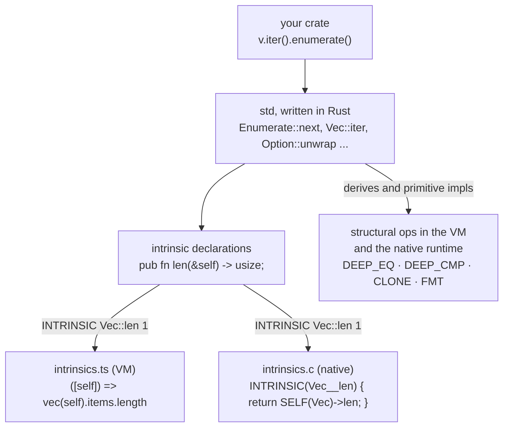
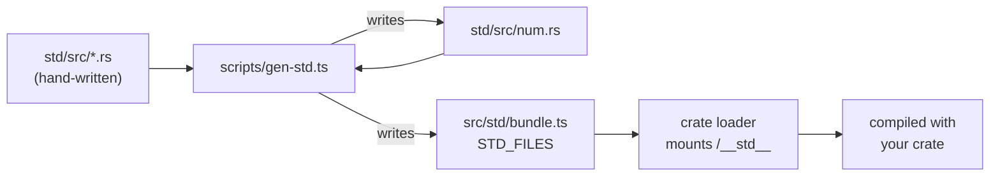
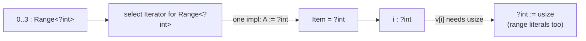

# 13 · The Standard Library

Most of Rust's standard library is ordinary Rust. `Option::unwrap_or` is a `match`, `Iterator::count` is a loop, and `Vec::get` is a bounds check plus an index. Only at the very bottom do you find things the language can't express on its own: allocating memory, talking to the operating system, compiler intrinsics.

TSRust's standard library has the same shape. It is a crate named `std`, written in Rust under [std/src/](../std/src/), and compiled by TSRust exactly like your code: resolved, type-checked, monomorphized and turned into bytecode. At the bottom are **intrinsics**, functions declared without a body. Each one is implemented twice: in TypeScript in [src/vm/intrinsics.ts](../src/vm/intrinsics.ts) for the VM, and in C in [native/runtime/intrinsics.c](../native/runtime/intrinsics.c) for native executables ([15-native-code.md](15-native-code.md)).

From the crate root, [std/src/lib.rs](../std/src/lib.rs):

```rust
//! At the very bottom are **intrinsics**: functions declared without a body,
//! like `pub fn push(&mut self, value: T);`. The code generator turns a call
//! to an intrinsic into a single `INTRINSIC` bytecode instruction that the VM
//! implements in TypeScript. Only this crate may declare them.
```



Reading the standard library is one of the best ways to learn how TSRust works, because it uses the compiler's own features (traits, generics, associated types, lifetimes, match ergonomics) with nothing hidden.

## How `std` gets into every program

The loader ([src/crates/loader.ts](../src/crates/loader.ts)) mounts the standard library at the virtual path `/__std__` and adds it as a dependency of every crate. The sources come from `STD_FILES` in `src/std/bundle.ts`, a generated file that embeds every file under `std/` as a string. That is how the browser playground compiles programs without a filesystem. It is also why the line tables of standard-library functions name files like `__std__/src/result.rs`. Both executors use that prefix (`isStdFunction` in [program.ts](../src/bytecode/program.ts)) to recognize library code, and report a panic inside it at the line in *your* code that called it, the way rustc's `#[track_caller]` does for `unwrap()` ([12-the-vm.md](12-the-vm.md)).

[scripts/gen-std.ts](../scripts/gen-std.ts) generates two things:

1. **`std/src/num.rs`**. Real Rust uses `macro_rules!` to stamp out the same methods for `i8`, `i16`, ..., `u64`. TSRust has no `macro_rules!`, so a TypeScript script writes the text instead: `MIN`/`MAX`, `checked_add`, `wrapping_mul`, `abs`, `Step`, `FromStr`, `Sum` and `Product` for every integer type, plus float and `char` methods.
2. **`src/std/bundle.ts`**, the embedded copy of all std sources.



`npm run gen` runs it, and `npm test` runs it automatically (`pretest`). **Edit `gen-std.ts`, not `num.rs`**: the generated file says so in its header, and the next `npm run gen` overwrites it.

### Intrinsics are only allowed in `std`

When the resolver meets a function without a body, it checks which crate it is in:

```ts
  private markIntrinsic(id: DefId, fn: A.FnItem, crate: Crate) {
    if (fn.body) return;
    if (crate.isStd) this.defs[id].intrinsic = true;
    else this.diags.error("resolve", fn.nameSpan, `free function without a body`)
      .help(`provide a definition for the function: \`{ ... }\``);
  }
```

The code generator turns a call to an intrinsic `DefId` into `INTRINSIC <name> <argc>`. The name follows a fixed rule (`intrinsicName` in [codegen.ts](../src/codegen/codegen.ts)): for a method in an `impl`, it is the self type's head plus the method (`Vec::push`, `str::len`, `i32::pow`); for a free function, it is the module plus the function (`mem::replace`, `collections::slot`). The VM looks that string up in the table built by `buildIntrinsics()`. The native back end turns it into a C symbol by replacing `::` with `__` and adding `rt_i_` (`rt_i_Vec__push`, `rt_i_mem__replace`), and links the call to that function in the runtime blob.

## The module list

| Module | Contents | Intrinsics |
|---|---|---|
| [boxed](../std/src/boxed.rs) | `Box<T>`, `Box::new`, `Clone for Box<T>`, `Display for Box<T>` (delegates to the inner value) | `Box::new` |
| [clone](../std/src/clone.rs) | `trait Clone` | — |
| [cmp](../std/src/cmp.rs) | `Ordering`, `PartialEq`, `Eq`, `PartialOrd` (with default `lt`/`le`/`gt`/`ge`), `Ord` (with `max`/`min`/`clamp`), `cmp::max`/`min` | — |
| [collections](../std/src/collections.rs) | `HashMap`, the entry API, `Iter`/`Keys`/`Values`, `trait Hash` (a marker) | map storage and lookup |
| [convert](../std/src/convert.rs) | `From`, `Into` (blanket impl), `From<&str> for String` | — |
| [default](../std/src/default.rs) | `trait Default` | — |
| [fmt](../std/src/fmt.rs) | `Formatter`, `Display`, `Debug`, `fmt::Result`, `fmt::Error` | `push_str`, `alternate` |
| [iter](../std/src/iter.rs) | `Iterator` and its provided methods, `IntoIterator`, `FromIterator`, `Sum`, `Product`, adapters, `Step`, range iteration | — |
| [marker](../std/src/marker.rs) | `trait Copy: Clone` | — |
| [mem](../std/src/mem.rs) | `replace`, `swap`, `take`, `drop` | `replace`, `swap` |
| [num](../std/src/num.rs) | generated numeric and `char` methods, `consts::PI` ... | most methods |
| [ops](../std/src/ops.rs) | `Add`, `Sub`, `Mul`, `Div`, `Rem`, `Neg`, `AddAssign`, `SubAssign`, `MulAssign`, `Range`, `RangeInclusive` | — |
| [option](../std/src/option.rs) | `Option<T>` and its combinators, `option::Iter` | — |
| [prelude](../std/src/prelude.rs) | re-exports (below) | — |
| [process](../std/src/process.rs) | `exit` | `exit` |
| [result](../std/src/result.rs) | `Result<T, E>` and its combinators | — |
| [str](../std/src/str.rs) | `str` methods, `Chars`, `Split`, `FromStr`, `ParseIntError`, `ParseFloatError` | searching, trimming, slicing |
| [string](../std/src/string.rs) | `String`, `ToString` (blanket impl over `Display`), `String + &str` | storage and mutation |
| [vec](../std/src/vec.rs) | `Vec<T>`, `Iter`, `IterMut`, `IntoIter`, sorting, `FromIterator` | storage and mutation |

## The prelude

Rust code can say `Some(5)`, `Vec::new()` and `x.clone()` without any `use`, because every module implicitly imports the **prelude**. TSRust's is [std/src/prelude.rs](../std/src/prelude.rs):

```rust
pub use crate::boxed::Box;
pub use crate::clone::Clone;
pub use crate::cmp::{Eq, Ord, PartialEq, PartialOrd};
pub use crate::convert::{From, Into};
pub use crate::default::Default;
pub use crate::iter::{IntoIterator, Iterator};
pub use crate::marker::Copy;
pub use crate::mem::drop;
pub use crate::option::Option::{self, None, Some};
pub use crate::result::Result::{self, Err, Ok};
pub use crate::string::{String, ToString};
pub use crate::vec::Vec;
```

The prelude is a real module of `use` declarations, not a hard-coded list. The resolver finds it once (`scope.types.get("prelude")`) and consults it as the last step of name lookup, after local variables, block items, module items and extern crates, and before primitive types ([04-name-resolution.md](04-name-resolution.md)). `HashMap` is not in the prelude, which is why you write `use std::collections::HashMap;` in TSRust just as in Rust.

## Lang items

The compiler has to know about some std items *by identity*. A range expression `a..b` must build a `std::ops::Range`. `?` must recognize `Option` and `Result`. A `for` loop calls `IntoIterator::into_iter`. `==` means `PartialEq::eq`. rustc marks such items with `#[lang = "..."]` attributes in the library source. TSRust keeps a table in the resolver instead, `LANG_PATHS` in [src/resolve/resolver.ts](../src/resolve/resolver.ts):

```ts
const LANG_PATHS: Record<string, string[]> = {
  Option: ["option", "Option"], Result: ["result", "Result"], Ordering: ["cmp", "Ordering"],
  Vec: ["vec", "Vec"], String: ["string", "String"], Box: ["boxed", "Box"], HashMap: ["collections", "HashMap"],
  Range: ["ops", "Range"], RangeInclusive: ["ops", "RangeInclusive"], Formatter: ["fmt", "Formatter"],
  Clone: ["clone", "Clone"], Copy: ["marker", "Copy"], Default: ["default", "Default"],
  PartialEq: ["cmp", "PartialEq"], Eq: ["cmp", "Eq"], PartialOrd: ["cmp", "PartialOrd"], Ord: ["cmp", "Ord"],
  Debug: ["fmt", "Debug"], Display: ["fmt", "Display"], Hash: ["collections", "Hash"],
  Iterator: ["iter", "Iterator"], IntoIterator: ["iter", "IntoIterator"], ToString: ["string", "ToString"],
  Add: ["ops", "Add"], Sub: ["ops", "Sub"], Mul: ["ops", "Mul"], Div: ["ops", "Div"], Rem: ["ops", "Rem"], Neg: ["ops", "Neg"],
  AddAssign: ["ops", "AddAssign"], SubAssign: ["ops", "SubAssign"], MulAssign: ["ops", "MulAssign"],
  From: ["convert", "From"],
};
```

After collecting definitions, the resolver looks up each path in the std crate and records `name → DefId`. Later stages ask `tcx.lang("Copy")` or `tcx.isLang(def, "Vec")`.

Five of these are also **native ADTs** (`isNativeAdt`: `Vec`, `String`, `Box`, `HashMap`, `Formatter`). They are declared in Rust as fieldless structs, `pub struct Vec<T>;`, and their storage belongs to the executor: `RVec`, `RString`, a one-element array and `RMap` in the VM ([12-the-vm.md](12-the-vm.md)), and C structs such as `Vec { len, data, cap }` in the native runtime ([runtime.h](../native/runtime/runtime.h)). The type checker gives `Box` and `String` their deref behavior. The code generator emits special type descriptors for them and never `COPY`s them.

## Notable implementations

### `Option` and `Result`

Both are plain enums. `Option` derives `Clone, Copy, PartialEq, Eq, PartialOrd, Ord, Debug`. The variant order `None, Some` is significant: it makes `None` tag 0 and `None < Some(_)`, as in Rust, and the code generator relies on it for `?` and `for` loops. The combinators are ordinary `match`es that show off Rust features:

```rust
    /// `&Option<T>` to `Option<&T>`. Note how `match self` with `self: &Self`
    /// binds `value` as `&T` automatically ("match ergonomics").
    pub fn as_ref(&self) -> Option<&T> {
        match self {
            Some(value) => Some(value),
            None => None,
        }
    }

    /// Take the value out, leaving `None` in its place.
    pub fn take(&mut self) -> Option<T> {
        crate::mem::replace(self, None)
    }
```

`Result` splits its `impl` by bounds. `unwrap` and `expect` must print the error, so they exist only when `E: Debug`:

```rust
/// These methods need to print the error, so they only exist when `E: Debug`.
/// Splitting an `impl` by bounds like this is a common Rust pattern.
impl<T, E: Debug> Result<T, E> {
```

The library has **no** closure-taking combinators: no `map`, `and_then`, `unwrap_or_else` or `filter`. TSRust has no closures yet ([14-differences-from-rust.md](14-differences-from-rust.md)).

### Iterator adapters without closures

`Iterator` has one required method, `next`, and a set of provided methods with default bodies. Without closures, the adapters are the ones that need no function argument: `enumerate`, `skip`, `take`, `step_by`, `zip` and `chain`, plus the consumers `count`, `last`, `nth`, `sum`, `product` and `collect`. Each adapter is a generic struct wrapping the inner iterator:

```rust
impl<I: Iterator> Iterator for Enumerate<I> {
    type Item = (usize, I::Item);
    fn next(&mut self) -> Option<(usize, I::Item)> {
        match self.iter.next() {
            Some(x) => {
                let i = self.count;
                self.count += 1;
                Some((i, x))
            }
            None => None,
        }
    }
}
```

After monomorphization, `v.iter().enumerate().skip(1).take(2)` becomes a stack of concrete structs (`Take<Skip<Enumerate<Iter<i32>>>>`), each with its own compiled `next`. That is how Rust's zero-cost iterators work too, minus the inlining that makes them actually zero-cost.

`sum`, `product` and `collect` dispatch through traits on the *result* type: `fn collect<B: FromIterator<Self::Item>>(self) -> B { B::from_iter(self) }`. That is why `let v: Vec<_> = it.collect();` needs the annotation, in TSRust as in Rust.

### `Step` and the generic `Range` impls

How should `for i in 0..n` iterate? One option is a separate impl for each integer type, `impl Iterator for Range<i32>`, `impl Iterator for Range<u8>`, and so on. TSRust instead uses a single generic impl over a small trait:

```rust
/// Types with a successor, so ranges of them can be iterated. One generic
/// impl per range type (below) lets inference flow: in `for i in 0..n`, the
/// item type is simply the range's element type.
pub trait Step: Copy + PartialOrd {
    fn forward(self) -> Self;
}

impl<A: Step> Iterator for crate::ops::Range<A> {
    type Item = A;
```

The reason is **type inference**. In

```rust
    let v = vec![10, 20, 30];
    let mut sum = 0;
    for i in 0..3 {
        sum += v[i];
    }
```

the literals `0` and `3` start out as an unknown integer type `{integer}`. With ten separate impls, the question "`Range<{integer}>: Iterator`, and what is its `Item`?" has ten candidate answers, so the solver would have to answer *ambiguous* and the loop variable's type would stay unknown. With one generic impl, the answer is immediate: the impl matches with `A := {integer}`, and `Item = A`. The loop variable `i` gets the *same* inference variable as the range, and when `v[i]` later requires `usize`, the range's literals become `usize` too:

```text
$ node src/cli.ts dump types step.rs
   2:9   v: Vec<i32>  (#8313)
   3:9   mut sum: i32  (#8319)
   4:9   i: usize  (#8322)
```



The `Step` impls themselves are generated, one per integer type, in `num.rs` (`fn forward(self) -> i8 { self + 1 }`). `char` has no `Step` impl, so `'a'..'e'` can't be iterated in TSRust. `RangeInclusive` carries an `exhausted` flag so that `0..=255u8` can yield 255 without computing 256 and overflowing, which is the same trick real Rust uses.

### `Vec`: a few intrinsics, a lot of Rust

`Vec<T>` has ten intrinsic methods (`new`, `push`, `pop`, `len`, `clear`, `insert`, `remove`, `swap`, `truncate`, `reverse`). Everything else is Rust on top of them: `get`, `first`, `last`, `contains`, `append`, `iter`, `iter_mut`, `clone`, `==`, and a `sort` that is an insertion sort written with `>` and `swap`. The owning iterator `IntoIter` uses one private intrinsic, `take_unchecked`, to move an element out of a vector without leaving a hole. A comment explains why that is safe: `IntoIter` owns the vector and never yields the same index twice.

### `HashMap` and the entry API

The storage is native, but iteration and the entry API are Rust. Three private intrinsics expose the VM's entry array:

```rust
fn slot_count<K, V>(map: &HashMap<K, V>) -> usize;
fn slot<K, V>(map: &HashMap<K, V>, index: usize) -> Option<(&K, &V)>;
fn entry_ref<K, V>(map: &mut HashMap<K, V>, key: K, default: V) -> &mut V;
```

`map.entry(k)` builds an `Entry { map, key }` struct that holds a `&mut HashMap`. `or_insert(default)` then calls `entry_ref`, which inserts if needed and returns a `Ref` into the map's value array. So the idiom

```rust
        *counts.entry(word).or_insert(0) += 1;
```

compiles to one `INTRINSIC collections::entry_ref 4` followed by a read-modify-write through the returned reference. The fourth argument isn't in the Rust signature: every `HashMap` and `collections` intrinsic gets the key type's descriptor appended, because the native runtime hashes and compares keys by walking that descriptor ([10-code-generation.md](10-code-generation.md)). It works in TSRust and it passes the borrow checker for the same reasons it does in Rust. The `Entry` holds a mutable loan of the map, and `or_insert`'s signature, `fn or_insert(self, default: V) -> &'a mut V`, says the result keeps that loan alive ([09-lifetimes.md](09-lifetimes.md)).

`Iter`, `Keys` and `Values` walk the slots from 0 to `slot_count` and skip tombstones. Real output from a word-count program:

```text
the: 2
cat: 2
saw: 1
other: 1
```

### Formatting and `ToString`

`Display` and `Debug` are ordinary traits with a `fmt(&self, f: &mut Formatter) -> fmt::Result` method. `Formatter` is a native `String` underneath, and `write_str` appends to it. The `Debug` impls for `Vec<T>` and `HashMap<K, V>` are declared without bodies. The code generator recognizes intrinsic `Debug`/`Display` methods and emits the VM's native `FMT` instead ([10-code-generation.md](10-code-generation.md)).

`ToString` is a blanket impl, exactly as in Rust:

```rust
/// A *blanket implementation*: one impl that covers every `T: Display`.
impl<T: Display + ?Sized> ToString for T {
    fn to_string(&self) -> String {
        format!("{}", self)
    }
}
```

## How to add a standard-library function

### Option A: pure Rust

If the function can be written with existing operations, write it in Rust. For example, to add `Vec::is_sorted` for `T: PartialOrd`, add an `impl<T: PartialOrd> Vec<T>` block to [std/src/vec.rs](../std/src/vec.rs) with a `while` loop comparing `self[i - 1] > self[i]`. Then:

1. Run `npm run gen` to re-bundle `src/std/bundle.ts`. (`node src/cli.ts` reads the bundle, not the files.)
2. Write a test using the `runOk`/`main` helpers from [tests/helpers.ts](../tests/helpers.ts), next to the similar tests in [tests/vm.test.ts](../tests/vm.test.ts).
3. Run `npm test`.

Prefer this route. Rust code in std is type-checked and borrow-checked like everything else, and it shows up in the playground's views.

### Option B: a new intrinsic

Use an intrinsic when you need something the executor must do natively, such as math functions, string searching, or access to native storage. An intrinsic has two implementations, one per executor, and both must agree byte for byte on output. Say you want `f64::hypot`:

1. **Declare it without a body.** Floats are generated, so edit `floatImpl` in [scripts/gen-std.ts](../scripts/gen-std.ts) and add `pub fn hypot(self, other: ${t}) -> ${t};` next to `atan2`. (For a hand-written module, declare it directly in the `.rs` file.)
2. **Implement it** in [src/vm/intrinsics.ts](../src/vm/intrinsics.ts) under the exact name codegen will produce, the self type's head plus the method. In `floatIntrinsics`, add an entry shaped like `atan2`: `` [`${t}::hypot`]: ([a, b]) => f(Math.hypot(n(a), n(b))) ``. Remember the calling convention: `&self`/`&mut self` arrive as a `Ref` (use the `deref`, `vec`, `rstr` and `str` helpers), `self` by value arrives as the value, and `()` is returned as `undefined`.
3. **Implement it again in C**, in [native/runtime/intrinsics.c](../native/runtime/intrinsics.c), as `rt_i_` plus the name with `::` replaced by `__`. Float methods are stamped out by the `FLOAT_INTRINSICS(T, CONV)` macro, so add a line next to `atan2` there: `INTRINSIC(T##__hypot) { UNUSED; return from_f64(CONV(fsqrt(F(0) * F(0) + F(1) * F(1)))); }`. Inside an intrinsic, `A(i)` is argument `i`, `F(i)` is argument `i` as a `double`, and `SELF(T)` dereferences a `&self` argument. There is no libc, so use the runtime's own helpers (`fsqrt` here). Then run `npm run build:runtime`, which needs gcc, `readelf`, `nm` and `objcopy`, and rewrites [src/native/runtime.generated.ts](../src/native/runtime.generated.ts). Commit that file, so nobody else needs a C compiler.
4. **Regenerate**: `npm run gen` rewrites `num.rs` and the bundle.
5. **Test** it, including panics and edge cases (NaN, overflow, empty inputs), in the VM and as a native executable. If it can panic, use rustc's exact message: `throw new Panic(...)` in TypeScript, `rt_panic_cstr(...)` in C. The test "every VM intrinsic has a native implementation" in [tests/native.test.ts](../tests/native.test.ts) fails if you forget step 3.
6. If the intrinsic returns `Option`/`Result`, build values with the `some`, `NONE`, `ok` and `err` helpers from [values.ts](../src/vm/values.ts). They encode the variant tags the enum declarations imply. The C runtime has the same helpers, `some(x)` and `none()`, in [runtime.c](../native/runtime/runtime.c).

An intrinsic missing from the VM's table compiles fine but fails at runtime with ``TSRust: missing intrinsic `name` `` when it is called. One missing from the native runtime fails earlier: the native back end checks every intrinsic a program uses before translating anything, and refuses with ``intrinsic `name` is not available in the native runtime``. Check the spelling against the `INTRINSIC <...>` line in `node src/cli.ts dump bytecode`.

## Where TSRust differs from rustc

- **Much smaller.** No slices, no `Rc`/`RefCell`, no `BTreeMap`/`HashSet`/`VecDeque`, no I/O beyond printing, and no closure-taking APIs (`map`, `filter`, `sort_by`, `unwrap_or_else`...).
- **Lang items are a table**, not `#[lang]` attributes, and the trait-solver's built-in impls for primitives and `String` are hard-coded in [src/typeck/traits.ts](../src/typeck/traits.ts) instead of being written in the library.
- **No `Borrow` trait.** `HashMap::get` takes `&K` exactly, so a `HashMap<&str, V>` needs `map.get(&"key")`.
- **Non-standard helpers.** `str::slice(start, end)` and `str::char_count()` exist to implement `&s[a..b]` and to count characters cheaply. `Vec::extend_from_vec` stands in for `extend`.
- **Error types** are simplified. `ParseIntError` holds a message string, so its `Debug` output differs from rustc's `ParseIntError { kind: InvalidDigit }`.
- **`Formatter::alternate()` always returns `false`**, and user `fmt` impls can't see width or precision.
- **`#[track_caller]` is approximated**: every standard-library function is treated as if it had the attribute, so a panic anywhere inside `std` is reported at the calling line in your code.
- **Two implementations of every intrinsic.** rustc's standard library is compiled once per target. TSRust's Rust part is compiled with your program, but its intrinsics exist in TypeScript and in C, and the two can drift. Case mapping is one place they already differ: the C runtime only knows Latin, Greek and Cyrillic ([15-native-code.md](15-native-code.md)).

## Try it

```sh
node src/cli.ts run examples/07_iterators.rs
node src/cli.ts run examples/09_collections.rs
node src/cli.ts dump types examples/07_iterators.rs      # watch range/iterator types get inferred
less src/std/bundle.ts                                    # the embedded std, as the playground sees it
```

In the playground:

- Chain `v.iter().enumerate().skip(1).step_by(2)` and look in the **Types** tab for the full adapter type.
- Call `.collect()` without a type annotation and read the error in **Diagnostics**.
- Write `println!("{:?}", 0..5)` and compare with real Rust, which prints `0..5`.
- In the **Bytecode** tab's function count, see how many std instances a word-count program needs.

## Exercises

1. **`Vec::sort` in O(n log n).** Replace the insertion sort in [std/src/vec.rs](../std/src/vec.rs) with a merge sort written in Rust. No new intrinsics are needed, only `swap`, indexing, `push` and `pop`. Compare `RunResult.steps` on 1,000 elements.
2. **`DoubleEndedIterator` and `rev()`.** Add the trait with `next_back`, implement it for `Range<A>` and `vec::Iter`, and add a `Rev<I>` adapter. You'll need a `Step::backward` method generated in `gen-std.ts`.
3. **`Step for char`.** Make `'a'..='z'` iterable. `forward` needs a way to go from a `char` to the next code point; consider `as u32` and `as char` casts in Rust, or a new intrinsic.
4. **`HashSet<T>`.** Implement it in Rust as a wrapper around `HashMap<T, ()>`, with `insert`, `contains`, `remove`, `len` and an iterator. Add it to `collections` and decide whether it needs a native `Debug`.
5. **Rust-style `Debug` for ranges.** Write a manual `impl<Idx: Debug> Debug for Range<Idx>` that prints `0..5`, replacing the derive in [std/src/ops.rs](../std/src/ops.rs). You will discover how a user `Debug` impl and the VM's structural formatter interact.
