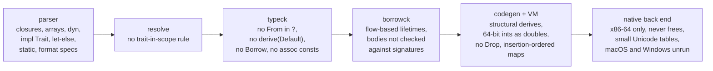

# 14 · Differences from Rust

TSRust is a teaching compiler. It implements a coherent *subset* of Rust, enough to write real programs with ownership, borrowing, traits, generics, pattern matching, iterators and modules, and it aims to behave exactly like `rustc` inside that subset. This chapter is the honest list of where it stops, or where it behaves differently. Every item below was checked against the source or by running the compiler. Where a behavior looks like a bug and not a design choice, the chapter says so.

The differences come from every stage of the pipeline:



## Syntax the parser rejects

These give a clear compile error, usually pointing to a workaround.

| Feature | What you get | Workaround |
|---|---|---|
| Closures `\|x\| x + 1` | "closures are not supported by TSRust yet" | write a named `fn` |
| Arrays and slices `[T; N]`, `&[T]`, `[1, 2, 3]` | "arrays and slices are not supported by TSRust yet; use `Vec<T>`" | `Vec<T>`, `vec![...]` |
| `dyn Trait`, `impl Trait`, `fn(...)` types | "\`dyn\` types are not supported by TSRust yet" | generics with trait bounds |
| `let ... else` | "\`let ... else\` is not supported by TSRust yet" | `match` or `if let` |
| `static` items | parse error | `const` |
| byte literals `b'a'`, `b"..."` | parse error | `'a' as u8` |
| associated `const` in traits | "expected \`fn\`, found keyword \`const\`" | a method returning the value |
| user macros | defining one: "expected item, found identifier \`macro_rules\`"; calling an unknown one: "cannot find macro" (lists the 15 built-ins) | functions |
| named format arguments `{x}` with `x = 1` | rejected | inline capture of a local: `{x}` |
| format specs other than `{}`, `{:?}`, `{:#?}`, `{:.N}` | "unsupported format spec" (e.g. `{:>5}`, `{:x}`, `{:08.3}`, `{:e}`) | format manually |

The built-in macros are `println!`, `print!`, `eprintln!`, `eprint!`, `format!`, `write!`, `writeln!`, `panic!`, `vec!`, `assert!`, `assert_eq!`, `assert_ne!`, `unreachable!`, `todo!` and `unimplemented!`. They are parsed directly as expressions, not expanded from token trees ([02-parsing.md](02-parsing.md)).

## Name resolution and privacy

- **Trait methods don't require the trait to be in scope.** Rust only finds `x.shout()` if `Shout` is imported. TSRust's method probe (`probeTraits` in [src/typeck/check.ts](../src/typeck/check.ts)) considers every trait that has a method by that name, preferring traits from where-clauses. This program is rejected by rustc with E0599 but accepted by TSRust:

  ```rust
  mod a {
      pub trait Shout { fn shout(&self) -> String; }
      impl Shout for i32 { fn shout(&self) -> String { format!("{}!", self) } }
  }
  fn main() {
      let x: i32 = 5;
      println!("{}", x.shout());   // TSRust prints "5!"
  }
  ```


## Type checking

- **No closures or function values.** A function name used as a value is an error ("TSRust doesn't support function pointers or closures yet"), and so is a tuple-variant constructor used as a value (`let f = Some;`, E0533). As a result there is no `map`/`filter`/`fold`/`sort_by`/`unwrap_or_else` in the standard library ([13-standard-library.md](13-standard-library.md)).
- **`?` does not call `From::from`.** The error type of the expression must equal the function's error type exactly. The diagnostic says so: "TSRust's \`?\` does not call \`From::from\` on errors". `Box<dyn Error>` is unavailable anyway.
- **`#[derive(Default)]` is rejected** with a hint to write the impl by hand, even though `Default` is in the derivable list. The other derives (`Debug, Clone, Copy, PartialEq, Eq, PartialOrd, Ord, Hash`) work.
- **No `Borrow` trait.** `HashMap<&str, i32>::remove("apple")` fails with "expected `&&str`, found `&str`". Write `remove(&"apple")`.
- **Operators on not-yet-known types** are assumed to be numeric. If inference later finds something else, you get E0369 with a note asking for a type annotation.
- **Overloadable operators** are `+ - * / %`, unary `-`, and `+= -= *=`, through the lang items in `LANG_PATHS`. `Index`, `Not`, the bitwise traits, `DivAssign` and so on cannot be implemented for user types.
- **Only bounded ranges** `a..b` and `a..=b` exist. `a..`, `..b` and `..` are rejected. `&v[1..3]` on a `Vec` is a type error, because there are no slices. Ranges of `char` aren't iterable (there is no `Step for char`).
- **`i128`/`u128`** exist as types but have no methods.
- **`?Sized`** is parsed and ignored.

## Borrow checking

The borrow checker ([08-ownership-and-borrowing.md](08-ownership-and-borrowing.md), [09-lifetimes.md](09-lifetimes.md)) implements moves, NLL-style liveness, two-phase borrows and the main error codes (E0382, E0499, E0502, E0505, E0506, E0507, E0515, E0597, E0596, E0384, E0106...). It agrees with rustc on the classic examples. Its model of lifetimes, though, is simpler than rustc's region inference:

- **Lifetimes become flows.** Each parameter of a callee is classified as `full`, `inner` or `none`, according to whether the result may borrow from it ([src/borrowck/signature.ts](../src/borrowck/signature.ts)). There are no region variables and no outlives constraints (`'a: 'b`).
- **Soundness gap: function bodies are not checked against their own signatures.** rustc rejects this function with "lifetime may not live long enough". TSRust accepts it, trusts the signature at the call site, and the program prints `b` after `b` has gone out of scope:

  ```rust
  fn pick<'a, 'b>(x: &'a str, y: &'b str) -> &'a str { y }
  fn main() {
      let a = String::from("a");
      let r;
      {
          let b = String::from("b");
          r = pick(&a, &b);
      }
      println!("{}", r);
  }
  ```

  It "works" only because the VM is garbage-collected.
- **Overlap is conservative.** When two places' projections have different kinds at the same depth, they are assumed to overlap. Distinct fields are distinguished; distinct indices are not (rustc doesn't distinguish those either).
- **The standard library is trusted** and not borrow-checked, because it contains bodiless intrinsics.

## Code generation and runtime

### Derives are structural, and bypass hand-written impls

`#[derive(PartialEq, Debug, Clone, PartialOrd)]` compiles to single VM instructions (`DEEP_EQ`, `FMT`, `CLONE`, `DEEP_CMP`) that walk a runtime type descriptor ([12-the-vm.md](12-the-vm.md)). rustc's derives call each field's *own* impl. They give the same answer until a field's type has a hand-written impl:

```rust
struct Celsius { deg: i32 }
impl fmt::Debug for Celsius { /* writes "20°C" */ }
impl PartialEq for Celsius { fn eq(&self, _other: &Celsius) -> bool { true } }

#[derive(Debug, PartialEq)]
struct Reading { at: i32, temp: Celsius }
```

| Expression | rustc | TSRust |
|---|---|---|
| `{:?}` of `a.temp` | `20°C` | `20°C` |
| `{:?}` of `a` | `Reading { at: 1, temp: 20°C }` | `Reading { at: 1, temp: Celsius { deg: 20 } }` |
| `a == b` (temps differ) | `true` | `false` |
| `{:?}` of `vec![Celsius { deg: 3 }]` | `[3°C]` | `[Celsius { deg: 3 }]` |
| `{:?}` of `Some(Celsius { deg: 4 })` | `Some(4°C)` | `Some(Celsius { deg: 4 })` |

`Box` shows the same split. `Display for Box<T>` is an ordinary impl in [std/src/boxed.rs](../std/src/boxed.rs) that calls the inner type's `fmt`, so `println!("{}", Box::new(money))`, where `Money` has a user `Display`, prints `$5`, as in rustc. But `Debug` of a box is still formatted structurally: `{:?}` of `Box::new(Celsius { deg: 3 })` prints `Celsius { deg: 3 }` rather than `3°C`.

### Integers in the VM are JavaScript numbers

- **64-bit integers are limited to ±(2^53 − 1).** `i64::MAX` is `9007199254740991`. Arithmetic beyond that panics with a message explaining why. Native executables do real 64-bit arithmetic, but share the limits on literals and constants listed under [the native back end](#the-native-back-end).
- **Bug: bitwise operations on 64-bit integers are not range-checked** in the VM, so they can silently produce inexact values: `!0u64` prints `18446744073709552000` (rustc: `18446744073709551615`), and `1u64 << 60` prints `1152921504606847000` (rustc: `1152921504606846976`). Native executables print rustc's values.
- **Always debug semantics:** overflow panics. There is no release-mode wrapping.

### Floats and formatting

The first four items are VM bugs. The native runtime formats floats with its own exact algorithm and compares `char`s as numbers, and it matches rustc on every example below ([15-native-code.md](15-native-code.md)).

- **Bug: `f32` values print with `f64` digits.** `let z: f32 = 0.1; println!("{:?}", z + 0.2);` prints `0.30000001192092896`, where rustc prints `0.3`. A literal assigned to an `f32` isn't rounded to `f32` precision either: `z` itself prints `0.1` only because it is still the `f64` value 0.1.
- **`{:?}` never uses exponent notation.** rustc prints `1e21`, `1e-7` and `1.5e300` for `Debug`. TSRust prints all the digits (`1000000000000000000000.0`, `0.0000001`, ...). `Display` matches, since rustc never uses exponents there either.
- **`{:.N}` uses JavaScript's `toFixed`**, which rounds exact ties upward: `{:.0}` of `2.5` and `0.5` gives `3` and `1`, and `{:.1}` of `0.25` gives `0.3`. Recent rustc rounds ties to even (`2`, `0`, `0.2`).
- **`char` and `&str` ordering** with `<`/`>` uses JavaScript string comparison (UTF-16 code units), not Unicode scalar values or bytes. It differs only above U+FFFF: `'\u{FFFD}' < '\u{1F600}'` is `false` in TSRust and `true` in Rust.
- `Debug` of a `Range` prints `Range { start: 0, end: 5 }` instead of `0..5`. `ParseIntError` prints `ParseIntError { message: "invalid digit found in string" }` instead of `ParseIntError { kind: InvalidDigit }`, and an empty string gets the same message instead of "cannot parse integer from empty string".
- `Formatter::alternate()` is always `false`, and user `fmt` impls receive no width or precision.

### Memory, panics and the process

- **No `Drop`, no destructors, no unwinding.** In the VM, values are garbage-collected. In a native executable, nothing is ever freed. A panic ends the program with exit code 101 (in the VM by throwing a JavaScript exception), so `catch_unwind` is impossible.
- **`#[track_caller]` is approximated.** rustc reports a panic at the caller's location only for functions marked `#[track_caller]`, such as `unwrap()`. TSRust treats every standard-library function that way, in both executors. For `unwrap()` the result is the same as rustc's, the column of the method name.
- **`HashMap` iterates in insertion order**, deterministically. rustc's order is randomized per process. Programs that depend on rustc's order are already wrong, but output can differ.
- **Limits:** the VM stops after 200 million instructions (50 million in the playground) and after 2000 nested calls. Each limit reports a TSRust-specific panic. Native executables have neither limit: an infinite loop runs forever, and runaway recursion crashes with `SIGSEGV` and no message.
- **No threads, no I/O** other than `print!`/`eprint!` and their friends, and `std::process::exit`.

## The native back end

The native back end ([15-native-code.md](15-native-code.md)) compiles the same bytecode to x86-64 machine code, so it inherits every difference above that comes from the front end. Its own:

- **Only Linux executables have been run.** The Mach-O (macOS) and PE (Windows) files are checked with `llvm-otool` and `llvm-readobj` and look correct, but have never been executed. The macOS shim uses raw system calls, which Apple doesn't guarantee to keep stable.
- **x86-64 only.** On Apple Silicon the macOS executable relies on Rosetta 2.
- **Nothing is freed.** The runtime's bump allocator never returns memory. Running out of memory prints "memory allocation failed" and exits (the runtime treats any small negative `mmap` result as an error, since the raw system call returns `-errno`).
- **Small Unicode tables.** Case mapping covers Latin-1, Latin Extended-A, Greek and Cyrillic, and `is_alphabetic` a few scripts. `"straße".to_uppercase()` gives `STRAßE` natively, and `STRASSE` in rustc and the VM.
- **64-bit literals lose precision.** The lexer parses integer literals into JavaScript numbers, and `.tsrb` stores constants as `f64`. `9007199254740993` prints `9007199254740992`. **Bug:** `let a: u64 = 18446744073709551615;` prints `0` natively (the VM prints `18446744073709552000`), and `let b: i64 = -9223372036854775808;` panics with "attempt to negate with overflow" in both executors. The standard library's `i64::MAX` and `u64::MAX` are `9007199254740991` in both.
- **`i128` and `u128` are 64 bits wide**, so `4000000000i128 * 4000000000` overflows.
- **No debug information**: no symbols, no section headers, no DWARF.
- `HashMap` iterates in insertion order, as in the VM.

## Roadmap: good next features

Ordered roughly from easiest to hardest. Each line names where to start.

| Difficulty | Feature | Where to start |
|---|---|---|
| ★ | Format width, fill, alignment, `{:x}`/`{:b}`/`{:e}` | [src/parser/format.ts](../src/parser/format.ts), the `FMT` operands in [codegen.ts](../src/codegen/codegen.ts), [src/vm/format.ts](../src/vm/format.ts) |
| ★ | Fix the VM bugs above: `f32` printing, 64-bit bitwise checks, `Debug` exponents (the native runtime's [format.c](../native/runtime/format.c) shows one way) | [src/vm/vm.ts](../src/vm/vm.ts), [src/vm/format.ts](../src/vm/format.ts) |
| ★ | Detect `mmap` failure in the native allocator | `rt_alloc` in [native/runtime/runtime.c](../native/runtime/runtime.c) |
| ★ | More numeric methods (`count_ones`, `leading_zeros`, `min`/`max` on ints, `char::from_u32`) | [scripts/gen-std.ts](../scripts/gen-std.ts) plus [intrinsics.ts](../src/vm/intrinsics.ts) |
| ★ | `#[derive(Default)]` | lift the check in [src/typeck/index.ts](../src/typeck/index.ts), then `DEFAULT` for structs in the VM |
| ★★ | `static` items and byte literals | lexer, parser, resolver ([01-lexing.md](01-lexing.md), [02-parsing.md](02-parsing.md)) |
| ★★ | Trait-in-scope rule for methods (E0599 with "trait not in scope" help) | `probeTraits` in [src/typeck/check.ts](../src/typeck/check.ts) |
| ★★ | `?` with `From::from` conversion | `checkTry` in typeck and the `try` case in codegen |
| ★★ | `DoubleEndedIterator`, `rev()`, `Step for char`, `HashSet` | [std/src/iter.rs](../std/src/iter.rs), [std/src/collections.rs](../std/src/collections.rs) |
| ★★ | Derives that call field impls (fixes the `Celsius` and `Box` `Debug` cases) | `builtinMethod` in codegen |
| ★★ | Associated consts in traits | parser, resolver, `tcx.constTy` |
| ★★ | Native code: 8-bit displacements, a peephole pass, a stack-overflow check in each prologue | [src/native/x64.ts](../src/native/x64.ts), [src/native/compile.ts](../src/native/compile.ts) |
| ★★ | Full Unicode case mapping and `is_alphabetic` in the native runtime | [native/runtime/intrinsics.c](../native/runtime/intrinsics.c) |
| ★★★ | `BigInt` for `i64`/`u64`/`i128`/`u128`, and exact 64-bit literals and constants for native code | the lexer, VM arithmetic, constants in the `.tsrb` format ([11-bytecode-format.md](11-bytecode-format.md)) |
| ★★★ | Native code that keeps values in registers instead of on the stack | the templates in [src/native/compile.ts](../src/native/compile.ts) |
| ★★★ | DWARF line tables, so `gdb` can show source | [src/native/elf.ts](../src/native/elf.ts) |
| ★★★ | Arrays and slices (`[T; N]`, `&[T]`, `&v[a..b]`) | new `Ty` kinds, a `Ref`-based slice value, borrowck projections |
| ★★★ | `let ... else`, unbounded ranges, `impl Trait` in argument position (sugar for generics) | parser desugaring plus typeck |
| ★★★★ | Closures and `Fn`/`FnMut`/`FnOnce` | capture analysis, closure types in typeck, captured places in borrowck, a closure value in the VM. This unlocks `map`/`filter`. |
| ★★★★ | `dyn Trait` with vtables | object-safety checks, a fat-pointer value, a `CALL_VIRTUAL` opcode |
| ★★★★ | Checking function bodies against declared lifetimes | region variables and outlives constraints in [src/borrowck/](../src/borrowck/) |
| ★★★★ | An AArch64 back end (and running the macOS and Windows outputs for real) | a new assembler next to [src/native/x64.ts](../src/native/x64.ts), the runtime rebuilt for `aarch64` |
| ★★★★★ | `Drop` and panic unwinding, and with them freeing memory in native code | drop elaboration in MIR, cleanup paths in codegen, unwinding in the VM, a real allocator in [runtime.c](../native/runtime/runtime.c) |
| ★★★★★ | `macro_rules!` | token-tree parsing and hygiene before the parser runs |

Closures are the feature that would change TSRust the most. They touch every stage: parsing, inference of closure signatures, the borrow checker (captures are borrows), monomorphization (each closure has its own type), and the VM. Real Rust code relies on them heavily.
