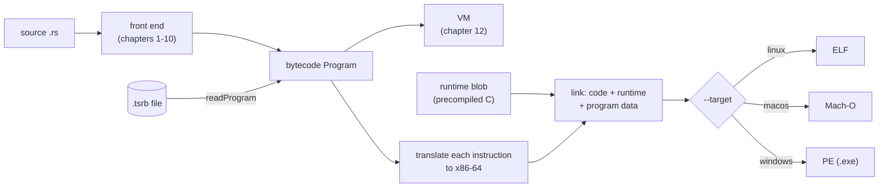
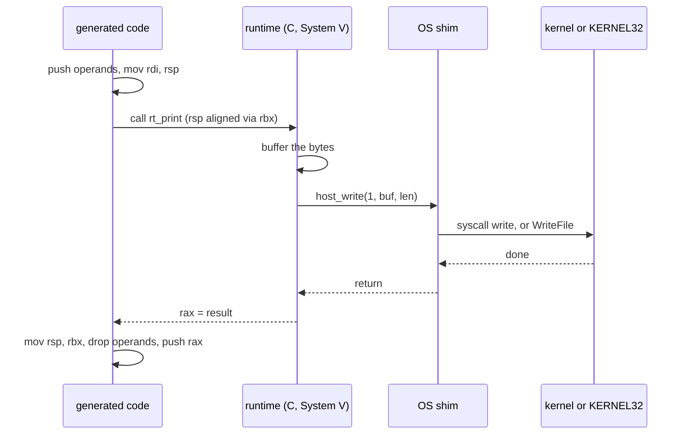
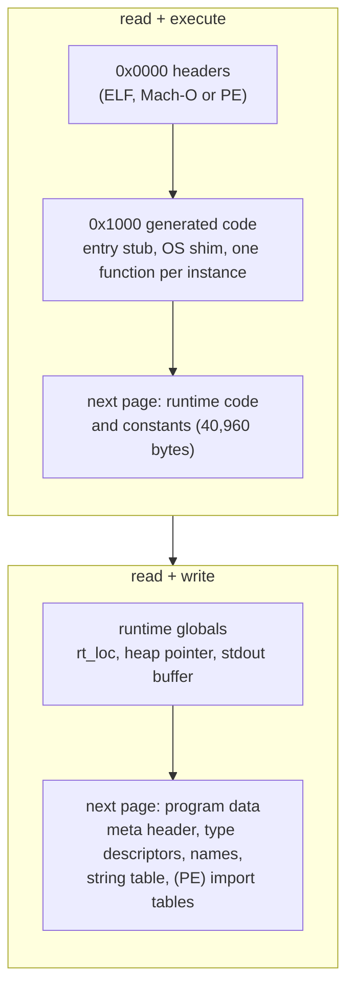
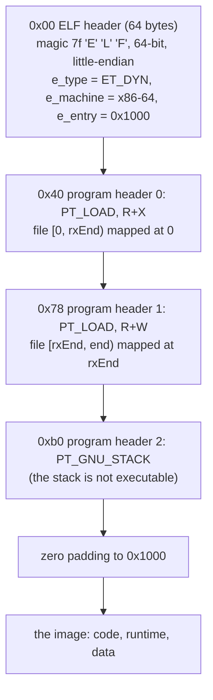
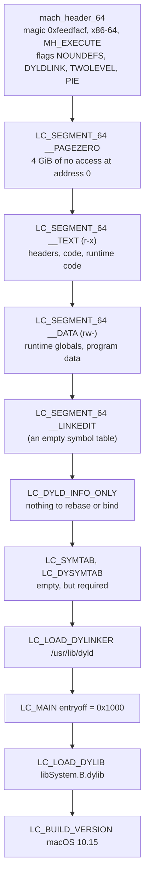
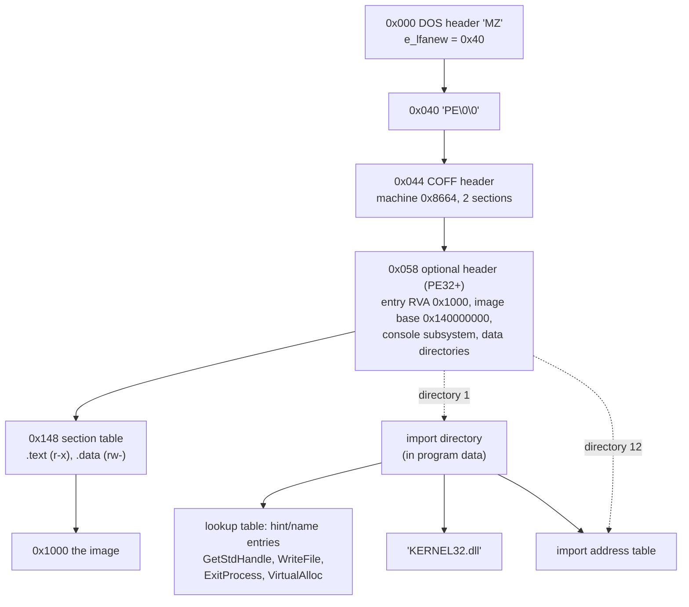

# 15 · Native code and executable formats

Until now, every TSRust program has ended up as a `.tsrb` file run by a TypeScript loop. `rustc` instead produces a file the operating system runs directly, made of machine instructions for a real CPU. This chapter covers TSRust's second back end, which does the same: it turns bytecode into x86-64 machine code, links it with a small runtime library, and writes an executable for Linux (ELF), macOS (Mach-O) or Windows (PE).

All of it is plain TypeScript with no assembler, linker or C compiler, so the playground can build an `.exe` in your browser. The source:

- [src/native/compile.ts](../src/native/compile.ts): translates each bytecode instruction, lays out the image, emits the OS shims and the program data.
- [src/native/x64.ts](../src/native/x64.ts): a hand-written x86-64 assembler, about 240 lines.
- [src/native/elf.ts](../src/native/elf.ts), [src/native/macho.ts](../src/native/macho.ts), [src/native/pe.ts](../src/native/pe.ts): the three container formats.
- [src/native/index.ts](../src/native/index.ts): `buildExecutable(program, target)`.
- [native/runtime/](../native/runtime/): the runtime library, in freestanding C. [scripts/build-runtime.ts](../scripts/build-runtime.ts) compiles it into [src/native/runtime.generated.ts](../src/native/runtime.generated.ts), which is committed.

## Why a native back end, and why from bytecode

A native back end turns "compiling to machine code" into bytes you can disassemble. It is also a second, independent implementation of the bytecode's meaning: the VM and the native code share nothing below the `Program` object, so when both print exactly what `rustc` prints, the meaning really is in the bytecode. And native code has real 64-bit integers, which the VM lacks.

The native back end starts from the same `Program` the VM runs. The bytecode stays the one intermediate format, so this back end knows nothing about Rust, and a `.tsrb` file can be turned into an executable later, without the source:

```text
$ node src/cli.ts build examples/15_game_of_life.rs --target bytecode -o gol.tsrb
    Finished gol.tsrb (bytecode, 6643 bytes, 12 functions) in 168ms
$ node src/cli.ts build gol.tsrb --target linux -o golx2
    Finished golx2 (linux x86-64 executable) in 10ms
$ node src/cli.ts build examples/15_game_of_life.rs --target linux -o golx
    Finished golx (linux x86-64 executable) in 188ms
$ cmp golx golx2 && echo same
same
```

Building from bytecode skips the front end, and the two executables are identical.



## Making the bytecode say what each word means

The VM can ask a value what it is (`typeof v === "string"`, `v instanceof RString`). Native code can't: a `char`, an `f64` and a pointer are all just 64 bits. So the bytecode had to change to say what each operand is, which bumped `FORMAT_VERSION` to 2 ([11-bytecode-format.md](11-bytecode-format.md)):

| Change | Why native code needs it |
|---|---|
| `CONST_F`, `CONST_CHAR` | `CONST` pushes an integer or a `&str`. A float constant must become its IEEE-754 bits, and a `char` constant its code point. |
| `STR_OF` next to `STR_REF` | `STR_REF` turns `&String` into `&str`, which is one memory load. `STR_OF` views a `String` *value* as `&str`, which costs nothing. The VM handled both by inspecting the value. |
| `EQ`/`NE`/`LT`/`LE`/`GT`/`GE` take a `num` kind | Signed and unsigned integers compare with different condition codes, floats compare with SSE instructions, and the new kind `str` compares two strings by their bytes. |
| `COPY` takes a type descriptor | Copying a `Copy` aggregate must know how deep to go. |
| HashMap intrinsics get the key's type descriptor | Hashing and comparing a key needs to know whether it is an integer, a `String` or a struct. |

The last one shows up as an extra argument in the bytecode. Here `ages: HashMap<String, i32>`, and type 0 is `{"k":"string"}`:

```text
    11  REF_LOCAL     1
    13  CONST         "Ann"
    15  INTRINSIC     <String::from> 1
    18  CONST         31
    20  CONST         0
    22  INTRINSIC     <HashMap::insert> 4
```

`insert` takes three arguments in Rust, but the instruction passes four. The VM ignores the last one.

## One 64-bit word per value

The VM gives each value one operand-stack slot, whatever its type. The native back end does the same, and each slot is one 64-bit machine word (`typedef unsigned long long V` in [runtime.h](../native/runtime/runtime.h)):

| Rust | The 64-bit word |
|---|---|
| integers, `bool`, `char` | the number itself, sign- or zero-extended to 64 bits |
| `f32`, `f64` | the bits of an IEEE-754 double (an `f32` is a double rounded to `f32` precision) |
| `()` | 0 |
| `&T`, `&mut T` | the address of the 64-bit slot that holds the `T` |
| `&str` | pointer to `Str { len, ptr }` |
| `String` | pointer to `StringBuf { len, ptr, cap }` |
| `Vec<T>` | pointer to `Vec { len, data, cap }` |
| `Box<T>` | pointer to one 64-bit cell |
| struct, tuple, enum | pointer to `Agg { u32 tag, u32 n, V fields[n] }` |
| `HashMap<K, V>` | pointer to a `Map` |

Two details make this layout cheap. A `StringBuf` starts with the same two fields as a `Str`, so a pointer to a `String` is already a valid `&str`. That is why `STR_OF` compiles to no instructions at all. And a reference is simply an address. The VM's `Ref` was an array plus an index; here `REF_LOCAL 3` is `lea rax, [rbp-32]`, and `FIELD_REF 1` loads the aggregate's address through the reference and adds 16 to skip the 8-byte header and field 0.

Uniform words make generics trivial. `Vec<i32>`, `Vec<String>` and `Vec<Point>` all store eight bytes per element, so the native back end never needs the size of `T`, and `Vec::push` is the same machine code for every `T`. rustc gives `Vec<u8>` one byte per element, which is much faster but needs a layout computation for every type.

## A template compiler

The translator in `compile.ts` is a **template compiler**: each bytecode instruction becomes a fixed snippet of machine code, chosen by the opcode and its operands alone. Early JIT compilers worked this way.

The VM's operand stack becomes the machine stack: `LOAD` is a real `push` and `STORE` a real `pop`. In each frame, `rbp` points at the saved frame pointer, the caller's arguments sit above it, and local slot `n` is at `[rbp - 8 - 8n]`. The prologue copies the arguments into their slots.

Here are some templates, taken from the `instruction()` switch:

| Bytecode | x86-64 |
|---|---|
| `CONST 40` | `push 40` |
| `LOAD 1` | `push qword [rbp-16]` |
| `STORE 1` | `pop qword [rbp-16]` |
| `REF_LOCAL 1` | `lea rax, [rbp-16]; push rax` |
| `LOAD_REF` | `pop rax; push qword [rax]` |
| `GET_FIELD 1` | `pop rax; push qword [rax+16]` |
| `GET_TAG` | `pop rax; mov eax, dword [rax]; push rax` |
| `ADD i32` | `pop rcx; pop rax; add rax, rcx; movsxd rdx, eax; cmp rdx, rax; jne panic_add; push rax` |
| `ADD u64` | `pop rcx; pop rax; add rax, rcx; jb panic_add; push rax` |
| `GT i32` | `pop rcx; pop rax; cmp rax, rcx; setg al; movzx eax, al; push rax` |
| `JUMP_IF_FALSE L` | `pop rax; test rax, rax; je L` |
| `CALL f 2` | `call f; add rsp, 16; push rax` |
| `RET` | `pop rax; mov rsp, rbp; pop rbp; ret` |
| `STR_OF` | (nothing) |

So this function:

```rust
fn add(a: i32, b: i32) -> i32 {
    a + b
}
```

with bytecode `LOAD 0; LOAD 1; ADD i32; RET` becomes this machine code (disassembled with `objdump`):

```text
    1145:  55                     push   rbp
    1146:  48 89 e5               mov    rbp,rsp
    1149:  48 83 ec 10            sub    rsp,0x10
    114d:  48 8b 85 18 00 00 00   mov    rax,QWORD PTR [rbp+0x18]     ; argument a
    1154:  48 89 85 f8 ff ff ff   mov    QWORD PTR [rbp-0x8],rax      ;   -> slot 0
    115b:  48 8b 85 10 00 00 00   mov    rax,QWORD PTR [rbp+0x10]     ; argument b
    1162:  48 89 85 f0 ff ff ff   mov    QWORD PTR [rbp-0x10],rax     ;   -> slot 1
    1169:  48 8d 05 d8 ce 00 00   lea    rax,[rip+0xced8]             ; "main.rs:2:5"
    1170:  48 89 05 89 ae 00 00   mov    QWORD PTR [rip+0xae89],rax   ; -> rt_loc
    1177:  ff b5 f8 ff ff ff      push   QWORD PTR [rbp-0x8]          ; LOAD 0
    117d:  ff b5 f0 ff ff ff      push   QWORD PTR [rbp-0x10]         ; LOAD 1
    1183:  59                     pop    rcx                          ; ADD i32
    1184:  58                     pop    rax
    1185:  48 01 c8               add    rax,rcx
    1188:  48 63 d0               movsxd rdx,eax
    118b:  48 39 c2               cmp    rdx,rax
    118e:  0f 85 09 00 00 00      jne    0x119d
    1194:  50                     push   rax
    1195:  58                     pop    rax                          ; RET
    1196:  48 89 ec               mov    rsp,rbp
    1199:  5d                     pop    rbp
    119a:  c3                      ret
    119b:  0f 0b                  ud2
    119d:  bf 00 00 00 00         mov    edi,0x0                      ; panic stub: "add"
    11a2:  48 83 e4 f0            and    rsp,0xfffffffffffffff0
    11a6:  e8 75 94 00 00         call   0xa620                       ; rt_panic_kind
```

(The `;` comments are added here. Everything else is real output.)

Every value goes through memory, and `push rax; pop rax` is the seam between the `ADD` and `RET` templates. An optimizing compiler would need two or three instructions for this function. In exchange, you can predict the machine code of any bytecode instruction exactly.

For jumps, `compileFunction` gives every instruction offset a label, and `JUMP 23` becomes a `jmp` to the label for offset 23.

## Encoding x86-64 by hand

[x64.ts](../src/native/x64.ts) has one method per instruction form, and each method appends bytes. An x86-64 instruction has this general shape:

```text
[REX prefix] opcode [ModRM] [SIB] [displacement] [immediate]
```

- **REX** (`0100WRXB`) is an optional prefix byte. `W` selects 64-bit operands. `R` and `B` supply a fourth bit for the register numbers in ModRM, which is how the encoding reaches `r8`–`r15`.
- **ModRM** (`mod:2 reg:3 rm:3`) names the operands. `reg` is a register. `rm` is a register when `mod = 11`, or memory at `[rm + disp32]` when `mod = 10`.
- **SIB** follows ModRM when `rm = 100`, because that encoding means "a scaled index follows" rather than `rsp`. To address `[rsp + 8]` you must emit a SIB byte, `0x24`, meaning "base `rsp`, no index".
- `mod = 00, rm = 101` doesn't mean `[rbp]`. In 64-bit mode it means **`[rip + disp32]`**: an address relative to the next instruction. Position-independent code depends on it.

Take the first load of the `add` example, `mov rax, [rbp+0x18]`:

```text
48 8b 85 18 00 00 00
│  │  │  └─────────── disp32 = 0x00000018, little-endian
│  │  └────────────── ModRM 0x85 = 10 000 101: mod=10 ([reg+disp32]), reg=000 (rax), rm=101 (rbp)
│  └───────────────── opcode 8B: MOV r64, r/m64
└──────────────────── REX 0x48 = 0100 1000: W=1 (64-bit)
```

A few more from real output:

- `ff b5 f8 ff ff ff` is `push qword [rbp-8]`. Opcode `FF` is a group of instructions, and the `reg` field of ModRM `0xb5` (`10 110 101`) selects which one: `/6` is `push`. There is no REX, because `push` is 64-bit by default.
- `41 ba 22 00 00 00` is `mov r10d, 0x22` in the Linux shim. Opcode `B8+r` puts the register in the opcode byte itself, and REX `0x41` sets `B` so that register 2 means `r10`, not `rdx`.
- `48 89 8c 24 08 00 00 00` is `mov [rsp+8], rcx`, and the `24` is the SIB byte. The test suite checks this encoding against the manual.
- `48 8d 05 d8 ce 00 00` is `lea rax, [rip+0xced8]` at address `0x1169`. The instruction is 7 bytes long, so `rip` is `0x1170` when it runs, and the address is `0x1170 + 0xced8 = 0xe048`, an entry in the string table.

The assembler always uses a 32-bit displacement, even where an 8-bit one would do.

Branch targets and data addresses are unknown while code is emitted, so the assembler writes a 32-bit placeholder and records a **fixup**: where the placeholder is, where the instruction ends, and the target (a label, or a symbol such as `rt:rt_loc` or `pd:str:3`). Once the image is laid out, `link()` writes `target - (base + next)` into each. That is a linker's relocation processing, cut down to one relocation type.

## Calling into the runtime

Allocation, formatting, string operations and every intrinsic live in the runtime library. A runtime function receives **`rdi = rsp`**, a pointer to the top of the operand stack, so `sp[0]` is the most recently pushed value. Immediate operands follow in `rsi`, `rdx` and so on, the result comes back in `rax`, and the generated code then drops the consumed values and pushes the result. `MAKE_AGG tag n`, for example, is this C function:

```c
/* MAKE_AGG tag n: the n fields are sp[n-1] .. sp[0]. */
EXPORT V rt_make_agg(V *sp, i64 tag, i64 n) {
  V a = agg_new((u32)tag, (u32)n);
  for (i64 i = 0; i < n; i++) ((Agg *)a)->f[i] = sp[n - 1 - i];
  return a;
}
```

C code may assume the System V ABI's rule that `rsp` is a multiple of 16 at every `call`, but the operand stack moves in 8-byte steps. So `rtCall` saves `rsp` in `rbx`, rounds `rsp` down, calls, and restores it:

```text
  139e:  48 89 e7        mov    rdi,rsp       ; sp = top of operand stack
  13a1:  be 00 00 00 00  mov    esi,0x0       ; type descriptor #0
  13a6:  48 89 e3        mov    rbx,rsp       ; remember rsp...
  13a9:  48 83 e4 f0     and    rsp,0xfffffffffffffff0   ; ...align it...
  13ad:  e8 3e 94 00 00  call   0xa7f0        ; rt_deep_cmp
  13b2:  48 89 dc        mov    rsp,rbx       ; ...and put it back
  13b5:  48 83 c4 10     add    rsp,0x10      ; drop the two operands
  13b9:  50              push   rax           ; push the result
```

That is `DEEP_CMP type#0` from `largest::<i32>` in [chapter 10](10-code-generation.md). It works because `rbx` is *callee-saved*: the C code must hand it back unchanged.



## Checked arithmetic and panic stubs

TSRust behaves like a debug build, so arithmetic is checked. For 64-bit types the CPU does it: after `add`, the overflow flag means signed overflow and the carry flag unsigned overflow, so `jo` or `jb` branches to a panic. Narrower types are computed in 64 bits and range-checked: `movsxd rdx, eax; cmp rdx, rax` asks whether sign-extending the low 32 bits gives back the same value, and for unsigned types `shr rdx, 32` asks whether any high bits are set. Division checks for zero and for `MIN / -1`, which would make `idiv` trap.

Float `%` calls `rt_frem`, which uses the x87 `fprem` instruction, since SSE has no remainder. Float comparisons use `ucomisd`, which reports NaN through the parity flag, so `==` is `sete` *and* `setnp`.

Each check is one conditional jump to a **panic stub** at the end of the function, one per kind of panic. In the `add` listing, the stub follows the `ud2`:

```text
mov edi, 0          ; PANIC.add
and rsp, -16
call rt_panic_kind  ; never returns
```

`rt_panic_kind` prints rustc's message ("attempt to add with overflow") with the current location and exits with status 101. Nothing runs afterwards, so the stub doesn't restore `rsp`.

## Panic locations

The VM looks up the failing instruction's offset in the line table ([chapter 12](12-the-vm.md)). Native code tracks the location at run time instead, in a runtime global `rt_loc` that points to a string constant such as `main.rs:2:5`. Wherever the line table starts a new location, the translator emits:

```text
lea rax, [rip + "main.rs:2:5"]
mov [rip + rt_loc], rax
```

After every `CALL`, the caller stores its own location again, since the callee moved it.

Standard-library functions never update `rt_loc`. That gives the effect of rustc's `#[track_caller]`: when `unwrap()` panics, the location is still the one your code stored. And for a method call, code generation records the location of the *method name*, which is what rustc reports:

```text
thread 'main' panicked at loc3.rs:4:15:
called `Option::unwrap()` on a `None` value
```

That is `let v = o.unwrap() + n;`, and column 15 is the `u` of `unwrap`. rustc, the VM (which reports the innermost frame outside the standard library) and the native executable all agree. A real compiler avoids the run-time cost with a table from code addresses to source lines (DWARF or PDB), searched only when something goes wrong.

## The runtime library

The runtime is about 1,800 lines of C in four files:

| File | Contents |
|---|---|
| [runtime.c](../native/runtime/runtime.c) | `rt_init`, the bump allocator, the stdout buffer, panics, casts, the instructions implemented in C |
| [format.c](../native/runtime/format.c) | `{}` and `{:?}` for every type, guided by type descriptors; exact float formatting; float parsing |
| [structural.c](../native/runtime/structural.c) | `DEEP_EQ`, `DEEP_CMP`, `CLONE`, `COPY` and hashing, walking a value and its descriptor together |
| [intrinsics.c](../native/runtime/intrinsics.c) | every intrinsic: `Vec`, `String`, `str`, `char`, integer and float methods, `HashMap` |

Why C? Float formatting, hashing and UTF-8 would be thousands of lines of hand-written assembly; in C they are ordinary code, and gcc optimizes them. The C is **freestanding**, with no libc and no system headers, because TSRust can't link against three different libcs. Everything it needs from the OS goes through three function pointers passed to `rt_init`: `write`, `exit` and `alloc`. Even `memcpy` is written out.

`npm run build:runtime` compiles it with gcc (`-O2 -ffreestanding -nostdlib -fPIC -fvisibility=hidden -mno-red-zone`), links it with a tiny linker script ([runtime.ld](../native/runtime/runtime.ld)) that puts the data on its own page, extracts the raw bytes with `objcopy -O binary`, and writes them, base64-encoded, to [runtime.generated.ts](../src/native/runtime.generated.ts) with the offset of every `rt_*` symbol (277 of them, 252 intrinsics). Building an executable then only copies that blob, so the browser can do it without gcc.

The blob must work at any address unpatched, so the build script checks that `readelf -r` reports no relocations and that no object file accesses a global through the **GOT**.

### The GOT bug

The second check exists because of a real bug. Position-independent C code normally reaches a global variable in one of two ways:

```text
default visibility:  mov rdx, [rip + counter@GOTPCREL]   ; load counter's address from the GOT
                     mov rax, [rdx]                       ; then load counter
hidden visibility:   mov rax, [rip + counter]             ; load counter directly
```

The global offset table (GOT) exists for shared libraries: a default-visibility global might be overridden by another library, so the compiler reaches it through a pointer that the dynamic loader fills in. TSRust has no dynamic loader. When an early version of the runtime had one global without `hidden` visibility, the static linker created a GOT entry for it holding the variable's absolute address, computed for a blob at address 0. Loaded at a random address, that entry pointed into unmapped memory, and the first access was a segmentation fault.

The fix is `#pragma GCC visibility push(hidden)` in [runtime.h](../native/runtime/runtime.h) plus `-fvisibility=hidden`, so every access is `rip`-relative. The build script now fails on any `GOTPCREL` relocation or `.got` section, so the bug can't come back silently.

### Printing floats exactly

Rust prints the *shortest* decimal string that reads back as the same float (`0.1 + 0.2` is `0.30000000000000004`). The VM gets that from JavaScript's `Number.prototype.toString`. [format.c](../native/runtime/format.c) implements the classic **Steele & White / Dragon4** algorithm: the float is exactly `f × 2^e`, and with the value and the distances to its neighboring floats held as big integers, it generates decimal digits until they identify the float uniquely. `{:.N}` rounds the *exact* binary value, ties to even.

This fixes three things the VM gets wrong ([14-differences-from-rust.md](14-differences-from-rust.md)): an `f32` is decomposed as an `f32`, `{:?}` uses exponent notation outside `[1e-4, 1e16)`, and `{:.0}` of `2.5` is `2`:

```rust
fn main() {
    let z: f32 = 0.1;
    println!("{:?} {:?}", z + 0.2, z);
    println!("{:?} {:?} {:?}", 1e21, 1e-7, 1.5e300);
    println!("{:.0} {:.0} {:.1}", 2.5, 0.5, 0.25);
    println!("{}", !0u64);
}
```

```text
$ node src/cli.ts run --native fl2.rs       # rustc prints exactly the same
0.3 0.1
1e21 1e-7 1.5e300
2 0 0.2
18446744073709551615
```

The VM prints `0.30000001192092896 0.1`, then `1e21` and `1.5e300` written out in full, then `3 1 0.3`, and finally `18446744073709552000` for `!0u64`, since a JavaScript number can't hold that value.

## Image layout and position independence

`buildImage` produces one flat array of bytes, the **image**, and leaves the first page blank for the container format's headers:



For `examples/01_hello.rs` the generated code is 2,105 bytes, so the runtime starts at `0x2000`, its globals at `0xc000` and the program data at `0xe000`. The parts are page-aligned because memory protection works in pages. Every address in the code, TSRust's and the runtime's, is `rip`-relative, so the image runs wherever it is loaded.

Program data needs one extra trick. A string constant is a `Str { len, ptr }`, and `ptr` would normally be an absolute address. The translator stores an *offset relative to the `Str` itself* instead, and `rt_init` turns each offset into a real pointer once, at startup:

```c
  Str *strings = (Str *)(meta_base + m->strings);
  for (u32 i = 0; i < m->nstrings; i++) strings[i].ptr = (const u8 *)&strings[i] + (i64)strings[i].ptr;
```

That is a self-relocating program in two lines. Type descriptors need no fix-up: they refer to each other by index.

The entry point, at `0x1000`, aligns the stack, passes the three shim functions and the program data to `rt_init`, runs `main`, and exits with status 0. This is the real beginning of `01_hello`'s executable, with names added after `objdump`'s address comments:

```text
    1000:  48 83 e4 f0           and    rsp,0xfffffffffffffff0
    1004:  48 8d 3d 29 00 00 00  lea    rdi,[rip+0x29]        # 0x1034  write shim
    100b:  48 8d 35 2a 00 00 00  lea    rsi,[rip+0x2a]        # 0x103c  exit shim
    1012:  48 8d 15 2c 00 00 00  lea    rdx,[rip+0x2c]        # 0x1045  alloc shim
    1019:  48 8d 0d e0 cf 00 00  lea    rcx,[rip+0xcfe0]      # 0xe000  program data
    1020:  e8 fb 8c 00 00        call   0x9d20                # rt_init
    1025:  e8 43 00 00 00        call   0x106d                # main
    102a:  bf 00 00 00 00        mov    edi,0x0
    102f:  e8 0c 90 00 00        call   0xa040                # rt_exit
```

The proof is to let the OS pick the address. A Linux ELF file of type `ET_DYN` is a *position-independent executable* (PIE), which the kernel loads at a random base on every run (ASLR). Here is a long-running TSRust executable, run twice and inspected through `/proc/<pid>/maps`:

```text
7dba8c6d7000-7dba8c6e3000 r-xp 00000000 00:30 25394   .../spin
7dba8c6e3000-7dba8c6e6000 rw-p 0000c000 00:30 25394   .../spin
---
7626bb8bd000-7626bb8c9000 r-xp 00000000 00:30 25394   .../spin
7626bb8c9000-7626bb8cc000 rw-p 0000c000 00:30 25394   .../spin
```

Two runs, two addresses, the same output.

## ELF: Linux

ELF ("Executable and Linkable Format") is the format of Linux, the BSDs and most Unix systems. [elf.ts](../src/native/elf.ts) writes three things: a 64-byte file header, a table of **program headers**, and the image.



The kernel reads only program headers (*segments*), each saying "map this range of the file at this address with these permissions". Section headers are for linkers and debuggers, and TSRust writes none, so `objdump -d` finds nothing to disassemble. File offsets equal addresses, so each segment is a straight copy:

```text
$ llvm-readelf-21 -l h
Elf file type is DYN (Shared object file)
Entry point 0x1000
There are 3 program headers, starting at offset 64

Program Headers:
  Type           Offset   VirtAddr           PhysAddr           FileSiz  MemSiz   Flg Align
  LOAD           0x000000 0x0000000000000000 0x0000000000000000 0x00c000 0x00c000 R E 0x1000
  LOAD           0x00c000 0x000000000000c000 0x000000000000c000 0x0024d8 0x0024d8 RW  0x1000
  GNU_STACK      0x000000 0x0000000000000000 0x0000000000000000 0x000000 0x000000 RW  0x10
```

With no `PT_INTERP` (dynamic loader) and no `PT_DYNAMIC`, the kernel maps the two segments and jumps straight to `0x1000` plus the random base.

## Mach-O: macOS

A Mach-O file is a header followed by **load commands**, each telling the kernel or the dynamic loader `dyld` one thing. macOS insists that every program go through `dyld` and link `libSystem`, so [macho.ts](../src/native/macho.ts) writes several commands TSRust doesn't really use:



`__PAGEZERO` makes the low 4 GiB inaccessible, so the image starts at `0x100000000`. The `PIE` flag lets the kernel slide the image, and an all-zero `LC_DYLD_INFO_ONLY` tells `dyld` there is nothing to fix up. `dyld` calls the `LC_MAIN` entry point like a C `main`; TSRust's never returns. The code is x86-64, so it runs on Intel Macs, and on Apple Silicon through Rosetta 2. `llvm-otool-21 -l` decodes all eleven load commands:

```text
Load command 1
      cmd LC_SEGMENT_64
  cmdsize 152
  segname __TEXT
   vmaddr 0x0000000100000000
   vmsize 0x000000000000c000
...
Load command 8
       cmd LC_MAIN
   cmdsize 24
  entryoff 4096
 stacksize 0
```

## PE: Windows

A Portable Executable starts with an MS-DOS header from 1981, whose only job today is the field at `0x3c` pointing to the `PE\0\0` signature. Then come a COFF header, an "optional" header (required for executables) and a section table:



Windows system-call numbers change between releases; the supported interface is the DLLs. So a program **imports** functions: the import directory names the DLL and the functions, and the loader writes each function's address into the **import address table** (IAT), which the shim calls through with `call qword [rip + slot]`. The tables hold image-relative addresses (RVAs), so `buildImage` builds them at the end of the program data, and [pe.ts](../src/native/pe.ts) only points the data directories at them.

`llvm-readobj-21 --coff-imports` reads them back:

```text
Import {
  Name: KERNEL32.dll
  ImportLookupTableRVA: 0xE500
  ImportAddressTableRVA: 0xE528
  Symbol: GetStdHandle (0)
  Symbol: WriteFile (0)
  Symbol: ExitProcess (0)
  Symbol: VirtualAlloc (0)
}
```

File alignment equals section alignment, so file offsets equal RVAs and the image is written unchanged. With no `.reloc` section and `RELOCS_STRIPPED` set, Windows loads the file at its preferred base `0x140000000`, not at a random address, even though the code would run anywhere.

## The OS shims

The machine code is the same for all three targets except for the shim: `write(fd, buf, len)`, `exit(code)` and `alloc(size)`. On Linux and macOS each is a system call, whose convention (arguments in `rdi`, `rsi`, `rdx`, `r10`, `r8`, `r9`, number in `rax`) is close enough to System V that `write` passes straight through:

| | Linux | macOS |
|---|---|---|
| write | `mov eax, 1; syscall; ret` | `mov eax, 0x2000004; syscall; ret` |
| exit | `exit_group` = 231 | `exit` = `0x2000001` |
| alloc | `mmap` = 9, `MAP_PRIVATE \| MAP_ANONYMOUS` = `0x22` | `mmap` = `0x20000c5`, flags `0x1002` |

The `0x2000000` on macOS selects the BSD system calls. Apple doesn't promise these numbers are stable, but these three haven't changed in decades.

On Windows the shim translates calling conventions. The runtime uses System V (`rdi`, `rsi`, `rdx`), and KERNEL32 uses **Microsoft x64**: arguments in `rcx`, `rdx`, `r8`, `r9`, then the stack, with 32 bytes of "shadow space" reserved for the callee. So `write` becomes `WriteFile(GetStdHandle(fd == 2 ? -12 : -11), buf, len, &written, NULL)`, the fifth argument at `[rsp+32]`, and `alloc` becomes `VirtualAlloc(NULL, size, MEM_COMMIT | MEM_RESERVE, PAGE_READWRITE)`. Windows grows the stack one guard page at a time, so a prologue with a frame over 4 KiB touches each page in order.

## Determinism

The executable is a pure function of the bytecode and the target: there is no timestamp (PE's `TimeDateStamp` is 0) and no build ID, and the only paths inside are the source file names used in panic locations. Building twice gives identical files:

```text
$ for t in linux macos windows; do
>   node src/cli.ts build examples/15_game_of_life.rs --target $t -o gol_$t.a
>   node src/cli.ts build examples/15_game_of_life.rs --target $t -o gol_$t.b
>   cmp gol_$t.a gol_$t.b && echo "$t identical $(stat -c %s gol_$t.a)"
> done 2>/dev/null
linux identical 66288
macos identical 69648
windows identical 69632
```

The playground runs the same modules, bundled by esbuild. Bundled for the browser platform and run next to the unbundled sources, they produced game-of-life executables with identical SHA-256 hashes for all three targets. (That check ran the bundle under Node, not inside a browser.)

## Testing

[tests/native.test.ts](../tests/native.test.ts) checks the pieces separately:

- the assembler's encodings against the x86-64 manual (`mov rax, [rbp-16]` must be `48 8b 85 f0 ff ff ff`, and so on);
- that every intrinsic the VM implements has a native `rt_i_...` symbol, so the two can't drift apart;
- the ELF, Mach-O and PE headers: magic numbers, machine types, the Mach-O `LC_MAIN` entry point, the PE import names;
- on Linux x86-64 only: that every example, built and *run*, prints exactly the `.expected` output recorded from `rustc`; that panics print rustc's message and location and exit with 101; and that a multi-crate package runs.

`npm run conformance` compares every example's output from `rustc` with both the VM's and the native executable's:

```text
✓ 01_hello.rs (vm + native)
✓ 02_ownership.rs (vm + native)
...
✓ 15_game_of_life.rs (vm + native)

all examples match rustc
```

To be explicit: **only the Linux executables were run.** The Mach-O and PE files were checked with `llvm-otool-21 -l` and `llvm-readobj-21 --file-headers --sections --coff-imports`, which parse them cleanly and show the structures described above, but no macOS or Windows machine has executed them. The Windows shim and the macOS system calls have never been exercised.

## Where TSRust differs from rustc

- **Template code, not optimized code.** rustc hands LLVM an SSA representation to optimize: register allocation, inlining, vectorization. TSRust's code bounces every value through memory; the `add` function above is 102 bytes. Only the gcc-compiled runtime is optimized.
- **No `Drop`, and nothing is ever freed.** The allocator is a bump allocator over 4 MiB chunks from `mmap` or `VirtualAlloc`, so a program that allocates in a loop grows without bound. When memory runs out, `rt_alloc` prints "memory allocation failed": it treats any small negative `mmap` result as an error, because the raw Linux system call returns `-errno` rather than `-1`. (macOS reports errors through the carry flag, which the shim doesn't check yet.)
- **x86-64 only.** On Apple Silicon the macOS executable depends on Rosetta 2.
- **macOS through raw system calls, Windows untested.** Real macOS programs call `libSystem`, and neither the Mach-O nor the PE output has been run.
- **Small Unicode tables.** The VM uses JavaScript's full case mapping. The C runtime maps case for Latin-1, Latin Extended-A, Greek and Cyrillic only, and `is_alphabetic` knows a few scripts: natively, `"straße".to_uppercase()` is `STRAßE` (rustc and the VM: `STRASSE`), `"աբգ".to_uppercase()` stays lowercase, and `'ა'.is_alphabetic()` is `false`.
- **64-bit integers, but not 64-bit literals.** Native arithmetic is truly 64-bit (`3000000000u64 * 3000000000` is `9000000000000000000`). But the lexer uses `parseInt` and `.tsrb` stores constants as `f64`, so literals beyond 2^53 are rounded: `9007199254740993` prints `9007199254740992`. **Bug:** `18446744073709551615` rounds to 2^64, which `CONST` wraps to `0`, and `-9223372036854775808` panics with "attempt to negate with overflow". The standard library's `i64::MAX` and `u64::MAX` are still `9007199254740991`.
- **`i128` and `u128` are 64-bit words**, so `4000000000i128 * 4000000000` panics natively.
- **No stack-overflow detection.** Deep recursion dies of `SIGSEGV`; `tsrust run --native` reports "process terminated by SIGSEGV (stack overflow from deep recursion?)", where rustc's own message is "has overflowed its stack". There is no instruction limit either.
- **No debug information**: no symbols, section headers or DWARF.
- **Write errors are ignored**, and partial writes aren't retried.

## Try it

```sh
node src/cli.ts build examples/15_game_of_life.rs           # native executable for this OS
./15_game_of_life
node src/cli.ts run --native examples/09_collections.rs     # build into a temp dir and run
node src/cli.ts build examples/01_hello.rs --target windows # 01_hello.exe (PE)
node src/cli.ts build examples/01_hello.rs --target macos   # 01_hello (Mach-O, x86-64)
node src/cli.ts build examples/01_hello.rs --target bytecode -o hello.tsrb
node src/cli.ts build hello.tsrb --target linux -o hello    # bytecode to executable
objdump -D -b binary -m i386:x86-64 -M intel --start-address=0x1000 --stop-address=0x1080 hello
```

`build` defaults to the host's target. With no section headers, `objdump` must treat the file as raw bytes; offset `0x1000` is the entry stub.

In the playground, pick a target in the toolbar and open the **Native** tab: it shows the image layout with offsets and the machine code bytes of each of your functions. **Download executable** builds the file in the browser (`chmod +x` it on Linux and macOS). Some experiments:

- Find the bytes of `fn f(a: i32, b: i32) -> i32 { a + b }` in the **Native** tab and decode them by hand. Then change `i32` to `u64` and watch the range check become a single `jb`.
- Compare `{:?}` of `0.1f32 + 0.2` under `node src/cli.ts run` and `run --native`.
- Run an executable under `strace`. For `01_hello` you'll see one 4 MiB `mmap`, one `write` per `println!` (stdout is line-buffered) and `exit_group(0)`.

## Exercises

1. **Keep the top of the stack in `rax`.** Track during translation whether the top of the operand stack is in memory or in `rax`, and emit the `push` only when needed. Flush at every label. Measure code size on `examples/14_algorithms.rs`.
2. **A peephole optimizer.** Delete `push rax; pop rax`, turn `push X; pop Y` into `mov Y, X`, and drop an `rt_loc` store that is immediately overwritten. Run it on a list of instructions before encoding, so the fixups stay right.
3. **8-bit displacements.** Make `modrmMem` use `mod = 01` when the displacement fits in a byte. How much smaller does the game of life get?
4. **Free memory.** Write a free-list allocator in [runtime.c](../native/runtime/runtime.c) and emit a `DROP type` instruction where MIR says a value dies ([08-ownership-and-borrowing.md](08-ownership-and-borrowing.md)). Start with `String` and `Vec`.
5. **An AArch64 back end.** Write `a64.ts` (every instruction is 32 bits) and a second translator, with a register as the operand-stack pointer since ARM has no `push`. The runtime must be rebuilt for `aarch64`, and on macOS the result must be code-signed.
6. **DWARF line information.** Emit section headers and a `.debug_line` section so `gdb` can show source lines. Then compute the panic location from the return address instead of storing `rt_loc`.
7. **Exact 64-bit constants.** Add a 64-bit integer constant tag to `.tsrb`, lex large literals as `bigint`, and generate the real `i64::MAX` for native code.
