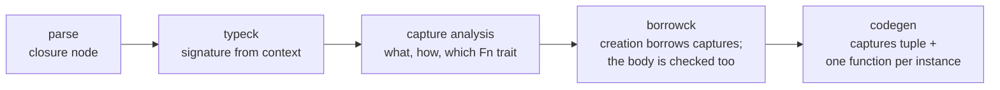

# 16 · Closures, slices and `unsafe`

These three features look unrelated, but each one cuts through the whole compiler. This chapter follows them from syntax to machine code. The earlier chapters describe the stages; here the focus is on what each feature adds to them.

## Closures

A closure is a function plus the variables it uses from around it.

```rust
let offset = 10;
let add = |x| x + offset;   // captures `offset` by reference
println!("{}", add(1));
```

### Every closure has its own type

Like `rustc`, TSRust gives each closure expression a unique type: `{ k: "closure", id, args }`, where `id` is the expression's node and `args` are the generic arguments of the enclosing function. Calling `iter.map(|x| ..)` therefore monomorphizes `map` for that exact closure, and the call inside `Map::next` is a direct call. No function pointer or vtable is involved.



### Inferring the signature

`|x| x + 1` doesn't say what `x` is. The answer usually comes from the bound on the parameter it is passed to:

```rust
fn map<B, F: FnMut(Self::Item) -> B>(self, f: F) -> Map<Self, F>
```

When `checkClosure` ([src/typeck/check.ts](../src/typeck/check.ts)) sees that its expected type is the unknown `F`, it searches the pending obligations for `F: FnMut(..)` and takes the parameter types from there. To give those obligations a chance to be useful, `checkArgs` checks ordinary arguments first and closures last. That's why `fold(0, |sum, x| sum + x)` knows the type of `sum`.

`F: Fn(A) -> B` is parser sugar for `F: Fn<(A,), Output = B>`. The three traits in [std/src/ops.rs](../std/src/ops.rs) have no methods: calls are compiled directly.

### What gets captured

The type checker can't decide how a closure captures variables, because that depends on final types: reading a `String` by value moves it, while reading an `i32` copies it. So [src/borrowck/captures.ts](../src/borrowck/captures.ts) runs after type checking. It lowers the closure body to MIR, where every auto-ref and copy is explicit, and looks at each statement touching an outer variable.

| The body... | Capture | Kind |
|---|---|---|
| reads `x` | `&x` | `Fn` |
| assigns to `x` or borrows it mutably | `&mut x` | `FnMut` |
| moves `x` out | `x` by value | `FnOnce` |

`move` changes the capture to by-value, but not the kind. Captures are places rather than variables, so a closure using `p.a` leaves `p.b` free. Inner closures are analyzed first, and their captures count as uses in the closure around them.

If a bound fixed the kind in advance (`F: Fn()`), a stronger use is an error at that use (E0594, E0596, E0507). Otherwise the closure gets the kind its body needs, and a bound it can't meet is E0525.

### Borrow checking

Creating a closure performs its captures: each by-reference capture is a real loan, held by the closure value. Everything the borrow checker knows then applies: while `let mut f = || x += 1` is still going to be used, touching `x` is an error. Calling `f` borrows it according to its kind, so an `FnMut` closure must be declared `mut`. The body is checked as its own MIR function, with outer variables as `upvar` locals.

### Running a closure

A closure value is a tuple of its captures. A by-reference capture holds a reference, and a by-value capture holds the value. The body is compiled to one function per instantiation, taking the captures as its first argument. Inside it, a place rooted at a captured variable is rewritten to go through that tuple (`realize` in [src/codegen/codegen.ts](../src/codegen/codegen.ts)).

Named functions have zero-sized types of their own too (`fndef`), which is how `.map(Some)` and `.map(String::from)` work. `fn(A) -> B` pointers are the one form of dynamic call: `FN_PTR` pushes a function and `CALL_PTR` calls it.

`impl Trait` in argument position is a hidden generic parameter. In return position it's an opaque type: callers see only its bounds, and code generation replaces it with the real type.

## Arrays and slices

`[T; N]` is `N` values stored together. `[T]` is a run of values of unknown length, so it only appears behind a pointer: `&[T]` carries a start and a length.

The array length is part of the type, stored as a type-level constant. This also gives const generics: `fn len<T, const N: usize>(a: &[T; N])` substitutes `N` like any other parameter.

| Rust | VM | Native |
|---|---|---|
| `[T; N]` | `RVec` | `Vec { len, data, cap }` |
| `&[T]`, `&mut [T]` | `RSlice { items, start, len }` | `Vec { len, first element, 0 }` |

A slice reference *is* the slice object, the same trick `&str` uses, so dereferencing it does nothing. On native code a slice has the layout of a `Vec`, and the indexing instructions don't need to know which they have. `Copy` arrays are duplicated when read, like `Copy` structs.

Three paths lead to a slice: deref coercion from `&Vec<T>`, unsizing from `&[T; N]`, and range indexing such as `&v[1..3]`. Method lookup follows the same steps, so `impl<T> [T]` in [std/src/slice.rs](../std/src/slice.rs) serves arrays and vectors too.

### Slice patterns

`[first, .., last]` and `[head, tail @ ..]` work in `match`, `let` and parameters. For exhaustiveness, an array has one constructor. A slice has one per length up to the longest pattern, plus one for "that long or longer" ([src/typeck/exhaustive.ts](../src/typeck/exhaustive.ts)). The borrow checker treats each position as a separate field, so `let [a, b] = &mut pair` gives two independent `&mut`s.

## `unsafe`

`unsafe` doesn't turn checks off in general. It allows a short list of operations, each reported as E0133 elsewhere:

- dereferencing a raw pointer
- calling an `unsafe fn`
- using a `static mut`

The checker keeps a counter of enclosing `unsafe` blocks and `unsafe fn` bodies. `unsafe trait` and `unsafe impl` must match (E0199, E0200).

Raw pointers have the same representation as references, and the borrow checker doesn't track them: converting `&mut x` to `*mut i32` ends the loan's influence. A `*const` still can't be written through (E0594). `add` and `offset` move a VM `Ref` along its array, or a native address by 8 bytes per element, since every value is one word.

`static` items live in global slots, initialized by a small start function before `main`. Constant expressions behind `&`, like `&[1, 2]`, are promoted to globals in the same way, which is why they can be returned from a function.

## Further reading

- [Differences from Rust](14-differences-from-rust.md) lists what these features still don't cover.
- [examples/17_closures.rs](../examples/17_closures.rs), [examples/18_slices.rs](../examples/18_slices.rs) and [examples/19_unsafe.rs](../examples/19_unsafe.rs) exercise them, and their output is compared with `rustc`.
