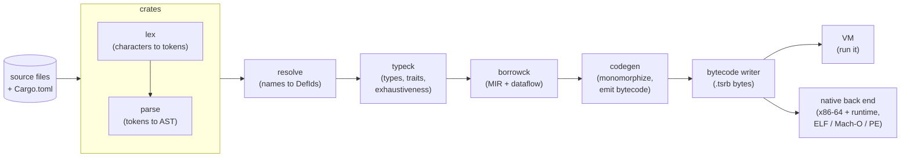
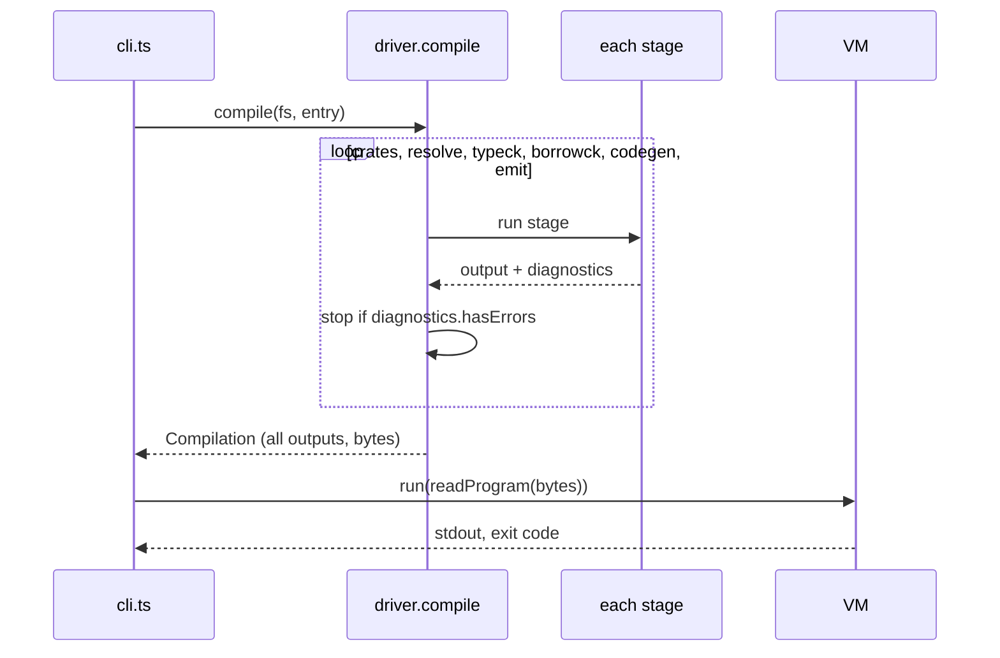

# TSRust

*Two can play at this game: a port of Rust to TypeScript.*

TSRust is a teaching compiler for a subset of Rust, written in plain TypeScript. It takes real Rust source code (`fn main() { println!("hi"); }`), checks it the way `rustc` does (types, traits, exhaustiveness, ownership, borrowing, lifetimes in signatures) and compiles it to bytecode for a small virtual machine. A second back end turns that bytecode into x86-64 machine code and writes real executables for Linux, macOS and Windows. The same compiler runs on the command line under Node and in the browser playground, which can build an executable too.

The point is not speed or completeness. The point is that you can read the whole thing. Every stage is a few hundred to a couple of thousand lines, every file opens with a doc comment that explains the idea it implements, and every intermediate result (tokens, syntax tree, inferred types, MIR, bytecode) can be printed. If you have ever wondered *how* the borrow checker knows that `s` was moved, or *why* `if x == S { .. }` doesn't parse as a struct literal, this is the place to find out.

These docs walk through the compiler one stage at a time. Each chapter explains a Rust idea first ("why does Rust need this?") and then shows how TSRust implements it, with links to the real source.

## The pipeline

A compiler is a chain of transformations. Each stage takes the previous stage's output, checks or enriches it, and hands something simpler (or better understood) to the next stage.



The driver ([src/driver.ts](../src/driver.ts)) runs the stages in order and stops at the first stage that reports an error. Later stages assume earlier ones succeeded, so it would be pointless (and confusing) to type-check a program whose names could not be resolved. Within one stage, though, errors never stop the work: the lexer, the parser and the checkers all record a diagnostic and keep going so you see as many problems as possible at once.

Every stage's output is kept on one `Compilation` object, which is why the CLI's `dump` command and the playground's tabs can show any stage you like. One exception to "stop at the first error" makes that more useful: when borrow checking fails, `compile()` still keeps the MIR on `c.borrowck`, so `dump mir` and the playground's **MIR** tab show what the borrow checker saw even for a program it rejects. (Code generation still doesn't run.)



Notice the last step: `execute` does not run the in-memory program. It first decodes the serialized `.tsrb` bytes, which proves the file format really contains everything needed to run.

## Stages, source files, and the Rust ideas they teach

| Stage | Source | What it does | Rust ideas you will meet |
|-------|--------|--------------|--------------------------|
| Lexing | [src/lexer/](../src/lexer/) | Characters to tokens | Literal suffixes (`10u8`), nested comments, lifetimes vs. chars, `>>` in generics |
| Parsing | [src/parser/](../src/parser/) | Tokens to an abstract syntax tree | Expression-oriented syntax, precedence, struct-literal and turbofish ambiguities, `if let` desugaring, `format!` strings checked at compile time |
| Crates and modules | [src/crates/](../src/crates/) | Reads `Cargo.toml`, follows `path` dependencies, loads `mod x;` files | Crates vs. modules, the crate DAG, `foo.rs` vs. `foo/mod.rs` |
| Name resolution | [src/resolve/](../src/resolve/) | Maps every path to a definition | Namespaces, `use` and re-exports, privacy, the prelude, shadowing |
| Type checking | [src/typeck/](../src/typeck/) | Infers and checks every expression's type | Hindley–Milner inference, integer literal defaults, method lookup and auto-deref, coercions |
| Traits and generics | [src/typeck/traits.ts](../src/typeck/traits.ts) | Proves `T: Trait` obligations | Impl selection, associated types, supertraits, `#[derive]`, operator traits |
| Pattern matching | [src/typeck/exhaustive.ts](../src/typeck/exhaustive.ts) | Exhaustiveness and reachability | Usefulness algorithm, witnesses like "`None` not covered" |
| Ownership and borrowing | [src/borrowck/](../src/borrowck/) | Lowers to MIR, runs dataflow | Moves, `Copy`, shared XOR mutable, non-lexical lifetimes |
| Lifetimes | [src/borrowck/signature.ts](../src/borrowck/signature.ts) | Checks signatures, computes what results borrow from | Elision rules, E0106, E0515, E0597 |
| Code generation | [src/codegen/](../src/codegen/) | Typed AST to stack bytecode | Monomorphization, static dispatch, drops and moves at runtime |
| Bytecode format | [src/bytecode/](../src/bytecode/) | Serializes programs to `.tsrb` | Instruction sets, LEB128 varints, line tables |
| The VM | [src/vm/](../src/vm/) | Executes bytecode | Stack machines, frames, references as places, panics with locations |
| Standard library | [std/](../std/), [src/vm/intrinsics.ts](../src/vm/intrinsics.ts) | `Option`, `Vec`, `String`, iterators, written in Rust | Intrinsics, the prelude, how much of `std` is "just Rust" |
| Native code | [src/native/](../src/native/), [native/runtime/](../native/runtime/) | Bytecode to x86-64 executables | Template compilation, instruction encoding, calling conventions, position independence, ELF, Mach-O and PE |

Shared infrastructure lives in [src/diagnostics.ts](../src/diagnostics.ts) (source spans and rustc-style error rendering) and [src/driver.ts](../src/driver.ts).

## Running it

TSRust needs Node 22.18 or newer (it runs the `.ts` files directly, with no build step). From the repository root:

```sh
npm install
node src/cli.ts run examples/01_hello.rs
```

```text
Hello, TSRust!
counting: 1
counting: 2
counting: 3
3 is odd
7 / 2 = 3, 2.5 * 2 = 5
```

The CLI ([src/cli.ts](../src/cli.ts)) has four commands. Each accepts either a single `.rs` file or a package directory containing a `Cargo.toml`, and `run` and `build` also accept a `.tsrb` file:

| Command | What it does |
|---------|--------------|
| `node src/cli.ts run <file.rs \| dir \| file.tsrb> [--native]` | Compile (if needed) and run in the VM, or with `--native` as an executable for this machine |
| `node src/cli.ts build <file.rs \| dir \| file.tsrb> [--target linux\|macos\|windows\|bytecode] [-o out]` | Compile to a native executable (by default for this machine) or, with `--target bytecode`, to a `.tsrb` file |
| `node src/cli.ts check <file.rs \| dir>` | Run every checking stage, but don't run the program |
| `node src/cli.ts dump <tokens\|ast\|types\|mir\|bytecode> <file.rs \| dir>` | Print one stage's output |

A multi-crate example lives in [examples/packages/](../examples/packages/):

```sh
node src/cli.ts run examples/packages/app
```

```text
=== shapes ===
total area: 7.142
***
```

A native executable for this machine (here Linux x86-64), or for another operating system:

```sh
node src/cli.ts build examples/01_hello.rs && ./01_hello
node src/cli.ts build examples/01_hello.rs --target windows    # 01_hello.exe
node src/cli.ts build examples/01_hello.rs --target bytecode   # 01_hello.tsrb
```

```text
    Finished 01_hello (linux x86-64 executable) in 143ms
Hello, TSRust!
counting: 1
...
```

Errors look like rustc's:

```text
error[E0382]: use of moved value: `s`
 --> examples/errors/E0382_use_after_move.rs:6:23
  |
5 |     let t = s;
  |             - value moved here
6 |     println!("{} {}", s, t);
  |                       ^ value used here after move
  = note: move occurs because `s` has type `String`, which does not implement the `Copy` trait
  = help: consider cloning the value if the performance cost is acceptable: `.clone()`, or borrowing it with `&` instead of moving it
```

[examples/errors/](../examples/errors/) has one small program per error code; each is a good starting point for reading the stage that reports it.

### Tests and conformance

```sh
npm test            # unit tests for every stage, plus every example
npm run conformance # compile each examples/*.rs with real rustc AND TSRust (VM and native), diff the output
```

`npm test` first runs `npm run gen`, which regenerates the bundled standard library (see [Crates and modules](03-crates-and-modules.md)). `npm run conformance` requires `rustc` on your `PATH`: it builds every top-level example with `rustc --edition 2021`, runs it, and compares its stdout byte for byte with the VM's and, on Linux x86-64, with a native executable's. The `.expected` files next to each example record rustc's output so the regular test suite can check TSRust without a Rust toolchain.

### The playground

The browser playground runs the very same compiler and VM on the page, with the standard library embedded as source. Pick an example from the dropdown, edit it, and press Run. The tabs show each stage: **Output**, **Diagnostics**, **Tokens**, **AST**, **Types**, **MIR**, **Bytecode**, **Native** (the executable's layout and each function's machine code), and **Pipeline** (crate graph and time per stage). You can download the compiled `.tsrb` and run it later with `node src/cli.ts run file.tsrb`, or pick Linux, macOS or Windows in the toolbar and click **Download executable** to get a program you can run directly.

## What subset of Rust is supported?

TSRust aims to accept real Rust: every program in [examples/](../examples/) also compiles with `rustc` and prints the same thing. But it only accepts a subset.

**Supported**

- Functions, `const`, type aliases, modules (inline and in files), `use` with nesting, globs, aliases and `pub use` re-exports, privacy
- Multi-crate packages with `path` dependencies
- Structs (named, tuple, unit), enums with data, `impl` blocks, associated consts
- Traits with default methods, associated types, supertraits, generic traits with defaults (`trait Add<Rhs = Self>`)
- Generics with bounds and `where` clauses, `<T as Trait>::Name` paths, turbofish
- `#[derive(Debug, Clone, Copy, PartialEq, Eq, PartialOrd, Ord, Hash)]`
- Operator overloading through `std::ops` and `std::cmp` traits
- `match` with every common pattern: literals, ranges, tuples, structs, enums, `|`, `@`, `ref`/`ref mut`, guards; exhaustiveness checking
- `if let`, `while let`, `loop` with `break value`, labeled loops, `for` over iterators, `?`
- References, `&mut`, moves and `Copy`, borrow checking with non-lexical lifetimes, lifetime parameters in signatures and structs
- `Box`, `Vec`, `String`, `&str`, `HashMap`, `Option`, `Result`, iterator adapters such as `enumerate`, `zip`, `chain`, `take`, `skip`, `step_by`, `sum`
- Built-in macros: `println!`, `print!`, `eprintln!`, `eprint!`, `format!`, `write!`, `writeln!`, `panic!`, `vec!`, `assert!`, `assert_eq!`, `assert_ne!`, `debug_assert!`, `unreachable!`, `todo!`, `unimplemented!`
- Runtime panics for integer overflow, out-of-bounds indexing, `unwrap` on `None`, with source locations

**Not supported** (most are rejected with a clear "not supported by TSRust yet" error)

- Closures (`|x| x + 1`, `move ||`), and therefore `map`/`filter`-style adapters that take them; function pointers and `fn` types
- Arrays and slices (`[T; N]`, `&[T]`, `[1, 2, 3]`): use `Vec<T>`
- Trait objects (`dyn Trait`) and `impl Trait` types: all dispatch is static
- `macro_rules!` and any macro not in the list above; named format arguments (`{x}` inline captures *are* supported)
- `let ... else`, `unsafe`, `static`, `async`, raw strings, byte strings, `\x` escapes, non-ASCII identifiers
- `#[derive(Default)]`
- Full region inference: lifetimes are checked with elision rules and per-argument "borrows-from" flows rather than rustc's outlives constraints, so the check is approximate
- 64-bit integers beyond 2^53 in the VM: integers are JavaScript numbers, and `i64::MAX` is `9007199254740991`. Native executables do real 64-bit arithmetic, but literals and the standard library's `MAX` constants have the same limit

[Differences from Rust](14-differences-from-rust.md) collects every simplification in one place.

## Reading order

The chapters follow the pipeline. Each one stands alone, but they are easiest in order.

1. [Lexing](01-lexing.md): characters to tokens, spans and diagnostics
2. [Parsing](02-parsing.md): recursive descent, precedence climbing, the AST
3. [Crates and modules](03-crates-and-modules.md): `Cargo.toml`, the crate graph, module files, the virtual filesystem
4. [Name resolution](04-name-resolution.md): definitions, imports, ribs
5. [Type checking](05-type-checking.md): inference by unification
6. [Traits and generics](06-traits-and-generics.md): trait selection and associated types
7. [Pattern matching](07-pattern-matching.md): exhaustiveness and usefulness
8. [Ownership and borrowing](08-ownership-and-borrowing.md): MIR and dataflow
9. [Lifetimes](09-lifetimes.md): signatures, elision, and what results borrow
10. [Code generation](10-code-generation.md): monomorphization and stack code
11. [The bytecode format](11-bytecode-format.md): the `.tsrb` file
12. [The VM](12-the-vm.md): executing bytecode
13. [The standard library](13-standard-library.md): `std` written in Rust, plus intrinsics
14. [Differences from Rust](14-differences-from-rust.md): every simplification in one place
15. [Native code and executable formats](15-native-code.md): x86-64, the runtime library, ELF, Mach-O and PE

A good way to read: keep the playground open next to the chapter, load the example the chapter mentions, and watch the relevant tab while you read the code.
